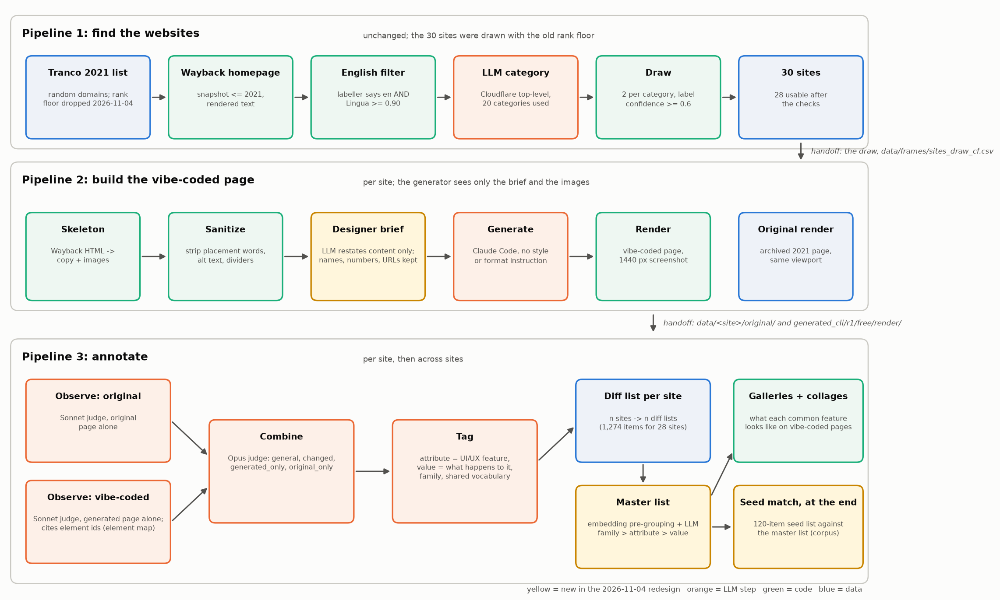

# Plan and status: the stylistic signature of vibe-coded websites

*Last updated 2026-11-04 (annotation pipeline redesigned, designer-brief layer added, full 28-site run done under the new design).* All three pipelines have run end to end on the 28-site seed set; pipelines 2 and 3 were re-run on 2026-11-04 under the redesign (briefs, observe-then-combine, master list, collages, seed match). Code lives in `pipeline/1_find_sites`, `pipeline/2_build_sites`, `pipeline/3_annotate` (+ `pipeline/shared`); each folder has a README and a runner. Details: [ANALYSIS_PLAN.md](ANALYSIS_PLAN.md) (pipeline 3), [DESIGN_DECISIONS.md](DESIGN_DECISIONS.md) (decisions, critiques, open questions), [SURVEY_DESIGN.md](SURVEY_DESIGN.md) (human baseline, not run), [seed_attributes/README.md](seed_attributes/README.md) (seed list). **Results viewer:** `data/master/viewer.html` (serve `data/master/` and open it; it shows the distribution plot, collages, master list with evidence sheets, and the seed match).

## Goal
**The goal is NOT good websites.** We want to know what a coding agent *naturally* produces on its own, with no style guidance and no format instruction, for **less-popular sites** (unlikely to be memorised), in order to identify features that may be inherent to vibe-coded websites. Take pre-2022 homepages from the Wayback Machine, give the agent only their copy and images, let it build whatever it chooses, then catalogue the traits of what it built (compared with the human original). Nothing is judged for quality, and generated pages are never "improved" or corrected; the judges describe differences neutrally.

## The three pipelines


*(Source: `pipeline/make_diagram.py`. Yellow boxes are new in the 2026-11-04 redesign.)*

In words: **(1)** draw sites from the 2021 Tranco list, keep English ones, label them with Cloudflare categories, draw 2 per category. **(2)** For each site: scrape the Wayback snapshot into copy and images, sanitize, have an LLM restate the content as a designer's brief (new wording), let Claude Code build the site from the brief and the images, render it at 1440 px. **(3)** For each site: a Sonnet judge observes the original alone, another observes the vibe-coded page alone, an Opus judge combines them into the site's diff list, a tagger gives each item an attribute (UI/UX feature) and a value (what happens to it); all diff lists are merged into one master list (family, attribute, value); screenshots show what each common feature looks like; the seed list is matched against the master list at the very end.

| | Pipeline 1: find sites | Pipeline 2: build sites | Pipeline 3: annotate |
|---|---|---|---|
| Question | Which sites, spread across what kinds of site? | What does the agent build from a designer-style brief of a site's content plus its images? | What is common on what it built, and how does it differ from the originals? |
| Code | `pipeline/1_find_sites/` | `pipeline/2_build_sites/` | `pipeline/3_annotate/` |
| Runner | `run_find_sites.py` | `run_build_sites.py` (per-site worker `run_site.py`) | `run_annotation.py` |
| Reads | Tranco list | the draw from pipeline 1 | `data/sites.csv`, `data/<site>/original/`, `data/<site>/generated_cli/r1/free/render/` |
| Writes | `data/frames/` | `data/sites.csv`, `data/sites_check.csv`, `data/<site>/` (incl. `prompt/brief.md`) | `data/<site>/diff/`, `data/master/` (master list, galleries, collages, seed match, plot, `viewer.html`) |
| Spend so far | about $2.65 (labelling) | about $11 (28 generations under the old protocol $5.57; briefs and 28 regenerations under the new one about $6) | about $22.98 for the 28-site run (observe $8.26, combine $7.47, tag $2.98, master $1.36, collage locator $2.75, seed match $0.16) plus the 4-site pilots; the archived routes cost about $99 (`deprecated/annotation_routes_2026-11-04/`) |

Shared code: `pipeline/shared/` (`llm.py`, `ledger.py`, `net.py`). Every scripted LLM call is logged to `data/ledger.jsonl`. One cross-pipeline dependency: pipeline 1 uses pipeline 2's skeletonizer in text-only mode to extract page copy for language checks and labels.

## Decisions in force (all pipelines)
| Item | Decision |
|---|---|
| Scope | **Desktop only** (1440px). Mobile is out of scope everywhere. No post-2023 control group |
| Human grading | **None for now** (deferred); confidence tiers and fact checks stand in. Phase 1 features / Basecamp are not seeds |
| Signatures | No threshold for calling a feature an "inherent signature" for now: the aim is to build shared features first. Generator-chosen fonts count as a possible signature; misplaced overlay images are recorded as a feature |
| Study size | 30 sites drawn; 28 usable after checks. First runs only, fewer than 40 |

---

## Pipeline 1: finding the websites
**Scripts** (`pipeline/1_find_sites/`): `build_frame.py` (sample + Wayback fetch), `english.py` + `review_english.py` (language), `page_features.py` + `label_categories.py` (LLM category labels), `draw_cf.py` (the draw), runner `run_find_sites.py`.

**Decisions**
- **Frame:** Tranco list of 2021-06-01 (id QXW4) is still the candidate source. The 30 sites drawn so far came from ranks **> 100,000**, but that **rank floor is no longer a requirement (2026-11-04; `build_frame.py` now defaults to `--min-rank 1`, pass `--min-rank 100001` to reproduce the old draw):** contamination is now handled by the designer-brief layer in pipeline 2 (the generator never sees the page's wording), so the rank floor is not needed to limit exposure. The site list stays exactly as drawn; the rule only matters if the frame is ever redrawn. Seeded random sample of 300 domains; homepage fetched from the Wayback snapshot nearest 2021-06-01 (must be <= 2021, HTTP 200, still at the root). 268 domains had a usable page (saved in `data/frames/html/`).
- **Categories:** Cloudflare's 26 top-level content categories, **applied by an LLM** to each 2021 page (not Cloudflare's own labels). Excluded: Adult Themes, Child Abuse, Gambling, Questionable Content, Security Risks, Violence (20 categories remain).
- **Language:** study sites must be English: the labeller says `en` AND the extracted copy is >= 0.90 English by Lingua (pages with < 5 usable sentences use the labeller's call). The threshold was reviewed against 52 human verdicts: no cutoff gets fewer than 9 of 52 wrong, so 0.90 was kept.
- **Draw:** English only, label confidence >= 0.6, passes the non-language viability checks. 2 per fulfilled category (24) + the single qualifying site of each of 3 partial categories + 3 extras from the largest categories = **30**, with 51 replacement candidates.

**Status:** done. Output: `data/frames/sites_draw_cf.csv`, `replacements_cf.csv`, `qualifying_sites.md`.
- Empty categories (0 qualifying): Ads, Information Technology, Miscellaneous, Religion, Weather. Noted, not filled.
- Final coverage after pipeline 2: Real Estate ended with 0 sites; Vehicles, Job Search & Careers and Social & Family with 1 each.

**Limits:** a balanced sample for comparing categories, not representative of the web; the category labels are unreviewed LLM labels (a few look doubtful, e.g. `widro.com`, `thync.com`, `cbdoilcreamnk.com`); Wayback survivorship; Tranco ranks do not reach the unranked tail.

**Open:** spot-check the labels of the drawn sites; fill the empty categories (e.g. keyword search of Tranco domain names); consider Common Crawl for the unranked tail.

---

## Pipeline 2: scraping / skeletonizing, then vibe-coding
**Scripts** (`pipeline/2_build_sites/`): `check_selected.py` (per drawn site: fetch, skeletonize, test usable, replace failures), `skeletonize.py`, `sanitize.py`, `generate.py`, `formats.py` + `render.py` (render whatever was built; the copy-fidelity check was removed 2026-10-26), per-site worker `run_site.py`, runner `run_build_sites.py`.

**Decisions**
- **Skeleton:** raw Wayback HTML (`id_`), images via `im_`. Included: `` (real source from `data-src`/`src`/`srcset`), desktop `<picture>` sources, titled inline SVGs, raster CSS backgrounds from stylesheets, `<style>` blocks and inline styles. Excluded: scripts, comments, hidden or `display:none` elements (media queries evaluated at 1440px), boilerplate by class name, mobile-only sources. Every drop is logged in `images_manifest.json`.
- **Usable inputs:** 150-3000 words of copy and 2-40 referenced images that downloaded; a failing site is replaced from the same category.
- **Sanitize** (writes `data/<site>/prompt/`, the only thing the generator sees): removes placement labels, **all image alt text**, divider rules, "(mobile version ...)" notes and images the copy does not reference. Keeps image file names, link addresses, emphasis and heading levels, the images, section order. Raw `copy.md` and `images/` are kept in the site folder.
- **Designer brief (new 2026-11-04; `brief.py`):** an LLM rewrites the sanitized copy as the content brief a designer would hand a developer: new wording, same facts; **names, numbers and URLs stay verbatim** (so brand recognition is still possible; accepted); English; content only, no layout, style, placement, purpose or audience; each `` reference kept exactly once and checked. Output `data/<site>/prompt/brief.md`; the verbatim copy is kept in `data/<site>/copy_verbatim.md`. This is the contamination control: the generator never sees the page's own wording, which is why the Tranco rank floor was dropped. Average brief about 580 words.
- **Sanitize** also strips placement words from image file names (`footer-graph.png` becomes `graph.png`); stripping content words as well was considered and **not** adopted (decided 2026-11-04).
- **Generator:** Claude Code (`claude -p`, Sonnet 5.5), prompt exactly: "Build a website from this content. brief.md has the content and images/ has the images." No style guidance, **no output-format instruction**; the agent chooses its stack. One `free` run per site; the stack is recorded (`meta.json`, `format.json`) and treated as data.

**Status:** done. 37 sites checked, **28 usable**, 9 excluded (too many images, too little copy, fewer than 2 images, or no replacement left). **All 28 sites were regenerated from designer briefs on 2026-11-04** under the new protocol (4 pilot sites first, then the other 24: about $4.21 for the 24 generations plus briefs; about 0.18 USD and 1 minute per generation); the old verbatim-copy generations are in `deprecated/old_protocol_2026-10-26/` and `deprecated/annotation_routes_2026-11-04/old_generated/`. All 28 rendered, and the user checked the renders by eye.
- **Result (old protocol, to recheck for the new one):** every agent built a single static HTML page (27 plain, 1 loading Alpine.js from a CDN); none chose React, Vue, Tailwind or a build tool.
- No copy-fidelity check: which copy the agent keeps is data.

**Known gaps:** a stylesheet Wayback cannot serve (e.g. a 500) disables CSS-based hiding and background capture for that site; tables flatten; the boilerplate filter is a substring match; specificity is ignored when resolving `display`; the auto-built copy of the 28 sites was not hand-reviewed.

**Open:** repeat runs on a subset (e.g. 5 sites x 3) to measure run-to-run noise; a second generator; Phase 1 (Basecamp, two prescribed stacks) is history and stays under `data/basecamp/` ([FEASIBILITY.md](data/basecamp/FEASIBILITY.md)).

---

## Pipeline 3: annotation (redesigned 2026-11-04, run on all 28 sites)

**Question:** what is common on what the agent built, and how does it differ from the originals? The earlier routes (feature catalog, embedding master list, attribute-value codebook, observation-only vs comparison arms) are archived in `deprecated/annotation_routes_2026-11-04/` (README there); their results stay readable and are summarised under "Archived routes" below.

**Steps** (runner `pipeline/3_annotate/run_annotation.py`, stages `elements,observe,combine,tag,master,galleries,collages,seed`; `--sites`, `--stages`, `--workers`, `--min-sites`, `--seed`, `--dry-run`):
1. **Elements** (`element_map.py`, free): numbers the visible elements of each generated page so observations can cite regions.
2. **Observe, original alone** (`observe_page.py`, Sonnet): describes the original page only.
3. **Observe, vibe-coded alone** (`observe_page.py`, Sonnet): describes the generated page only and cites element ids.
4. **Combine** (`combine_observations.py`, Opus): reads both lists and writes the site's **diff list**: observations with status `general` (on both), `changed`, `generated_only`, `original_only`. The original is included because what is general cannot be told from the vibe-coded page alone. *Naming:* the **diff list** belongs to one website (original vs vibe-coded); the **master list** is all diff lists together.
5. **Tag** (`tag_observations.py`): every observation gets an **attribute** (the UI/UX feature, a general noun phrase, never "original" or "generated"), a **value** written `<action>: <what happens to it>` with the action (kept, changed, added, dropped) forced to match the status, a **family** and a page-wide flag. A shared running vocabulary (`data/diff_vocab.json`) keeps attribute names consistent across sites. Output `data/<site>/diff/diff.json`: n diff lists for n sites.
6. **Master list** (`build_master.py`): attributes are embedded (fastembed BAAI/bge-small-en-v1.5), clustered inside each family (cosine average linkage, distance < 0.30, groups over 40 re-split), packed into LLM calls of at most 60 attributes that merge and summarise them, then one call per family writes a family summary. Result: family -> attribute -> value, each value with its sites on the generated and the original side, status counts, examples and element ids. Output `data/master/master_list.{json,md}`.
7. **Galleries** (`evidence_galleries.py`, free): per attribute value, a sheet of crops of the cited elements on each vibe-coded page (red outline, context around it).
8. **Collages** (`feature_collages.py`, one vision call per site): per attribute, one collage with one tile per vibe-coded site, showing the page region where it appears.
9. **Seed match, at the very end** (`match_seed.py`): the seed list (v1.3, 120 items; `seed_attributes/`) is matched against the master list as a corpus. Each attribute is `is_item`, `property_of_item` or `none`; the report says which seed items the observations corroborate and what the observations add that the seed list lacks. No culling yet.
Also: `plot_distribution.py` (feature distribution plot), `build_viewer.py` (results viewer), `make_diagram.py` in `pipeline/` (the figure above).

**Decisions:**
- One Sonnet judge per side, one Opus judge to combine (chosen over Sonnet for both).
- Attribute is the UI/UX feature; value is what happens to it. This lets the master list group like the old codebook did, with no closed value sets.
- Master list depth is family -> attribute -> value; an embedding pre-grouping was added because free-text merging by an LLM alone was unchecked and too coarse. No higher levels.
- No Tranco rank floor, brief keeps names/numbers/URLs verbatim, placement-word stripping only for image names (see pipeline 1 and 2).
- No human grading and no signature thresholds yet; the seed list is not culled yet.

**Results of the 28-site run (2026-11-04):**
- 1,274 diff observations (36-55 per site): changed 916 (72%), general 137, generated_only 118, original_only 103.
- Master list: **133 attributes in 9 families** (component 56, copy 18, semantic_dom 12, imagery 11, typography 11, layout 9, decoration 8, color 7, other 1), 104 attributes on at least 2 sites. On the generated side 11 attributes appear on all 28 sites (e.g. body typeface, page layout, footer, buttons and calls to action, copy tone, corner radius) and 95 on at least 2; the distribution is bimodal (27 attributes on one site, 23 on 22-28; `data/master/feature_distribution.png`). Presence on every site is not sameness: the values hold the style.
- 117 gallery entries in 89 attribute folders; 84 collages (752 crops of 915 possible tiles; one attribute with no located tile).
- Seed match (v1.3): 39 of 120 seed items matched by at least one master attribute (38 shown on the vibe-coded page on >= 1 site, 29 on >= 2, 10 on >= half of the sites); 81 never matched. 67 of the 133 master attributes are about a seed item (36 the item, 31 a property); **66 (49%) are not about any seed item**, 49 of them on >= 2 sites.
- Cost about $22.98 (observe $8.26, combine $7.47, tag $2.98, master $1.36, collages $2.75, seed $0.16), plus the pilots.

**Caveats:** 72% of items are labelled "changed", which may be liberal and has not been spot-checked; the 0.30 grouping threshold is untuned and the LLM merge is one unchecked pass per call; collage boxes come from a vision model and are unverified; the judges and the generator are the same model family; a feature on every site is present everywhere but may differ in value; names, numbers and URLs stay in the brief, so brand recognition is still possible; there is no human check yet (see SURVEY_DESIGN.md).

**Deferred:** human validation, lift (coding the originals), run-to-run noise, contamination probe (`contamination_probe.py`, built, not run), signature thresholds, seed-list culling.

**Archived routes (kept for reference, not run any more).** Judge pair with confidence tiers (2,592 observations, tiers A 2,263 / B 303 / C 26), LLM feature catalog (188 features, hold-out coverage 0.90, discovery curve not plateaued), embedding merge of observation sheets (430 master entries), attribute-and-value codebook (278 attributes, 1,039 values, 7,724 coded cells, evidence cited on 96%), observation-only vs comparison arms and the first seed pilot. Details are in DESIGN_DECISIONS.md 3.1-3.10, ANALYSIS_PLAN.md (marked superseded) and `deprecated/annotation_routes_2026-11-04/README.md`.

**Kept in `pipeline/3_annotate/` besides the new scripts:** `agree.py`, `contamination_probe.py`, `measurements.py`, `spotcheck.py`, `element_map.py`, `evidence_galleries.py`, `feature_collages.py`.

---

## Repository map
```
pipeline/1_find_sites  2_build_sites  3_annotate  shared     the three pipelines + shared helpers (each has README.md and a runner)
pipeline/make_diagram.py                                     draws pipeline_diagram.png
data/frames/        pipeline 1      data/<site>/, data/sites*.csv   pipeline 2 (incl. prompt/brief.md, generated_cli/, original/)
data/<site>/diff/   per-site observations, combined diff list, tags      data/master/   master list, galleries/, collages/, seed match, plot, viewer.html
data/diff_vocab.json  shared attribute vocabulary                        data/ledger.jsonl   every scripted LLM call (cost, model, prompt hash)
seed_attributes/    seed list versions v1 to v1.3 and provenance        data/basecamp/   Phase 1
deprecated/old_protocol_2026-10-26/               the first 28 generations (verbatim-copy protocol) and their analysis
deprecated/annotation_routes_2026-11-04/          archived annotation routes, arms, old generations of the 28 sites (README inside)
```
Run from the project root, in order: `python pipeline/1_find_sites/run_find_sites.py`, `python pipeline/2_build_sites/run_build_sites.py` (the brief stage is in `run_site.py`), `python pipeline/3_annotate/run_annotation.py` (each accepts `--dry-run` and `--stages`). Then `python pipeline/3_annotate/plot_distribution.py` and `python pipeline/3_annotate/build_viewer.py`; to look at the results serve `data/master/` (for example `python3 -m http.server 8765 --directory data/master`) and open `viewer.html`.

## Risks
- Wayback rate-limiting and outages, and a laptop that sleeps (the runners wait for the network and resume); survivorship from needing a usable 2021 snapshot.
- LLM category labels, the English filter and the feature catalog are LLM-made and not human-verified.
- Judges, detectors and the generator are the same model family; mitigated by the second judge and fact checks, not by a different model family.
- Unpopular does not guarantee unseen by LLMs; contamination is reduced, not removed (probe not yet run).
- Copyright: keep scraped content private; publish only derived observations.
