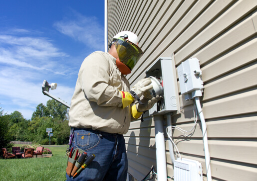

## Organisation
AEP Texas is an electric utility, part of American Electric Power. Its website has a Spanish version at https://espanol.aeptexas.com and its main address is https://www.aeptexas.com.

## Account access and navigation
- Customers can log in to manage their account. The login form asks for User ID and Password, offers a "Remember User ID" option, and has links for forgotten User ID (/account/forgot-user-id) and forgotten password (/account/forgot-password/). New users can register at /account/register. Greeting text: "Welcome back! Please login to manage your account."
- Main menu items: My Account, Outages, Savings, Community, Contact.
- Further topic links: Safety (/safety/), Company (/company/), Clean Energy (/clean-energy/), Business (/business/).

## Headline message and quick links
- Tagline: "Knowledge is power."
- Notice: because scams have increased during the pandemic, customers can read what to do to protect their families (/account/bills/fraud-scams).
- Quick links: Electric Choice (/company/about/choice/); Report an outage (/outages/report); Start, Stop, Move service (/account/service); Rates & Tariffs (/company/about/rates/).

## Home energy savings and rebates
- Customers can apply for rebates and save energy and money at home. AEP Texas offers rebates that offset the cost of energy-efficient upgrades, including ENERGY STAR® appliances and heating and cooling systems, which keep saving for years.
- Call to action: "Learn about incentives" – https://aeptexasefficiency.com/
- Tip: switching to LED bulbs saves even more. Call to action: "See how" – /savings/business/energy/lighting

## Electric cars

"Get Revved up for Electric Cars": information to know before purchasing an electric vehicle (/clean-energy/electric-cars).

## Business solutions

"Solutions for your business": ways to save money, connect service and more (/business/industry-solutions/).

## New customers

"Are you new to AEP Texas": a welcome to the AEP family, with an invitation to register a new account (/account/register).

## Outage alerts
- "Enroll in outage alerts": customers receive email or text messages when their power goes out and when it comes back on. Call to action: "Sign up today" (/account/settings/notifications/).

## Meter order status

Title: "View Your Meter Order Status". Explains how to follow a meter installation order from start to finish. Call to action: "Track your order" (/business/builders/meter-status).

## Outage FAQ

Title: "Confused About Outages?" Answers to the most commonly asked questions. Call to action: "Get answers" (/outages/faq).

## Community

Title: "Caring for Our Community". Shows how AEP Texas works with residents to bring a better future to local communities. Call to action: "How we're helping" (/community/caring).

## Contact and support
- Phone for help: 866.223.8508 (tel:8662238508)
- Other links: Visit AEP.com (https://www.aep.com), Investors (https://aep.com/investors/), Careers (https://aep.com/careers/)
- Social media: Twitter (https://twitter.com/intent/user?screen_name=AEPTexas), Facebook (https://www.facebook.com/AEPTexas), YouTube (https://www.youtube.com/user/AEPTexas)

## Legal
Using the site means accepting the AEP Terms and Conditions. Privacy Policy link: /privacy-policy. Copyright © 1996-2021 American Electric Power. All Rights Reserved.

