****

All DepartmentsAccounting & AuditActuarialCall CenterClaimsCommunication & Corporate RelationsCustomer ExperienceData Science & AnalyticsFinance & EconomicsHuman ResourcesInformation TechnologyInvestmentsLegalMarketingOperationsProcurementProductProject managementRisk ManagementSalesTraining & DevelopmentUnderwriting

At Allstate, everyone is essential to the good we do. Unique knowledge, backgrounds and perspectives make Allstate great. That’s why we’re working to create an environment in which everyone can pursue their purpose and be their best.

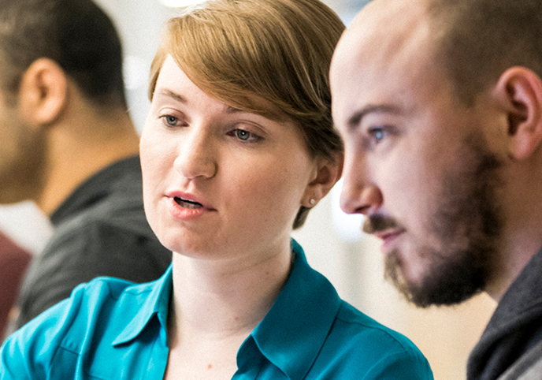

Good Work We believe good work becomes a reality when we all use and develop our passions, plans, and potential for good - at work and in life.

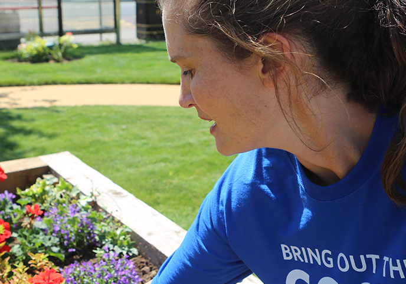

Good Life Our commitment to helping our employees often extends into opportunities to pursue their passions, strengths, and personal goals at work and in their free time.

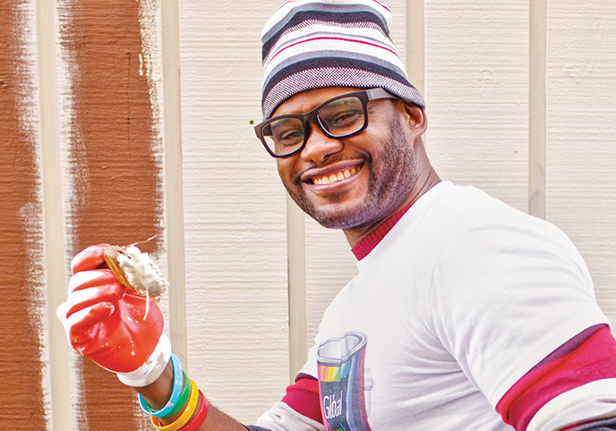

Good Hands We offer opportunities for employees looking for new ways to get involved, and we encourage our people to continue giving back to causes they are passionate about.

## Discover Allstate

## Explore Inclusive Diversity

 Allstate encourages employees to bring their whole selves to work.
[Visit Page](/diversity)

## Veterans & Transitioning Military

 We’re committed to recruiting Veteran candidates.
[Visit Page](/veterans/)

## Benefits for a Good Life

 Discover a culture designed to help you thrive.
[Visit Page](/benefits)

## Career Areas at Allstate

Opportunity is the hallmark of the Allstate career experience. Every day is different, with new ideas, challenges, and rewards just around the corner—no matter which department you’re a part of. It’s an exciting place to build a meaningful career at any level.

Our dynamic culture and our leadership’s commitment to ongoing learning mean that you may have opportunities to grow your skills, explore new directions, and chart a career path that fits your passion. Learn more about how you can help us shape the future in:

- [Claims](/claims/)
- [Continuous Improvement & Industrial Engineering](/continuous-improvement-industrial-engineering/)
- [Customer Service & Support](/customer-service-support/)
- [Data Science & Analytics](/data-science-analytics/)
- [Finance](/finance-investments/)
- [Human Resources](/human-resources/)
- [Legal](/legal/)
- [Marketing & Corporate Relations](/marketing-corporate-relations/)
- [Product & Pricing](/product-pricing/)
- [Sales](/sales/)
- [Technology](/technology/)

## Meet the People Behind Allstate

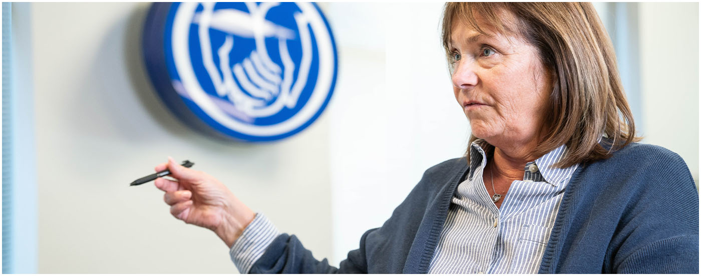

### Maureen D.

Agent Advocate
- Woodridge, IL

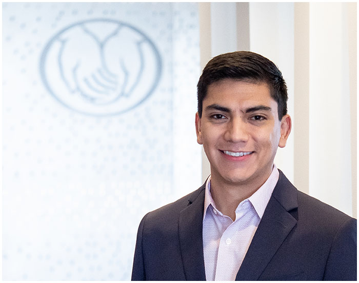

### Eric G.

Associate counsel, Innovation Law
- Northbrook, IL

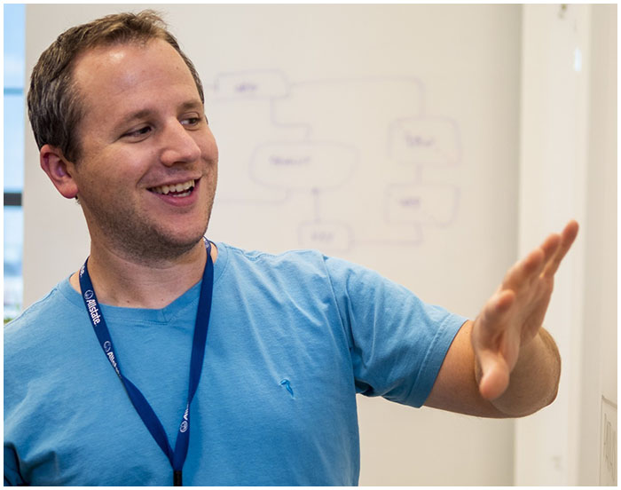

### Paul D.

Software Engineer
- Charlotte, NC

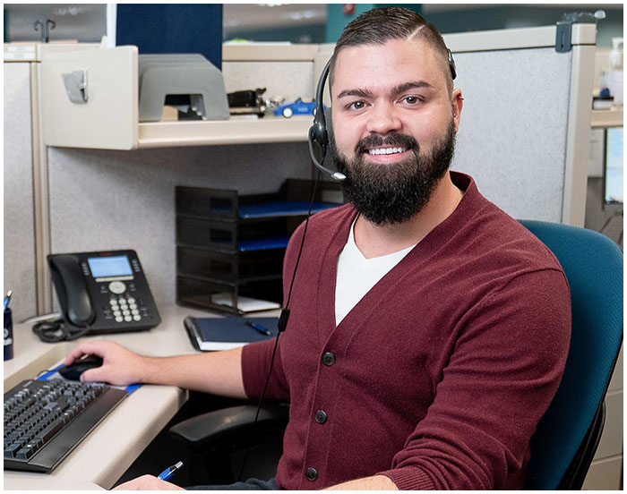

### Joe W.

Commerical Senior Claims Service Adjuster
- Chandler, AZ

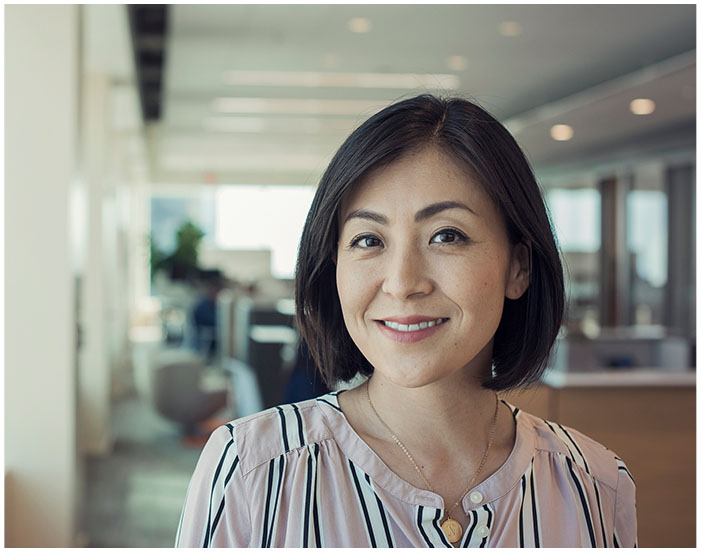

### Dana T.

Senior Product Consultant
- Denver, CO

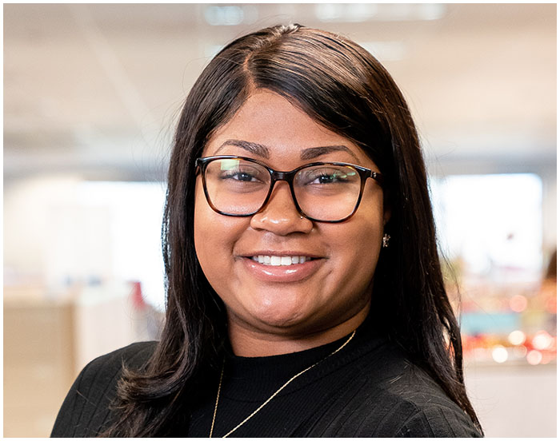

### Brooke T.

Property Senior Claims Adjuster
- Woodridge, IL

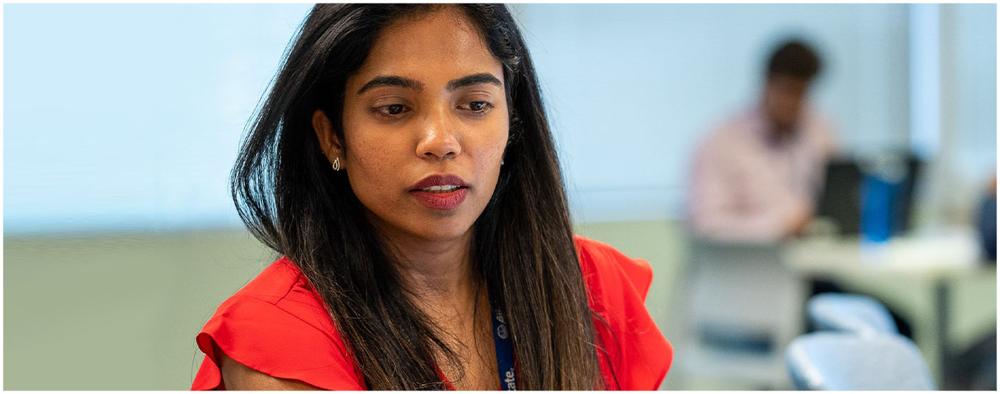

### Mythili P.

Infrastructure Engineer
- Irving, TX

## Grow Your Career With Allstate

Our employees are at the core of our success which is why we are committed to professional growth and development. At Allstate, everyone’s path is a little different with the same opportunity to achieve their career aspirations.

[1](#1)[2](#2)[3](#3)

Xiomara R.
7 years with Allstate

### Talent Share Division Manager,
 Personal Property Liability Service

2020 | Charlotte, NC

- Employee Engagement Leader,
 Customer Contact Center
 2018 – 2020 | Charlotte, NC
- Licensed Service Leader,
 Customer Contact Center
 2015 – 2018 | Charlotte, NC
- Frontline Leader for Allstate’s first
 Unlicensed Service Bilingual Team,
 Customer Contact Center
 2014 – 2015 | Charlotte, NC
- Licensed Service Specialist,
 Business Insurance
 Apr 2014 – Nov 2014 | Charlotte, NC
- Unlicensed Service Representative
 2013 – 2014 | Charlotte, NC

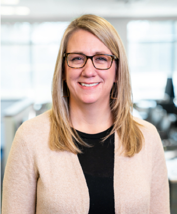

Shelby C.
7 years with Allstate

### Operations Claims
 Service Leader for the CSA

2019 – Present | Woodridge, IL

- Unrepresented Casualty Claims Service Leader
 2016 – 2019 | Woodridge, IL
- Liability Claims Service Leader
 2014 – 2016 | Northbrook, IL
- Casualty Adjuster
 Major injury, Represented, Litigation
 2013 – 2014 | Woodridge, IL

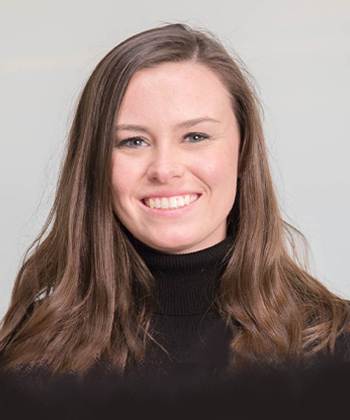

Bridget R.
4 years with Allstate

### Product Manager, Emerging Businesses
 2019- Present | Chicago, IL

- **Technology Leadership Development Program,
 3-year Rotational Program**
- Year 3: Robotics Process Automation Product Manager, Allstate Technology
 2018-2019 | Northbrook, IL
- Year 2: Rating Services Organization Consultant, Emerging Business
 2017-2018 | Chicago, IL
- Year 1: Product Owner/Business Analyst, Allstate Technology
 2016-2017 | Northbrook, IL

## Testimonials

[1](#1)[2](#2)[3](#3)

>

“Everyone is encouraged to volunteer and give back however they can throughout the year. I enjoy giving back to the community and supporting the causes that are meaningful to me.”

– Lisa,
Senior Lead Internal Auditor

>

“I’m proud of building Allstate’s first Bilingual Unlicensed Service team during my first assignment as a leader. It’s an exciting opportunity for our employees and to better serve our Spanish-speaking customers.”

– Xiomara,
Employee Engagement Leader

>

“Our leaders understand that the world is changing fast and people need to adapt and learn new skills. Allstate is committed to helping employees continuously develop and grow.”

– Kelly,
Cloud Engineer

## Future Events

[VIEW ALL FUTURE EVENTS ](https://www.allstate.jobs/events/)

## See What We're Up To

[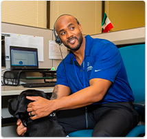](https://www.instagram.com/p/B5LPJhxFc5l/)
[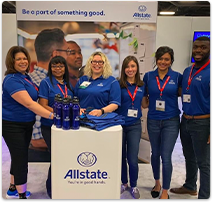](https://www.instagram.com/p/B01BU1mlkpY/)
[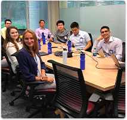](https://www.instagram.com/p/ByDkUCrl-Zb/)
[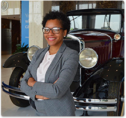](https://www.instagram.com/p/B3c8MFjlicW/)

 Follow Us

