# Allstate Careers: Content Brief

## Organisation and brand
Allstate is an insurance company with a careers site at https://www.allstate.jobs/.

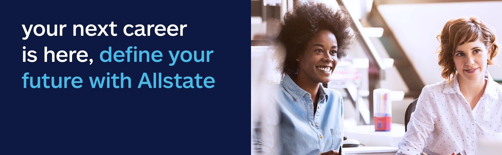

## Job search departments
Job seekers can filter openings by department. The options are: All Departments, Accounting & Audit, Actuarial, Call Center, Claims, Communication & Corporate Relations, Customer Experience, Data Science & Analytics, Finance & Economics, Human Resources, Information Technology, Investments, Legal, Marketing, Operations, Procurement, Product, Project Management, Risk Management, Sales, Training & Development, Underwriting.

## Company message
Allstate says every employee matters to the good the company does. It values people's differing knowledge, backgrounds and viewpoints, and says it is working to build an environment where each person can follow their purpose and do their best.

## Three themes
**Good Work**
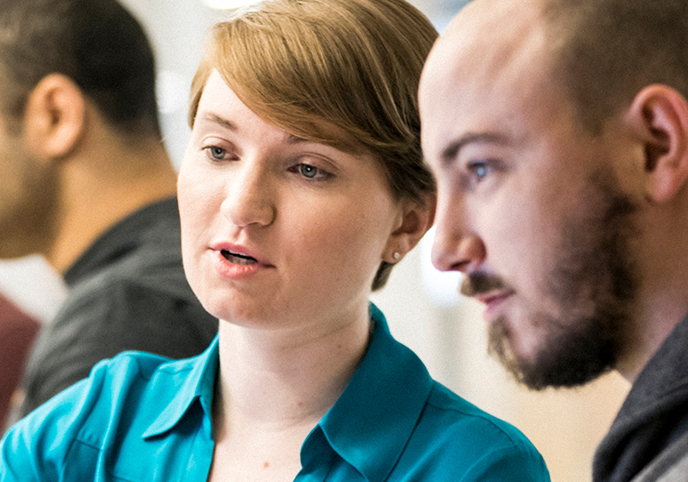
Allstate believes good work happens when people put their passions, plans and potential to use and develop them, both on the job and in life.

**Good Life**
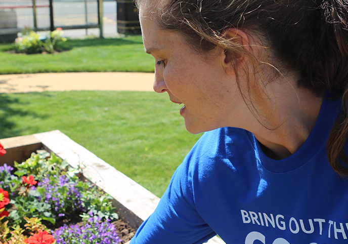
The company's support for employees often goes beyond the job. It helps them pursue their passions, strengths and personal goals, whether at work or in their free time.

**Good Hands**

Allstate provides ways for employees to get more involved. It encourages them to keep supporting causes they care about.

## Discover Allstate
**Explore Inclusive Diversity**
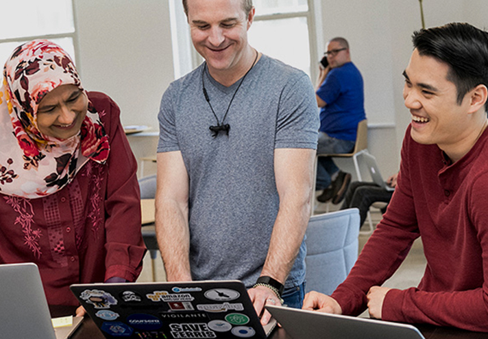
Allstate invites employees to bring their whole selves to work. Link: "Visit Page" → /diversity

**Veterans & Transitioning Military**

The company is committed to recruiting Veteran candidates. Link: "Visit Page" → /veterans/

**Benefits for a Good Life**
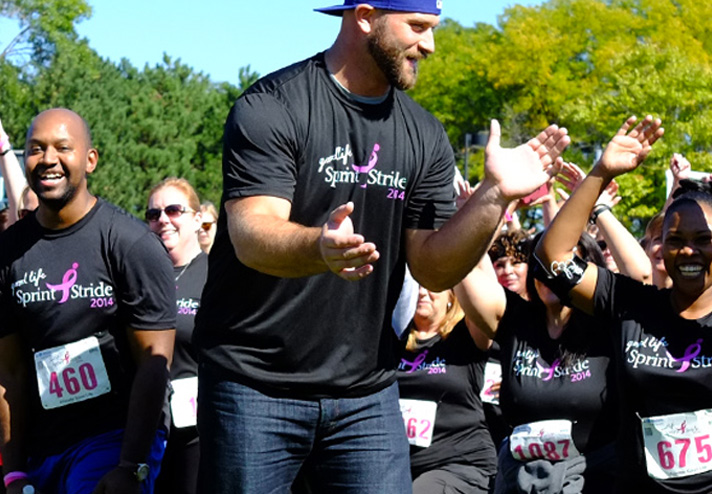
Allstate describes a culture built to help people thrive. Link: "Visit Page" → /benefits

## Career areas
Allstate describes opportunity as the defining feature of working there. Each day brings new ideas, challenges and rewards in every department, and it positions itself as a place to build a meaningful career at any level.

Its dynamic culture and its leaders' commitment to continuous learning mean employees may get chances to build skills, try new directions and shape a career path that suits their passion. Visitors are invited to learn how they can help shape the future in these areas:
- Claims: /claims/
- Continuous Improvement & Industrial Engineering: /continuous-improvement-industrial-engineering/
- Customer Service & Support: /customer-service-support/
- Data Science & Analytics: /data-science-analytics/
- Finance: /finance-investments/
- Human Resources: /human-resources/
- Legal: /legal/
- Marketing & Corporate Relations: /marketing-corporate-relations/
- Product & Pricing: /product-pricing/
- Sales: /sales/
- Technology: /technology/

## Employee profiles: people behind Allstate
- 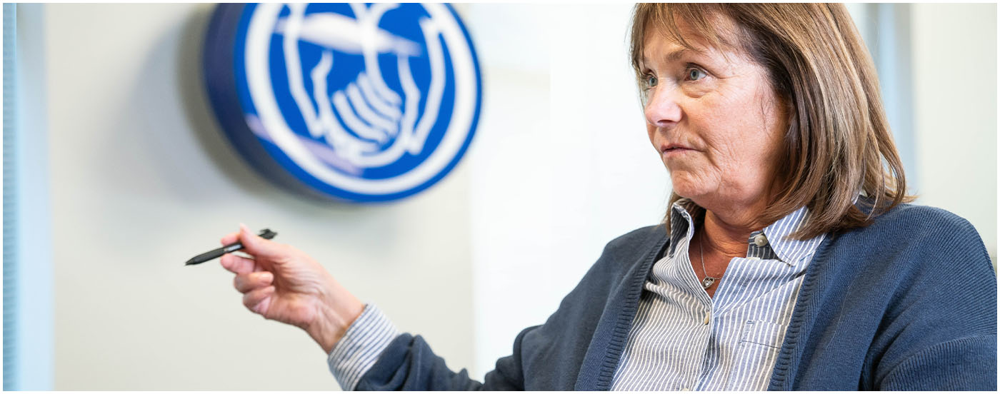 Maureen D., Agent Advocate, Woodridge, IL
- 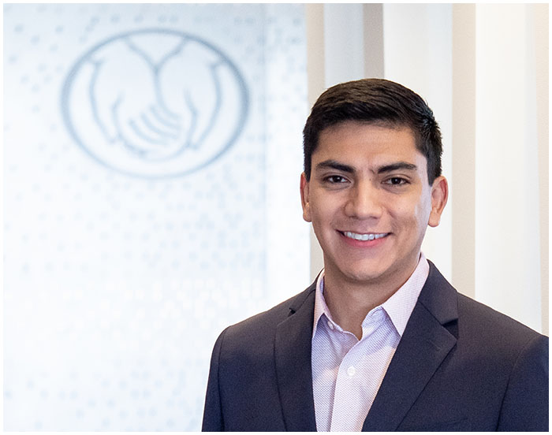 Eric G., Associate Counsel, Innovation Law, Northbrook, IL
- 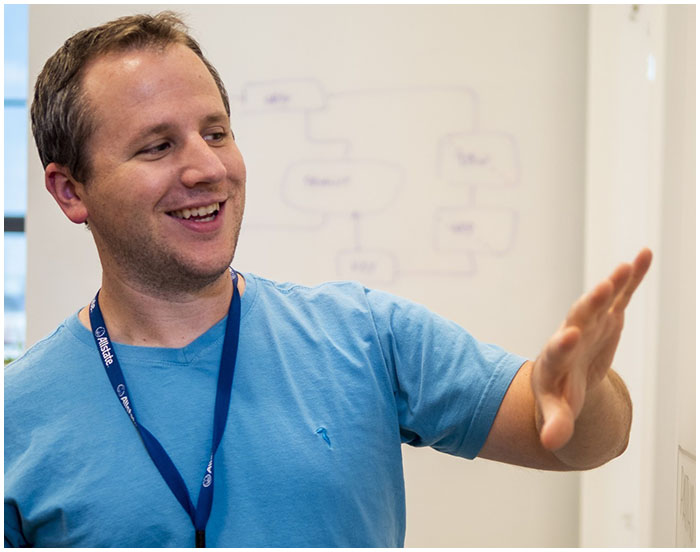 Paul D., Software Engineer, Charlotte, NC
- 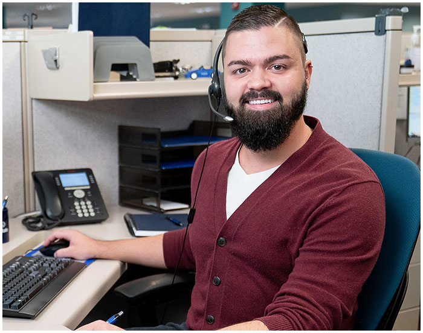 Joe W., Commercial Senior Claims Service Adjuster, Chandler, AZ
- 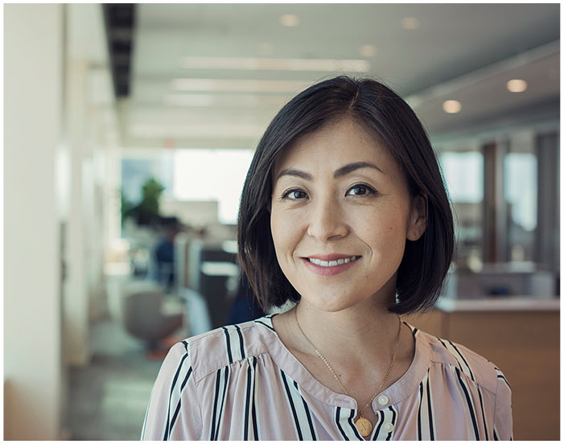 Dana T., Senior Product Consultant, Denver, CO
- 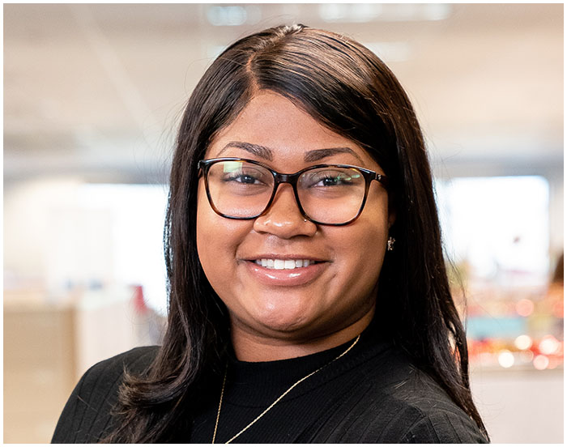 Brooke T., Property Senior Claims Adjuster, Woodridge, IL
- 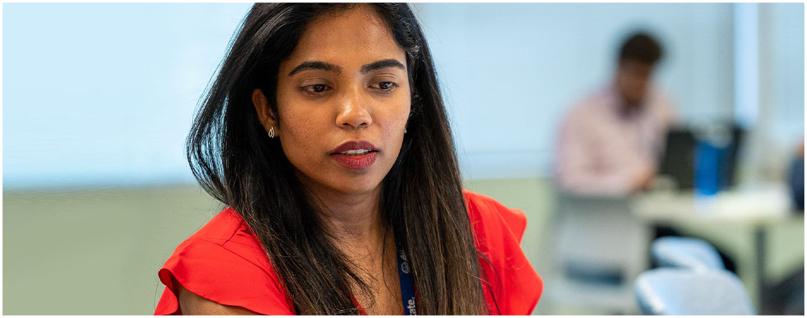 Mythili P., Infrastructure Engineer, Irving, TX

## Career growth
Allstate says its employees are central to its success, so it is committed to their professional growth and development. Each person's path differs, but everyone has the same opportunity to reach their career goals. Three career stories are presented as a set of three.

**Xiomara R.** (7 years with Allstate)
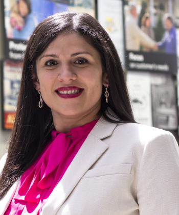
- Current role: Talent Share Division Manager, Personal Property Liability Service, 2020, Charlotte, NC
- Employee Engagement Leader, Customer Contact Center, 2018–2020, Charlotte, NC
- Licensed Service Leader, Customer Contact Center, 2015–2018, Charlotte, NC
- Frontline Leader for Allstate's first Unlicensed Service Bilingual Team, Customer Contact Center, 2014–2015, Charlotte, NC
- Licensed Service Specialist, Business Insurance, Apr 2014–Nov 2014, Charlotte, NC
- Unlicensed Service Representative, 2013–2014, Charlotte, NC

**Shelby C.** (7 years with Allstate)
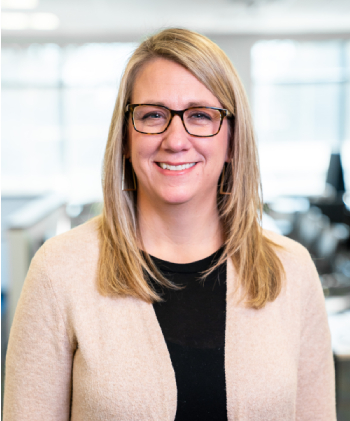
- Current role: Operations Claims Service Leader for the CSA, 2019–Present, Woodridge, IL
- Unrepresented Casualty Claims Service Leader, 2016–2019, Woodridge, IL
- Liability Claims Service Leader, 2014–2016, Northbrook, IL
- Casualty Adjuster (major injury, represented, litigation), 2013–2014, Woodridge, IL

**Bridget R.** (4 years with Allstate)
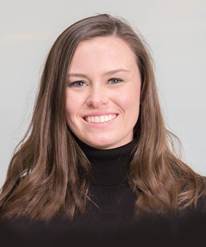
- Current role: Product Manager, Emerging Businesses, 2019–Present, Chicago, IL
- Came through the Technology Leadership Development Program, a 3-year rotational program:
  - Year 3: Robotics Process Automation Product Manager, Allstate Technology, 2018–2019, Northbrook, IL
  - Year 2: Rating Services Organization Consultant, Emerging Business, 2017–2018, Chicago, IL
  - Year 1: Product Owner/Business Analyst, Allstate Technology, 2016–2017, Northbrook, IL

## Employee testimonials
Three testimonials are presented as a set of three.

- 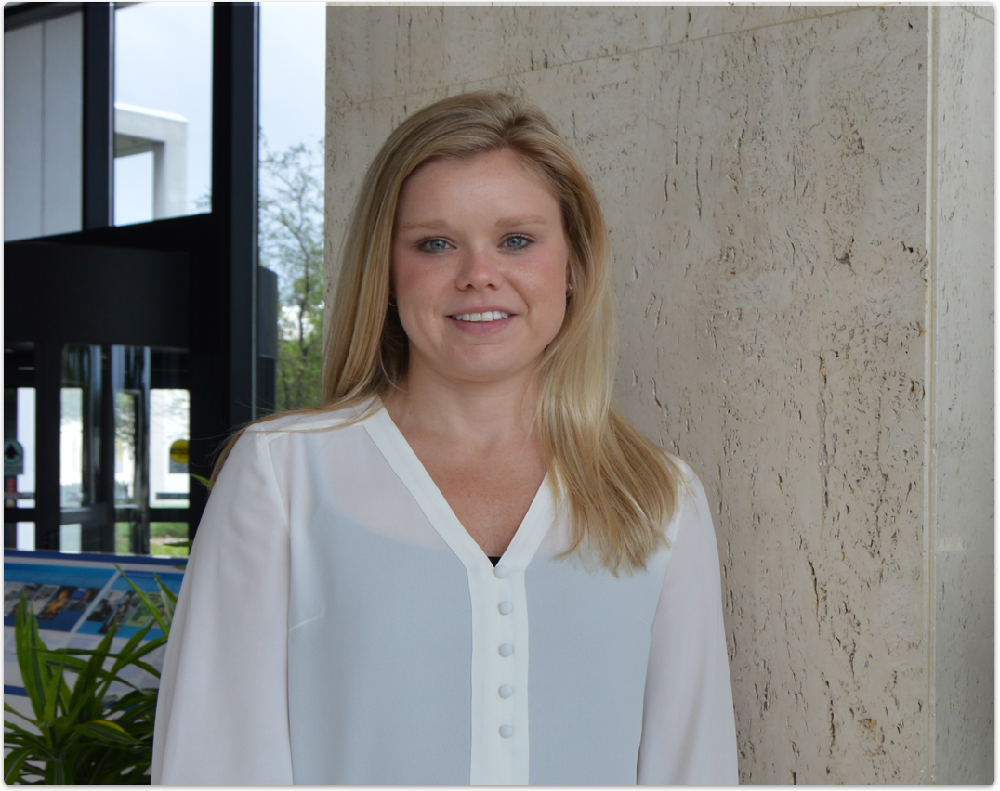 Lisa, Senior Lead Internal Auditor: Employees are encouraged to volunteer and give back in whatever ways they can all year. Lisa enjoys serving the community and supporting causes that matter to her.
- 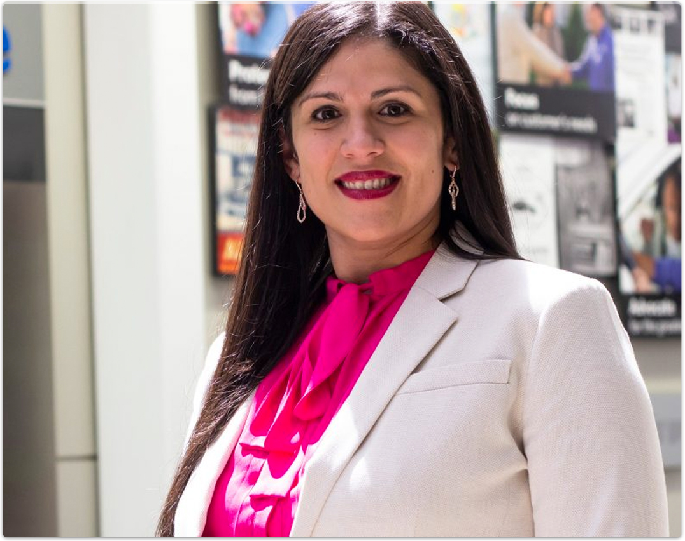 Xiomara, Employee Engagement Leader: She is proud of having built Allstate's first Bilingual Unlicensed Service team during her first assignment as a leader. She sees it as a great opportunity for employees and a way to serve Spanish-speaking customers better.
- 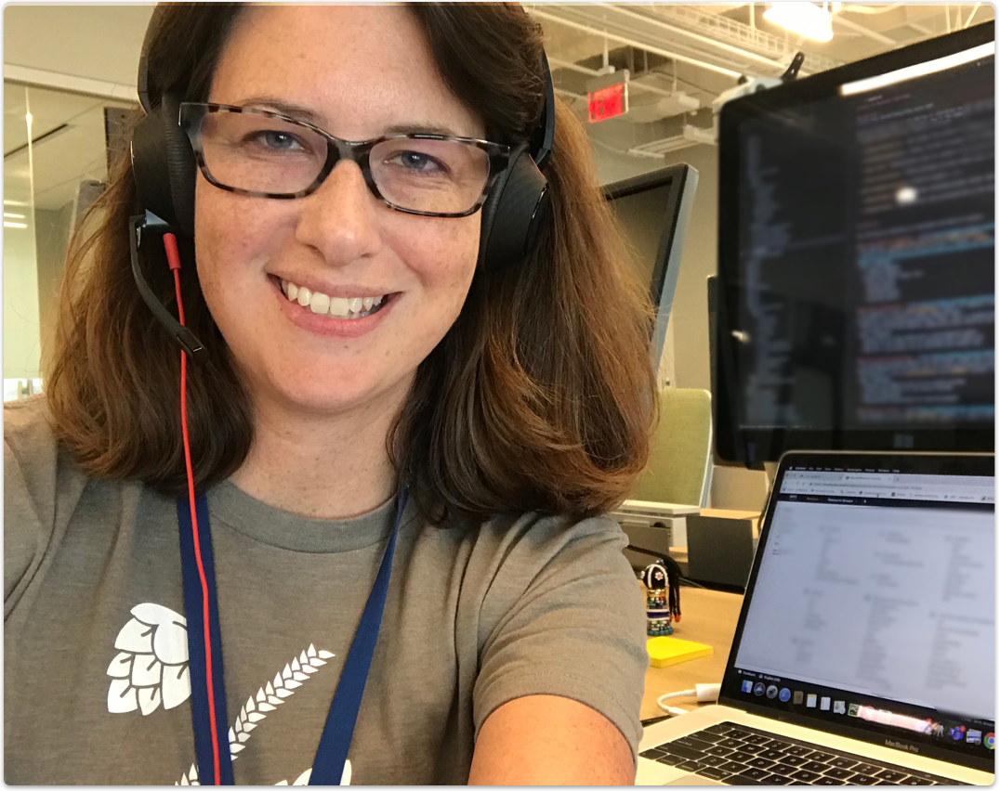 Kelly, Cloud Engineer: Leaders recognise that the world is changing quickly and that people must adapt and learn new skills. Allstate is committed to helping employees keep developing and growing.

## Events
Link to see every upcoming event: "View all future events" → https://www.allstate.jobs/events/

## Social media
The page features four Instagram posts:
- [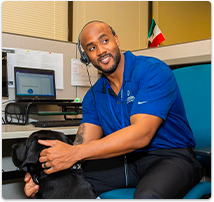](https://www.instagram.com/p/B5LPJhxFc5l/)
- [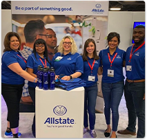](https://www.instagram.com/p/B01BU1mlkpY/)
- [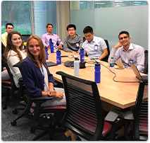](https://www.instagram.com/p/B3c8MFjlicW/) is the third, and the fourth is below.
- [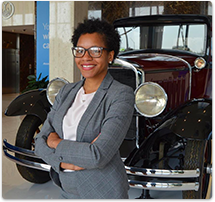](https://www.instagram.com/p/B3c8MFjlicW/)

Follow Allstate Careers on:
-  Facebook: https://www.facebook.com/AllstateCareers
-  Instagram: https://www.instagram.com/allstate_careers/
-  Twitter: https://twitter.com/AllstateCareers
-  YouTube: https://www.youtube.com/channel/UCsqbhaLz0e3fLcF8jREJjSw
-  LinkedIn: https://www.linkedin.com/company/allstate
