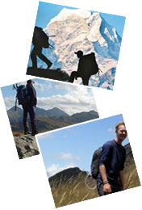

- [Home](index.php)
- [About Us](index.php?linkId=6)
- [Testimonials](index.php?linkId=37)
- [Contact Us](index.php?linkId=30)

 

- [Adventure Activities](index.php?linkId=1)

- [Destination](index.php?linkId=2)

- [Special Packages](index.php?linkId=3)

- [Services](index.php?linkId=4)

- [Gallery](index.php?linkId=31)

- [Plan a trip](index.php?action=planatrip)

- 
Products

- [Pashmina](index.php?linkId=33)

- [Garments](index.php?linkId=34)

- [Handicrafts](index.php?linkId=44)

 Recommend this site to a Friend
  Your Name

 Friend's Name

 Friend's Email

 Alpine Everest Group
 P.O.Box:24601
 Str: Lazimpat-2, Kathmandu, Nepal.
 Tel/Fax:+977-1-4441377, 400-50-00, 400-50-57
 Cell:+977-9841330184, 9741178888
 Skype: alpine8848
 MSN: alpine8848@live.com
 Email: alpine8848@asia.com

 

# Namaste, Welcome to Alpine Everest

Alpine Everest Expedition and Treks established with a view to provide best services to its beloved guest. Guest satisfaction during tour and trek under our best supervision is our business moto. We strongly believe in quality service and our prime objective is to make every trip of our valued customers smooth and enjoyable.

 As we firmly believe in personalized service, we always design the custom tailored itineraries where people are not bound to take set programs. We are planning to sale a lots of holiday package tours including high and soft adventure trips, school trips, family holiday trip etc. in the coming years. For reliability, quality service and tours of great style, please remember us we are always at your service.

# Gallery

 
 
 
 
 
 
 
 
 
 
[more](index.php?linkId=32)

# Products

 
 
 
 
 
 
 
 
[more](index.php?linkId=36)      Copyright © Alpine Everest Expedition & Trek 2010. All rights reserved.
