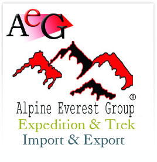
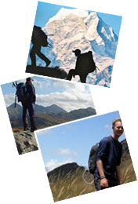

## Organisation
Alpine Everest Expedition and Treks (also styled Alpine Everest Group), a Nepal-based travel company. Copyright notice: © Alpine Everest Expedition & Trek 2010, all rights reserved.

## Navigation links
- Home (index.php)
- About Us (index.php?linkId=6)
- Testimonials (index.php?linkId=37)
- Contact Us (index.php?linkId=30)

## Tours menu

Links, each with a small bullet marker:

- Adventure Activities (index.php?linkId=1)

- Destination (index.php?linkId=2)

- Special Packages (index.php?linkId=3)

- Services (index.php?linkId=4)

- Gallery (index.php?linkId=31)

- Plan a trip (index.php?action=planatrip)

## Products menu
A group labelled "Products" with these links, each with a small bullet marker:

- Pashmina (index.php?linkId=33)

- Garments (index.php?linkId=34)

- Handicrafts (index.php?linkId=44)

## Refer a friend
A small form inviting visitors to recommend the site to someone they know. Fields: visitor's own name, friend's name, friend's email.

## Contact details

- Company: Alpine Everest Group
- P.O. Box: 24601
- Street address: Lazimpat-2, Kathmandu, Nepal
- Tel/Fax: +977-1-4441377, 400-50-00, 400-50-57
- Cell: +977-9841330184, 9741178888
- Skype: alpine8848
- MSN: alpine8848@live.com
- Email: alpine8848@asia.com

## Welcome message

Greeting: "Namaste", welcome to Alpine Everest.

Alpine Everest Expedition and Treks was founded to give its guests the best possible service. Its stated business motto is guest satisfaction on every tour and trek, delivered under the company's close supervision. The company says it believes strongly in quality service and that its main aim is to make each customer's trip smooth and enjoyable.

Because it values personal service, the company builds custom-tailored itineraries so travellers are not forced onto fixed programmes. In the coming years it plans to sell many holiday package tours, including high-adventure and soft-adventure trips, school trips and family holidays. It asks visitors to remember it for reliability, quality service and stylish tours, and says it is always at their service.

## Gallery
A set of ten photo thumbnails, each linking to an individual gallery item (index.php?galleryId=) with IDs 20, 14, 15, 12, 16, 21, 11, 17, 22, 18, plus a "more" link to the full gallery (index.php?linkId=32).

## Products showcase
A set of eight product thumbnails, each linking to an individual product item (index.php?listId=) with IDs 23, 22, 21, 20, 19, 18, 17, 16, plus a "more" link to the full product list (index.php?linkId=36).

