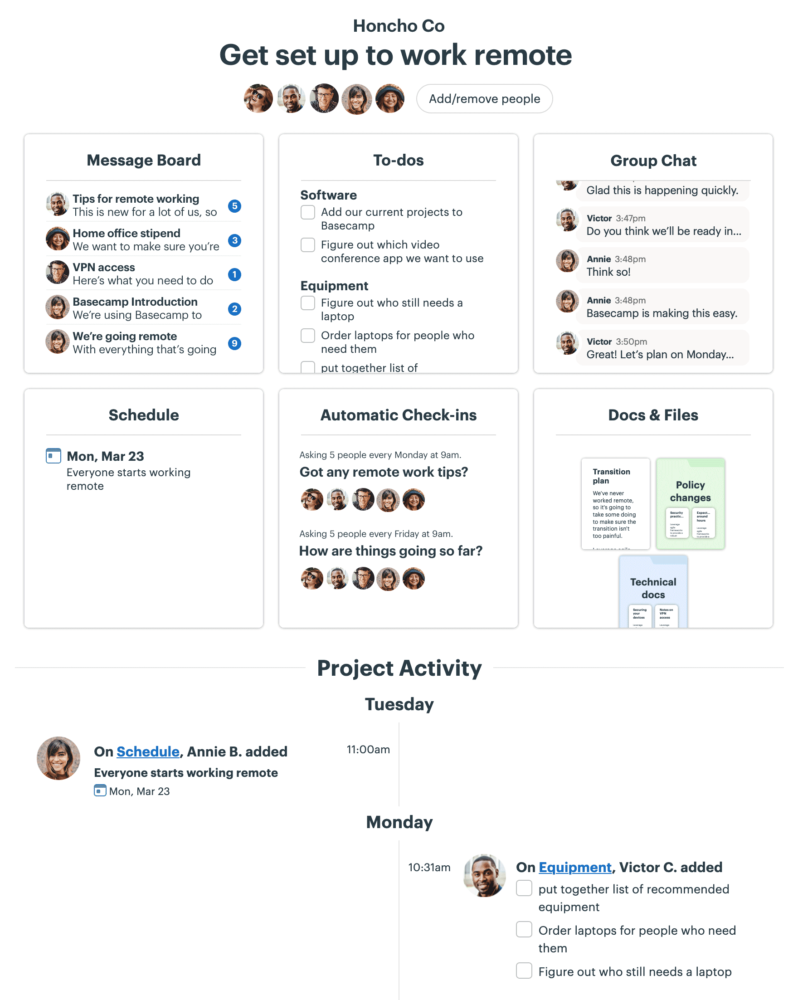
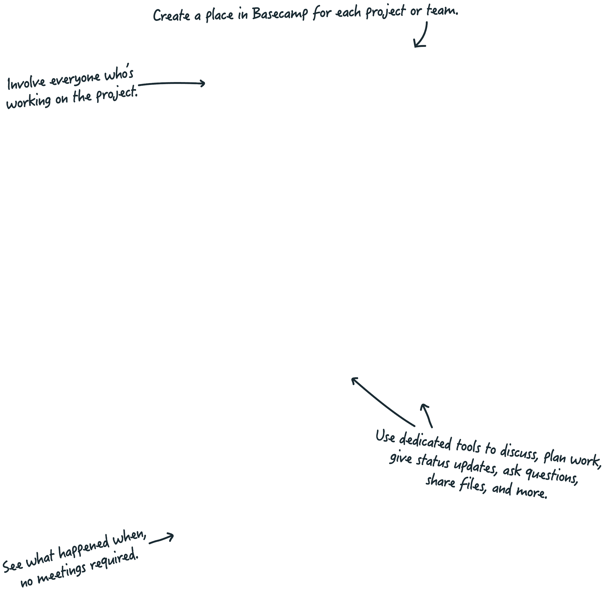
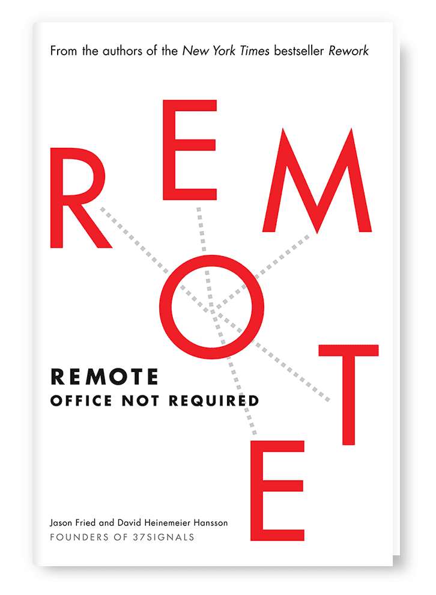
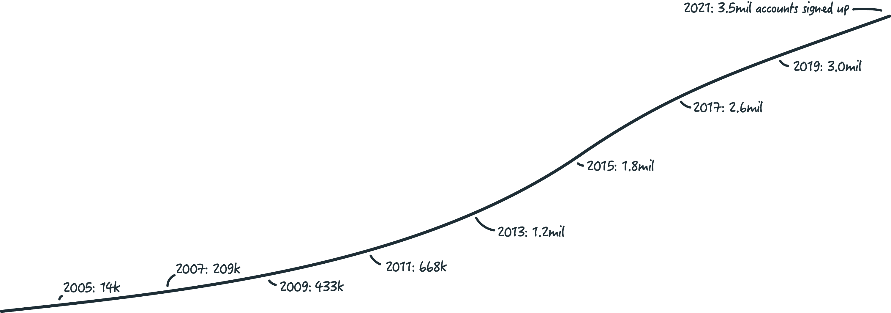

Navigation: [How it works](/how-it-works) · [Before & after](/before-and-after) · [Got clients?](/features/clients) · [Pricing](/pricing) · [Support](/support) · [Sign in](https://launchpad.37signals.com/signin) · [Try it FREE](https://3.basecamp.com/signup/account/new?plan=one_v1)

 “extremely user friendly”

 “perfect solution for remote teams”

 “truly amazing!”

# The All-In-One Toolkit for Working Remotely.

**Before Basecamp:** Projects feel scattered, things slip, it’s tough to see where things stand, and people are stressed. **After Basecamp:** Everything’s organized in one place, you’re on top of things, progress is clear, and a sense of calm sets in.

[Give Basecamp a Try](/pricing)

4,000 companies signed up in the last week alone!

---

(mobile version: images/project-remote-small.png)

## One place, not all over the place.

**Remote work is especially challenging when** stuff’s spread out across emails, file services, task managers, spreadsheets, chats, meetings, etc. Things get lost, you don’t know where to look for stuff, and people put the right information in the wrong place.

**But when it’s all together in Basecamp, you’ll see** where everything is, understand what everyone’s working on, and know exactly where to put the next thing everyone needs to know about. Your team can access Basecamp from anywhere - on the web, on iOS, and Android. This is the modern way – The Basecamp Way to Work.

**[Basecamp is different – take a deeper look at how it works >](/how-it-works)**

---

## We literally wrote the book on working remotely.

We don't just make software for remote work; we wrote a popular and influential book about working remotely too. **REMOTE** shows both employers and employees how they can work together, remotely, from any desk, in any place, anytime, anywhere. Avoid common pitfalls, learn best practices, and get up to speed *quick*.

[learn more about REMOTE](/books/remote)

---

## Companies change for the better when they work in Basecamp.

Software development shops, design firms, freelancers, consultants, architects, agencies, media companies, schools, and non-profits around the world have switched to Basecamp to **fundamentally improve** their project workflow.

> “I’ve used Basecamp for a million projects over the last decade and a half. It's beautiful software that has resisted every wrong trend and stayed true to the things that mattered most. Highly recommended.”
> — Tobi Lütke, CEO, Shopify

> “We can see exactly what needs to be done and when. We're much more efficient.”
> — Tina Lannin, 121 Captions

> “We've had less confusion with task responsibilities and deadlines, which has increased productivity and efficiency.”
> — Dale Lavine, NASA

> “Accountability for tasks. No more ‘I thought so and so was responsible for that.’”
> — George Groves, Piehole.TV

> “We are all collaborating more on feedback, it helps to show accountability as well.”
> — Samantha Silberberg, Quartz

> “We don't need to spend as much time in meetings now that we use Basecamp.”
> — Brad Vandiviere, Faith Chapel Billings

> “Transparency and communication has increased.”
> — Joey Rosenberg, Women Who Code

> “Time management and productivity. Makes my job easier rather than having to constantly ask for progress updates.”
> — Kyle Jernigan, Crossroads Church

> “Greater collaboration and less Excel!”
> — Spencer Stevenson, 3M

> “Task completion! The lists and reminders help people remember what they said they were going to do and helps hold them accountable to the team.”
> — Scot Evans, University of Miami

**[Hear from hundreds more customers about what's changed for the better since they made the switch to Basecamp >](/customers)**

**Have questions? [Holler](/support). Ready to get going? Engage:**

[Give Basecamp a Try](/pricing)

4,000 companies signed up in the last week alone!

---

**Basecamp apps:** [iOS, Android, Mac, and PC](/via), [integrations](/extras).
**Company:** [about us](/about), [podcast](https://rework.fm/), [blog](https://signalvnoise.com/), [books](/books), [handbook](/handbook), [newsletter](/newsletter).
**Guides:** [going remote](/remote-resources), [team communication](/guides/how-we-communicate), [group chat: group stress](/guides/group-chat-problems).
**Our new app:** [HEY - email at its best](https://hey.com).
**Fine print:** [customer rights](/rights), [privacy & terms](/about/policies), [uptime](/uptime/bc3), [system status](/status).

*Copyright ©1999-2021 Basecamp. All rights reserved. Enjoy the rest of your day!*
