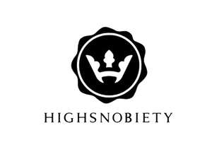
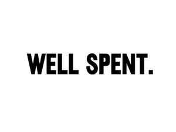
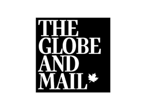
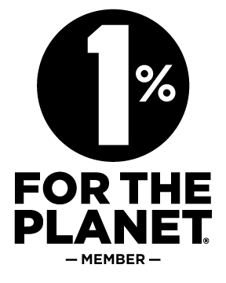

## Brand overview
Bather Trunk Company (bather.com) is a Toronto, Canada-based maker of men's surf and swim products. It launched in 2013 with the aim of providing quality swim and surf pieces, with a street-inspired approach, that complement a well-curated wardrobe of essentials and can be worn both on and off the beach. Copyright 2021 Bather Trunk Company.

## Store announcements and navigation
- Free shipping on orders over $150 USD (links to /collections/sweatsuits).
- Main navigation: Shop (/collections/all), About (/pages/about), Journal (/blogs/journal), Stockists (/pages/stockists).
- Utility links: Search (/search) and Cart (/cart).
- Logo:  (links to /).

## Current collection
- New arrivals: the Spring/Summer '21 collection is now available. Call to action: shop now (/collections/all).
- A second call to action announces SS21 as available now, inviting visitors to shop the full collection (/collections/all).
- New bandana towels, with a link to shop accessories (/collections/accessories).
- Camp shirts, with a link to view all (/collections/shirts).
- A prompt to browse the latest products. 

## Featured products
- Beige Hula Girl Camp Shirt, tagged "Made in Canada" (https://bather.com/products/beige-hula-girl-camp-shirt/).
- Orange Hawaiian Tropics Swim Trunk, tagged "100% recycled polyester" (https://bather.com/products/orange-hawaiian-tropics-swim-trunk/).
- Black Bandana Swim Trunk, tagged "Ultra soft mesh lining" (/products/black-bandana-swim-trunk).

## Sustainability
- All new surf and swim products now use fully recycled fabrics, in addition to being made locally. Headline claim: made with 100% recycled materials. Call to action: learn more (https://bather.com/pages/about-our-fabrics). 
- A "Made in Canada" sustainability story links to /pages/about (learn more). 

## Gift cards
- Gift cards are available now, with a buy-now link (/products/gift-card). 

## Journal feature
- "Excellent Adventures" is a journal story, with a link to read (/blogs/journal).

## Press quotes
- Highsnobiety: the team at Bather are year-round swimwear experts.
- GQ: Bather's trunks meet its strict swim trunk standards and are even better on the beach.
- New York Times: the trunks are designed to stand out and are easy to wear away from the beach.
- Well Spent: offers many great prints, including bandanas, palm trees and florals, that keep the wearer looking good.
- Business Insider: calls them the best swim trunks for summer.
- The Globe and Mail: describes Bather as a Toronto-based maker of stylish, comfortable men's swimwear.
- Press logos:      

## Our ethos

- Bather works with experienced local designers, manufacturers and fabric suppliers to build a customer-first fashion brand offering slow fashion at an affordable price.
- The company doesn't cut corners or take shortcuts. Challenges are seen as exciting, and the solutions are meant to result in exciting products.
- Bather is a member of 1% for the Planet and gives a portion of every sale to ocean cleanups and marine conservation. Membership directory pages: https://directories.onepercentfortheplanet.org/business-members/bather-trunk-co and https://directories.onepercentfortheplanet.org/profile/bather-trunk-co. 

## Journal posts
- **The Spring 2021 Style Guide** (/blogs/journal/the-spring-2021-style-guide): with spring showers over and warmer months near, a seasonal wardrobe refresh is in order. Link: read more.
- **SS21 Lookbook** (/blogs/journal/ss21-lookbook): Toronto, ON, April 15, 2021. Announces that for Spring/Summer '21, Bather is moving to recycled fabrics for all its new products. Link: read more.
- **Bather's Gift Guide Giveaway** (/blogs/journal/bathers-holiday-2020-giveaway): open to Canada and the USA until Christmas Day. Tied to the annual holiday gift guide of timeless, unique suggestions. Link: read more.
- Link to all posts (/blogs/journal).

## Social and external links
- Facebook: https://www.facebook.com/bathertrunks
- Instagram: https://instagram.com/bather
- Pinterest: https://www.pinterest.com/bathertrunks
- Lifestyle site: http://lifestyle.bather.com/

## Customer information links
- Contact (/pages/contact)
- FAQ (/pages/faq)
- Sizing (/pages/sizing)
- Shipping & Returns (/pages/faq)
- Gift Card (/products/gift-card)
- GQ Best Stuff Box (/products/gq-navy-and-black-striped-swim-trunk)
- Press (/pages/press)
- Privacy (/pages/privacy)

## Email sign-up
- Subscribers get 10% off their first order and are first to hear about new products, promotions, events and more. Action: subscribe.

## Accepted payment methods
       

Payments accepted: American Express, Apple Pay, Diners Club, Discover, Mastercard, PayPal, Shop Pay, Visa.
