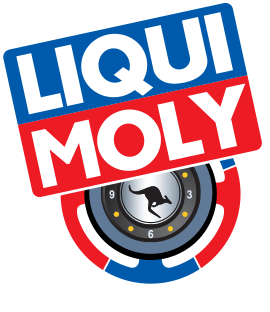
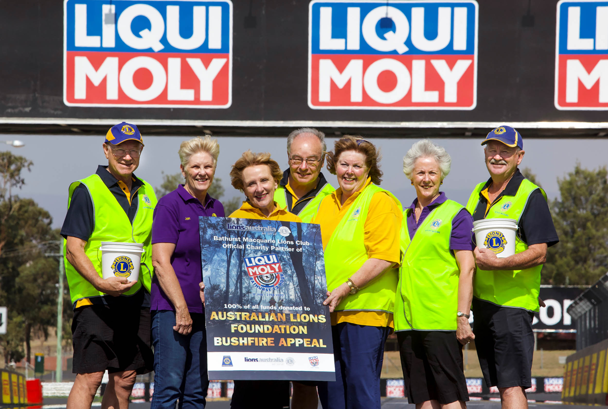

*search*

# 

Liqui-moly Bathurst 12 Hour
Australia’s International Endurance race
31 JANUARY – 2 FEBRUARY 2020

- [Home](/)
- [News](/news)
- [Video](http://www.bathurst12hour.com.au/videos/)
- [The Event](https://www.bathurst12hour.com.au/the-event/)

- [Map](https://www.bathurst12hour.com.au/the-event/map/)
- [Getting to the event](https://www.bathurst12hour.com.au/the-event/getting-to-the-event/)
- [What’s on](https://www.bathurst12hour.com.au/the-event/whats-on/)
- [Accommodation](https://www.bathurst12hour.com.au/the-event/accommodation/)
- [Camping](https://www.bathurst12hour.com.au/camping/)
- [Event & Race Officials](https://www.bathurst12hour.com.au/the-event/event-race-officials/)
- [FAQs](https://www.bathurst12hour.com.au/the-event/faqs/)
- [The Race](https://www.bathurst12hour.com.au/race-information/)

- [Race Information](https://www.bathurst12hour.com.au/race-information/)
- [Entry List](https://www.bathurst12hour.com.au/race-information/entry/)
- [Competitors](https://www.bathurst12hour.com.au/competitors/)

- [Bathurst 12 Hour Entry Registration](https://www.bathurst12hour.com.au/competitor-entry/)
- [Supplementary Regulations and Sporting & Technical Regulations](https://www.bathurst12hour.com.au/competitors/supplementary-regulations-and-sporting-technical-regulations/)
- [CAMS Foreign Participation VISA](https://www.bathurst12hour.com.au/competitors/cams-foreign-participation-visa/)
- [Driver & Ride Board](https://www.bathurst12hour.com.au/competitors/driver-ride-board/)
- [Schedule](https://www.bathurst12hour.com.au/schedule/)
- [Results](https://www.bathurst12hour.com.au/results/)
- [Previous Races](https://www.bathurst12hour.com.au/race-information/previous-races/)
- [Bushfires Appeal](https://www.bathurst12hour.com.au/bushfires/)

- 
- 

 

 [Featured News](/category/feature/)  [Bathurst 12 Hour to return in 2022](https://www.bathurst12hour.com.au/news/bathurst-12-hour-to-return-in-2022/)
 [Oct 19, 2020](https://www.bathurst12hour.com.au/news/bathurst-12-hour-to-return-in-2022/)

[**](https://www.facebook.com/sharer/sharer.php?u=https://www.bathurst12hour.com.au/news/bathurst-12-hour-to-return-in-2022/&t=Bathurst 12 Hour to return in 2022)
[**](https://twitter.com/intent/tweet?url=https://www.bathurst12hour.com.au/news/bathurst-12-hour-to-return-in-2022/&text=Bathurst 12 Hour to return in 2022)    [Read more](https://www.bathurst12hour.com.au/news/bathurst-12-hour-to-return-in-2022/)

 

 [More than $74,000 raised via #B12hr Bushfire…](https://www.bathurst12hour.com.au/news/more-than-74000-raised-via-b12hr-bushfire-relief-efforts/)
 [Feb 13, 2020](https://www.bathurst12hour.com.au/news/more-than-74000-raised-via-b12hr-bushfire-relief-efforts/)

[**](https://www.facebook.com/sharer/sharer.php?u=https://www.bathurst12hour.com.au/news/more-than-74000-raised-via-b12hr-bushfire-relief-efforts/&t=More than $74,000 raised via #B12hr Bushfire Relief efforts)
[**](https://twitter.com/intent/tweet?url=https://www.bathurst12hour.com.au/news/more-than-74000-raised-via-b12hr-bushfire-relief-efforts/&text=More than $74,000 raised via #B12hr Bushfire Relief efforts)   [Read more](https://www.bathurst12hour.com.au/news/more-than-74000-raised-via-b12hr-bushfire-relief-efforts/)

 

 [MotorActive matches massive donation to Bushfire relief](https://www.bathurst12hour.com.au/news/motoractive-matches-massive-donation-to-bushfire-relief/)
 [Feb 05, 2020](https://www.bathurst12hour.com.au/news/motoractive-matches-massive-donation-to-bushfire-relief/)

[**](https://www.facebook.com/sharer/sharer.php?u=https://www.bathurst12hour.com.au/news/motoractive-matches-massive-donation-to-bushfire-relief/&t=MotorActive matches massive donation to Bushfire relief)
[**](https://twitter.com/intent/tweet?url=https://www.bathurst12hour.com.au/news/motoractive-matches-massive-donation-to-bushfire-relief/&text=MotorActive matches massive donation to Bushfire relief)   [Read more](https://www.bathurst12hour.com.au/news/motoractive-matches-massive-donation-to-bushfire-relief/)

 
 [First major donation lodged for B12hr Bushfire…](https://www.bathurst12hour.com.au/news/first-major-donation-lodged-for-b12hr-bushfire-relief/)
 [Feb 04, 2020](https://www.bathurst12hour.com.au/news/first-major-donation-lodged-for-b12hr-bushfire-relief/)  

 
 [59Racing grabs podium despite late call-up](https://www.bathurst12hour.com.au/news/59racing-grabs-podium-despite-late-call-up/)
 [Feb 04, 2020](https://www.bathurst12hour.com.au/news/59racing-grabs-podium-despite-late-call-up/)  

 
 [Pepper beats housemate to Bathurst honour](https://www.bathurst12hour.com.au/news/pepper-beats-housemate-to-bathurst-honour/)
 [Feb 03, 2020](https://www.bathurst12hour.com.au/news/pepper-beats-housemate-to-bathurst-honour/)  

 
 [Gounon hails M-Sport performance after breakthrough 12…](https://www.bathurst12hour.com.au/news/gounon-hails-m-sport-performance-after-breakthrough-12-hour-win/)
 [Feb 03, 2020](https://www.bathurst12hour.com.au/news/gounon-hails-m-sport-performance-after-breakthrough-12-hour-win/)  

#### follow us

Social Media
Stay up-to-date with the latest #B12HR news via Facebook and Twitter.

- 
- 

Links

- [Contacts](https://www.bathurst12hour.com.au/contact/)
- [Media](https://www.bathurst12hour.com.au/the-event/media/)
- [Privacy Policy](https://www.bathurst12hour.com.au/privacy-policy/)
- [Terms & Conditions](https://www.bathurst12hour.com.au/terms-conditions/)

 
 
 
 
 
 
 
 
 
 
 
 
 
 
 
 
 
 
 
 
 
 
 
 
 
 

© 2021 LIQUI-MOLY Bathurst 12 Hour. All Rights Reserved
