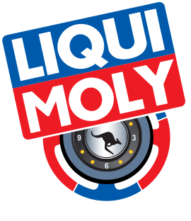
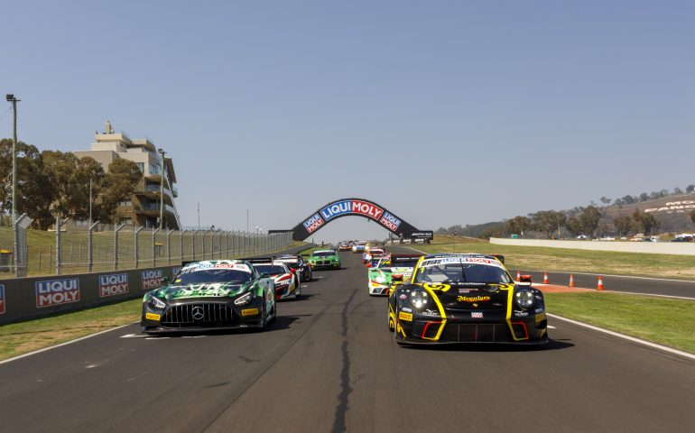
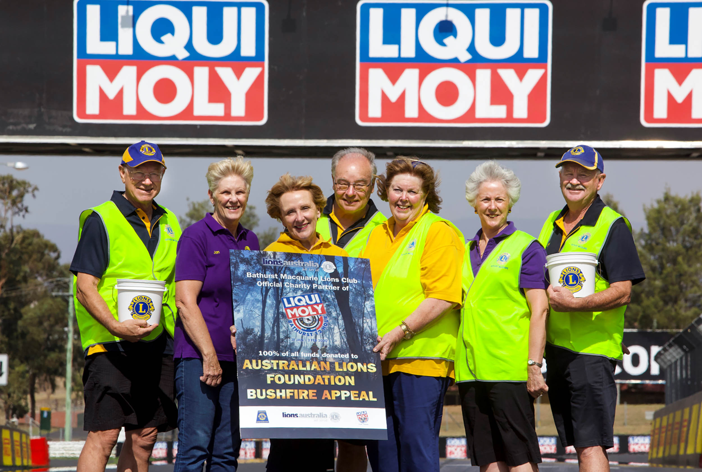
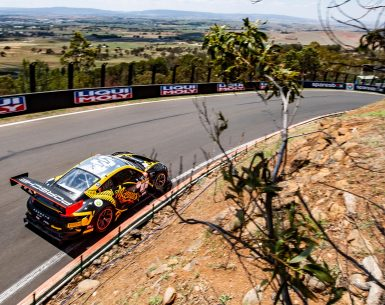
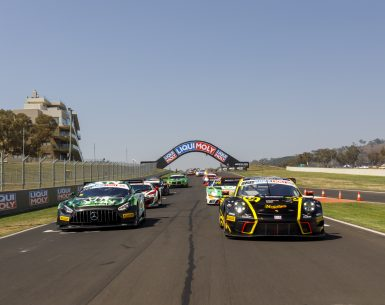
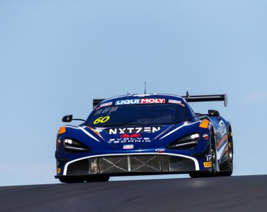
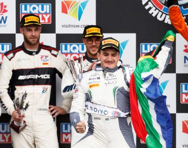
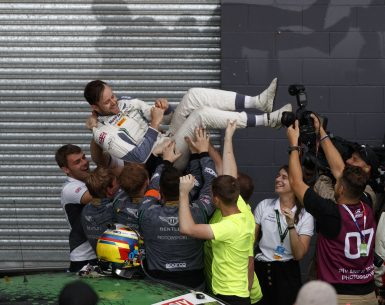

## Organisation and event
- Liqui-moly Bathurst 12 Hour (hashtag #B12HR) is Australia's international endurance car race.
- Website: https://www.bathurst12hour.com.au/
- Logo: 
- Event dates shown: 31 January – 2 February 2020.
- Site copyright notice: © 2021 LIQUI-MOLY Bathurst 12 Hour. All Rights Reserved. Logo: 
- General site image: 
- The site has a search function.

## Site navigation links
- Home: /
- News: /news
- Video: http://www.bathurst12hour.com.au/videos/
- The Event: https://www.bathurst12hour.com.au/the-event/
  - Map: https://www.bathurst12hour.com.au/the-event/map/
  - Getting to the event: https://www.bathurst12hour.com.au/the-event/getting-to-the-event/
  - What's on: https://www.bathurst12hour.com.au/the-event/whats-on/
  - Accommodation: https://www.bathurst12hour.com.au/the-event/accommodation/
  - Camping: https://www.bathurst12hour.com.au/camping/
  - Event & Race Officials: https://www.bathurst12hour.com.au/the-event/event-race-officials/
  - FAQs: https://www.bathurst12hour.com.au/the-event/faqs/
- The Race: https://www.bathurst12hour.com.au/race-information/
  - Race Information: https://www.bathurst12hour.com.au/race-information/
  - Entry List: https://www.bathurst12hour.com.au/race-information/entry/
  - Competitors: https://www.bathurst12hour.com.au/competitors/
    - Bathurst 12 Hour Entry Registration: https://www.bathurst12hour.com.au/competitor-entry/
    - Supplementary Regulations and Sporting & Technical Regulations: https://www.bathurst12hour.com.au/competitors/supplementary-regulations-and-sporting-technical-regulations/
    - CAMS Foreign Participation VISA: https://www.bathurst12hour.com.au/competitors/cams-foreign-participation-visa/
    - Driver & Ride Board: https://www.bathurst12hour.com.au/competitors/driver-ride-board/
  - Schedule: https://www.bathurst12hour.com.au/schedule/
  - Results: https://www.bathurst12hour.com.au/results/
  - Previous Races: https://www.bathurst12hour.com.au/race-information/previous-races/
  - Bushfires Appeal: https://www.bathurst12hour.com.au/bushfires/

## Social media
- Facebook: https://www.facebook.com/Bathurst12Hour
- Twitter: https://twitter.com/Bathurst12hour
- Visitors are invited to follow on Facebook and Twitter for the latest #B12HR news.
- Each news story can be shared on Facebook and Twitter, and each has a "Read more" link.
- News category link: Featured News (/category/feature/)

## News stories
1. **Bathurst 12 Hour to return in 2022** (featured news), 19 Oct 2020. Announces the race's comeback in 2022. https://www.bathurst12hour.com.au/news/bathurst-12-hour-to-return-in-2022/ 
2. **More than $74,000 raised via #B12hr Bushfire Relief efforts**, 13 Feb 2020. https://www.bathurst12hour.com.au/news/more-than-74000-raised-via-b12hr-bushfire-relief-efforts/ 
3. **MotorActive matches massive donation to Bushfire relief**, 5 Feb 2020. https://www.bathurst12hour.com.au/news/motoractive-matches-massive-donation-to-bushfire-relief/ 
4. **First major donation lodged for B12hr Bushfire Relief**, 4 Feb 2020. https://www.bathurst12hour.com.au/news/first-major-donation-lodged-for-b12hr-bushfire-relief/ 
5. **59Racing grabs podium despite late call-up**, 4 Feb 2020. https://www.bathurst12hour.com.au/news/59racing-grabs-podium-despite-late-call-up/ 
6. **Pepper beats housemate to Bathurst honour**, 3 Feb 2020. https://www.bathurst12hour.com.au/news/pepper-beats-housemate-to-bathurst-honour/ 
7. **Gounon hails M-Sport performance after breakthrough 12 Hour win**, 3 Feb 2020. https://www.bathurst12hour.com.au/news/gounon-hails-m-sport-performance-after-breakthrough-12-hour-win/ 

## Other links
- Contacts: https://www.bathurst12hour.com.au/contact/
- Media: https://www.bathurst12hour.com.au/the-event/media/
- Privacy Policy: https://www.bathurst12hour.com.au/privacy-policy/
- Terms & Conditions: https://www.bathurst12hour.com.au/terms-conditions/

## Sponsors and partners (each links to its page under https://www.bathurst12hour.com.au/sponsors/)
- Liqui-Moly: /sponsors/liqui-moly/ 
- NSW Government / Destination NSW: /sponsors/destination-nsw/ 
- Visit NSW: /sponsors/visit-nsw/ 
- Meguiar's: /sponsors/meguiars/ 
- Pirelli: /sponsors/pirelli/ 
- Mercedes-AMG: /sponsors/mercedes-amg/ 
- Audi: /sponsors/audi/ 
- Aston Martin: /sponsors/aston-martin/ 
- Sparesbox: /sponsors/sparesbox/ 
- bp Australia: /sponsors/bp-australia/ 
- Shannons: /sponsors/shannons/ 
- McLaren: /sponsors/mclaren/ (logo image missing)
- Pirtek: /sponsors/pirtek/ 
- Porsche: /sponsors/porsche/ 
- Lotus: /sponsors/lotus/ 
- Volkswagen Amarok: /sponsors/volkswagen-amarok/ 
- Race Fuels: /sponsors/race-fuels/ 
- Autologic: /sponsors/autologic/ 
- Scandia: /sponsors/scandia/ 
- Scuderia Autoart: /sponsors/scuderia-autoart/ 
- MTA: /sponsors/mta/ 
- KW: /sponsors/kw/ 
- Coca-Cola Amatil: /sponsors/coca-cola-amatil/ 
- Fox Sports: /sponsors/fox-sports/ 
- 7NEWS: /sponsors/7-news/ 
- 7mate: /sponsors/7-mate/ 
