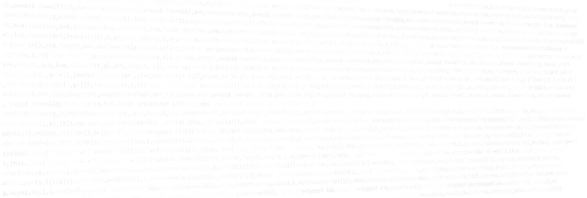
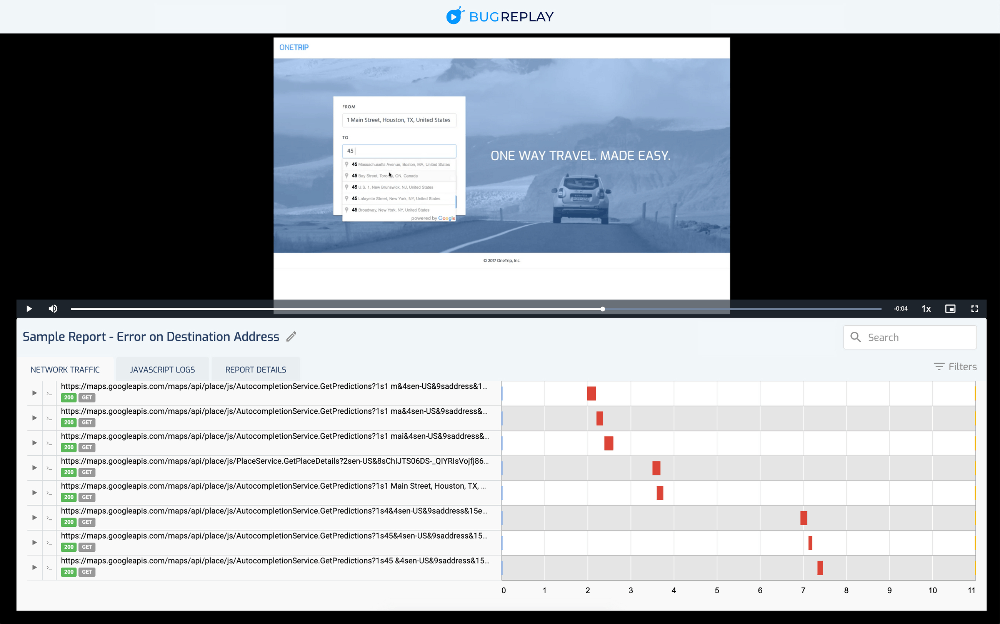
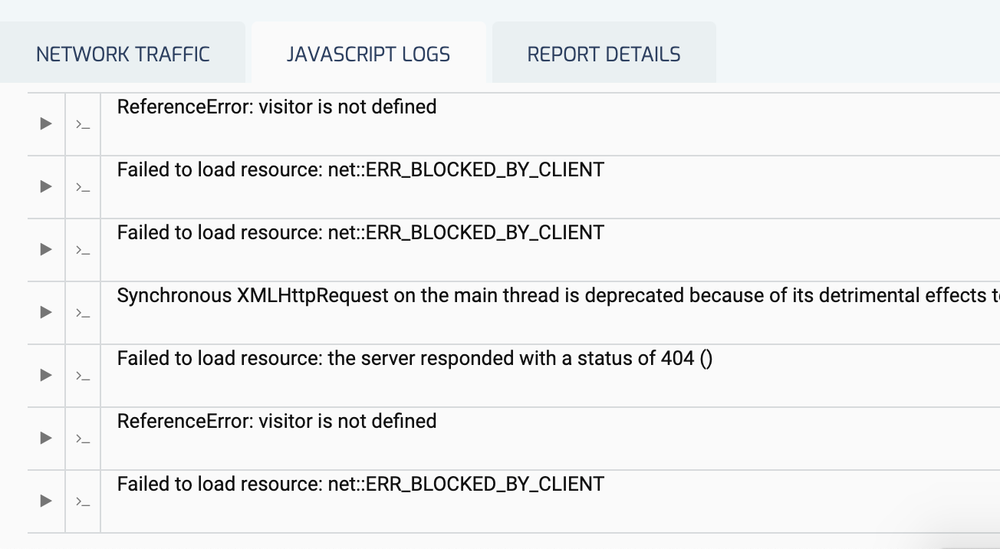
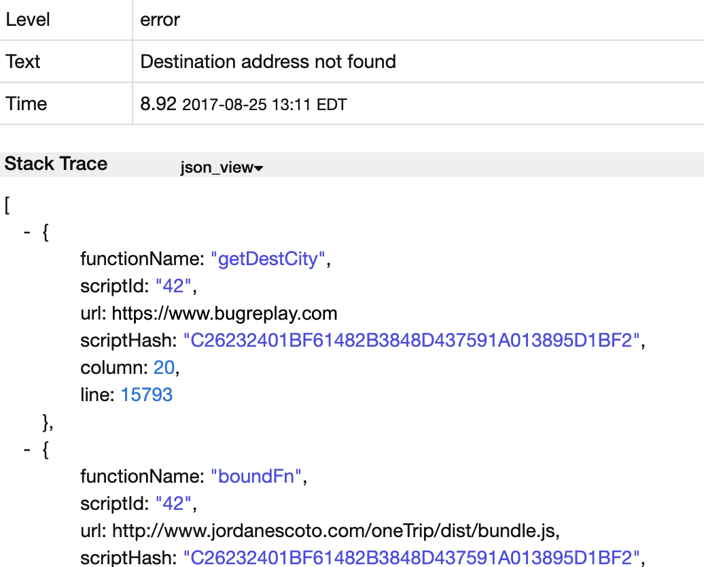
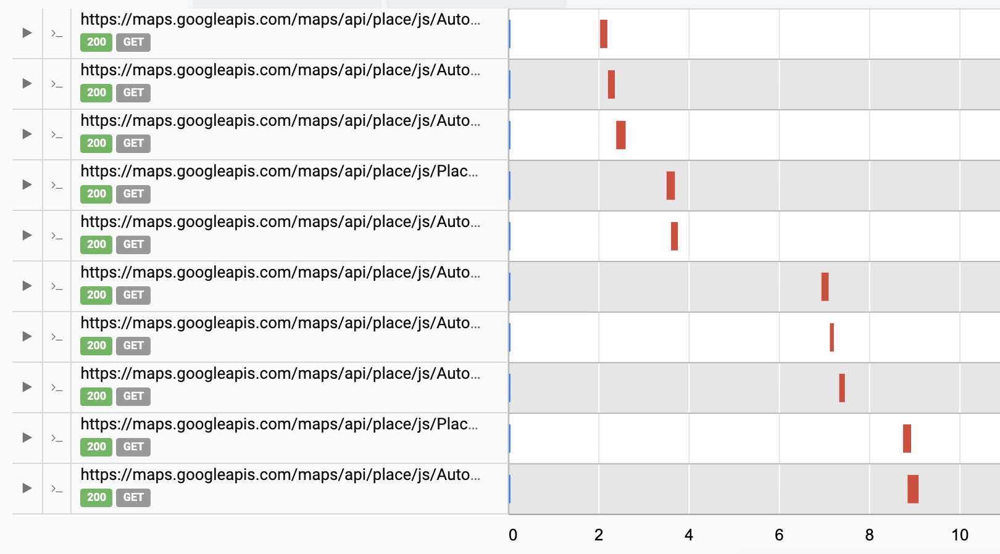
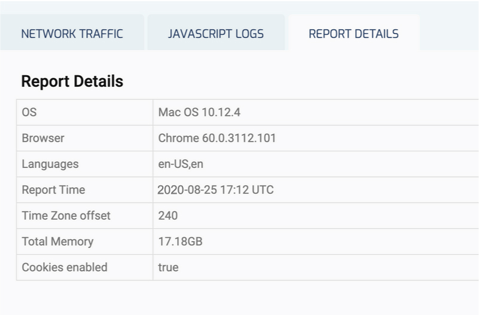
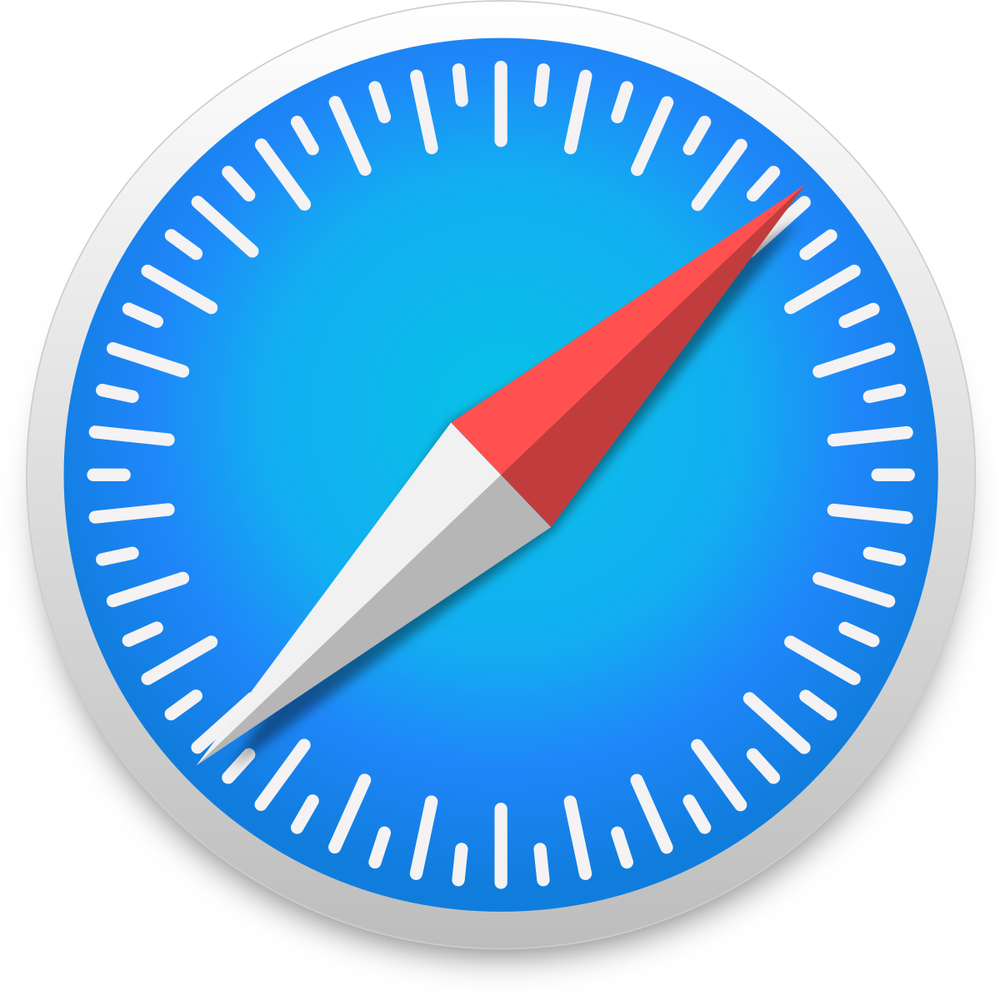
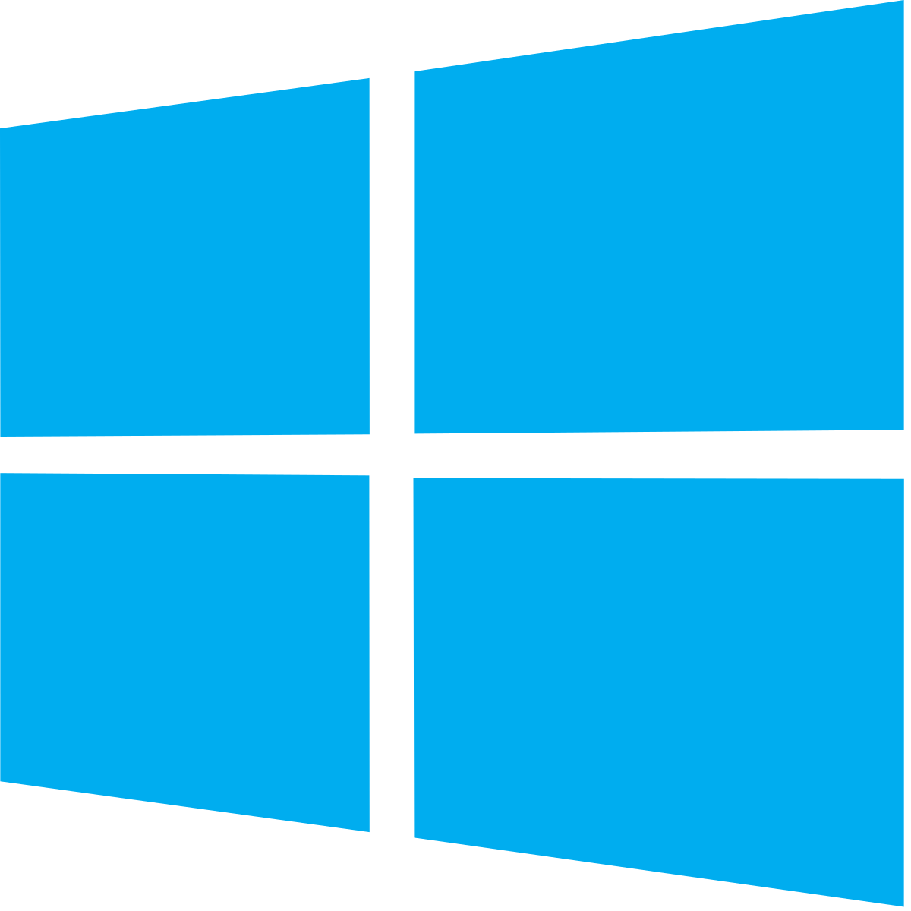
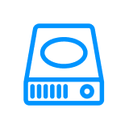
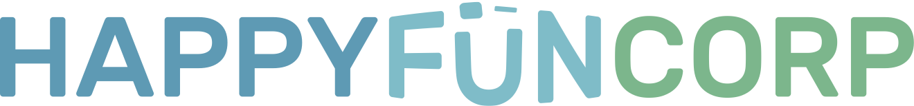

[Products](/products)[Updates](/updates)[Blog](https://blog.bugreplay.com/)[Login](https://app.bugreplay.com/#/login)
[
sign up](https://app.bugreplay.com/#/register)

# A time machine for bugs

Screencast synced with developer console logs & network traffic.
All the data you need to create awesome bug reports.

[

FREE 30-DAY TRIAL](https://app.bugreplay.com/#/register)

# BugReplay gives you all the data you need to diagnose and fix issues

# Developer Console Logs

Wish you could see the full JS console along with the video? The screencast is automatically synchronized with JavaScript exceptions and console debugging logs, including stack traces for errors. You can see exactly what's happening at a precise moment in the video.

# Network Traffic

Stop guessing whether a network call fired. All network requests & responses are synced with the video, so you can pinpoint exactly where the problem occurred. To measure your site's performance, the report includes resource timing information for every request.

# Environmental Data

Sites have different behavior depending on the user's environment. BugReplay reports include the user's device and web browser, and other environmental data such as whether cookies are enabled, so you can rule out those variables fast.

# Available on

.png)

# Features

# Record your screen

Show your developers exactly what happened, and *how* it happened

# Narrate your recording

Using your mic, walk your team through the screen recording

# Annotate with a comment

Add comments and flags at specific points throughout the video

# Screenshots

Take unlimited screenshots in addition to videos

.png)

# Record audio

Capture the sound from the website you're recording, in addition to the video

# Share a report

Keep your reports private or easily share them outside your team with a public URL

# Local storage

For additional security, ask about our Desktop product

# Organize your dashboard

With projects, tags, statuses, search filters, and more

.png)

# HAR file exports

Download the HAR file, or export to your analytics vendor via 3rd-party API

# 3-second countdown

Position your screen before the recording commences

# Notifications

Get notified about key project activity

# Feedback tool

Receive the same videos from your clients without asking them to create an account

[Learn More](/feedback)

# Integrates with all the tools you use

# Trusted by

# Testimonials

“Keep doing what you're doing - you guys have found a way to bridge the gap between support and engineering.”

John Tabone, Software Engineer at Tervela

“BugReplay has more or less replaced all the screen-recording products we used to use as part of our development process. It's easy to use and extremely useful for our engineers. Love it.”

Spela Cedilnik, Senior Product Specialist at ProFinda

“This fantastic! The first thing the devs had to do was reproduce the issue, now I just throw recordings at the dev guys! I don't have to worry about typing out all the little nuances to recreate issues.”

DJ Yarber, QA Engineer at ACV Auctions

“Replay helps us consistently and quickly log bugs and provides our development team with more information than before.”

Sloan Urry, Director of Product Development at AVASIS

© 2021 Bugreplay Inc. All rights reserved.

[Products](/products)[Updates](/updates)[Blog](https://blog.bugreplay.com/)[FAQ](/faq)[hello@bugreplay.com](mailto:contact@bugreplay.com?subject=Hello)
[Terms of Service](/tos)[Privacy Policy](/privacy)[Press](/press)

