- 
- 
- 

-
-

- [All Models](https://www.corvsport.com/corvette-list/)
- [C1](https://www.corvsport.com/c1-corvette-overview-birth-legend/)

- [C1 Corvette Overview](https://www.corvsport.com/c1-corvette-overview-birth-legend/)
- [C1 Corvette Buyers Guide](https://www.corvsport.com/the-c1-corvette-buyers-guide/)
- [C1 Models & Specs](https://www.corvsport.com/Corvette/C1/Corvette-C1.html)

- [1953 C1 Corvette](https://www.corvsport.com/1953-c1-corvette/)
- [1954 C1 Corvette](https://www.corvsport.com/1954-c1-corvette/)
- [1955 C1 Corvette](https://www.corvsport.com/1955-c1-corvette/)
- [1956 C1 Corvette](https://www.corvsport.com/1956-c1-corvette/)
- [1957 C1 Corvette](https://www.corvsport.com/1957-c1-corvette/)
- [1958 C1 Corvette](https://www.corvsport.com/1958-c1-corvette/)
- [1959 C1 Corvette](https://www.corvsport.com/1959-c1-corvette/)
- [1960 C1 Corvette](https://www.corvsport.com/1960-c1-corvette/)
- [1961 C1 Corvette](https://www.corvsport.com/1961-c1-corvette/)
- [1962 C1 Corvette](https://www.corvsport.com/1962-c1-corvette/)
- [C1 VIN Decoder](https://www.corvsport.com/c1-corvette-vin-decoder/)
- [C1 Order Guides](https://www.corvsport.com/tag/c1-order-guides/)
- [C1 RPO Codes](https://www.corvsport.com/tag/c1-rpo-codes/)
- [C1 Production Stats](https://www.corvsport.com/tag/c1-production-numbers/)
- [C1 Build Dates](https://www.corvsport.com/c1-corvette-build-dates/)
- [C1 Gallery & Photos](https://www.corvsport.com/category/corvette-galleries/c1-corvette-gallery/)
- [C1 Corvette Blog](https://www.corvsport.com/category/corvette-generation/c1-corvette/)
- [C2](https://www.corvsport.com/c2-corvette-overview-sting-ray/)

- [C2 Corvette Overview](https://www.corvsport.com/c2-corvette-overview-sting-ray/)
- [C2 Corvette Buyers Guide](https://www.corvsport.com/the-c2-corvette-buyers-guide/)
- [C2 Models & Specs](https://www.corvsport.com/Corvette/C2/Corvette-C2.html)

- [1963 Corvette](https://www.corvsport.com/1963-corvette-research/)
- [1964 Corvette](https://www.corvsport.com/1964-corvette-research/)
- [1965 Corvette](https://www.corvsport.com/1965-corvette-research/)
- [1964 C2 Corvette](https://www.corvsport.com/1964-c2-corvette/)
- [1965 C2 Corvette](https://www.corvsport.com/1965-c2-corvette/)
- [1966 C2 Corvette](https://www.corvsport.com/1966-c2-corvette/)
- [1967 C2 Corvette](https://www.corvsport.com/1967-c2-corvette/)
- [C2 VIN Decoder](https://www.corvsport.com/c2-corvette-vin-decoder/)
- [C2 Order Guides](https://www.corvsport.com/tag/c2-order-guides/)
- [C2 RPO Codes](https://www.corvsport.com/tag/c2-rpo-codes/)
- [C2 Production Stats](https://www.corvsport.com/tag/c2-production-numbers/)
- [C2 Build Dates](https://www.corvsport.com/c2-corvette-build-dates/)
- [C2 Gallery & Photos](https://www.corvsport.com/category/corvette-galleries/c2-corvette-gallery/)
- [C2 Corvette Blog](https://www.corvsport.com/category/corvette-generation/c2-corvette/)
- [C3](https://www.corvsport.com/c3-corvette-overview-shark-generation/)

- [C3 Corvette Overview](https://www.corvsport.com/c3-corvette-overview-shark-generation/)
- [C3 Corvette Buyers Guide](https://www.corvsport.com/c3-corvette-buyers-guide/)
- [C3 Models & Specs](https://www.corvsport.com/Corvette/C3/Corvette-C3.html)

- [1968 C3 Corvette](https://www.corvsport.com/1968-c3-corvette/)
- [1969 C3 Corvette](https://www.corvsport.com/1969-c3-corvette/)
- [1970 C3 Corvette](https://www.corvsport.com/1970-c3-corvette/)
- [1971 C3 Corvette](https://www.corvsport.com/1971-c3-corvette/)
- [1972 C3 Corvette](https://www.corvsport.com/1972-c3-corvette/)
- [1973 C3 Corvette](https://www.corvsport.com/1973-c3-corvette/)
- [1974 C3 Corvette](https://www.corvsport.com/1974-c3-corvette/)
- [1975 C3 Corvette](https://www.corvsport.com/1975-c3-corvette/)
- [1976 C3 Corvette](https://www.corvsport.com/1976-c3-corvette/)
- [1977 C3 Corvette](https://www.corvsport.com/1977-c3-corvette/)
- [1978 C3 Corvette](https://www.corvsport.com/1978-c3-corvette/)
- [1979 C3 Corvette](https://www.corvsport.com/1979-c3-corvette/)
- [1980 C3 Corvette](https://www.corvsport.com/the-c3-corvette/)
- [1981 C3 Corvette](https://www.corvsport.com/1981-c3-corvette/)
- [1982 C3 Corvette](https://www.corvsport.com/1982-c3-corvette/)
- [C3 VIN Decoder](https://www.corvsport.com/c3-corvette-vin-numbers/)
- [C3 Order Guides](https://www.corvsport.com/tag/c3-order-guides/)
- [C3 RPO Codes](https://www.corvsport.com/tag/c3-rpo-codes/)
- [C3 Production Stats](https://www.corvsport.com/tag/c3-production-numbers/)
- [C3 Build Dates](https://www.corvsport.com/c3-corvette-build-dates-production-figures/)
- [C3 Gallery & Photos](https://www.corvsport.com/category/corvette-galleries/c3-corvette-gallery/)
- [C3 Corvette Blog](https://www.corvsport.com/category/corvette-generation/c3-corvette/)
- [C4](https://www.corvsport.com/c4-corvette-overview-arrival-future-king/)

- [C4 Corvette Overview](https://www.corvsport.com/c4-corvette-overview-arrival-future-king/)
- [C4 Corvette Buyers Guide](https://www.corvsport.com/c4-corvette-buyers-guide/)
- [C4 Models & Specs](https://www.corvsport.com/Corvette/C4/1984/C4_1984_Overview.html)

- [1984 C4 Corvette](https://www.corvsport.com/1984-c4-corvette/)
- [1985 C4 Corvette](https://www.corvsport.com/1985-c4-corvette/)
- [1986 C4 Corvette](https://www.corvsport.com/1986-c4-corvette/)
- [1987 C4 Corvette](https://www.corvsport.com/1987-c4-corvette/)
- [1988 C4 Corvette](https://www.corvsport.com/1988-c4-corvette/)
- [1989 C4 Corvette](https://www.corvsport.com/1989-c4-corvette/)
- [1990 C4 Corvette](https://www.corvsport.com/1990-c4-corvette/)
- [1991 C4 Corvette](https://www.corvsport.com/1991-c4-corvette/)
- [1992 C4 Corvette](https://www.corvsport.com/1992-c4-corvette/)
- [1993 C4 Corvette](https://www.corvsport.com/1993-c4-corvette/)
- [1994 C4 Corvette](https://www.corvsport.com/1994-c4-corvette/)
- [1995 C4 Corvette](https://www.corvsport.com/1995-c4-corvette/)
- [1996 C4 Corvette](https://www.corvsport.com/1996-c4-corvette/)
- [C4 VIN Decoder](https://www.corvsport.com/c4-corvette-vin-numbers/)
- [C4 RPO Codes](https://www.corvsport.com/tag/c4-rpo-codes/)
- [C4 Order Guides](https://www.corvsport.com/tag/c4-order-guides/)
- [C4 Production Stats](https://www.corvsport.com/tag/c4-production-numbers/)
- [C4 Gallery & Photos](https://www.corvsport.com/category/corvette-galleries/c4-corvette-gallery/)
- [C4 Build Dates](https://www.corvsport.com/c4-corvette-build-dates/)
- [C4 Corvette Blog](https://www.corvsport.com/category/corvette-generation/c4-corvette/)
- [C5](https://www.corvsport.com/c5-corvette-new-vision-greatness/)

- [C5 Corvette Overview](https://www.corvsport.com/c5-corvette-new-vision-greatness/)
- [C5 Corvette Buyers Guide](https://www.corvsport.com/c5-corvette-buyers-guide/)
- [C5 Models & Specs](https://www.corvsport.com/Corvette/C5/Corvette-C5.html)

- [1997 C5 Corvette](https://www.corvsport.com/1997-c5-corvette/)
- [1998 C5 Corvette](https://www.corvsport.com/1998-c5-corvette/)
- [1999 C5 Corvette](https://www.corvsport.com/1999-c5-corvette/)
- [2000 C5 Corvette](https://www.corvsport.com/2000-c5-corvette/)
- [2001 C5 Corvette](https://www.corvsport.com/2001-c5-corvette/)
- [2002 C5 Corvette](https://www.corvsport.com/2002-c5-corvette/)
- [2003 C5 Corvette](https://www.corvsport.com/2003-c5-corvette/)
- [2004 C5 Corvette](https://www.corvsport.com/2004-c5-corvette/)
- [C5 RPO Codes](https://www.corvsport.com/tag/c5-rpo-codes/)
- [C5 Order Guides](https://www.corvsport.com/tag/c5-order-guides/)
- [C5 Production Stats](https://www.corvsport.com/tag/c5-production-numbers/)
- [C5 Build Dates](https://www.corvsport.com/c5-corvette-build-dates/)
- [C5 Gallery & Photos](https://www.corvsport.com/category/corvette-galleries/c5-corvette-gallery/)
- [C5 Corvette Blog](https://www.corvsport.com/category/corvette-generation/c5-corvette/)
- [C6](https://www.corvsport.com/c6-corvette-evolution-superstar/)

- [C6 Corvette Overview](https://www.corvsport.com/c6-corvette-evolution-superstar/)
- [C6 Corvette Buyers Guide](https://www.corvsport.com/the-c6-buyers-guide/)
- [C6 Models & Specs](https://www.corvsport.com/Corvette/C6/Corvette-C6.html)

- [2005 C6 Corvette](https://www.corvsport.com/2005-c6-corvette/)
- [2006 C6 Corvette](https://www.corvsport.com/2006-c6-corvette/)
- [2007 C6 Corvette](https://www.corvsport.com/2007-c6-corvette/)
- [2008 C6 Corvette](https://www.corvsport.com/2008-c6-corvette/)
- [2009 C6 Corvette](https://www.corvsport.com/2009-c6-corvette/)
- [2010 C6 Corvette](https://www.corvsport.com/2010-c6-corvette/)
- [2011 C6 Corvette](https://www.corvsport.com/2011-c6-corvette/)
- [2012 C6 Corvette](https://www.corvsport.com/2012-c6-corvette/)
- [2013 C7 Corvette](https://www.corvsport.com/2013-c6-corvette/)
- [C6 RPO Codes](https://www.corvsport.com/tag/c6-rpo-codes/)
- [C6 Order Guides](https://www.corvsport.com/tag/c6-order-guides/)
- [C6 Production Stats](https://www.corvsport.com/tag/c6-production-numbers/)
- [C6 Build Dates](https://www.corvsport.com/c6-corvette-build-dates/)
- [C6 Gallery & Photos](https://www.corvsport.com/category/corvette-galleries/c6-corvette-gallery/)
- [C6 Corvette Blog](https://www.corvsport.com/category/corvette-generation/c6-corvette/)
- [C7](https://www.corvsport.com/c7-corvette-performance-driven-function/)

- [C7 Corvette Overview](https://www.corvsport.com/c7-corvette-performance-driven-function/)
- [C7 Model & Specs](https://www.corvsport.com/Corvette/C7/Corvette-C7.html)

- [2014 C7 Corvette](https://www.corvsport.com/2014-c7-corvette/)
- [2015 C7 Corvette](https://www.corvsport.com/2015-c7-corvette/)
- [2016 C7 Corvette](https://www.corvsport.com/2016-c7-corvette/)
- [2017 C7 Corvette](https://www.corvsport.com/2017-c7-corvette/)
- [2018 C7 Corvette](https://www.corvsport.com/2018-c7-corvette/)
- [2019 C7 Corvette](https://www.corvsport.com/2019-c7-corvette/)
- [C7 RPO Codes](https://www.corvsport.com/tag/c7-rpo-codes/)
- [C7 Order Guides](https://www.corvsport.com/tag/c7-order-guides/)
- [C7 Production Stats](https://www.corvsport.com/tag/c7-production-numbers/)
- [C7 Build Dates](https://www.corvsport.com/c7-corvette-build-dates/)
- [C7 Gallery & Photos](https://www.corvsport.com/category/corvette-galleries/c7-corvette-gallery/)
- [C7 Corvette Blog](https://www.corvsport.com/category/corvette-generation/c7-corvette/)
- [C8](https://www.corvsport.com/category/corvette-generation/c8-corvette/)

- [C8 Corvette Overview](https://www.corvsport.com/2020-c8-corvette-specs-information/)
- [C8 Models & Specs](https://www.corvsport.com/2020-c8-corvette-specs-information/)

- [2020 C8 Corvette](https://www.corvsport.com/2020-c8-corvette/)
- [C8 Corvette Overview](https://www.corvsport.com/2020-c8-corvette-specs-information/)
- [C8 RPO Codes](https://www.corvsport.com/tag/c8-rpo-codes/)
- [C8 Order Guides](https://www.corvsport.com/tag/c8-order-guides/)
- [C8 Production Stats](https://www.corvsport.com/tag/c8-production-numbers/)
- [C8 Gallery & Photos](https://www.corvsport.com/category/corvette-galleries/c8-corvette-gallery/)
- [C8 Corvette Blog](https://www.corvsport.com/category/corvette-generation/c8-corvette/)
- [Misc](https://www.corvsport.com/category/misc/)

- [Models Research](#)

- [Corvette Generations](https://www.corvsport.com/corvette-generations/)
- [Full Model List](https://www.corvsport.com/corvette-full-model-list/)
- [Sales Brochures](https://www.corvsport.com/free-corvette-sales-brochures-3/)
- [Buyer’s Guides](https://www.corvsport.com/corvette-buyers-guides/)
- [Special Editions](https://www.corvsport.com/special-edition-corvette-guide/)
- [Best Vette Lists](https://www.corvsport.com/category/special-corvette/best-vette/)
- [Other Research](#)

- [Corvette Aftermarket Modifications](https://www.corvsport.com/corvette-mods/)
- [Corvette Engines](https://www.corvsport.com/category/engines/)
- [Production & Sales](https://www.corvsport.com/corvette-production-numbers/)
- [Dealer Playbooks](https://www.corvsport.com/free-corvette-dealer-playbooks/)
- [RPO Codes & Guides](https://www.corvsport.com/corvette-rpo-codes-all-years/)
- [Owners Manuals](https://www.corvsport.com/free-corvette-owners-manuals/)
- [VIN Decoder](https://www.corvsport.com/corvette-vin-decoder-all-years/)
- [Specifications](https://www.corvsport.com/corvette-specs/)
- [Glossary](https://www.corvsport.com/category/misc/glossary/)
- [Culture](#)

- [Showcase Your ‘Vette on CorvSport!](https://www.corvsport.com/showcase-my-corvette/)
- [Reader Car Showcase](https://www.corvsport.com/category/misc/reader-car-showcase/)
- [Corvette Culture](https://www.corvsport.com/category/misc/corvette-culture/)
- [Special Edition Corvettes](https://www.corvsport.com/special-edition-corvette-guide/)
- [Corvette Photos & Pics](https://www.corvsport.com/corvette-photos-galleries/)
- [Corvette Wallpapers](https://www.corvsport.com/corvette-wallpapers-hub/)
- [Mods & Aftermarket](https://www.corvsport.com/corvette-mods/)
- [Corvette Racing](https://www.corvsport.com/corvette-racing/)
- [Cool Vette Stuff (Shop)](https://www.corvsport.com/category/shop/)
- [Corvettes Videos](https://www.corvsport.com/cool-corvettes-videos/)
- [For Sale](#)

- [Sell Your Corvette on CorvSport!](https://www.corvsport.com/sell-my-corvette/)
- [Corvettes For Sale](https://www.corvsport.com/cool-corvettes-for-sale/)
- [News](https://www.corvsport.com/corvette-news/)

- [Submit News](https://www.corvsport.com/submit-news/)
- [Vette Shirts](https://100mph.cc/collections/corvette/?utm_campaign=a07menu&utm_source=corvsport&utm_medium=menu_link_header)

-

# Corvette Data, News, Racing, Lifestyle, & More

### The Richest Source of Corvette Data, Specs, & Model History Online

**Whether You Want To Do Research On a Specific Corvette Model Or Just Keep Up to Date on All Things Corvette, This Is The Place for You.** If you're a fan of unbridled, all-American horsepower or dreamed of owning one of the most revered sports cars in the world - the revolutionary Chevrolet Corvette - you are in the right place!

Latest Vette News & Posts

### [CORVETTE RACING WINS IN DETROIT!](https://www.corvsport.com/corvette-racing-wins-in-detroit/)

CORVETTE RACING WINS IN DETROIT: Milner, Tandy Win Battle of Corvette C8.Rs at Belle Isle The No. 4 Mobil 1/SiriusXM...
[Read More](https://www.corvsport.com/corvette-racing-wins-in-detroit/)

### [Barrett-Jackson Las Vegas 2021: A Corvette Lover’s Dream Auction](https://www.corvsport.com/barrett-jackson-las-vegas-2021-a-corvette-lovers-dream-auction/)

One of the most anticipated Corvette auctions is coming to the world-renowned Barrett-Jackson Las Vegas auction June 17-19 2021, held in the West Hall of the Las Vegas Convention Center (LVCC).
[Read More](https://www.corvsport.com/barrett-jackson-las-vegas-2021-a-corvette-lovers-dream-auction/)

### [Rare 1960 Le Mans Corvette Goes to Auction!](https://www.corvsport.com/rare-1960-le-mans-corvette-goes-to-auction/)

One of the Original 1960 Le Mans Corvette Racers Goes to Auction at RM Sotheby’s Long before the Corvette became...
[Read More](https://www.corvsport.com/rare-1960-le-mans-corvette-goes-to-auction/)

### [1989 Corvette Performance & Specifications](https://www.corvsport.com/1989-corvette-specifications/)

See the complete technical specifications and performance information for the 1989 Chevrolet Corvette, including engine specs, acceleration, & quarter mile.
[Read More](https://www.corvsport.com/1989-corvette-specifications/)

[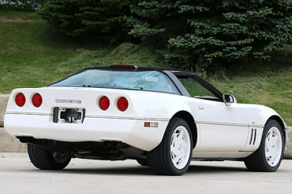](https://www.corvsport.com/1988-corvette-vin/)

### [1988 Chevrolet Corvette VIN Numbers](https://www.corvsport.com/1988-corvette-vin/)

For all 1988 Corvettes, the Vehicle Identification Number was stamped on a plate on the inner vertical surface of the left windshield pillar visible through the windshield.
[Read More](https://www.corvsport.com/1988-corvette-vin/)

[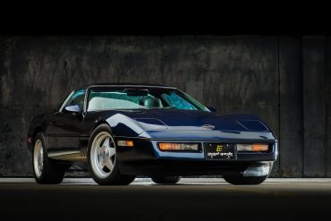](https://www.corvsport.com/1988-corvette-manual/)

### [1988 Corvette Sales Brochures, Posters, & Advertisements](https://www.corvsport.com/1988-corvette-manual/)

See the original 1988 Corvette sales brochure here.
[Read More](https://www.corvsport.com/1988-corvette-manual/)

[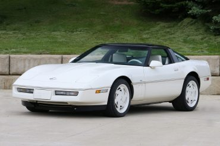](https://www.corvsport.com/1988-corvette-options/)

### [1988 Corvette Pricing, Factory Options, & Colors](https://www.corvsport.com/1988-corvette-options/)

The 1988 Corvette was maturing as both a performance platform and as an aesthetic knockout. Get all the options, pricing, and color data here.
[Read More](https://www.corvsport.com/1988-corvette-options/)

[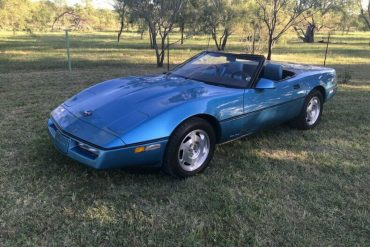](https://www.corvsport.com/1988-corvette-common-issues/)

### [1988 Corvette Common Issues](https://www.corvsport.com/1988-corvette-common-issues/)

The following list of common issues is intended for individual reference only, and may not reflect the specific issues of every 1988 Corvette.
[Read More](https://www.corvsport.com/1988-corvette-common-issues/)

[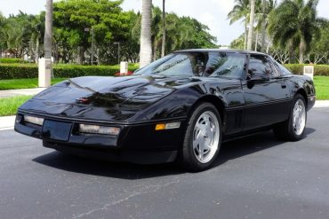](https://www.corvsport.com/1988-corvette-maintenance/)

### [1988 Corvette Recalls, Technical Service Bulletins, & Maintenance Schedule](https://www.corvsport.com/1988-corvette-maintenance/)

Looking for information on how to maintain your 1988 Corvette? We've curated resources to help you keep your Corvette in great shape for years to come!
[Read More](https://www.corvsport.com/1988-corvette-maintenance/)

[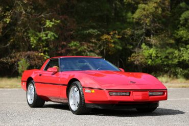](https://www.corvsport.com/1988-corvette-specifications/)

### [1988 Corvette Performance & Specifications](https://www.corvsport.com/1988-corvette-specifications/)

See the complete technical specifications and performance information for the 1988 Chevrolet Corvette, including engine specs, acceleration, & quarter mile.
[Read More](https://www.corvsport.com/1988-corvette-specifications/)

[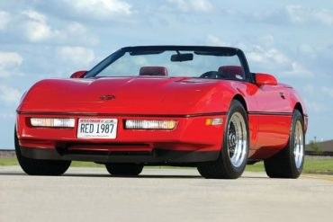](https://www.corvsport.com/1987-corvette-vin/)

### [1987 Chevrolet Corvette VIN Numbers](https://www.corvsport.com/1987-corvette-vin/)

For all 1987 Corvettes, the Vehicle Identification Number was stamped on a plate on the inner vertical surface of the left windshield pillar visible through the windshield.
[Read More](https://www.corvsport.com/1987-corvette-vin/)

[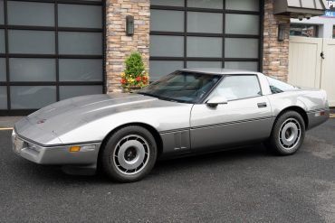](https://www.corvsport.com/1987-corvette-manual/)

### [1987 Corvette Sales Brochures, Posters, & Advertisements](https://www.corvsport.com/1987-corvette-manual/)

See the original 1987 Corvette sales brochure here.
[Read More](https://www.corvsport.com/1987-corvette-manual/)

[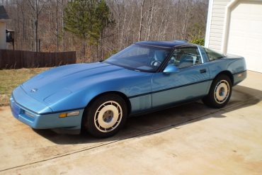](https://www.corvsport.com/1987-corvette-options/)

### [1987 Corvette Pricing, Factory Options, & Colors](https://www.corvsport.com/1987-corvette-options/)

We've scoured the web to curate the factory pricing, options, and interior/exterior color options for the 1987 Chevrolet Corvette.
[Read More](https://www.corvsport.com/1987-corvette-options/)

[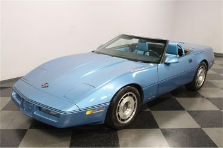](https://www.corvsport.com/1987-corvette-common-issues/)

### [1987 Corvette Common Issues](https://www.corvsport.com/1987-corvette-common-issues/)

The following list of common issues is intended for individual reference only, and may not reflect the specific issues of every 1987 Corvette.
[Read More](https://www.corvsport.com/1987-corvette-common-issues/)

[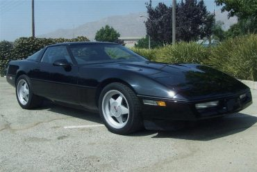](https://www.corvsport.com/1987-corvette-maintenance/)

### [1987 Corvette Recalls, Technical Service Bulletins, & Maintenance Schedule](https://www.corvsport.com/1987-corvette-maintenance/)

Looking for information on how to maintain your 1987 Corvette? We've curated resources to help you keep your Corvette in great shape for years to come!
[Read More](https://www.corvsport.com/1987-corvette-maintenance/)
[Load more](#)

### Subscribe to Best Corvette Newsletter on the Planet

  Subscribe**

- 
- 
- 

### Trending

  

### [CORVETTE RACING WINS IN DETROIT!](https://www.corvsport.com/corvette-racing-wins-in-detroit/)

### [Barrett-Jackson Las Vegas 2021: A Corvette Lover’s Dream Auction](https://www.corvsport.com/barrett-jackson-las-vegas-2021-a-corvette-lovers-dream-auction/)

### [Rare 1960 Le Mans Corvette Goes to Auction!](https://www.corvsport.com/rare-1960-le-mans-corvette-goes-to-auction/)

The Best Corvette News Around

We deliver all the news, rumors, deals and events directly to you once a week. We promise not to spam you with boring crap. All cool Corvette stuff, all the time.

  Subscribe**

Model Research

### [C8 Corvette Production Halted at Bowling Green Plant](https://www.corvsport.com/c8-corvette-production-halted-at-bowling-green-plant/)

2021 C8 Corvette Production Halted Due To Parts Supply Issue It was announced this week that General Motors was shutting...
[Read More](https://www.corvsport.com/c8-corvette-production-halted-at-bowling-green-plant/)

[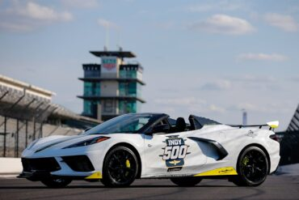](https://www.corvsport.com/2021-mid-engine-corvette-to-pace-indy-500/)

### [2021 Mid-Engine Corvette to Pace Indy 500](https://www.corvsport.com/2021-mid-engine-corvette-to-pace-indy-500/)

THE 2021 MID-ENGINE CORVETTE STINGRAY CONVERTIBLE WILL LEAD THE FIELD OF THE 105TH INDIANAPOLIS 500, PRESENTED BY GAINBRIDGE The Corvette...
[Read More](https://www.corvsport.com/2021-mid-engine-corvette-to-pace-indy-500/)

[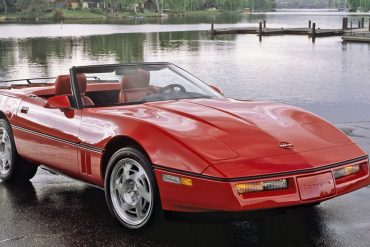](https://www.corvsport.com/1987-corvette-specifications/)

### [1987 Corvette Performance & Specifications](https://www.corvsport.com/1987-corvette-specifications/)

See the complete technical specifications and performance information for the 1987 Chevrolet Corvette, including engine specs, acceleration, & quarter mile.
[Read More](https://www.corvsport.com/1987-corvette-specifications/)

[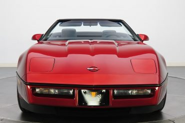](https://www.corvsport.com/1986-corvette-vin/)

### [1986 Chevrolet Corvette VIN Numbers](https://www.corvsport.com/1986-corvette-vin/)

For all 1986 Corvettes, the Vehicle Identification Number was stamped on a plate on the inner vertical surface of the left windshield pillar visible through the windshield.
[Read More](https://www.corvsport.com/1986-corvette-vin/)

[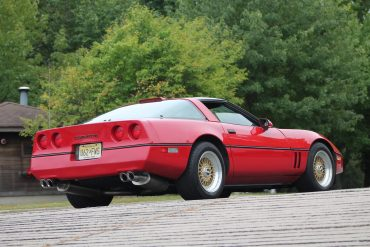](https://www.corvsport.com/1986-corvette-manual/)

### [1986 Corvette Sales Brochures, Posters, & Advertisements](https://www.corvsport.com/1986-corvette-manual/)

See the original 1986 Corvette sales brochure here.
[Read More](https://www.corvsport.com/1986-corvette-manual/)

[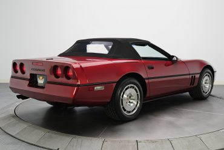](https://www.corvsport.com/1986-corvette-options/)

### [1986 Corvette Pricing, Factory Options, & Colors](https://www.corvsport.com/1986-corvette-options/)

We've scoured the web to curate the factory pricing, options, and interior/exterior color options for the 1986 Chevrolet Corvette.
[Read More](https://www.corvsport.com/1986-corvette-options/)

[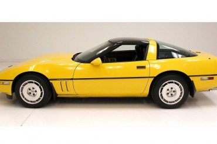](https://www.corvsport.com/1986-corvette-common-issues/)

### [1986 Corvette Common Issues](https://www.corvsport.com/1986-corvette-common-issues/)

The following list of common issues is intended for individual reference only, and may not reflect the specific issues of every 1986 Corvette.
[Read More](https://www.corvsport.com/1986-corvette-common-issues/)

[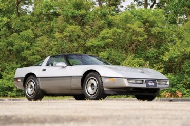](https://www.corvsport.com/1986-corvette-maintenance/)

### [1986 Corvette Recalls, Technical Service Bulletins, & Maintenance Schedule](https://www.corvsport.com/1986-corvette-maintenance/)

Looking for information on how to maintain your 1986 Corvette? We've curated resources to help you keep your Corvette in great shape for years to come!
[Read More](https://www.corvsport.com/1986-corvette-maintenance/)

[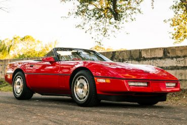](https://www.corvsport.com/1986-corvette-specifications/)

### [1986 Corvette Performance & Specifications](https://www.corvsport.com/1986-corvette-specifications/)

See the complete technical specifications and performance information for the 1986 Chevrolet Corvette, including engine specs, acceleration, & quarter mile.
[Read More](https://www.corvsport.com/1986-corvette-specifications/)

[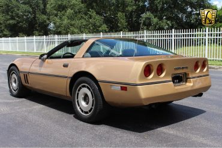](https://www.corvsport.com/1985-corvette-vin/)

### [1985 Chevrolet Corvette VIN Numbers](https://www.corvsport.com/1985-corvette-vin/)

For all 1985 Corvettes, the Vehicle Identification Number was stamped on a plate on the inner vertical surface of the left windshield pillar visible through the windshield.
[Read More](https://www.corvsport.com/1985-corvette-vin/)

### [1985 Corvette Sales Brochures, Posters, & Advertisements](https://www.corvsport.com/1985-corvette-manual/)

See the original 1985 Corvette sales brochure here.
[Read More](https://www.corvsport.com/1985-corvette-manual/)

[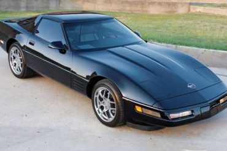](https://www.corvsport.com/1985-corvette-options/)

### [1985 Corvette Pricing, Factory Options, & Colors](https://www.corvsport.com/1985-corvette-options/)

We've scoured the web to curate the factory pricing, options, and interior/exterior color options for the 1985 Chevrolet Corvette.
[Read More](https://www.corvsport.com/1985-corvette-options/)

[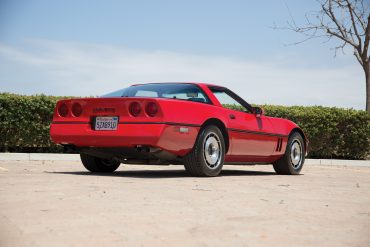](https://www.corvsport.com/1985-corvette-common-issues/)

### [1985 Corvette Common Issues](https://www.corvsport.com/1985-corvette-common-issues/)

The following list of common issues is intended for individual reference only, and may not reflect the specific issues of every 1985 Corvette.
[Read More](https://www.corvsport.com/1985-corvette-common-issues/)

[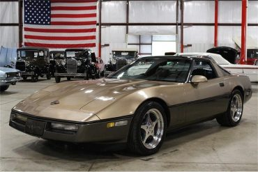](https://www.corvsport.com/1985-corvette-maintenance/)

### [1985 Corvette Recalls, Technical Service Bulletins, & Maintenance Schedule](https://www.corvsport.com/1985-corvette-maintenance/)

Looking for information on how to maintain your 1985 Corvette? We've curated resources to help you keep your Corvette in great shape for years to come!
[Read More](https://www.corvsport.com/1985-corvette-maintenance/)

[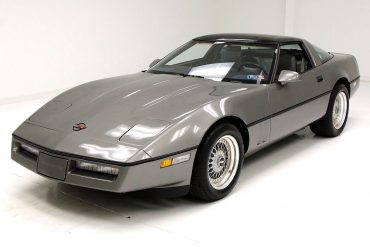](https://www.corvsport.com/1985-corvette-specifications/)

### [1985 Corvette Performance & Specifications](https://www.corvsport.com/1985-corvette-specifications/)

See the complete technical specifications and performance information for the 1985 Chevrolet Corvette, including engine specs, acceleration, & quarter mile.
[Read More](https://www.corvsport.com/1985-corvette-specifications/)
[Load more](#)

### Subscribe to Best Corvette Newsletter on the Planet

  Subscribe**

- 
- 
- 

### Trending

  

### [CORVETTE RACING WINS IN DETROIT!](https://www.corvsport.com/corvette-racing-wins-in-detroit/)

### [Barrett-Jackson Las Vegas 2021: A Corvette Lover’s Dream Auction](https://www.corvsport.com/barrett-jackson-las-vegas-2021-a-corvette-lovers-dream-auction/)

### [Rare 1960 Le Mans Corvette Goes to Auction!](https://www.corvsport.com/rare-1960-le-mans-corvette-goes-to-auction/)

Must Watch Corvette Videos

[See more](https://www.corvsport.com/category/corvette-galleries/corvette-videos/)

**

  Playing

### [If You Take Your Corvette C8 To The Track A Lot, Bring Extra Brake Pads!](https://www.corvsport.com/if-you-take-your-corvette-c8-to-the-track-a-lot-bring-extra-brake-pads/)

  Playing

### [If You Take Your Corvette C8 To The Track A Lot, Bring Extra Brake Pads!](https://www.corvsport.com/if-you-take-your-corvette-c8-to-the-track-a-lot-bring-extra-brake-pads/)

  Playing

### [Detroit Speed Produces A Track Weapon Corvette C3](https://www.corvsport.com/detroit-speed-produces-a-track-weapon-corvette-c3/)

  Playing

### [Honda NSX & Corvette C8 Drivers Switch Seats](https://www.corvsport.com/honda-nsx-corvette-c8-drivers-switch-seats/)

  Playing

### [Friendliest Texan Ever Picks Up His Cammed C7 Z06](https://www.corvsport.com/friendliest-texan-ever-picks-up-his-cammed-c7-z06/)

  Playing

### [Fabspeed Releases Sport Cats & Valvetronic Exhaust](https://www.corvsport.com/fabspeed-releases-sport-cats-valvetronic-exhaust/)

  Playing

### [New Corvette C8 HTC Owner Shows The Engine Bay](https://www.corvsport.com/new-corvette-c8-htc-owner-shows-the-engine-bay/)

  Playing

### [Everyday Driver Compares a Z06 To A Z06 & Another Z06](https://www.corvsport.com/everyday-driver-compares-a-z06-to-a-z06-another-z06/)

  Playing

### [There Is Already A Fully Electric Corvette Out There](https://www.corvsport.com/there-is-already-a-fully-electric-corvette-out-there/)

  Playing

### [How Does A Corvette C8 Stack Up Against German Rivals?](https://www.corvsport.com/how-does-a-corvette-c8-stack-up-against-german-rivals/)

  Playing

### [Corvettes at Carlisle 2020 Video Shows One Of The First Delivered HTC](https://www.corvsport.com/corvettes-at-carlisle-2020-video-shows-one-of-the-first-delivered-htc/)

C8 Corvettes

[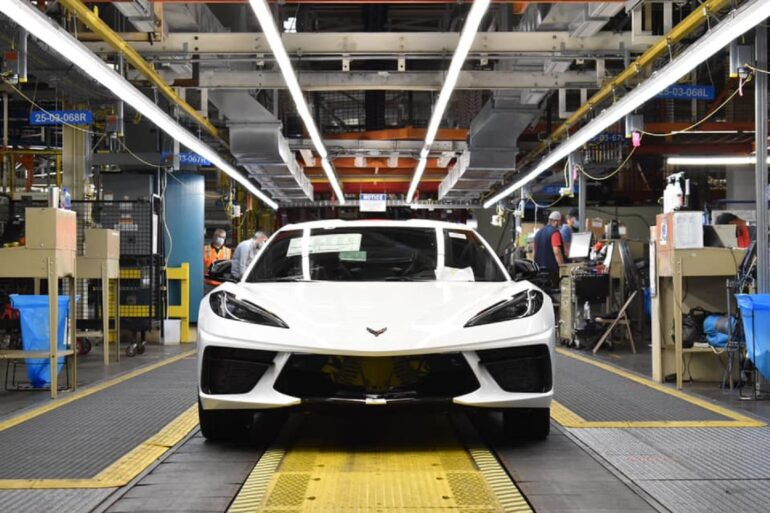](https://www.corvsport.com/c8-corvette-production-halted-at-bowling-green-plant/)

### [C8 Corvette Production Halted at Bowling Green Plant](https://www.corvsport.com/c8-corvette-production-halted-at-bowling-green-plant/)

### [2021 Mid-Engine Corvette to Pace Indy 500](https://www.corvsport.com/2021-mid-engine-corvette-to-pace-indy-500/)

### [The Future of the Z06 is Brighter than we Expected: What We Know so Far](https://www.corvsport.com/the-future-of-the-z06-is-brighter-than-we-expected/)

### [These Are the 4 Best Mods for Your C8 Corvette](https://www.corvsport.com/these-are-the-4-best-mods-for-your-c8-corvette/)

C7 Corvettes

[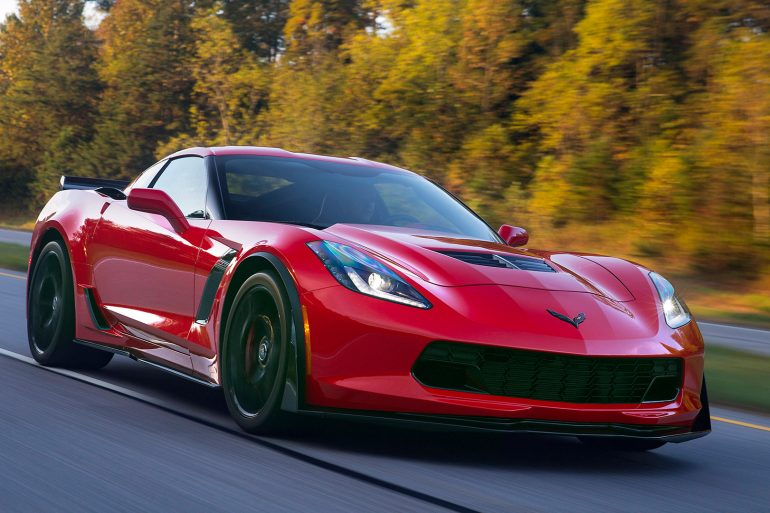](https://www.corvsport.com/the-c7-corvette-buyers-guide/)

### [The C7 Corvette Buyers Guide](https://www.corvsport.com/the-c7-corvette-buyers-guide/)

### [The Final 2020 Corvette Will be a Sebring Orange Convertible](https://www.corvsport.com/the-final-2020-corvette-will-be-a-sebring-orange-convertible/)

### [FOR SALE: 2019 Corvette ZR1](https://www.corvsport.com/for-sale-2019-corvette-zr1/)

### [Lawsuit Over Cracked Corvette Wheels Dismissed](https://www.corvsport.com/lawsuit-over-cracked-corvette-wheels-dismissed/)

C6 Corvettes

[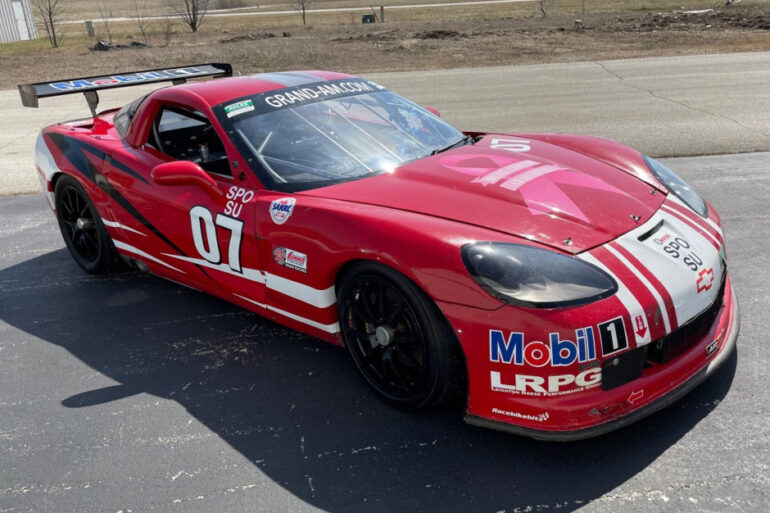](https://www.corvsport.com/for-sale-2008-corvette-grand-am-race-car/)

### [FOR SALE: 2008 Corvette Grand-Am Race Car](https://www.corvsport.com/for-sale-2008-corvette-grand-am-race-car/)

### [FOR SALE: Incredibly Low Mileage 2007 Corvette Z06!](https://www.corvsport.com/for-sale-incredibly-low-mileage-2007-corvette-z06/)

### [Watch a C6 Corvette Z06 Set a Naturally Aspirated Record at the Drag Strip](https://www.corvsport.com/watch-a-c6-corvette-z06-set-a-naturally-aspirated-record-at-the-drag-strip/)

### [FOR SALE: 2007 Chevrolet Corvette Coupe Budweiser Shootout Pace Car](https://www.corvsport.com/for-sale-2007-chevrolet-corvette-coupe-budweiser-shootout-pace-car/)

C5 Corvettes

[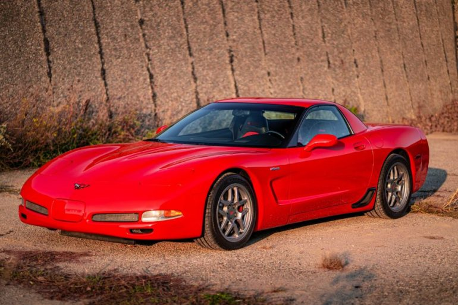](https://www.corvsport.com/for-sale-2002-corvette-z06/)

### [FOR SALE: 2002 Corvette Z06](https://www.corvsport.com/for-sale-2002-corvette-z06/)

### [The Best 2000s Corvettes](https://www.corvsport.com/best-2000s-corvettes/)

### [The Best Corvettes of the 1990s](https://www.corvsport.com/best-1990s-corvettes/)

### [Chevrolet LS6 Engine: Specifications, Configurations, & More](https://www.corvsport.com/chevrolet-ls6-engine/)

C4Corvettes

[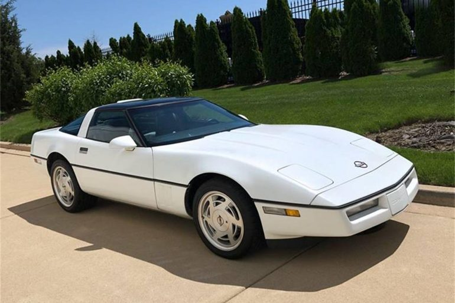](https://www.corvsport.com/1989-corvette-specifications/)

### [1989 Corvette Performance & Specifications](https://www.corvsport.com/1989-corvette-specifications/)

### [1988 Chevrolet Corvette VIN Numbers](https://www.corvsport.com/1988-corvette-vin/)

### [1988 Corvette Sales Brochures, Posters, & Advertisements](https://www.corvsport.com/1988-corvette-manual/)

### [1988 Corvette Pricing, Factory Options, & Colors](https://www.corvsport.com/1988-corvette-options/)

C3 Corvettes

[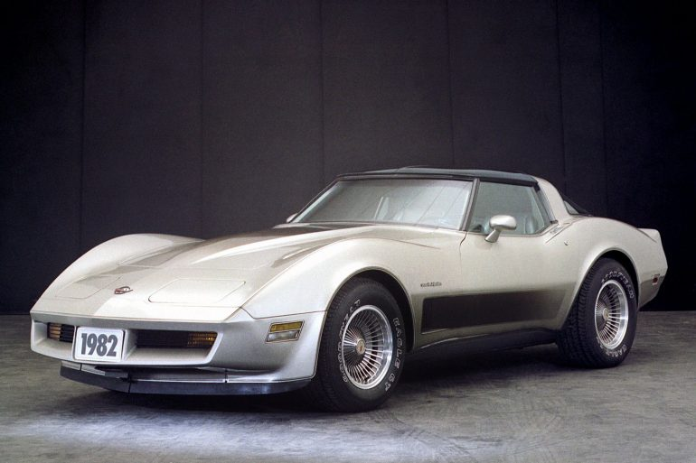](https://www.corvsport.com/1982-corvette-vin/)

### [1982 Chevrolet Corvette VIN Numbers](https://www.corvsport.com/1982-corvette-vin/)

### [1982 Corvette Sales Brochures, Posters, & Advertisements](https://www.corvsport.com/1982-corvette-manual/)

### [1982 Corvette Pricing, Factory Options, & Colors](https://www.corvsport.com/1982-corvette-options/)

### [1982 Corvette Recalls, Technical Service Bulletins, & Maintenance Schedule](https://www.corvsport.com/1982-corvette-maintenance/)

C2 Corvettes

[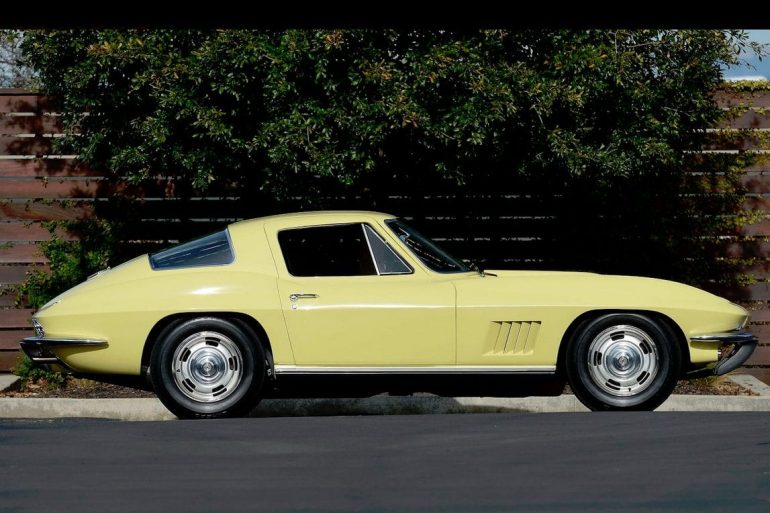](https://www.corvsport.com/1967-corvette-videos/)

### [1967 Chevrolet Corvette Video Gallery](https://www.corvsport.com/1967-corvette-videos/)

### [1967 Corvette Sales Brochures, Posters, & Advertisements](https://www.corvsport.com/1967-corvette-manual/)

### [1967 Chevrolet Corvette VIN Numbers](https://www.corvsport.com/1967-corvette-vin/)

### [1967 Corvette Pricing, Factory Options, & Colors](https://www.corvsport.com/1967-corvette-options/)

C1 Corvettes

### [1961 Numbers Matching Corvette C1 For Sale](https://www.corvsport.com/1961-numbers-matching-corvette-c1-for-sale/)

[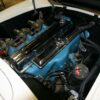](https://www.corvsport.com/1953-1955-stovebolt-6-cylinder-engine/)

### [1953-55 Stovebolt Inline 6 Cylinder Engine Guide: Specs, Features, & More](https://www.corvsport.com/1953-1955-stovebolt-6-cylinder-engine/)

### [1962 Chevrolet Corvette Video Gallery](https://www.corvsport.com/1962-corvette-videos/)

[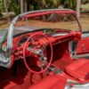](https://www.corvsport.com/1962-corvette-options/)

### [1962 Corvette Pricing, Factory Options, & Color](https://www.corvsport.com/1962-corvette-options/)

---

-
- 
- 
- 
-

- [About Us](https://www.corvsport.com/about-us/)
- [The Team](https://www.corvsport.com/meet-the-team/)
- [Advertise](https://www.corvsport.com/corvette-advertising/)
- [Contact Us](https://www.corvsport.com/contact-us/)
- [Terms of Use](https://www.corvsport.com/terms-of-use/)
- [Privacy Policy](https://www.corvsport.com/privacy-policy/)
- [Sell Your Vette](https://www.corvsport.com/sell-my-corvette/)
- [Submit News](https://www.corvsport.com/submit-news/)
[**](#)
        [**](#)
