#  Partnership for a Drug-Free New Jersey

##  In Cooperation with the Governor’s Council on Alcoholism and Drug Abuse and the NJ Dept. of Human Services

   Select a drug to learn about Alcohol Bath Salts Cocaine / Crack DXM Ecstasy Heroin K2 Spice Inhalants Methamphetamine (Meth) Prescription Pain Relievers Prescription Sedatives & Tranquilizers Prescription Stimulants Marijuana Molly Flakka Fentanyl Vaping   Learn

    Search

-  [ Home ](/)
-  [ About Us ](/about-us/)
-  [ TalkNowNJ.com ](/talknownj/)
-  [ School ](/school/)
-  [ Research ](/research/)
-  [ Parent Education ](/child-break/)
-  [ Drugs Don't Work ](/drugs-dont-work/)
-  [ Town Halls ](/knockoutopioidabuse/)

-
Just the Facts
-
In the ER
-
In the Home
-
In the Doctor's Office
-
In the Workplace
-
In the Schools
-
In the Community

 Americans who have lost their lives to the opioid epidemic

250654

# Happening at PDFNJ

-  [Webinar - May 20th - " The ALTO Program: Treating Pain without Opioids"](http://knockoutday.drugfreenj.org/register)
-  • [PDFNJ Honoring Nurses All Month with Free Continuing Education Credit Webinar](http://drugfreenj.org/news/pdfnj-honoring-national-nurses-week-all-month-free-continuing-education-credit-webinar/)
-  • [TodayNJ - A Calendar of Online Events FOR PREVENTION, TREATMENT, & Recovery Support](http://drugfreenj.org/community/)

 

#  Prescriber Education

 This webinar is designed to satisfy the New Jersey one hour continuing education requirement concerning prescription opioids. It is specifically tailored for healthcare professionals including, dentists, MDs, DOs, NPs, PAs, residents & fellows, and medical students.

 [Read More](https://knockoutopioidabuse.drugfreenj.org/njsaferx/)

 

#  Know the Risks of Marijuana

 Marijuana use among all adult age groups, both sexes, and pregnant women is going up. At the same time, the perception of how harmful marijuana use can be is declining.

 [Read More](https://www.samhsa.gov/marijuana)

 

#  Parent Education

 Vaping is an important public health issue... especially for NJ kids.

 [Read More](http://www.vapefactsnj.com)

 

#  In Memoriam: Kyran Killian, PDFNJ Parent Educator

 Kyran James Killian, 74, of Vineland, passed away on May 5, 2021 surrounded by loved ones who will continue to honor him by following his example of living life to the fullest.

 [Read More](http://drugfreenj.org/news/memoriam-kyran-killian-pdfnj-parent-educator/)

 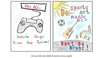

#  Middlesex and Cumberland County Students Win PDFNJ Statewide Fourth Grade Folder Contest

 Michael McCabe from James A. McDivitt School in Old Bridge, Middlesex County, and Nathan Tenev from St. Mary’s School in Vineland, Cumberland County, were selected as co-winners of the contest. Their designs will be featured on the 40,000 folders distributed to fourth grade classrooms throughout the state this fall.

 [Read More](http://drugfreenj.org/news/middlesex-cumberland-county-students-win-pdfnj-statewide-fourth-grade-folder-contest/)

 

#  Monmouth County Teen Wins Statewide Substance Use Prevention Music Competition

 Congratulations Samantha Yannarelli of Mater Dei Prep! She is the first place winner of the 2021 Your Song! Your Voice! Shout Down Drugs New Jersey music competition. Visit shoutdowndrugs.com and listen to Samantha's winning song as well as the other great performances!

 [Read More](http://drugfreenj.org/news/monmouth-county-teen-wins-statewide-substance-use-prevention-music-competition/)

 

#  northjersey.com: Americans deserve the right to know about opioids — and alternatives

 Senator Vitale has been a legislative leader in New Jersey’s fight against the opioid epidemic. He authored and played a key role in the passage of the state’s Patient Notification Act in 2017, which required prescribers to discuss with patients the addictive qualities of opioids and possible alternatives that exist to treat pain prior to prescribing an opioid. That law has served as a model for similar laws passed by 18 other states, as well as the Opioid Patients’ Right to Know Act.

 [Read More](https://www.northjersey.com/story/opinion/2021/04/23/nj-patients-and-parents-need-know-addictive-qualities-opiods/7327888002/)

 

#  PDFNJ Highlights Opioid Prevention and Awareness Initiative at Rx Drug Abuse & Heroin Summit

 MILLBURN, N.J. — The Partnership for a Drug-Free New Jersey (PDFNJ) is showcasing its award-winning Knock Out Opioid Abuse Day initiative this week at the Rx Drug Abuse & Heroin Summit this week, which is being held virtually after kicking off Monday.

 [Read More](http://drugfreenj.org/news/pdfnj-highlights-opioid-prevention-awareness-initiative-rx-drug-abuse-heroin-summit/)

 

#  nj1015.com: NJ’s new laws on marijuana — an ‘open call’ for minors to try it?

 Angelo Valente, executive director of the Partnership for a Drug-Free New Jersey, noted "conclusive research" is lacking on the true impact of marijuana use on the developing brain.

 [Read More](http://drugfreenj.org/news/nj1015com-njs-new-laws-marijuana-open-call-minors-try-it-read-more-njs-new-laws-marijuana-open-call-minors-try-it-https-nj1015com-njs-new-laws-marijuana-open-call-minors-try-it-utm_sourcetsmcliputm_mediumreferral/)

 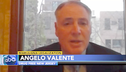

#  PDFNJ Ex. Dir. Angelo Valente Discussed the New Marijuana laws in NJ on ABC6 Philadelphia

 TRENTON, New Jersey -- Legislation to set up a recreational marijuana marketplace, decriminalize cannabis and loosen penalties for underage possession of the drug and alcohol was signed into law Monday by New Jersey Gov. Phil Murphy, more than three months after voters overwhelmingly approved a ballot question to legalize adult use of the drug.

 [Read More](http://drugfreenj.org/news/pdfnj-ex-dir-angelo-valente-discussed-new-marijuana-laws-nj-abc6-philadelphia/)

 

#  NJ Patient Notification Law Introduced by Congress to Help Prevent Opioid Addiction Nationally

 WASHINGTON — U.S. Representative David Trone (D-Md.), along with Reps. Guy Reschenthaler (R-Pa.), Teresa Leger Fernandez (D-N.M.), and David McKinley (R-W.V.), has introduced the bipartisan Opioid Patients’ Right to Know Act to help prevent opioid addiction across the country that is based on the success of the New Jersey Patient Notification Act.

 [Read More](http://drugfreenj.org/news/nj-patient-notification-law-introduced-congress-help-prevent-opioid-addiction-nationally/)

 

#  cdc.gov: Overdose Deaths Accelerating During COVID-19

 Over 81,000 drug overdose deaths occurred in the United States in the 12 months ending in May 2020, the highest number of overdose deaths ever recorded in a 12-month period, according to recent provisional data from the Centers for Disease Control and Prevention (CDC).

 [Read More](http://drugfreenj.org/newsroom/cdcgov-overdose-deaths-accelerating-during-covid-19/)

 

#  nj.com: Drug, alcohol support groups exempt from N.J.’s 10-person indoor gathering limit

 Addiction support groups including Alcoholics Anonymous and Narcotics Anonymous are exempt from New Jersey’s recently enacted 10-person limit for indoor gatherings due to the coronavirus outbreak under a clarification included in a separate executive order signed Monday night by Gov. Phil Murphy.

 [Read More](https://www.nj.com/coronavirus/2020/12/drug-alcohol-support-groups-exempt-from-njs-10-person-indoor-gathering-limit.html)

 

#  PDFNJ at NJEA 2020: Emerging Drug Trends

 MILLBURN - Partnership for a Drug-Free New Jersey Executive Director, Angelo Valente, and Director of Opioid Response and Prevention, Angela Conover, presented at the 2020 New Jersey Education Association convention on behalf of the New Jersey Association of School Social Workers.

 [Read More](http://drugfreenj.org/njea/)

 

#  Elaine Pozycki, Chairwoman of PDFNJ, in Response to Purdue Pharma Guilty Plea

 Millburn, NJ - “Purdue Pharma’s agreement to plead guilty to felony charges in part for illegally incentivizing doctors to prescribe more opioid-based pain relievers to patients, even-though the company knew full well how highly addictive these medicines are, underscores the importance of warning patients of the risks of addiction and discussing non-opioid pain relief alternatives."

 [Read More](http://drugfreenj.org/news/statement-elaine-pozycki-chairwoman-pdfnj-response-purdue-pharma-guilty-plea/)

 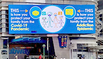

#  PDFNJ Unveils Campaign in Times Square to Raise Awareness about Opioid Use

 MILLBURN, NJ — The Partnership for a Drug-Free New Jersey (PDFNJ) today announced the unveiling of a new public health campaign featured in Times Square that is reminding families to talk to their children and communicate about the two life-threatening public concerns – the COVID-19 pandemic and the opioid epidemic.

 [Read More](http://drugfreenj.org/news/pdfnj-unveils-campaign-times-square-raise-awareness-opioid-use/)

 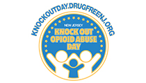

#  Knock Out Opioid Abuse Day to Be Recognized on October 6th

 MILLBURN — Thousands of New Jersey residents will be coming together virtually to Knock Out Opioid Abuse on October 6, for the state’s 5th Annual Knock Out Opioid Abuse Day.

 [Read More](http://drugfreenj.org/news/knock-opioid-abuse-day-be-recognized-october-6th/)

 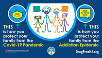

#  PDFNJ Unveils New Campaign Raising Awareness About Vital Family Communication and Masking Amid Pandemic

 MILLBURN — The Partnership for a Drug-Free New Jersey (PDFNJ) has unveiled a new media campaign raising awareness of how to keep families safe from two life-threatening public concerns facing all New Jerseyans – Covid-19 pandemic and the opioid epidemic.

 [Read More](http://drugfreenj.org/news/pdfnj-unveils-new-campaign-raising-awareness-about-vital-family-communication-masking-amid-pandemic/)

 

#  popsugar.com: The US Opioid Crisis Is Pulling Families Under at an Alarming Rate, and We Need to Take Action

 Twenty-six-year-old Briana Schroeder is a mom. She's self-assured with a measured voice. She's a former high school athlete, an animal-lover, and a recovering heroin addict.

 [Read More](http://drugfreenj.org/news/popsugarcom-us-opioid-crisis-pulling-families-under-alarming-rate-we-need-take-action/)

 

#  npr.org: Doctors And Dentists Still Flooding U.S. With Opioid Prescriptions

 Despite widespread devastation caused by America's opioid epidemic, an investigation by NPR found that doctors and other health care providers still prescribe highly addictive pain medications at rates widely considered unsafe.

 [Read More](http://drugfreenj.org/newsroom/nprorg-doctors-dentists-still-flooding-us-opioid-prescriptions/)

 

#  northjersey.com: As COVID-19 rages, we cannot forget our home-grown pandemic

 As we must continue to work on all fronts to defeat the COVID-19 pandemic, which has already taken more than 130,000 lives, we must redouble our efforts to curb our very own domestic pandemic, Opioid Use Disorder, which continues to take nearly 50,000 lives annually.

 [Read More](http://drugfreenj.org/news/northjerseycom-as-covid-19-rages-we-cannot-forget-our-home-grown-pandemic-opinion/)

 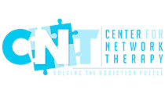

#  Recovery Center for Network Therapy Facebook Live Panel Discussion

 Bill Lillis, PDFNJ's Parent Education Coordinator took part in a panel discussion for the Recovery Center for Network Therapy (CNT) on Monday, June 22nd. Topics covered in the discussion included: why individuals suffering from substance use disorder are more susceptible to COVID-19, programs NJ residents can leverage to access treatment and law enforcement’s role in incentivizing people to treatment.

 [Read More](https://www.facebook.com/RecoveryCNTNJ/videos/708988333010344/  )

 

#  nj.com: Overdose deaths jump in 2020, with nearly 10 people a day dying last month in N.J.

 Drug overdose deaths in New Jersey have leaped 20% this year amid a pandemic that advocates fear has exacerbated drug abuse and made it harder for those with addictions to secure treatment.

 [Read More](http://drugfreenj.org/news/njcom-overdose-deaths-jump-2020-nearly-10-people-day-dying-last-month-nj/)

 

#  njtvonline.org: [VIDEO] Kids weigh in on pandemic and protests

 Kids across New Jersey are living through history: a once-in-a-generation pandemic and a nationwide civil rights outcry. It can be a lot to handle for elementary and middle schoolers, so to help them understand and reflect on their place in history, The Partnership for a Drug-Free New Jersey asked kids to write about the silver lining they’ve experienced in the last few months.

 [Read More](http://drugfreenj.org/news/njtvonlineorg-video-kids-weigh-pandemic-protests/)

 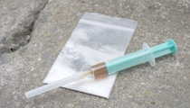

#  psychcongress.com: Overdose Deaths on the Rise Again Amid COVID-19

 Suspected overdose submissions to the Office of National Drug Control Policy’s Overdose Data Mapping Application Program from January to April this year are up 16.6% vs. the same period in 2019, according to an ODMAP report.

 [Read More](http://drugfreenj.org/newsroom/psychcongresscom-overdose-deaths-rise-again-amid-covid-19/)

 

#  Children Across NJ Share Positive Experiences Discovered While Social Distancing

 MILLBURN, NJ — New Jersey children are finding some “silver linings” to the social distancing caused by the COVID-19 pandemic. The Partnership for a Drug-Free New Jersey’s (PDFNJ) Share Your Silver Linings campaign invited kindergarten through 8th grade students to share a story about a new healthy and positive family ritual, habit, activity or a healthy tip they have discovered while social distancing.

 [Read More](http://drugfreenj.org/news/children-across-nj-share-positive-experiences-discovered-while-social-distancing/)

 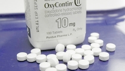

#  northjersey.com - New Jersey says doctors must prescribe Narcan alongside opioids for at-risk patients

 For the duration of the coronavirus crisis, doctors, dentists and other healthcare workers who prescribe opioids to patients with chronic pain may now have to prescribe an overdose-reversal drug alongside it. Announced Thursday by New Jersey Attorney General Gurbir Grewal, the rule demands healthcare practitioners prescribe naloxone, commonly known by its brand name Narcan, to those regularly taking higher doses of opioids or combining opioids with benzodiazepines, which include anti-anxiety medications like Xanax.

 [Read More](http://drugfreenj.org/newsroom/northjerseycom-new-jersey-says-doctors-must-prescribe-narcan-alongside-opioids-risk-patients/)

 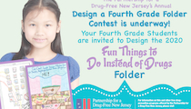

#  Hudson and Mercer County Students Win PDFNJ Statewide Fourth Grade Folder Contest

 MILLBURN — More than 3,400 fourth grade students from across New Jersey have showcased their artistic skills and entered the Partnership for a Drug-Free New Jersey’s (PDFNJ) Design a Fourth Grade Folder contest this year. The talented winners were chosen out of 28 finalists who were showcased in a virtual award ceremony held on May 12th.

 [Read More](http://drugfreenj.org/news/hudson-mercer-county-students-win-pdfnj-statewide-fourth-grade-folder-contest/)

 

#  National Opioid Expert Dr. Andrew Kolodny Leads Knock Out Opioid Abuse Webinar

 MILLBURN, NJ — As New Jersey, the nation and the world continue to face the difficulties and tragedy of the COVID-19 pandemic, the Partnership for a Drug-Free New Jersey and The Horizon Foundation for New Jersey continued the conversation on the national opioid crisis affecting millions of Americans.

 [Read More](http://drugfreenj.org/news/national-opioid-expert-dr-andrew-kolodny-leads-knock-opioid-abuse-webinar/)

 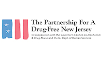

#  New Study Offers Promising Results of the Patient Notification Act in the Fight Against the Opioid Epidemic

 Millburn, NJ — A new study has found that the Patient Notification Act, a New Jersey law that requires medical practitioners to discuss the addictive potential of opioid-based painkillers with their patients (and parents of minors), and to also discuss a safer non-opioid alternative when available, is having a profound impact on the fight against the opioid epidemic.

 [Read More](http://drugfreenj.org/news/new-study-offers-promising-results-patient-notification-act-fight-against-opioid-epidemic/)

 

#  PDFNJ Unveils Share Your Silver Linings Story Campaign for Students Across New Jersey

 MILLBURN, NJ — The Partnership for a Drug-Free New Jersey (PDFNJ) is announcing a new campaign aimed at sharing positive stories or “silver linings” New Jersey students have discovered during this time of social distancing.

 [Read More](http://drugfreenj.org/news/partnership-drug-free-new-jersey-unveils-share-your-silver-linings-story-campaign-students-across-new-jersey/)

 

#  CONGRATS TO SHANNON HARRINGTON!! WINNER OF THE 2020 SHOUT DOWN DRUGS COMPETITION

 Listen to Shannon's winning song

 [Read More](http://shoutdowndrugs.com/contestants/)

 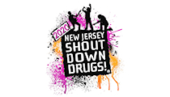

#  Be Sure To Cast Your Vote Today For The New Jersey Shout Down Drugs Music Contest!

 Voting is underway for the New Jersey Shout Down Drugs music contest sponsored by 95.9 WRAT and the New Jersey Broadcasters Association. Go to ShoutDownDrugs.com and cast your vote for your favorite songs written and performed by teens across New Jersey who want to share their music and drug-free prevention messages.

 [Read More](http://drugfreenj.org/news/cast-your-vote-today-new-jersey-shout-down-drugs-music-contest/)

 

#  PDFNJ To Unveil a Social Media Campaign Focused On Things To Do Together At Home

 MILLBURN, NJ - During these trying times, The Partnership for a Drug-Free New Jersey (PDFNJ) plans to offer ideas and tips through a new social media campaign entitled, the PDFNJ Tip of the Day. The Tips to be unveiled on March 23, will provide inspiration to families and children through different tips and activities to do in inside during the Coronavirus pandemic. A new tip to be posted each day.

 [Read More](http://drugfreenj.org/news/pdfnj-unveil-social-media-campaign-focused-things-do-together-home/)

 

#  nj1015.com - Don’t let pandemic beat you: A drug abuse warning during coronavirus

 As fear, anxiety and stress overtake our bodies, minds and hearts during this coronavirus pandemic, there is a concern that many may turn to alcohol and drugs for comfort. Angelo Valente, executive director for A Partnership for a Drug-Free New Jersey, says there is no question that stress from COVID-19 can put people at risk for substance abuse — especially young people.

 [Read More](http://drugfreenj.org/news/nj1015com-dont-let-pandemic-beat-you-drug-abuse-warning-during-coronavirus/)

 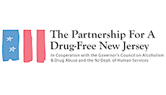

#  Partnership for A Drug Free New-Jersey Response to Coronavirus Pandemic

 The Partnership for a Drug-Free New Jersey extends to you and your family our best wishes for continued good health. Please follow all of the guidelines and new rules that have been announced to stop the spread of the coronavirus. In response to the COVID-19 (coronavirus) pandemic, PDFNJ has begun to cancel, postpone or make accommodations for all live, in-person group events that are currently planned.

 [Read More](http://drugfreenj.org/news/partnership-drug-free-new-jersey-response-coronavirus-pandemic/)

 

#  njtvonline.org: Teaching third graders about the dangers of substance abuse [VIDEO]

 Children as young as 11-years-old admitted to vaping last year. New Jersey Hospital Association data shows that’s two years younger than the year before. Now, the Partnership for a Drug-Free New Jersey is piloting an education program to help kids avoid substance abuse. But is third grade too early to start the program?

 [Read More](http://drugfreenj.org/news/njtvonlineorg-teaching-third-graders-about-dangers-substance-abuse/)

 

#  PDFNJ and PSEG Foundation Bring Substance Use Prevention Efforts to the Classroom

 Union City, NJ— The Partnership for a Drug-Free New Jersey (PDFNJ) and the PSEG Foundation have collaborated to send a message to 25,000 young New Jersey students across the state on the importance of healthy choices through the annual Third Grade Life Choices Coloring and Activity Book.

 [Read More](http://drugfreenj.org/news/pdfnj-pseg-foundation-bring-substance-use-prevention-efforts-classroom-1/)

 

#  steveadubato.org: The Impact of the Opioid Epidemic on Student Athletes [VIDEO]

 PDFNJ's Executive Director, Angelo Valente, sat down with Think Tank's Steve Adubato to talk about educating communities about the opioid epidemic and the importance of educating student athletes about the dangers and early signs of addiction.

 [Read More](http://drugfreenj.org/news/steveadubatoorg-impact-opioid-epidemic-student-athletes/)

 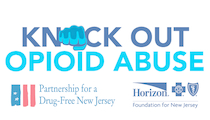

#  capemaycountyherald.com: Knock Out Opioid Abuse Prescriber Education Makes Impact on NJ Healthcare Professionals and Patients

 MILLBURN - Thousands of New Jersey residents have benefited from their medical professionals’ increased awareness of the risks posed by prescription opioids, thanks to an opioid webinar launched by the Partnership for a Drug-Free New Jersey (PDFNJ) and Horizon Blue Cross Blue Shield of New Jersey (BCBSNJ).

 [Read More](http://drugfreenj.org/news/capemaycountyheraldcom-knock-opioid-abuse-prescriber-education-makes-impact-nj-healthcare-professionals-patients/)

 

#  More Than 100 Billion Doses of Opioid Pills Were Shipped Between 2006 and 2014

 Data collected by the Drug Enforcement Administration shows more than 100 billion doses of oxycodone and hydrocodone were shipped nationwide between 2006 and 2014, The Washington Post reports.

 [Read More](http://drugfreenj.org/newsroom/more-than-100-billion-doses-opioid-pills-were-shipped-between-2006-2014/)

 

#  nj.com: A new campaign against vaping is launching in N.J. schools

 Teens around New Jersey are going back to school and being warned against the dangers of vaping with a new campaign sponsored by the Partnership for a Drug-Free New Jersey and the office of the state Attorney General.

 [Read More](http://drugfreenj.org/news/njcom-new-campaign-against-vaping-launching-nj-schools/)

 

#  New Jersey Students to Receive Messages on the Dangers of Vaping

 MILLBURN ­— There’s nothing safe about vaping. That’s the message the Partnership for a Drug-Free New Jersey (PDFNJ) will be sharing with youth as they return from holiday break this week. PDFNJ, in collaboration with the New Jersey Office of the Attorney General, has unveiled a media campaign about the dangers of vaping that will be distributed to each of the more than 3,500 schools in the state.

 [Read More](http://drugfreenj.org/news/new-jersey-students-receive-messages-dangers-vaping/)

 

#  washingtonpost.com: ‘It only took one pill’: How addiction starts

 The road to Paul Little’s addiction began during a hard day at work. He took one pill to ease a headache, which turned into nine-month habit. “I got up to 20 to 30 Percocets a day,” the former Air Force doctor said. “I was eating them like M&Ms.” Kathy Thomas took opioids for two years until a doctor told her she was being unnecessarily medicated. She still lives with the psychological consequences.

 [Read More](https://www.washingtonpost.com/nation/2019/12/23/it-only-took-one-pill-how-addiction-starts/)

 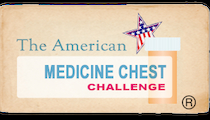

#  New Jersey Families Challenged to Help Knock Out Opioid Abuse

 MILLBURN — On November 9, communities across the state will participate in the 11th Annual American Medicine Chest Challenge – New Jersey (AMCC-NJ) Day of Awareness of Prescription Drug Abuse and Safe Disposal, a public health initiative created by the Partnership for a Drug-Free New Jersey (PDFNJ) to help raise awareness about the dangers of prescription drug abuse and empower families to safeguard their home through the 5-step challenge.

 [Read More](http://drugfreenj.org/news/new-jersey-families-challenged-help-knock-opioid-abuse/)

 

#  Knock Out Opioid Abuse Town Hall in Somerset Hills Highlights Impact of Opioid Epidemic on Community

 PDFNJ and The Horizon Foundation for New Jersey held a Knock Out Opioid Abuse Town Hall in Somerset Hills on Tuesday, October 22. From left, Angelo Valente, Executive Director - PDFNJ; Somerset County Prosecutor Michael Robertson; Amanda Carroll, a Bernardsville resident in long-term recovery; Dr. Gail, Granowtiz, MD, Anesthesiologist; Chris Barton, Clinical Design Liason, Behavioral Health, Horizon Blue Cross Blue Shield of NJ; Jodi D’Agostini, Founder and Board Chair of Community in Crisis; Katie Meyler, a Bernardsville resident; and Father Rick Morley of St. Mark’s Episcopal Church.

 [Read More](http://drugfreenj.org/news/knock-opioid-abuse-town-hall-somerset-hills-highlights-impact-opioid-epidemic-community/)

 

#  Knock Out Opioid Abuse Town Hall in Camden Highlights Impact of Opioid Epidemic on Community

 CAMDEN — Local experts on the opioid epidemic ravaging New Jersey addressed its impact on Camden and discussed solutions with its residents at a Knock Out Opioid Abuse Town Hall sponsored by the Partnership for a Drug-Free New Jersey (PDFNJ) and The Horizon Foundation for New Jersey.

 [Read More](http://drugfreenj.org/news/knock-opioid-abuse-town-hall-camden-highlights-impact-opioid-epidemic-community/)

 

#  jerseyshoreonline.com: Forum Seeks Solution To Opioid Epidemic

 Toms River Mayor Thomas F. Kelaher, left, joins Ocean County Prosecutor Bradley D. Billhimer; Heather Price, Volunteer Coordinator for Hope Sheds Light, Susan S. Jones, Reverend of Holy Cross Lutheran Church; and Beverly Prima, Hope Sheds Light during a Knock Out Opioid Abuse Town Hall. (Photo by Bob Vosseller)

 [Read More](http://drugfreenj.org/news/jerseyshoreonlinecom-forum-seeks-solution-opioid-epidemic/)

 

#  Knock Out Opioid Abuse Town Hall Highlights Impact of Opioid Epidemic on Hunterdon Medical Center Community

 PDFNJ and The Horizon Foundation for New Jersey held a Knock Out Opioid Abuse Town Hall in Flemington on Wednesday, October 9. From left, Hunterdon County Prosecutor Michael Willians; Dr. Nimish Mehta, Hunterdon Medical Center; Nava Bastola, Public Health Analyst, NY/NJ High Intensity Drug Trafficking Area program (HIDTA); Lesley Gabel, Co-Director, CEO, Prevention Resources; Divya Paliwal, MD, Chief Clinical Transformation Office, Horizon Blue Cross Blue Shield of New Jersey; Angelo Valente, Executive Director of PDFNJ; Dr. Jeffrey Moore, Superintendent, Hunterdon Central Regional High School; and Heather Ogden, Advocacy Coordinator, NCADD – NJ; Greg Rearick, Supervisor, Hunterdon Opioid Overdose Recovery Program.

 [Read More](https://www.tapinto.net/towns/flemington-slash-raritan/sections/health-and-wellness/articles/town-hall-targets-opioid-abuse  )

 

#  Rutgers Athletics Knock Out Opioid Abuse Town Hall Highlights Impact of Opioid Epidemic

 PDFNJ and The Horizon Foundation for New Jersey held a Knock Out Opioid Abuse Town Hall in Cape May on Friday, October 4. From left, Angelo Valente, Executive Director of PDFNJ; Ray Lucas, former Rutgers and NFL quarterback; Greg Vetrone, Rutger’s men’s basketball Director of Player Development; and John J. Hoffman, Rutgers University Senior Vice President and General Counsel.

 [Read More](http://drugfreenj.org/news/rutgers-athletics-knock-opioid-abuse-town-hall-highlights-impact-opioid-epidemic/)

 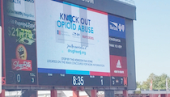

#  PDFNJ and Rutgers Football Team up for #KnockOutOpioidAbuse Day

 The Partnership for a Drug-Free New Jersey and the Horizon Foundation for New Jersey attended the Rutgers football game on October 5th to help educate athletes and Rutgers football fans about the dangers of opioids and to distribute materials for #KnockOutOpioidAbuse Day in New Jersey!

 

#  NJ Residents Distribute Life-Saving Information on Knock Out Opioid Abuse Day

 NEW JERSEY—New Jersey residents spread awareness and prevention information regarding the opioid crisis on October 6, a day Governor Phil Murphy recently commemorated as Knock Out Opioid Abuse Day in New Jersey.

 [Read More](http://www.drugfreenj.org/news/new-jersey-residents-distribute-life-saving-information-knock-opioid-abuse-day/)

 

#  njtvonline.org: How to Combat Opioid Abuse in Student Athletes [VIDEO]

 The Partnership for Drug-Free New Jersey and Horizon Blue Cross Blue Shield New Jersey, an underwriter of NJTV News, is traveling across the state to host Knock Out Opioid Abuse town hall events. Friday they were at the Rutgers University Athletic Center sharing personal stories.

 [Read More](http://drugfreenj.org/news/njtvonlineorg-how-combat-opioid-abuse-student-athletes/)

 

#  Knock Out Opioid Abuse Town Hall in Cape May Highlights Impact of Opioid Epidemic on Community

 CAPE MAY — Local experts on the opioid epidemic ravaging New Jersey addressed its impact on Cape May and discussed solutions with its residents at a Knock Out Opioid Abuse Town Hall sponsored by the Partnership for a Drug-Free New Jersey (PDFNJ) and The Horizon Foundation for New Jersey.

 [Read More](https://www.capemaycountyherald.com/community/community_support/article_8f95dad8-e6dc-11e9-9529-fb044eb93112.html)

 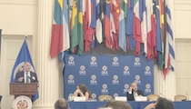

#  PDFNJ Featured At Organization of American States in Washington, D.C.

 PDFNJ Executive Director Angelo M. Valente spoke at the first Organization of American States (OAS) meeting to address substance use in Washington D.C. on September 30 about the Partnership for a Drug-Free New Jersey's strategies to spread awareness about substance use, misuse and abuse.

 

#  Knock Out Opioid Abuse Town Hall in Toms River Highlights Impact of Opioid Epidemic on Community

 TOMS RIVER - From left, Mayor Thomas F. Kelaher; Ocean County Prosecutor Bradley D. Billhimer; Heather Price, Volunteeer Coordinator for Hope Sheds Light and Person in Long-Term Recovery; Angelo Valente, Executive Director of PDFNJ; Susan S. Jones, Reverand of Holy Cross Lutheran Church; and Beverly Prima, Hope Sheds Light.

 [Read More](http://drugfreenj.org/news/knock-opioid-abuse-town-hall-toms-river-highlights-impact-opioid-epidemic-community/)

 

#  New PDFNJ Campaign Highlights Danger of Prescription Opioids

 NEW YORK — A powerful new message in Times Square from the Partnership for a Drug-Free New Jersey emphasizes the dangers of prescription opioids.

 [Read More](http://drugfreenj.org/news/new-pdfnj-campaign-highlights-danger-prescription-opioids/)

 

#  Thousands Impacted by PDFNJ’s Squash The Stigma Challenge

 MILLBURN — Eradicating the stigma of addiction was the goal of hundreds of participants in the Partnership for a Drug-Free New Jersey’s #SquashTheStigma initiative.

 [Read More](http://drugfreenj.org/news/thousands-impacted-pdfnjs-squash-stigma-challenge/)

 

#  Winners Announced in PDFNJ’s Online Family Fishing Tournament

 MILLBURN — The Partnership for a Drug-Free New Jersey announced five winners for its Fifth Annual Don’t Get Hooked on Drugs Online NJ Family Fishing Tournament. Carl Cocozza and Vince Miranda of Atlantic County, Mike Mezak of Bergen County, Tim McHugh of Gloucester County, and Stephanie Osborne of Morris County were randomly selected as the winners of the competition. Each winner will receive a $100 gift card.

 [Read More](http://drugfreenj.org/news/winners-announced-pdfnjs-online-family-fishing-tournament/)

 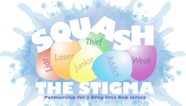

#  Squash the Stigma

 PDFNJ’s online Squash the Stigma challenge, beginning August 1 and concluding on International Overdose Awareness Day on August 31, calls family and friends who have been impacted by to take a public stand against stigma.

 [Read More](http://drugfreenj.org/news/pdfnj-launches-online-stigma-challenge/)

 

#  nj1015.com - NJ Drug Overdose Death Rate Drops Slightly: What’s Working?

 Drug overdose deaths in the Garden State have been steadily rising for years but finally there is some good news to report. For the first six months of 2019, the number of fatal overdoses was down 7% compared to the same timeframe in 2018.

 [Read More](http://drugfreenj.org/news/nj1015com-nj-drug-overdose-death-rate-drops-slightly-whats-working/)

 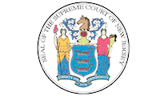

#  njbiz.com: State’s highest court will hear case on medical cannabis in the workplace

 New Jersey’s Supreme Court announced Tuesday it will consider whether or not a Ridgewood funeral home discriminated against one of its employees in 2016 for using medical cannabis.

 [Read More](http://drugfreenj.org/newsroom/njbizcom-states-highest-court-will-hear-case-medical-cannabis-workplace/)

 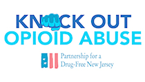

#  Partnership for a Drug-Free New Jersey’s Knock Out Opioid Abuse Day Project Signed into Law

 MILLBURN -- Governor Phil Murphy officially made Oct. 6 Knock Out Opioid Abuse Day. Knock Out Opioid Abuse Day is a statewide project created by the Partnership for a Drug-Free New Jersey in cooperation with the Governor’s Council on Alcoholism and Drug Abuse; the New Jersey Department of Human Services, Division of Addiction Services; and the Community Coalition for a Safe and Healthy Morris, with help from partners across the state.

 [Read More](http://drugfreenj.org/news/partnership-drug-free-new-jerseys-knock-opioid-abuse-day-project-signed-law/)

 

#  njbiz.com: Change course

 A pair of organizations team up to educate drug prescribers about limiting unnecessary opioid use

 [Read More](http://drugfreenj.org/news/njbizcom-change-course/)

 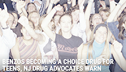

#  Benzos Becoming a Choice Drug for Teens, NJ Drug Advocates Warn

 Drug experts are now warning of a dangerous new health problem involving medications like Valium and Xanax that are typically prescribed for anxiety and insomnia.

 [Read More](http://drugfreenj.org/news/nj1015com-benzos-becoming-choice-drug-teens-nj-drug-advocates-warn/)

 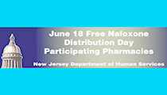

#  On June 18th the NJ Dept. of Human Services Will Distribute Free Naloxone

 No prescription needed. No insurance required. Find out what pharmacies are participating by following the read more link.

 [Read More](https://nj.gov/governor/stopoverdoses/Naloxone_Participating_Pharmacies.pdf)

 

#  [VIDEO] PDFNJ Discusses New Jersey Program for Free Naloxone

 Matt Birchenough, PDFNJ Dir. of Special Events, discusses NJ's free naloxone program with News12.

 [Read More](http://drugfreenj.org/news/video-pdfnj-discusses-new-jersey-program-free-naloxone/)

 

#  PDFNJ Claims Three First-Place Trophies at NJ Ad Club Jersey Awards

 MILLBURN ­— The Partnership for a Drug-Free New Jersey (PDFNJ) received six awards, including three first-place awards, at the NJ Ad Club’s 51st Annual Jersey Awards on June 5.

 [Read More](http://drugfreenj.org/news/pdfnj-claims-three-first-place-trophies-nj-ad-club-jersey-awards/)

 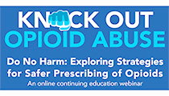

#  Knock Out Opioid Abuse Initiative Launches New Online Course for Prescribers

 MILLBURN — In response to the opioid epidemic ravaging New Jersey, the Partnership for a Drug-Free New Jersey (PDFNJ) and Horizon Blue Cross Blue Shield of New Jersey (Horizon BCBSNJ) have turned their focus toward educating prescribers on safe and responsible prescribing.

 [Read More](http://drugfreenj.org/news/knock-opioid-abuse-initiative-launches-new-online-course-prescribers/)

 

#  NJ AG Grewal Announces Lawsuit Against Sackler Family at Law Enforcement Opioid Conference

 ATLANTIC CITY ­--- New Jersey Attorney General Gurbir Grewal announced his office has filed a lawsuit against eight members of the Sackler family, founders of Purdue Pharma, at an opioid conference hosted by the Partnership for a Drug-Free New Jersey on Thursday.

 [Read More](http://drugfreenj.org/news/nj-ag-grewal-announces-lawsuit-against-sackler-family-pdfnj-statewide-law-enforcement-opioid-conference/)

 

#  NJ AG Gurbir Grewal to Deliver Keynote Address at May 30th Law Enforcement Opioid Training

 NJ Attorney General Grewal will discuss statewide initiatives to address the ongoing opioid epidemic and emphasize the role of law enforcement in combating this critical issue at the New Jersey Law Enforcement Training: On the Front Lines of the Opioid Epidemic.

 [Read More](http://www.drugfreenj.org/lawtraining/)

 

#  PDFNJ Executive Director Named to NJBIZ’s 2019 Health Care Power 50

 MILLBURN — Partnership for a Drug-Free New Jersey Executive Director Angelo Valente earned recognition as one of the top figures in the health care field this week after NJBIZ selected him for its 2019 Health Care Power 50 list.

 [Read More](http://drugfreenj.org/news/pdfnj-executive-director-named-njbizs-2019-health-care-power-50/)

 

#  Morris County Teen Wins Statewide Substance Use Prevention Music Competition

 PDFNJ held its 15th Annual New Jersey Shout Down Drugs Prevention Concert on Friday, May 10 at Rutgers University in New Brunswick. From left, WCTC Radio Host and Prevention Concert master of ceremonies Bert Baron, second-place winner Jermaine Bethea, first-place winner Tiffany Enemuo, third-place winner Carolina Rial and PDFNJ Executive Director Angelo Valente.

 [Read More](http://drugfreenj.org/news/morris-county-teen-wins-statewide-substance-use-prevention-music-competition/)

 

#  Bergen and Hudson County Students Win PDFNJ Statewide Fourth Grade Folder Contest

 Ava Wittreich of Washington School in Bergenfield and Alysa Patel of Public School 27 in Jersey City were selected as co-winners of the Design a Fourth Grade Folder contest. Their designs will appear on the folder distributed annually to thousands of fourth graders throughout the state.

 [Read More](http://drugfreenj.org/news/bergen-hudson-county-students-win-pdfnj-statewide-fourth-grade-folder-contest/)

 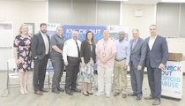

#  Galloway Residents Seek Solutions to Opioid Epidemic at Knock Out Opioid Abuse Town Hall

 PDFNJ and The Horizon Foundation for New Jersey held a Knock Out Opioid Abuse Town Hall in Galloway on May 7th. From left, Jennifer Goudy, Senior Program Officer, The Horizon Foundation for New Jersey; Dr. Brian Acunto; Galloway Police Chief Donna Higbee; Galloway Ambulance Chief Chuck Uhl; Laurie Smith of Join Together Atlantic County; Scott Gras, Peer Recovery Specialist with the Atlantic County Sheriff’s Office; Reverend Mike Walker of Highland Community Church; PDFNJ Ex. Dir. Angelo Valente; and Galloway Mayor Anthony Coppola Jr.

 [Read More](http://drugfreenj.org/news/galloway-residents-seek-solutions-opioid-epidemic-knock-opioid-abuse-town-hall/)

 

#  PDFNJ Recognizes Dr. Andrew Kolodny at Angel of Hope Gala

 JERSEY CITY — The Partnership for a Drug-Free New Jersey (PDFNJ) honored Dr. Andrew Kolodny with the Angel of Hope Award for his efforts in the fight against the nationwide opioid epidemic at the Angel of Hope Gala, held Thursday at the Harborside Atrium.

 [Read More](http://drugfreenj.org/news/pdfnj-recognizes-dr-andrew-kolodny-angel-hope-gala/)

 

#  Robbinsville Residents Seek Solutions to Opioid Epidemic at Knock Out Opioid Abuse Town Hall

 The Knock Out Opioid Abuse Town Hall examined the opioid epidemic’s effects on Robbinsville and actions to address the issue. From left, Mercer County Prosecutor Angelo Onofri, Dr. Neal Schofield, Robbinsville Mayor Dave Fried, Roy Leitstein, PDFNJ Executive Director Angelo Valente; Fred DiOrio, Dental Director of Government Programs for Horizon NJ Health; Marissa Esposito; and Reverend Edgar Shaffer.

 [Read More](http://drugfreenj.org/news/robbinsville-residents-seek-solutions-opioid-epidemic-knock-opioid-abuse-town-hall/)

 

#  PDFNJ’s Elaine Pozycki and Angelo Valente featured on ABC7’s Protect Our Children

 The program is hosted by Eyewitness News Anchor Diana Williams and addresses the worst drug crisis in American history - the opioid crisis - which is truly a public health emergency.

 [Read More](https://abc7ny.com/society/protect-our-children-the-opioid-crisis---watch-it-here-on-abc7ny/5208065/)

 

#  What Can Employers Do to Maintain a Safe and Drug-Free Workplace?

 Positive test results among active employees is a cause for concern among employers. The Partnership for a Drug-Free New Jersey moderates a NJBIZ panel discusssion on a wide range of issues, including current testing policies.

 [Read More](http://drugfreenj.org/news/njbizcom-experts-address-substance-abuse-workplace/)

 

#  [VIDEO] National Leaders Converge on New Jersey to Combat the Opioid Epidemic

 The Knock Out Opioid Abuse Summit, in partnership with the The Horizon Foundation for New Jersey, looks at the Federal and State responses to the Opioid Epidemic.

 [Read More](http://drugfreenj.org/news/njtvonlineorg-summit-looks-state-federal-responses-opioid-epidemic/)

 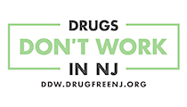

#  Statewide Seminar Addresses the Legal Issues of Marijuana in the Workplace

 ANDOVER — New Jersey businesses concerned about establishing and maintaining a drug-free working environment are invited to attend a free statewide seminar Tuesday, April 9 from 9 to 11:30 a.m. at Perona Farms in Andover.

 [Read More](http://drugfreenj.org/news/statewide-seminar-addresses-legal-issues-marijuana-workplace/)

 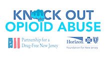

#  Next Round of Knock Out Opioid Abuse Town Halls to Kick off with Summit on Government Response to Opioid Epidemic

 NEWARK — After conducting more than two dozen town halls statewide to better understand the scope and impact of New Jersey’s opioid epidemic, the Partnership for a Drug-Free New Jersey and Horizon Blue Cross Blue Shield of New Jersey (Horizon BCBSNJ) will kick off a new round of town halls, with a fresh focus on customizing solutions to individual communities and leveraging local resources to combat the problem.

 [Read More](http://drugfreenj.org/news/next-round-knock-opioid-abuse-town-halls-kick-summit-government-response-opioid-epidemic/)

 

#  NJ 101.5 FM talks with PDFNJ and Horizon Foundation for NJ

 PDFNJ's Angela Conover and the Horizon Foundation for New Jersey's Dr. Steven Peskin speak with Bert Baron about the upcoming March 27 Knock Out Opioid Abuse Summit in Newark.

 [Read More](https://wctcam.com/episodes/pdfnjs-knock-out-opioid-abuse-summit-3-22-19/)

 

#  Did the FDA ignite the opioid epidemic?

 A drug manufacturer denounces his own industry and explains to 60 Minutes how a label change by the FDA expanded the use of opioids

 [Read More](http://drugfreenj.org/newsroom/cbsnewscom-did-fda-ignite-opioid-epidemic/)

 

#  [VIDEO] PDFNJ Co-Chair Elaine Pozycki Addresses Doctors at Holy Name Medical Center

 Elaine Pozycki, who lost her son to opioid addiction, addresses a group of doctors at Holy Name Medical Center and asks them to consider opioid alternatives.

 [Read More](http://drugfreenj.org/news/pdfnj-co-chair-elaine-pozycki-addresses-doctors-holy-name-medical-center/)

 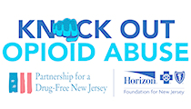

#  Knock Out Opioid Abuse Summit Announced for March 27th

 Join us at The Newark Museum on March 27 for the Knock Out Opioid Abuse Summit on the State and Federal Response to the Opioid Epidemic. Representatives from the state and federal governments will discuss the impact of the opioid crisis and resources available for communities to help address the epidemic.

 [Read More](http://knockoutopioidabuse.drugfreenj.org/summit)

 

#  PDFNJ Joins NJ OAG and NJISAA In Opioid Athlete Awareness Initiative

 TRENTON – Acting to address the increased risk of opioid abuse among high school athletes, the Office of the New Jersey Coordinator for Addiction Responses and Enforcement Strategies (“NJ CARES”) and the New Jersey State Interscholastic Athletic Association (“NJSIAA”) announced on Tuesday Feb. 19, a new partnership to educate student athletes on addiction risks associated with sports injuries and opioid use.

 [Read More](http://drugfreenj.org/newsroom/tapintonet-new-njsiaa-policy-will-require-student-athletes-parents-watch-opioid-education-video/)

 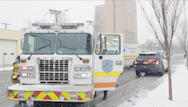

#  abc7ny.com: School bus driver revived with Narcan after crashing in New Jersey

 NEWARK, New Jersey (WABC) -- The driver of a school bus carrying children with special needs was revived with the narcotic overdose drug Narcan after crashing in New Jersey Wednesday, according to authorities.

 [Read More](http://drugfreenj.org/newsroom/abc7nycom-school-bus-driver-revived-narcan-after-crashing-new-jersey/)

 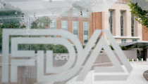

#  washingtonpost.com: FDA, drug companies, doctors mishandled use of powerful fentanyl painkiller

 The Food and Drug Administration, drug companies and doctors mishandled distribution of a powerful fentanyl painkiller, allowing widespread prescribing to ineligible patients despite special measures designed to safeguard its use, according to a report released Tuesday.

 [Read More](http://drugfreenj.org/newsroom/washingtonpostcom-fda-drug-companies-doctors-mishandled-use-powerful-fentanyl-painkiller/)

 

#  STATEWIDE CAMPAIGN TO SECURE MEDICINES IN THE HOME LAUNCHED TODAY

 Trenton, February 19, 2019 – Today the New Jersey Realtors, HealthCare Institute of New Jersey (HINJ), Pharmaceutical Research and Manufacturers of America (PhRMA) and Partnership for a Drug-Free New Jersey launched a campaign to educate Realtors and homeowners with an active listing, along with the general public, about the importance of securing medicines in their homes and properly disposing of unused drugs that are no longer needed.

 [Read More](http://drugfreenj.org/news/video-statewide-safe-home-safe-sale-campaign-help-save-lives-protect-homeowners-they-sell-their-home/)

 

#  nj.com: N.J. student, 13, gave classmates marijuana gummy bears. Teen girl ends up in hospital.

 A 13-year-old student in Bergen County has been charged after giving his classmates edible marijuana gummy bears during school hours after one of his fellow students became ill and had to be taken to the hospital, police said.

 [Read More](http://drugfreenj.org/newsroom/njcom-nj-student-13-gave-classmates-marijuana-gummy-bears-teen-girl-ends-up-hospital/)

 

#  PDFNJ Ex. Dir. Angelo M. Valente Appears Live on Fox5 News with Ernie Anastos

 PDFNJ's Angelo Valente and 2017 winner of the NJ Shout Down Drugs competition, Taylor Van Cleave, spoke with Fox5's Ernie Anastos.

 [Read More](http://drugfreenj.org/news/pdfnjs-ex-dir-angelo-m-valente-njsdd-winner-taylor-van-cleave-appear-live-fox5-news-ernie-anastos/)

 

#  PDFNJ Ex. Dir. Angelo M. Valente Introduces Miss America to NJSDD Winner Taylor Van Cleave

 2019 Miss America Nia Franklin and PDFNJ Executive Director Angelo Valente, along with the 2017 New Jersey Shout Down Drugs winner Taylor Van Cleave, take a moment to pose for a photo at the Fox5 studios in NYC.

 [Read More](http://drugfreenj.org/news/pdfnjs-ex-dir-angelo-m-valente-njsdd-winner-taylor-van-cleave-appear-live-fox5-news-ernie-anastos/)

 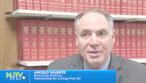

#  njtvonline.org: Advocates try to rein in prescriptions from dentists to combat opioid crisis

 PDFNJ Executive Director Angelo M. Valente spoke with reporter Leah Mishkin of NJTV about Safer Prescribing Practices for Pediatric Dentists as part of the Do No Harm series. Click the read more to watch.

 [Read More](http://www.drugfreenj.org/news/njtvonlineorg-advocates-try-rein-prescriptions-dentists-combat-opioid-crisis/)

 

#  PDFNJ 3rd Grade Healthy Lifestyle Activity Book Campaign Encourages Drug-Free Choices

 Watch the 3rd Grade Healthy Lifestyle Activity Book Campaign, Supported by the PSEG Foundation on NJTV News' Garden State Express.

 [Read More](http://drugfreenj.org/news/pdfnj-3rd-grade-healthy-lifestyle-activity-book-campaign-encourages-drug-free-choices/)

 

#  PDFNJ Ex. Dir. Angelo M. Valente discusses the Crisis of Opioid Addictions on My9's "New Jersey Now"

 Watch "New Jersey Now" discussing the New Jersey opioid epidemic with PDFNJ Ex. Dir., Angelo M. Valente.

 [Read More](http://drugfreenj.org/news/pdfnj-ex-dir-angelo-m-valente-appears-new-jersey-now/)

 

#  40,000 Healthy Lifestyle Activity Books to Arrive ‘Polar Express’ Style for New Jersey 3rd Graders

 Maria Spina from the PSEG Foundation, Arianna and Anthony Calamusa, 3rd Graders from the McGinn Elementary School, and Angelo Valente, Executive Director of the Partnership of a Drug-Free New Jersey

 [Read More](http://drugfreenj.org/news/40000-healthy-lifestyle-activity-books-arrive-polar-express-style-new-jersey-3rd-graders/)

 

#  nytimes.com: Balancing the Risks and Benefits of Opioids for Children

 Experts say opioids are sometimes warranted for kids, in cases like severe burns or major trauma. But doctors should prescribe carefully, and parents should never keep leftovers in the house.

 [Read More](http://drugfreenj.org/newsroom/nytimescom-balancing-risks-benefits-opioids-children/)

 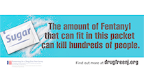

#  Partnership for a Drug-Free New Jersey Launches Campaign to Prevent Fentanyl Deaths

 MILLBURN — In response to the crisis that has claimed thousands of New Jersey residents in the past four years alone, the Partnership for a Drug-Free New Jersey (PDFNJ) has launched a media campaign to make families aware of the fentanyl outbreak in New Jersey communities.

 [Read More](http://drugfreenj.org/news/partnership-drug-free-new-jersey-launches-campaign-prevent-fentanyl-deaths/)

 

#  Angelo Valente Discusses Rise in Fentanyl Deaths on WCBS 880

 More than half of the 3,100 overdose deaths in New Jersey in 2018 involved the opioid pain reliever fentanyl. Partnership for a Drug-Free New Jersey, Executive Director Angelo Valente talks with WCBS Newsradio 880 about the increase in deaths and the launch of a fentanyl media campaign to combat this issue.

 [Read More](http://drugfreenj.org/assets/_control/content/files/010919.WCBS.Drug_Deaths_In_New_Jersey_Reach_Over_3,000_For_1st_Time.mp3)

 

#  PDFNJ Executive Director Discusses Opioid Crisis on Comcast Newsmakers

 Jill Horner speaks with Angelo Valente, Executive Director from the Partnership for Drug Free New Jersey, about Knock Out Opioid Abuse and Shout Down Drugs.

 [Read More](http://drugfreenj.org/news/pdfnj-executive-director-discusses-opioid-crisis-comcast-newsmakers/)

 

#  PDFNJ to recognize Dr. Andrew Kolodny at 2019 Angel of Hope Gala

 MILLBURN — The Partnership for a Drug-Free New Jersey (PDFNJ) will present its Angel of Hope Award to Dr. Andrew Kolodny in recognition of his efforts to help solve the nation’s opioid crisis at a gala celebration on April 11, 2019, at the Harborside Atrium in Jersey City.

 [Read More](http://drugfreenj.org/news/partnership-drug-free-new-jersey-recognize-dr-andrew-kolodny-2019-angel-hope-gala/)

 

#  PDFNJ Featured on Inside Edition

 Partnership for a Drug-Free New Jersey Executive Director Angelo Valente spoke with Inside Edition about a recent study finding that 6 percent of teens and young adults who were prescribed opioids by a dentist were diagnosed with opioid abuse within a year.

 [Read More](http://drugfreenj.org/news/pdfnj-featured-inside-edition/)

 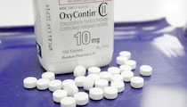

#  washingtonpost.com - Study: Dental painkillers may put young people at risk of opioid addiction

 Dentists who prescribe opioid painkillers to teenagers and young adults after pulling their wisdom teeth may be putting their patients at risk of addiction, a new study finds.

 [Read More](http://drugfreenj.org/newsroom/washingtonpostcom-study-dental-painkillers-may-put-young-people-risk-opioid-addiction/)

 

#  The Teen Vaping Trend – What Parents Need to Know

 Vaping is the act of inhaling and exhaling the aerosol, often referred to as vapor, produced by an e-cigarette or similar device. It’s become more popular among teens than regular cigarettes, especially given that vaping devices can be used for anything from flavors like mango, mint or tutti frutti, to flavorings containing nicotine or THC, the chemical compound in marijuana that produces the high.

 [Read More](https://drugfree.org/parent-blog/the-teen-vaping-trend-what-parents-need-to-know/)

 

#  nj1015.com: AN OLD DRUG MAKES A COMEBACK IN NEW JERSEY

 Methamphetamine use is on the rise, especially in southern parts of the Garden State.

 [Read More](http://drugfreenj.org/news/nj1015com-old-drug-makes-comeback-new-jersey/)

 

#  time.com - U.S. Life Expectancy Dropped for the Third Year in a Row. Drugs and Suicide Are Partly to Blame

 Still, drugs — namely opioids such as heroin — continue to be a considerable cause of fatalities. And synthetic opioids, such as fentanyl, are a growing problem: The rate of overdose deaths involving these drugs rose by 45% from 2016 to 2017.

 [Read More](http://drugfreenj.org/newsroom/timecom-us-life-expectancy-dropped-third-year-row-drugs-suicide-are-partly-blame/)

 

#  Vaping Guide Released as F.D.A. Cracks Down on E-Cigarette Vendors Selling to Minors

 NEW YORK – November 28, 2018 – Partnership for Drug-Free Kids, the nation’s leading nonprofit committed to helping families struggling with their son’s or daughter’s substance use, today is launching an essential resource guide for parents and caregivers, “Vaping: What You Need to Know And How to Talk With Your Kids.”

 [Read More](http://drugfreenj.org/newsroom/vaping-guide-released-as-fda-cracks-down-e-cigarette-vendors-selling-minors/)

 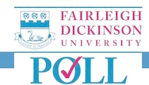

#  Study Shows More New Jersey Parents Recognize Links Between Prescription Opioids and Heroin Use

 MILLBURN — New Jersey parents are becoming more aware of the risks of prescription opioids and their link to heroin use, according to a study by the Partnership for a Drug-Free New Jersey (PDFNJ).

 [Read More](http://drugfreenj.org/news/study-shows-more-new-jersey-parents-recognize-links-between-prescription-opioids-heroin-use/)

 

#  PDFNJ Executive Director Inducted in Advertising Hall of Fame of New Jersey

 PDFNJ Executive Director Angelo Valente, far right, was inducted into the Advertising Hall of Fame of New Jersey on November 8 at the Highlawn Pavilion in West Orange. As executive director since PDFNJ’s inception in 1992, Valente has spearheaded a number of unique substance use prevention public service campaigns that have been spread throughout the state and the nation. Valente was joined by fellow inductees, from left, Barry Schiro, Donna Bonavita, Larry Durst and Collette Liantonio.

 [Read More](http://drugfreenj.org/news/pdfnj-executive-director-inducted-advertising-hall-fame-new-jersey/)

 

#  New Jersey AG sues J&J subsidiary for practices related to opioid products

 The state of New Jersey has filed a five-count lawsuit against Janssen Pharmaceuticals Inc., a subsidiary of Johnson & Johnson, for deceiving consumers about the dangers of two of its opioid products with high potential for abuse – Nucynta and Nucynta ER, Attorney General Gurbir Grewal said Tuesday.

 [Read More](http://drugfreenj.org/newsroom/njbizcom-ag-sues-jj-subsidiary-practices-related-opioid-products/)

 

#  CarePoint Foundation Honors Angelo Valente with Community Service Award

 The CarePoint Foundation honored Partnership for a Drug-Free New Jersey Executive Director Angelo Valente with the Daniel A. Kane Memorial Community Service Award at the CarePoint Foundation Gala at Saint Peter's University on Thursday, October 25.

 [Read More](http://drugfreenj.org/news/carepoint-foundation-honors-angelo-valente-community-service-award/)

 

#  PDFNJ Co-Chair Elaine Pozycki Discusses Addiction in Radio Interview

 PDFNJ Co-Chair Elaine Pozycki has been a leader in the nationwide effort to pass legislation requiring doctors and other health care providers to inform their patients about the risks of opioids before prescribing them. She joined Steppin’ Out Radio recently to discuss her son’s battle with addiction and her efforts to bring the Patient Notification Act to every state in the country.

 [Read More](http://steppinoutradio.com/?p=3629 )

 

#  CarePoint Foundation to Host “A Night on Broadway” Gala to Celebrate Hudson County Community

 Angelo M. Valente, Executive Director of the Partnership for a Drug-Free New Jersey, to Be Honored

 [Read More](http://drugfreenj.org/news/carepoint-foundation-host-night-broadway-gala-celebrate-hudson-county-community/)

 

#  NJTV Special Details Impact of Knock Out Opioid Abuse Town Hall Series in Fight Against Opioid Epidemic

 NEW JERSEY — A new special that premiered Thursday night on NJTV spotlighted the significance of the Knock Out Opioid Abuse Town Hall Series in addressing New Jersey’s ongoing opioid crisis.

 [Read More](http://drugfreenj.org/news/njtv-special-details-impact-knock-opioid-abuse-town-hall-series-fight-against-opioid-epidemic/)

 

#  njbmagazine.com: Combatting the Opioid Crisis

 While the number of opioid prescriptions is down, the number of deaths continues to rise.

 [Read More](http://drugfreenj.org/newsroom/njbmagazinecom-combatting-opioid-crisis/)

 

#  New Jersey Residents Lead Effort to Knock Out Opioid Abuse

 PDFNJ Executive Director Angelo Valente joined the Health and Wellness Coalition at Pompton Lakes High School in Passaic County to deliver the message of Knock Out Opioid Abuse throughout the community.

 [Read More](http://drugfreenj.org/news/new-jersey-residents-lead-effort-knock-opioid-abuse/)

 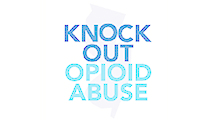

#  New Jersey Legislature Shows Support for Knock Out Opioid Abuse Day

 TRENTON — The New Jersey State Legislature reaffirmed its commitment to fighting the opioid epidemic and its support for the efforts of the Partnership for a Drug-Free New Jersey by proclaiming October 6 as Knock Out Opioid Abuse Day in the state.

 [Read More](http://drugfreenj.org/news/new-jersey-legislature-shows-support-knock-opioid-abuse-day/)

 

#  New Jersey Legislators Discuss Response to Opioid Crisis

 FLORHAM PARK — PDFNJ hosted a breakfast to address the legislative response to NJ’s opioid epidemic Monday morning in Florham Park. From left, Morris County Sheriff James Gannon; Bianca Madzarova, projects specialist for the office of United States Senator Cory Booker; PDFNJ Executive Director Angelo Valente; Barbara Kauffman, Director of Prevention Services at Morris County Prevention is Key; Assemblyman Anthony M. Bucco; and Assemblyman Kevin J. Rooney.

 [Read More](http://drugfreenj.org/news/new-jersey-legislators-discuss-response-opioid-crisis/)

 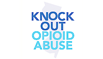

#  New Jersey High Schools to Spread Opioid Awareness through Athletics

 NEW JERSEY — In the coming weeks, student athletes, coaches and administrators from high schools throughout the state will help to spread vital messages about the risks of prescription opioids and their link to heroin use as part of the Partnership for a Drug-Free New Jersey’s third annual Knock Out Opioid Abuse Day.

 [Read More](http://drugfreenj.org/news/new-jersey-high-schools-spread-opioid-awareness-through-athletics/)

 

#  PDFNJ Executive Director Angelo M. Valente Selected to NJ Ad Hall of Fame

 Partnership for a Drug-Free New Jersey Executive Director Angelo Valente will be one of five new members of the Advertising Hall of Fame of New Jersey inducted in 2018, the NJ Ad Club announced Tuesday.

 [Read More](http://drugfreenj.org/news/pdfnj-executive-director-angelo-m-valente-selected-nj-ad-hall-fame/)

 

#  New Jersey Volunteers to Fight Opioid Epidemic on Knock Out Opioid Abuse Day

 NEW JERSEY — Volunteers throughout the state will unite to combat the deadly opioid crisis on Saturday, Oct. 6, by delivering vital information in their communities on the dangers of prescription opioids and their link to heroin use on the third annual Knock Out Opioid Abuse Day.

 [Read More](http://drugfreenj.org/news/new-jersey-volunteers-fight-opioid-epidemic-knock-opioid-abuse-day/)

 

#  PDFNJ’s Angela Conover Discusses Naloxone in Schools with 1450 WCTC’s Bert Baron

 Angela Conover discusses naloxone in NJ high schools.

 [Read More](http://drugfreenj.org/news/pdfnjs-angela-conover-discusses-naloxone-schools-1450-wctcs-bert-baron/)

 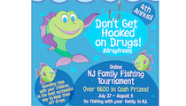

#  Families Catch Fish and Fun in PDFNJ’s Online Fishing Tournament

 MILLBURN — The Partnership for a Drug-Free New Jersey announced six winners today for its fourth annual Don’t Get Hooked on Drugs Online NJ Family Fishing Tournament.

 [Read More](http://drugfreenj.org/news/families-catch-fish-fun-partnership-drug-free-new-jerseys-online-fishing-tournament/)

 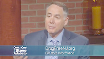

#  One on One With Steve Adubato

 [VIDEO] PDFNJ Ex. Director Angelo Valente Goes ‘One-on-One’ with Steve Adubato to Discuss the Opioid Crisis

 [Read More](http://drugfreenj.org/news/video-pdfnj-ex-director-angelo-valente-goes-one-one-steve-adubato-discuss-opioid-crisis/)

 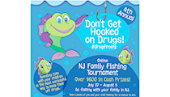

#  PDFNJ Encourages Family Fun with Online Fishing Tournament

 MILLBURN — The Partnership for a Drug-Free New Jersey (PDFNJ) is asking families to cast their lines and reel in some quality time this summer as part of the fourth annual Don’t Get Hooked on Drugs Online NJ Family Fishing Tournament.

 [Read More](http://drugfreenj.org/news/pdfnj-encourages-family-fun-online-fishing-tournament/)

 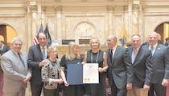

#  New Jersey Senate Honors PDFNJ Co-Chair Elaine Pozycki

 Partnership for a Drug-Free New Jersey Co-Chair Elaine Pozycki received a resolution from the New Jersey State Senate for her leadership in addressing the opioid crisis. From left, Senator Christopher “Kip” Bateman, Senator Joseph Vitale, Caroline Pozycki, Caroline Pozycki Torres, Elaine Pozycki, Harry Pozycki, PDFNJ Executive Director Angelo Valente and Senate President Stephen Sweeney.

 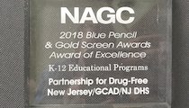

#  PDFNJ’s Shout Down Drugs Program Recognized with National Award

 CAPE CORAL, Fla. — The Partnership for a Drug-Free New Jersey (PDFNJ) earned national acclaim for its New Jersey Shout Down Drugs high school music competition last week at the National Association of Government Communicators’ (NAGC) 2018 Blue Pencil & Gold Screen Awards.

 [Read More](http://drugfreenj.org/news/pdfnjs-shout-down-drugs-program-recognized-national-award/)

 

#  New Jersey Senate to Honor PDFNJ Chair Elaine Pozycki

 TRENTON — The New Jersey Senate will be honoring Elaine Pozycki for her leadership in addressing New Jersey’s opioid epidemic by presenting a resolution at 2 p.m. Thursday, June 21, at the Statehouse.

 [Read More](http://drugfreenj.org/news/new-jersey-senate-honor-pdfnj-chair-elaine-pozycki/)

 

#  PDFNJ Takes Best of Public Relations Trophy at 50th Annual NJ Ad Club Jersey Awards

 PDFNJ Executive Director Angelo Valente and Media Coordinator Matt Birchenough display the Partnership’s five trophies won at the 50th Annual Jersey

 [Read More](http://drugfreenj.org/news/pdfnj-takes-best-public-relations-trophy-50th-annual-nj-ad-club-jersey-awards/)

 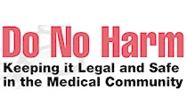

#  Do No Harm Symposium Highlighted at International Conference on Opioids

 BOSTON – The Do No Harm Symposium Series, a prescriber education program organized by the Partnership for a Drug-Free New Jersey (PDFNJ) and the Drug Enforcement Administration (DEA) – New Jersey Division, is being showcased among the programs showcased at the 2018 International Conference on Opioids that began Sunday and will run through Tuesday at Harvard Medical School.

 [Read More](http://drugfreenj.org/news/do-no-harm-symposium-be-highlighted-international-conference-opioids/)

 

#  PDFNJ Participates in White House Sports and Fitness Day

 The White House invited the Partnership and St. Francis Academy in Union City to attend a Sports and Fitness Day. PDFNJ collaborated with St. Francis Academy in Union City to select New Jersey students to accompany the Partnership at the event.

 [Read More](http://drugfreenj.org/news/partnership-drug-free-new-jersey-participates-white-house-sports-fitness-day/)

 

#  Mercer County Residents Discuss Opioid Epidemic with Experts at Town Hall

 An expert panel that included, from left, Barrett Young, Dr. Stuart Roe, Barbara Sprechman, Assemblywoman Verlina Reynolds-Jackson, Dr. Rachael Evans and Mercer County Prosecutor Angelo Onofri provided a comprehensive view of the opioid epidemic and its impact on Mercer County at Wednesday night’s Knock Out Opioid Abuse Town Hall, sponsored by PDFNJ and the Horizon Foundation for New Jersey.

 [Read More](http://drugfreenj.org/news/mercer-county-residents-discuss-opioid-epidemic-experts-town-hall/)

 

#  Experts Detail Opioid Epidemic’s Impact on Essex County

 The Partnership for a Drug-Free New Jersey and the Horizon Foundation for New Jersey hosted the 19th event in the Knock Out Opioid Abuse Town Hall Series in Essex County on Tuesday. Panelists included, from left, Dr. Lewis S. Nelson, Essex County Assistant Prosecutor Michele Miller, Barbara Kauffman, Mariel Hufnagel, Nicholas Beam and Dr. Janet Philips.

 [Read More](http://drugfreenj.org/news/experts-detail-opioid-epidemics-impact-essex-county/)

 

#  Ocean County Prosecutor, Other Experts Lead Opioid Discussion at Town Hall

 LITTLE EGG HARBOR TWP. — Ocean County experts addressed the ongoing opioid crisis at a Knock Out Opioid Abuse Town Hall on Thursday at Calvary Baptist Church in Little Egg Harbor. From left, Michael Capko, Pastor Mike Dellaperute, Liza DeJesus, Dr. Muhammad Abbas and Ocean County Prosecutor Joseph Coronato.

 [Read More](http://drugfreenj.org/news/ocean-county-prosecutor-other-experts-lead-opioid-discussion-town-hall/)

 

#  Statewide Seminar Addresses Impact of Opioid Epidemic and Legalization of Marijuana on the Workplace

 MAYS LANDING — More than 75 small business owners, employers and other New Jersey residents received an in-depth look into the issues affecting the establishment and maintenance of drug-free workplaces at the Partnership for a Drug-Free New Jersey’s annual Legal Issues of a Drug-Free Workplace Statewide Seminar on Wednesday morning.

 [Read More](http://drugfreenj.org/news/statewide-seminar-addresses-impact-opioid-epidemic-legalization-marijuana-workplace/)

 

#  Hunterdon County Residents and Experts Examine Causes and Solutions for Opioid Epidemic

 Hunterdon County experts led a discussion on the opioid epidemic and its impact on Hunterdon County at a Knock Out Opioid Abuse Town Hall organized by the Partnership for a Drug-Free New Jersey and the Horizon Foundation for New Jersey. From left, 1450 WCTC AM radio host Bert Baron, Hunterdon County Executive Assistant Prosecutor Michael Sweeney, Christine Cochrane of Hunterdon Medical Center, State Senator Christopher “Kip” Bateman, Lesley Gabel of Prevention Resources, Karen Widico of Prevention Resources and Frank Lovell III from Freedom House.

 [Read More](http://drugfreenj.org/news/hunterdon-county-residents-experts-examine-causes-solutions-opioid-epidemic/)

 

#  32 Students from NJ Recognized for Prevention Messages at Fourth Grade Folder Contest Ceremony

 POINT PLEASANT BEACH — More than 4,000 fourth grade students from across New Jersey drew their idea of a fun time as part of the Partnership for a Drug-Free New Jersey’s Design a Fourth Grade Folder contest this year, but just two will have their designs appear on the folder distributed annually to thousands of fourth graders throughout the state.

 [Read More](http://drugfreenj.org/news/bergen-burlington-county-students-recognized-substance-use-prevention-messages-fourth-grade-folder-contest-ceremony/)

 

#  Passaic County Experts Provide Comprehensive View of the Opioid Epidemic’s Local Impact

 PDFNJ and the Horizon Foundation for New Jersey held a Knock Out Opioid Abuse Town Hall in Passaic County on Thursday at the Hawthorne Gospel Church. The expert panel of speakers featured, from left, Alton Robinson, Tim Stanley, Dr. William Kernan, Dr. Steve Aydin, Dr. Adelaide Viguri and Passaic County Prosecutor Camelia M. Valdes.

 [Read More](http://drugfreenj.org/news/passaic-county-experts-provide-comprehensive-view-opioid-epidemics-local-impact/)

 

#  Bergen County Teen Wins Statewide Substance Use Prevention Music Competition

 MENDHAM — Students from across New Jersey united Friday night to deliver a stirring collection of musical substance use prevention messages at the 14th Annual New Jersey Shout Down Drugs Prevention Concert held at Daytop New Jersey by PDFNJ. Maria Chung, a student at Northern Valley Regional High School at Old Tappan in Bergen County, won first place for her original song, “You Could Have Done Better.”

 [Read More](http://drugfreenj.org/news/bergen-county-teen-wins-statewide-substance-use-prevention-music-competition/)

 

#  Experts and Residents Examine Impact, Solutions to Opioid Crisis at Hudson County Town Hall

 JERSEY CITY — A group of Hudson County and national experts on the opioid epidemic provided a comprehensive view of the deadly epidemic for an audience of hundreds of county residents who attended Tuesday’s Knock Out Opioid Abuse Town Hall, organized by the Partnership for a Drug-Free New Jersey and the Horizon Foundation for New Jersey.

 [Read More](http://drugfreenj.org/news/experts-residents-examine-impact-solutions-opioid-crisis-hudson-county-town-hall/)

 

#  Cape May County Experts and Residents Seek Solutions at Opioid Town Hall

 DENNIS TWP. — A group of Cape May County residents engaged in dialogue with experts, who advocated for a diverse and coordinated response to help find solutions to the statewide opioid crisis at a Knock Out Opioid Abuse Town Hall held Thursday morning, sponsored by the Partnership for a Drug-Free New Jersey and the Horizon Foundation for New Jersey.

 [Read More](http://drugfreenj.org/news/cape-may-county-experts-residents-seek-solutions-opioid-town-hall/)

 

#  PDFNJ and PSEG Foundation Bring Substance Use Prevention Efforts to the Classroom

 PDFNJ and the PSEG Foundation delivered the Third Grade Contract for a Healthy Life to students at Yantacaw School in Nutley on Tuesday, April 10. From left, John Latka, Senior Vice President of Electric and Gas Operations for PSE&G Yantacaw School Principal Frank Francia; Maria Spina, Program Officer for the PSEG Foundation; Angelo Valente, Executive Director of PDFNJ; and school nurse Katherine Flannery.

 [Read More](http://drugfreenj.org/news/pdfnj-pseg-foundation-bring-substance-use-prevention-efforts-classroom/)

 

#  Drugs Don’t Work in NJ! Seminar to Highlight Importance of Drug-Free Workplace Policies

 MILLBURN – The Partnership for a Drug-Free New Jersey (PDFNJ) will focus on substance use in the workplace next month at its annual Legal Issues of a Drug-Free Workplace Statewide Seminar.

 [Read More](http://drugfreenj.org/news/drugs-dont-work-nj-seminar-highlight-importance-drug-free-workplace-policies/)

 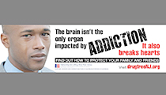

#  PDFNJ Teams with Lamar Advertising in Campaign Showing Effects of Addiction

 MILLBURN – The Partnership for a Drug-Free New Jersey (PDFNJ) has launched a new media campaign highlighting the emotional pain associated with addiction and has received help spreading that message from the advertising community.

 [Read More](http://drugfreenj.org/news/pdfnj-teams-lamar-advertising-campaign-showing-effects-addiction/)

 

#  Horizon Foundation Helps PDFNJ Prepare Parents to Prevent Substance Use in Their Families

 OLD BRIDGE – The Partnership for a Drug-Free New Jersey (PDFNJ), with critical support from The Horizon Foundation for New Jersey, has once again ensured that thousands of New Jersey parents will be well-equipped to speak with the children about substance use.

 [Read More](http://drugfreenj.org/news/horizon-foundation-helps-pdfnj-prepare-parents-prevent-substance-use-their-families/)

 

#  Ex. Dir. Angelo Valente Discusses Upcoming PDFNJ Events on Comcast Newsmakers [VIDEO]

 Jill Horner speaks with Angelo Valente, Executive Director from the Partnership For A Drug-Free New Jersey, about Shout Down Drugs, Middle school PSA, and Knock Out Opioid Abuse Town Hall Series.

 [Read More](http://drugfreenj.org/news/ex-dir-angelo-valente-discusses-upcoming-pdfnj-events-comcast-newsmakers-video/)

 

#  CDC Study Finds Significant Increase in Opioid Overdoses

 “The CDC report released today is yet another indicator that the opioid epidemic is still raging in communities throughout the country,” PDFNJ Ex. Dir. Angelo Valente said. “No person or community, regardless of gender, race, economic standing or any other factor, is immune to this crisis.”

 [Read More](http://drugfreenj.org/news/cdc-study-finds-significant-increase-opioid-overdoses/)

 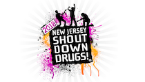

#  PDFNJ Announces 18 Finalists in the New Jersey Shout Down Drugs Music Competition

 MILLBURN — New Jersey students representing 13 counties have been chosen as finalists in the 2018 New Jersey Shout Down Drugs music competition organized by the Partnership for a Drug-Free New Jersey (PDFNJ).

 [Read More](http://drugfreenj.org/news/pdfnj-announces-18-finalists-new-jersey-shout-down-drugs-music-competition/)

 

#  PDFNJ Ex. Dir. Angelo M. Valente Visits NJ Recovery Center with Senator Menendez

 ELIZABETH, N.J. – U.S. Senator Bob Menendez, a senior member of the Senate Finance Committee that sets national health policy, today toured a local recovery center in Elizabeth, where he met with experts and individuals in recovery, and discussed additional federal resources available to help New Jersey combat the growing opioid epidemic.

 [Read More](http://drugfreenj.org/news/menendez-visits-nj-recovery-center-lauds-6b-new-federal-funding-combat-opioid-crisis-video/)

 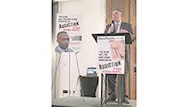

#  Experts and Affected Residents Unite to Discuss Opioid Crisis at PDFNJ’s Family Breakfast

 MOUNT LAUREL — More than 100 New Jersey residents directly affected by the ongoing opioid crisis discussed the crisis with experts Wednesday morning at the Partnership for a Drug-Free New Jersey’s Third Annual Breakfast for Families and Communities Impacted by Opioid Abuse.

 [Read More](http://drugfreenj.org/news/experts-affected-residents-unite-discuss-opioid-crisis-pdfnjs-family-breakfast/)

 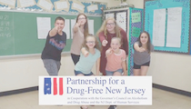

#  Hamilton Township Students Write Winning Script in Partnership for a Drug-Free New Jersey’s Middle School PSA Challenge

 HAMILTON — A group of six Hamilton Township middle school students will soon be seen on televisions across New Jersey delivering a strong message on the importance of substance use prevention as part of the Partnership for a Drug-Free New Jersey’s (PDFNJ) annual statewide Middle School Public Service Announcement (PSA) Challenge.

 [Read More](http://drugfreenj.org/news/hamilton-township-students-write-winning-script-partnership-drug-free-new-jerseys-middle-school-psa-challenge/)

 

#  PDFNJ Ex. Dir. Angelo M. Valente Discusses Opioid Legislation on CBS 2

 PDFNJ Executive Director Angelo Valente spoke with CBS 2 – New York about legislation adopted in New Jersey last year limiting initial opioid prescriptions to a five-day supply.

 [Read More](http://drugfreenj.org/news/newyorkcbslocalcom-prescription-addiction-patients-sue-doctors-saying-they-got-them-hooked-opioids/)

 

#  LISTEN - PDFNJ Discusses Opioid Crisis on Salt Lake City Radio Station

 PDFNJ Co-Chair Elaine Pozycki and Ex. Dir. Angelo M. Valente discussed the opioid crisis last week on the “Rod Arquette Show” on 105.9 KNRS in Salt Lake City. They discussed legislation adopted last year in New Jersey that requires prescribers to discuss with their patients the addictive nature of opioid painkillers and possible alternatives to opioids before prescribing them.

 [Read More](http://drugfreenj.org/news/listen-pdfnj-discusses-opioid-crisis-salt-lake-city-radio-station/)

 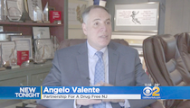

#  PDFNJ Executive Director Discusses the Opioid Crisis with CBS 2

 [Last] Wednesday, CBS2’s Ali Bauman had the opportunity to sit down with them [women in recovery] and find out why they’re speaking so openly and freely about their fight with addiction.

 [Read More](http://drugfreenj.org/news/newyorkcbslocalcom-seen-11-new-jersey-women-open-up-about-battles-heroin-addiction/)

 

#  Majority of New Jersey Residents Surveyed ‘Not Very Concerned’ About Dangers of Prescription Opioids

 MILLBURN — Nearly half of New Jersey residents who participated in a recent survey report little or no concern about the potential dangers of prescription pain medication to themselves or a family member, according to the study released today by the Partnership for a Drug-Free New Jersey (PDFNJ).

 [Read More](http://drugfreenj.org/news/majority-new-jersey-residents-surveyed-not-very-concerned-about-dangers-prescription-opioids/)

 

#  Deadline to Enter New Jersey Shout Down Drugs Competition is February 1

 MILLBURN — New Jersey high school students are invited to share their musical drug prevention messages as part of the 2018 New Jersey Shout Down Drugs music competition, organized by the Partnership for a Drug-Free New Jersey.

 [Read More](http://drugfreenj.org/news/deadline-enter-new-jersey-shout-down-drugs-competition-february-1/)

 

#  PDFNJ Study: Media Campaign Produces Increased Efforts to Prevent Opioid Abuse

 MILLBURN — Media messages motivate New Jersey residents to take action steps to prevent opioid abuse in their homes and communities, according to a study recently released by the Partnership for a Drug-Free New Jersey (PDFNJ).

 [Read More](http://drugfreenj.org/news/pdfnj-study-media-campaign-produces-increased-efforts-prevent-opioid-abuse/)

 

#  Middlesex County Experts and Residents Hold Dialogue on Opioid Crisis at Knock Out Opioid Abuse Town Hall

 Hundreds of Middlesex County residents arrived in East Brunswick on Tuesday night to discuss the opioid crisis affecting New Jersey. The expert panel, from left, included Middlesex County Prosecutor Andrew C. Carey; New Jersey State Senator Joseph Vitale (D ¬– Middlesex); Assemblywoman Nancy Pinkin (D – Middlesex); Vanessa Vitolo, outreach coordinator with Victory Bay Recovery Center; Bonnie Nolan, addiction services coordinator for Woodbridge Township; and moderator Bert Baron of 1450 WCTC.

 [Read More](http://drugfreenj.org/news/middlesex-county-experts-residents-hold-dialogue-opioid-crisis-knock-opioid-abuse-town-hall/)

 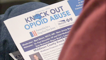

#  fios1news.com: East Brunswick town hall talks taking on the opioid epidemic

 On Tuesday night, a town hall meeting in Middlesex County brought residents together to talk and work towards lowering that number to zero.

 [Read More](http://www.fios1news.com/newjersey/east-brunswick-town-hall-opioid-epidemic#.WjGBBEpKtPZ)

 

#  This Is Jersey with Gary Gellman - Interview w/ PDFNJ Ex. Dir. Angelo M. Valente [VIDEO]

 [Read More](http://drugfreenj.org/news/this-jersey-gary-gellman-interview-w-pdfnj-ex-dir-angelo-m-valente-video/)

 

#  Experts Discuss Many Factors of Opioid Epidemic in Union County’s Knock Out Opioid Abuse Town Hall

 The Partnership for a Drug-Free New Jersey held its 12th Knock Out Opioid Abuse Town Hall on Tuesday in Union County. The expert panel featured, from left, Alton Robinson, Mariel Hufnagel, Pam Capaci, Sheriff Joseph Cryan, Acting Prosecutor Thomas K. Isenhour and Dr. Andrew Kaufman.

 [Read More](http://drugfreenj.org/news/experts-discuss-many-factors-opioid-epidemic-union-countys-knock-opioid-abuse-town-hall/)

 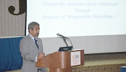

#  Nationally Recognized Oral Surgeon, Other Experts Inform Doctors and Dentists on Safer Opioid Prescribing

 Dr. A. Omar Abubaker, a dentist and oral surgeon who lost his son, Adam, to a heroin overdose in 2014, addressed an audience of dentists and doctors on safer prescribing of opioids at Thursday's Do No Harm Symposium hosted by the Partnership for a Drug-Free New Jersey at JFK Medical Center.

 [Read More](http://drugfreenj.org/news/test/)

 

#  njtvonline.org: Christie defends president’s opioid crisis declaration [VIDEO]

 Critics in the substance abuse treatment community Friday continued to find fault with Donald Trump’s approach to solving the nation’s opioid epidemic. The president declared a temporary public health emergency that included no extra federal funding. Trump promised treatment, but emphasized anti-drug education.

 [Read More](http://drugfreenj.org/news/njtvonlineorg-christie-defends-presidents-opioid-crisis-declaration/)

 

#  njtvonline.org: HEALTH Are doctors changing their prescribing habits? [VIDEO]

 Medical professionals from New York and New Jersey were taking notes at a “Do No Harm” symposium and staring at the staggering statistics for overdose deaths in just the first half of 2016 compared to all of 2015.

 [Read More](http://drugfreenj.org/news/njtvonlineorg-health-are-doctors-changing-their-prescribing-habits-video/)

 

#  cinnaminsonsun.com: Burlington County talks impact and solutions to opioid abuse at Knock Out Opioid Abuse Town Hall

 Burlington County residents and other officials gathered at Rowan College at Burlington County in Mt. Laurel last week as part of the Partnership for a Drug-Free New Jersey’s latest stop in the statewide “Knock Out Opioid Abuse” town hall series.

 [Read More](http://drugfreenj.org/news/cinnaminsonsuncom-burlington-county-talks-impact-solutions-opioid-abuse-knock-opioid-abuse-town-hall/)

 

#  Bergen County Volunteers and PDFNJ Continue to Spread Life-Saving Message at ‘Friday Night Lights Out to Knock Out Opioid Abuse’

 PDFNJ Executive Director Angelo Valente and State Assemblyman Kevin Rooney hand out #KnockOutOpioidAbuse wristbands to fans prior to the Don Bosco versus Bergen Catholic football game Friday night.

 [Read More](http://drugfreenj.org/news/bergen-county-volunteers-pdfnj-continue-spread-knock-opioid-abuse-message-high-school-football-games/)

 

#  Somerset County Experts, Residents Focus on Opioid Epidemic at Knock Out Opioid Abuse Town Hall

 BERNARDSVILLE — Residents of Somerset County gathered at Bernards High School on Tuesday night to not only learn from experts but also to share their own knowledge and concerns about the opioid epidemic ravaging New Jersey at the Partnership for a Drug-Free New Jersey’s Knock Out Opioid Abuse Town Hall.

 [Read More](http://drugfreenj.org/news/somerset-county-experts-residents-focus-opioid-epidemic-knock-opioid-abuse-town-hall/)

 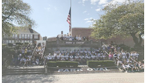

#  northjersey.com - Opioids: Nutley athletes raise awareness

 Nutley High School student-athletes sought Friday to help educate those at high risk for opioid abuse, including themselves.

 [Read More](http://drugfreenj.org/news/northjerseycom-opioids-nutley-athletes-raise-awareness/)

 

#  Angelo Valente, PDFNJ Executive Director, Discusses Knock Out Opioid Abuse Day on 1450 WCTC

 Partnership for a Drug-Free New Jersey Executive Director Angelo Valente spoke with Bert Baron of 1450 WCTC about the importance of Knock Out Opioid Abuse Day. Today, volunteers around the state will be spreading critical information on the risks of prescription opioids and their link to heroin abuse. Valente also spoke about the Knock Out Opioid Abuse Town Hall Series, which will be moving to Somerset County on October 10.

 [Read More](http://drugfreenj.org/news/angelo-valente-pdfnj-ex-dir-speaks-bert-baron-1450-wctc/)

 

#  SAVE THE DATE: Knock Out Opioid Abuse Day in New Jersey - October 6, 2017

 The statewide single-day initiative will mobilize the prevention and treatment communities, community leaders and concerned citizens to raise awareness of the potential for dependency on prescribed pain medicine and its link to heroin abuse rates in our state. Teams of volunteerswill visit physician and dental offices, as well as homes in local communities, to distribute this vital information.

 [Read More](http://drugfreenj.org/knockoutvolunteers/)

 

#  Knock Out Opioid Abuse Town Hall Brings Opioid Discussion to Cumberland, Gloucester and Salem Counties

 SEWELL — Residents of Cumberland, Gloucester and Salem counties gathered at Rowan College at Gloucester County to join the conversation on the opioid epidemic ravaging families and communities throughout the state at Wednesday night’s Knock Out Opioid Abuse Town Hall held by the Partnership for a Drug-Free New Jersey (PDFNJ).

 [Read More](http://drugfreenj.org/news/knock-opioid-abuse-town-hall-brings-opioid-discussion-cumberland-gloucester-salem-counties/)

 

#  njherald.com: Opioid crisis unites public, professionals at town hall

 ANDOVER TOWNSHIP -- The opioid epidemic is very real and very much in our own backyards. So what is being done about it? That was the question at the forefront Friday morning at The Center for Prevention and Counseling during the Knock Out Opioid Abuse town hall, a series presented by the Partnership for a Drug-Free New Jersey.

 [Read More](http://drugfreenj.org/news/njheraldcom-opioid-crisis-unites-public-professionals-town-hall/)

 

#  Sussex County Residents Focus on Solutions to Opioid Epidemic at Knock Out Opioid Abuse Town Hall

 ANDOVER — A standing-room-only crowd of Sussex County residents packed The Center for Prevention & Counseling on Friday to join the conversation on the statewide opioid epidemic gripping New Jersey at the Partnership for a Drug-Free New Jersey’s Knock Out Opioid Abuse Town Hall.

 [Read More](http://drugfreenj.org/news/sussex-county-residents-focus-solutions-opioid-epidemic-knock-opioid-abuse-town-hall/)

 

#  Medical Professionals Gather to Develop Solutions to Opioid Abuse Epidemic at Do No Harm Symposium

 HACKETTSTOWN — Dozens of medical professionals gathered at Hackettstown Regional Medical Center on Tuesday to learn what role they can play in stemming the current opioid crisis at the Partnership for a Drug-Free New Jersey’s (PDFNJ) Do No Harm Symposium.

 [Read More](http://drugfreenj.org/news/medical-professionals-gather-develop-solutions-opioid-abuse-epidemic-do-no-harm-symposium/)

 

#  comcastnewsmakers.com [VIDEO]: Angelo Valente, Ex. Dir. PDFNJ Sits Down with Jill Horner

 Jill Horner speaks with Angelo Valente, Executive Director from the Partnership For a Drug-Free New Jersey, about the Knock Out Opioid Abuse Town Hall Series.

 [Read More](http://drugfreenj.org/news/comcastnewsmakerscom-video-angelo-valente-ex-dir-pdfnj-sits-down-jill-horner/)

 

#  PDFNJ Fishing Tournament Brings Families Together

 MILLBURN — The Partnership for a Drug-Free New Jersey announced six winners today in its third annual Don’t Get Hooked on Drugs Online NJ Family Fishing Tournament.

 [Read More](http://drugfreenj.org/news/pdfnj-fishing-tournament-big-success-families/)

 

#  Pres. Trump declares opioid crisis is a national emergency, pledges more money and attention

 President Trump on Thursday declared the country’s opioid crisis a national emergency, saying the scourge exceeded anything he had seen with other drugs in his lifetime.

 [Read More](http://drugfreenj.org/news/washingtonpostcom-trump-declares-opioid-crisis-national-emergency-pledges-more-money-attention/)

 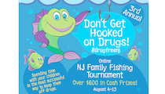

#  3rd Annual Don't Get Hooked on Drugs Fishing Contest!

 Online NJ Family Fishing Tournament - Over $600 in Cash Prizes! - August 4-13: Go fishing with your family in NJ. Take a photo of you and your child fishing for a chance to win. Like us on Facebook at PartnershipForADrugFreeNewJersey or follow us on Twitter @drugfreenj and Instagram at drugfreenj, then post the picture of your group and tag it with #drugfreenj

 [Read More](http://drugfreenj.org/news/3rd-annual-dont-get-hooked-drugs-fishing-contest/)

 

#  BATTLING THE OPIOID EPIDEMIC

 This special two part broadcast airing on Friday July 21st and repeated on Friday, August 18th, from 9 PM to 10 PM focuses on the critical problem facing America. These shows, part I will air the week of September 19th, part II the week of September 26, 2017 on CUNY TV, airing 8 times during the week.

 [Read More](http://drugfreenj.org/news/battling-opioid-epidemic/)

 

#  Hamilton Township Students Write Winning Script in PDFNJ’s Middle School PSA Challenge

 The winners of the 2017 Middle School PSA Challenge are, from left, Alyssa Johnson, Matthew Valyo, Ashley Schoener, Regina Jannetto, Hannah Linkowsky and Meghan Krencicki from Grice Middle School in Hamilton Township.

 [Read More](http://drugfreenj.org/news/hamilton-township-students-write-winning-script-pdfnjs-middle-school-psa-challenge/)

 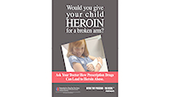

#  PDFNJ Claims Two First-Place Trophies at NJ Ad Club Jersey Awards

 MILLBURN — The Partnership for a Drug-Free New Jersey (PDFNJ) earned five awards, including two first prizes, at the 49th Annual NJ Ad Club Jersey Awards held Wednesday, June 7.

 [Read More](http://drugfreenj.org/news/partnership-drug-free-new-jersey-claims-two-first-place-trophies-nj-ad-club-jersey-awards/)

 

#  Gov. Chris Christie Stresses Increased Prescriber Education, Destigmatizing Addiction in Do No Harm Keynote Speech on Opioid Crisis

 Gov. Chris Christie addressed medical professionals Monday, June 12, at the Partnership for a Drug-Free New Jersey’s Do No Harm symposium at Morristown Medical Center. The governor was joined on stage by Partnership Chair Elaine Pozycki and Executive Director Angelo Valente.

 [Read More](http://drugfreenj.org/news/gov-chris-christie-stresses-increase-prescriber-education-destigmatizing-addiction-keynote-speech-opioid-crisis/)

 

#  Former Gov. James Florio Honored with Drugs Don’t Work in NJ! Founder’s Award at Annual Seminar

 Former Gov. James Florio, left, pictured alongside Partnership for a Drug-Free New Jersey Executive Director Angelo Valente, received the Drugs Don’t Work in NJ! Founder’s Awards for his foresight and vision in establishing Drugs Don’t Work in NJ! to help New Jersey businesses at Wednesday’s annual Legal Issues of a Drug-Free Workplace Statewide Seminar held at Saint Peter’s University.

 [Read More](http://www.fios1news.com/newjersey/former-nj-governor-honored#.WTmCSGgrKUl)

 

#  Register Now for the 20th Annual Legal Issues of a Drug-Free Workplace Seminar

 Governor James J. Florio will be presented with the Drugs Don’t Work in NJ! Founder’s Award for his foresight and vision in establishing Drugs Don’t Work in NJ as a resource for the New Jersey business community to be compassionate and competitive.

 [Read More](http://drugfreenj.org/ddw2017registration/)

 

#  Bergen County Teens Win Statewide Substance Abuse Prevention Music Competition

 NEW BRUNSWICK – The musical substance abuse prevention messages of 21 high school students cascaded from the stage at Rutgers University’s Nicholas Music Center on Friday, May 19, at the Partnership for a Drug-Free New Jersey’s 13th Annual New Jersey Shout Down Drugs Prevention Concert.

 [Read More](http://drugfreenj.org/news/bergen-county-teens-win-statewide-substance-abuse-prevention-music-competition/)

 

#  tapinto.net: Huge Crowd Attends Opioid Abuse Discussion in Morristown

 MORRISTOWN, NJ —The Knock Out Opioid Abuse Town Hall meeting drew a capacity crowd seeking to learn from a panel of experts and engage in a discussion about the opioid crisis. The event, sponsored the Horizon Foundation for New Jersey, the Morris County Prosecutor’s Office, the Morris County Sheriff’s Office and the Community Coalition for a Safe & Healthy Morris, allowed Morris County residents to join the conversation surrounding the opioid epidemic.

 [Read More](http://drugfreenj.org/news/tapintonet-huge-crowd-attends-opioid-abuse-discussion-morristown/)

 

#  Parsippany hosts 'Knockout Opioid Abuse' town hall meeting [VIDEO]

 The goal of the town hall is to help people understand addiction and help protect their families

 [Read More](http://drugfreenj.org/news/parsippany-hosts-knockout-opioid-abuse-town-hall-meeting-video/)

 

#  Watch Alert: PDFNJ Ex. Dir, Angelo M. Valente on State of Affairs

 PDFNJ Ex. Dir., Angelo M. Valente appeared on State of Affairs with Steve Adubato to discuss the opioid epidemic, PDFNJ's role in the fight against addiction, and the important collaboration PDFNJ has with Horizon Foundation of New Jersey to combat this crisis.

 [Read More](http://drugfreenj.org/news/watch-alert-pdfnj-ex-dir-angelo-m-valente-state-affairs/)

 

#  Student Finalists in Statewide Drug Prevention Folder Artwork Contest Recognized at Award Ceremony

 SAYREVILLE, N.J. — More than 6,000 fourth grade students from across New Jersey participated in the Partnership for a Drug-Free New Jersey’s Fourth Grade Folder contest, but just 30 earned their way to the award ceremony held May 3 at the Middlesex County Fire Academy.

 [Read More](http://drugfreenj.org/news/student-finalists-statewide-drug-prevention-folder-artwork-contest-recognized-award-ceremony/)

 

#  [VIDEO] Governor Christie Lauds Partnership for a Drug-Free New Jersey’s Efforts to Combat Opioid Epidemic

 TOMS RIVER — Governor Chris Christie praised the Partnership for a Drug-Free New Jersey (PDFNJ) for its leadership in the state and country in the fight against the opioid crisis, during a press conference on National Prescription Drug Take Back Day being held Saturday, April 29.

 [Read More](http://drugfreenj.org/news/video-pdfnj-ex-dir-angelo-m-valente-introduces-gov-christie-national-prescription-take-back-day-event/)

 

#  comcastnewsmakers.com: [VIDEO] Town Hall Meetings about a Drug Free NJ with Angelo Valente

 Jill Horner speaks with Angelo Valente, Executive Director from the Partnership For a Drug-Free New Jersey, about Town Hall Meetings in NJ addressing the opioid epidemic.

 [Read More](http://drugfreenj.org/news/comcastnewsmakerscom-video-town-hall-meetings-about-drug-free-nj-angelo-valente/)

 

#  dailyrecord.com: Heroin scourge in focus for Morris Sheriff Gannon in first 100 days

 On June 4, Morris County Sheriff Gannon plans to open the Hope Wing at the Morris County correctional facility in Morris Township. A jail pod, or unit, with about 50 beds will be designated for eligible inmates who want to voluntarily use their time confined to start overcoming addiction

 [Read More](http://drugfreenj.org/news/dailyrecordcom-heroin-scourge-focus-morris-sheriff-gannon-first-100-days/)

 

#  Knock Out Opioid Abuse Town Hall Series Kicks Off in Atlantic County

 GALLOWAY — Atlantic County residents arrived at Stockton University on Monday to join the conversation on the opioid crisis facing the nation at the Partnership for a Drug-Free New Jersey’s first Knock Out Opioid Abuse Town Hall.

 [Read More](http://drugfreenj.org/news/knock-opioid-abuse-town-hall-series-kicks-atlantic-county/)

 

#  pressofatlanticcity.com: Atlantic County residents explore how to tackle opioid epidemic

 The gathering, organized by Partnership for a Drug-Free New Jersey and Horizon Foundation for New Jersey, was one in a series of events taking place statewide to fuel discussion about the skyrocketing rates of addiction and overdoses.

 [Read More](http://drugfreenj.org/news/pressofatlanticcitycom-atlantic-county-residents-explore-how-tackle-opioid-epidemic/)

 

#  snjtoday.com: Drug Symposium Educates Nursing Students in Salem County

 PENNS GROVE, N.J. - Opioid abuse is tragically a growing issue not only here in the Garden Sate, but across the entire country. In response to this epidemic, the Partnership for a Drug-Free New Jersey organization made its way to Salem County to educate nursing students on the staggering statistics that are growing each year.

 [Read More](http://drugfreenj.org/news/snjtodaycom-drug-symposium-educates-nursing-students-salem-county/)

 

#  foxnews.com: Most teens who abuse opioids 1st got them from a doctor

 Most American teenagers who abuse opioid drugs first received the drugs from a doctor, a new study finds.

 [Read More](http://drugfreenj.org/news/foxnewscom-most-teens-who-abuse-opioids-1st-got-them-doctor/)

 

#  Horizon Supports PDFNJ Efforts to Empower Parents to Prevent Opioid and Other Substance Misuse in Their Family

 MILLBURN --- Deciding when and how to talk to your kids about drugs can be a big decision. Thanks to the support of the Horizon Foundation for New Jersey, for the 17th year, the Partnership for a Drug-Free New Jersey (PDFNJ) is able to provide parents information on how and when to have those conversations.

 [Read More](http://drugfreenj.org/news/horizon-supports-pdfnj-efforts-empower-parents-prevent-opioid-other-substance-misuse-their-family/)

 

#  mtlaurelsun.com - Sun Editorial: End to the ‘American Epidemic?’

 New Jersey is aiming to attack the opioid problem at its source — the prescriber.

 [Read More](http://drugfreenj.org/news/mtlaurelsuncom-sun-editorial-end-american-epidemic/)

 

#  pressofatlanticcity.com: JTAC brings religious, faith based leaders together to address addiction

 MAYS LANDING — Seeking guidance and help from a religious or faith-based leader is common for families and people impacted by addiction.

 [Read More](http://drugfreenj.org/news/pressofatlanticcitycom-jtac-brings-religious-faith-based-leaders-together-address-addiction/)

 

#  fios1news.com: Gov. Christie signs new legislation aimed at curbing opioid addiction [VIDEO]

 The new law limits the initial supply of pain pills that can be prescribed and aids people getting into addiction treatment

 [Read More](http://www.fios1news.com/newjersey/gov-christie-signs-new-legislation-opioid-addiction#.WLA6nDsrJPY)

 

#  comcastnewsmakers.com: [VIDEO] Opioid Abuse Epidemic with Angelo Valente of Partnership for a Drug-Free NJ

 Jill Horner speaks with Angelo Valente, Executive Director from the Partnership for a Drug-Free NJ, about Opioid Abuse Epidemic.

 [Read More](http://drugfreenj.org/news/comcastnewsmakerscom-video-opioid-abuse-epidemic-angelo-valente-partnership-drug-free-nj/)

 

#  nj1015.com: Christie signs new painkiller prescription limit into law

 Completing a challenge issued to the legislature in his State of the State address last month and continuing his most aggressive, innovative campaign in the nation against drug addiction, Governor Christie signed into law today his life-saving healthcare reform that will guarantee insurance coverage for people to access immediate treatment and to limit initial opioid prescriptions.

 [Read More](http://drugfreenj.org/news/nj1015com-christie-signs-new-painkiller-prescription-limit-law/)

 

#  We need a comprehensive approach to N.J.'s opioid crisis | Opinion

 Robert A. Marino, Chairman, President & CEO of Horizon Blue Cross Blue Shield of New Jersey, and a member of PDFNJ’s Executive Committee, has authored a recent Star-Ledger editorial calling for the need for a comprehensive approach to address New Jersey’s opioid epidemic.

 [Read More](http://drugfreenj.org/news/njcom-we-need-comprehensive-approach-njs-opioid-crisis-opinion/)

 

#  app.com: New opioid law would put NJ out front

 Six years after the Centers for Disease Control and Prevention declared prescription drug overdoses “An American Epidemic,” the state Legislature is set to enact the strongest measures in the country to cut into the opioid and heroin crisis.

 [Read More](http://drugfreenj.org/news/appcom-new-opioid-law-would-put-nj-front/)

 

#  New Jersey: First in the Nation to Require Physicians to Discuss Addictive Qualities of Opiates Prior to Prescribing

 (TRENTON) – Legislation sponsored by Assembly Democrats Joseph Lagana, Nancy Pinkin, Valerie Vainieri Huttle, Marlene Caride, Ralph Caputo and Benjie Wimberly enlisting the aid of healthcare providers in discussing the dangers of certain opioid medications prior to issuing a prescription to patients who are minors was signed into law on Monday.

 [Read More](http://drugfreenj.org/news/new-jersey-first-nation-require-physicians-discuss-addictive-qualities-opiates-prior-prescribing/)

 

#  PDFNJ Ex. Dir. Angelo M. Valente, five others win Everyday Hero Awards from NJTV

 Angelo M. Valente accepts his award for prevention from John Servidio, General Manager, NJTV at NJTV's Healthy NJ: New Jersey's Drug Addiction Crisis Everyday Heroes Award Celebration.

 [Read More](http://drugfreenj.org/news/appcom-coronato-five-others-win-everyday-hero-awards-njtv/)

 

#  app.com: Advocates, critics react to Christie's sweeping drug plan

 Anti-drug advocates hailed Gov. Chris Christie's pledge Tuesday to make New Jersey's addiction crisis a top job in the final year of his term in office, but there were worries about funding and follow through.

 [Read More](http://drugfreenj.org/news/appcom-advocates-critics-react-christies-sweeping-drug-plan/)

 

#  PDFNJ Applauds Governor’s Prevention Plan in State of State Address

 MILLBURN --- The Partnership for a Drug-Free New Jersey applauds Governor Chris Christie for his announcement today during the 2017 State of the State address, highlighting the fact that the majority of heroin addicts first became addicted through the use of prescription opioids and four out of every five new heroin users got started by misusing prescription painkillers.

 [Read More](http://drugfreenj.org/news/pdfnj-applauds-governors-prevention-plan-state-state-address/)

 

#  OPIOID ADDICTION HEADS TO GOVERNOR'S DESK

 (TRENTON) – Legislation sponsored by Assembly Democrats Joseph Lagana, Nancy Pinkin, Valerie Vainieri Huttle, Marlene Caride, Ralph Caputo and Benjie Wimberly enlisting the aid of healthcare providers in discussing the dangers of certain opioid medications prior to issuing a prescription to patients who are minors was approved, 77-0, by the full Assembly on Monday.

 [Read More](http://drugfreenj.org/news/opioid-addiction-heads-governors-desk/)

 

#  Bill Would Require Minors Getting Opioids Be Notified of Addiction Risk [VIDEO]

 The state’s opioid addiction toll on young people is staggering. Last year 1,587 people died of overdoses. The Governor’s Council on Alcoholism and Drug Abuse reported some 4,200 people under the age of 25 were admitted to substance abuse treatment programs in 2012.

 [Read More](http://drugfreenj.org/news/njtvonlineorg-bill-would-require-minors-getting-opioids-be-notified-addiction-risk/)

 

#  Lagana, Pinkin, Vainieri Huttle, Caride, Caputo & Wimberly Bill Enlisting the Aid of Physicians in the Conversation with Teens on Opioid Addiction Advances

 (TRENTON) – An Assembly panel on Monday approved legislation sponsored by Assembly Democrats Joseph Lagana, Nancy Pinkin, Valerie Vainieri Huttle, Marlene Caride, Ralph Caputo and Benjie Wimberly enlisting the aid of healthcare providers in discussing the dangers of certain opioid medications prior to issuing a prescription to patients who are minors.

 [Read More](http://drugfreenj.org/news/lagana-pinkin-vainieri-huttle-caride-caputo-wimberly-bill-enlisting-aid-physicians-conversation-teens-opioid-addiction-advances/)

 

#  VITALE-WEINBERG BILL REQUIRING CONTINUING EDUCATION FOR HEALTH CARE PROFESSIONALS ON PRESCRIBING OPIOIDS CLEARS SENATE

 TRENTON – Legislation sponsored by Senator Joseph F. Vitale and Senate Majority Leader Loretta Weinberg that would require certain health care professionals to complete continuing education credits on topics related to prescription opioids cleared the Senate today.

 [Read More](http://drugfreenj.org/news/vitale-weinberg-bill-requiring-continuing-education-health-care-professionals-prescribing-opioids-clears-senate/)

 

#  State Dental Association, NJDA, Leads Conversation on Safe Prescribing

 Mark Vitale, President of the New Jersey Dental Association (NJDA) and Angelo Valente, Executive Director, PDFNJ attend the Do No Harm symposium at Monmouth Medical Center to educate members of the dental community on the heroin and prescription drug abuse epidemic in New Jersey and develop solutions to stem the public health crisis.

 [Read More](http://drugfreenj.org/news/new-prescribing-guidelines-opiates-released-state-dental-association-njda-leads-conversation-safe-prescribing/)

 

#  Over 2,000 New Jerseyans Took to The Streets to Knock Out Opiate Abuse on October 6th

 Throughout New Jersey thousands of moms, dads, prevention and treatment professionals, students and concerned citizens are taking to the streets to raise awareness about the opiate abuse epidemic impacting our state.

 [Read More](http://www.drugfreenj.org/galleries/gallery/KOOAphotos/)

 

#  nj.com: Narcan used 18K times on N.J. overdose victims since 2014

 Since 2014, New Jersey emergency officials have deployed opioid overdose reversal drug Narcan more than 18,000 times. It's the clearest indicator we have about how many overdoses have occurred in NJ.

 [Read More](http://drugfreenj.org/news/njcom-narcan-used-18k-times-nj-overdose-victims-since-2014/)

 

#  statnews.com: Drug maker thwarted plan to limit OxyContin prescriptions at dawn of opioid epidemic

 ...an investigation by STAT has found that Purdue Pharma, the manufacturer of OxyContin, thwarted the state’s plan by paying a middleman, known as a pharmacy benefits manager, to prevent insurers from limiting prescriptions of the drug.

 [Read More](http://drugfreenj.org/news/statnewscom-drug-maker-thwarted-plan-limit-oxycontin-prescriptions-dawn-opioid-epidemic/)

 

#  NJ State Senator Lesniak Announces Legislation to Curb New Jersey’s Opiate Abuse Epidemic

 PATERSON – Senator Raymond J. Lesniak (D-20), today, unveiled his plan to introduce legislation that is geared at reducing the number of New Jersey residents who become dependent on a prescribed opiate, at a press conference at Eva’s Village, Paterson.

 [Read More](http://drugfreenj.org/news/nj-state-senator-lesniak-announces-legislation-curb-new-jerseys-opiate-abuse-epidemic/)

 

#  Congratulations to the 2016 Online Fishing Tournament Winners

 [Read More](http://drugfreenj.org/news/congratulations-2016-online-fishing-tournament-winners/)

 

#  snjtoday.com: Cumberland County Joins New Jersey in Knocking Out Opioid Abuse

 MILLVILLE, N.J. – 2,000 volunteers across the state joined together on Thursday in hopes of knocking out the growing epidemic of opiate abuse. In Millville, the community and local police partnered with Drug-Free New Jersey to participate in Knock Out Opiate Abuse Day.

 [Read More](https://snjtoday.com/video-cumberland-county-joins-new-jersey-in-knocking-out-opioid-abuse1232/)

 

#  Glen Rock Surgeon 'Knocks Out Opiate Abuse'

 Dr. Balzani and Kathy Balzani, volunteers for Knock Out Opiate Abuse Day, along with Angelo Valente, Ex. Director of PDFNJ, present information on safe prescribing as part of Knock Out Opiate Abuse Day to Dr Robert Kayal, MD/FAAOS and Leon Colao of Kayal Orthopedic Center in Glen Rock, NJ.

 [Read More](http://drugfreenj.org/news/fairlawndailyvoicecom-glen-rock-surgeon-knocks-opiate-abuse/)

 

#  Girl Scout's Gold Award Project Brings AMCC Dropbox to East Orange

 An AMCC Medicine Dropbox was brought to the East Orange, New Jersey, community with the concerted efforts of Alexis Lobaina as her Girl Scouts Gold Award project. From left to right is Sgt. Yasmine Johnson, East Orange Police Dept. Community Relations; Alexis Lobaina; Chief Phyllis L. Bindi; and Joel Torres, ADAPT Senior Coordinator.

 [Read More](http://drugfreenj.org/news/girl-scouts-gold-award-project-brings-amcc-dropbox-east-orange/)

 

#  app.com: Volunteers to make house calls to doctors about opioids

 Volunteers working to lower the death toll from the heroin epidemic will pay doctors a visit Oct. 6, delivering a message about what federal authorities believe is the best way to attack the crisis.

 [Read More](http://drugfreenj.org/news/appcom-volunteers-make-house-calls-doctors-about-opioids/)

 

#  Clergy become first responders in Opiate Abuse Epidemic

 Middlesex County Prosecutor Andrew C. Carey welcomed attendees to the Faith based Do No Harm Symposium held at the First Presbyterian Church of Woodbridge. The Partnership for a Drug-Free New Jersey’s Do No Harm Symposium was geared for faith-based leaders who want to learn more about the opiate epidemic and how they can help prevent the spread and help support families of the addicted.

 [Read More](http://drugfreenj.org/news/clergy-become-first-responders-opiate-abuse-epidemic/)

 

#  Chasing the Dragon: Prescription Drug Abuse and Heroin Prevention Training Session

 JERSEY CITY -- A prescription drug abuse and heroin prevention training session was held today at Saint Peter’s University, to educate community stakeholders, local law enforcement, and education officials on the ongoing efforts to educate New Jersey’s youth and young adults about the perils of heroin and prescription drug abuse.

 [Read More](http://drugfreenj.org/news/chasing-dragon-prescription-drug-abuse-heroin-prevention-training-session/)

 

#  US Surgeon General’s "Turn the Tide" Initiative Drives Home Need for Action to Ensure Doctors Educate Patients & Themselves on Opiate Addiction

 At a NJ addiction forum, hosted by Senators Booker and Menendez in cooperation with Partnership for a Drug-Free New Jersey, US Surgeon General Vivek Murthy called doctors and other healthcare providers “the first line of defense in the battle against addiction”.

 [Read More](http://drugfreenj.org/news/us-surgeon-generals-turn-tide-initiative-drives-home-need-action-ensure-doctors-educate-patients-themselves-opiate-addiction/)

 

#  Angelo Valente, Ex. Dir. of PDFNJ, Appears on Comcast Newsmakers to Discuss Knock Out Opiate Abuse Day

 Candace Kelley speaks with Angelo Valente, Executive Director from the Partnership for a Drug-Free NJ, about Knock Out Opiate Abuse Day. Follow us on Twitter: @drugfreenj and Facebook. Recorded on: 8/3/2016.

 [Read More](http://drugfreenj.org/news/comcastnewsmakerscom-knock-opiate-abuse-day-video/)

 

#  Surgeon General Calls on Prescribers to Mobilize to Prevent Opioid Abuse

 LIVINGSTON -- U.S. Surgeon General Vivek H. Murthy, brought his Turn the Tide tour to New Jersey today, to discuss the current opiate abuse epidemic impacting the state, and discuss action steps physicians can take to stem the tide of the epidemic. The Surgeon General is currently on a national tour designed to educate and mobilize prescribers to take immediate action to end this epidemic.

 [Read More](http://www.njspotlight.com/stories/16/08/08/explainer-new-effort-to-encourage-doctor-patient-conversations-about-addiction/)

 

#  PDFNJ to Host United States Surgeon General at Opioid Forum at St. Barnabas Medical Center

 With the leadership of New Jersey’s United States Senators Bob Menendez and Cory Booker, the Partnership for a Drug-Free New Jersey is pleased to invite you to join us as we welcome United States Surgeon General Vivek Murthy to New Jersey for a Forum on Addiction and Healing on August 8, 2016. Joined by Under Secretary for Health at the Department of Veteran’s Affairs, and moderated by the Partnership for a Drug-Free New Jersey, Surgeon General Murthy, Senators Menendez and Booker, will address New Jersey’s Heroin and Opioid Abuse Crisis at this forum.

 [Read More](http://drugfreenj.org/news/pdfnj-host-united-states-surgeon-general-opioid-forum-st-barnabas-medical-center/)

 

#  PDFNJ Honored by the Mental Health Association in New Jersey

 Partnership for a Drug Free New Jersey’s representative, Chris Barton, accepts the Mental Health Association in New Jersey’s Spotlight on Excellence in Addiction Services Award from Carolyn Beauchamp, President and CEO of MHANJ, at the organizations recent annual Evening of Excellence Dinner.

 [Read More](http://drugfreenj.org/news/pdfnj-honored-mental-health-association-new-jersey/)

 

#  2016 PDFNJ Parent Tracking Study Featured on Comcast Newsmakers

 Jill Horner of Comcast Newsmakers speaks with Angelo Valente, Ex. Dir. of PDFNJ, about the 2016 Parent Tracking Study

 [Read More](http://comcastnewsmakers.com/2016/06/16/nj160615-8/)

 

#  PDFNJ's Third Grade Contract for a Healthy Life Initiative Selects Two Random Winners

 Over 25,000 3rd grade students received contracts from more than 1100 classrooms, while over 260 schools participated. Congratulations!

 [Read More](http://drugfreenj.org/news/pdfnjs-third-grade-contract-healthy-life-initiative-selects-two-random-winners/)

 

#  Statewide Study Finds Nearly 1 in 3 Parents Do Not Link Painkillers with Heroin Abuse

 MILLBURN – As New Jersey battles an opioid abuse epidemic, a Partnership for a Drug-Free New Jersey (PDFNJ) study, released today, found that nearly one in three parents of New Jersey middle school students do not believe there is a link between painkillers prescribed for things like sports injuries and wisdom tooth removal and the rising use of heroin in New Jersey.

 [Read More](http://drugfreenj.org/news/pdfnj-releases-results-12th-annual-parent-tracking-study/)

 

#  nj.com: Physicians, drug officials speak on opiate abuse: 'Many in the medical community were duped'

 Physicians from across Hudson County and the state gathered at CarePoint Health's Hoboken University Medical Center on 6/10/16 to discuss what medical professionals can do to curtail this epidemic.

 [Read More](http://drugfreenj.org/news/njcom-physicians-drug-officials-speak-opiate-abuse-many-medical-community-were-duped/)

 

#  PDFNJ Honored at Jersey Awards Dinner by NJ Ad Club for Before They Prescribe-You Decide Campaign

 Executive Director Angelo M. Valente proudly holds the 1st place award given to PDFNJ.

 [Read More](http://drugfreenj.org/news/pdfnj-honored-jersey-awards-dinner-nj-ad-club-before-they-prescribe-you-decide-campaign/)

 

#  Listen to the Whole 2016 NJSDD Concert!

 All the performers and winning acts can now be heard in their entirety from the concert on 5/25/16!

 [Read More](http://drugfreenj.org/blog/post/new-jersey-high-school-students-shout-down-drugs-statewide-substance-abuse-prevention-music-competition/)

 

#  National and State Leaders Gather at CarePoint to Develop Solutions to NJ Opioid Abuse Epidemic

 HOBOKEN-- With New Jersey in the grips of an opioid abuse epidemic, physicians from across the county and state gathered at the CarePoint Health’s Hoboken University Medical Center for the Partnership for a Drug-Free New Jersey’s (PDFNJ) Do No Harm Symposium, today, to discuss and develop solutions to stem this public health crisis.

 [Read More](http://drugfreenj.org/news/national-state-leaders-gather-carepoint-develop-solutions-nj-opioid-abuse-epidemic/)

 

#  And the 2016 NJSDD Winners Are...

 Congratulations to our winners! From left to right: PDFNJ Executive Director Angelo Valente, 1st place finalists Juan Ferreria, Alexia Velaquez and Ayman Abdalla of AJani, second place finalist Michelle Greco,third place finalist Ricky Persaud Jr, and WCTC 1450AM on-air talent and host of the concert Bert Baron. ‪#‎shoutdowndrugs‬

 [Read More](http://drugfreenj.org/news/2016-njsdd-winners-are/)

 

#  newyork.cbslocal.com: New Jersey Lawmakers Hoping To Limit Opioid Prescriptions To Teens [VIDEO]

 HOWELL, N.J. (CBSNewYork) — A new bill in New Jersey could help fight the national epidemic of prescription drug abuse.

 [Read More](http://drugfreenj.org/news/newyorkcbslocalcom-new-jersey-lawmakers-hoping-limit-opioid-prescriptions-teens/)

 

#  nj1015.com- More than prayer: NJ houses of worship tackling heroin crisis

 With more and more New Jerseyans getting hooked on prescription painkillers and heroin, the Partnership for a Drug Free New Jersey is reaching out to the faith-based community for help. A drug awareness symposium held in Lawrence attracted several Central Jersey religious leaders on Thursday.

 [Read More](http://drugfreenj.org/news/nj1015com-more-than-prayer-nj-houses-worship-tackling-heroin-crisis/)

 

#  PDFNJ Honors Sen. Joseph F. Vitale at Angela of Hope Gala

 Sen. Joseph F. Vitale (D-19), Chairman of the Health, Human Services, and Senior Citizens Committee, was the honoree at the Partnership for a Drug-Free New Jersey's Angel of Hope Gala. Steve and Elaine Pozycki, gala chairs, presented Senator Vitale with the Angel of Hope award for his dedication to eliminating substance abuse in New Jersey.

 [Read More](http://drugfreenj.org/news/pdfnj-honors-sen-joseph-f-vitale-angela-hope-gala/)

 

#  nj1015.com: NJ heroin crisis: Many Parents Clueless About Prescription-Drug Connection

 Despite ongoing efforts to educate New Jersey parents about the dangers of prescription drug abuse, a new study finds many moms and dads remain completely in the dark.

 [Read More](http://drugfreenj.org/news/nj1015com-nj-heroin-crisis-many-parents-clueless-about-prescription-drug-connection/)

 

#  NJ Sens. Menendez and Booker Join PDFNJ Ex. Dir, Angelo Valente in Bergenfield

 PDFNJ Ex. Dir Angelo M. Valente joins Sens. Menendez and Booker in Bergenfield for the installation of an American Medicine Chest Challenge (AMCC) permanent prescription drug drop box. This event was held to raise awareness about the need to dispose of unused, unwanted, and expired medicine.

 [Read More](http://drugfreenj.org/news/nj-sens-menendez-booker-join-pdfnj-ex-dir-angelo-valente-bergenfield/)

 

#  Student Finalists in Statewide Drug Prevention Folder Artwork Contest Recognized at Newark Museum Ceremony

 (NEWARK, NJ) – Over 6,000 fourth grade students from across New Jersey participated and 30 were selected as finalists and recognized at the Partnership for a Drug-Free New Jersey (PDFNJ) Design a Fourth Grade Folder Contest Award Ceremony on April 27, 2016.

 [Read More](http://drugfreenj.org/news/nj-student-finalists-statewide-drug-prevention-folder-artwork-contest-recognized-newark-museum-ceremony/)

 

#  njtvonline.org: Opioid Addiction Forum Focuses on Prevention, Over Prescribing, Treatment [VIDEO]

 These days, it’s not too hard to fill a room full of people when you tell them there’s an event to discuss opioid addiction. That’s because there are fewer and fewer lives that haven’t been touched by the epidemic. “We’re not going to solve this problem in isolation and we know that everyone together is the only way we’re going to be able to work toward solutions that could be very effective in our state,” said Partnership for a Drug-Free New Jersey Executive Director Angelo Valente.

 [Read More](http://drugfreenj.org/news/njtvonlineorg-opioid-addiction-forum-focuses-prevention-prescribing-treatment/)

 

#  PDFNJ Ex. Dir Angelo M. Valente Appears on Fox 5/Good Day Street Talk

 Angelo Valente [center], along with Joel Pomales [right] Clinical Outreach Coordinator and Director of Advocacy With College Recovery, will be featured on Fox 5/Good Day Street Talk Saturday, April 2nd at 6am.

 [Read More](http://drugfreenj.org/news/pdfnj-ex-dir-angelo-m-valente-appears-fox-5-good-day-street-talk/)

 

#  PDFNJ and President Obama Both Speak at National Rx Summit in Atlanta

 President Obama and PDFNJ both participated in the National Rx Summit held in Atlanta between March 28th and April 1st.

 [Read More](http://drugfreenj.org/news/pdfnj-president-obama-both-speak-national-rx-summit-atlanta/)

 

#  From Times Square to Town Squares

 New York, NY – A national Public Service Campaign (PSA) "You Decide Before They Prescribe," geared at educating parents on the link between prescribed prescription pain medicine and heroin abuse and encouraging them to speak to their doctor regarding the addictive qualities of pain medicine and the possible alternatives. From left: Steven J. Pozycki, Founder, Chairman and CEO of SJP Properties, Elaine Pozycki, Partnership for a Drug-Free New Jersey (PDFNJ) Board of Trustees Co-Chair, and Angelo M. Valente, Executive Director of PDFNJ

 [Read More](http://drugfreenj.org/news/times-square-town-squares/)

 

#  hhnmag.com: Provocative Times Square Billboard Warns Parents Against Opioid Dangers

 A heroin addiction can start in the most innocent of places, not under a bridge, but in the dentist’s chair or pediatrician’s office. As noted in H&HN’s previous coverage, there is an opioid epidemic raging across the U.S., killing thousands of Americans every day. Often, doctors are prescribing pain pills like oxycodone for sports injuries, kids end up getting hooked, and when the Rx dries up, they turn to street heroin that’s stronger, cheaper and easier to obtain.

 [Read More](http://drugfreenj.org/news/hhnmagcom-provocative-times-square-billboard-warns-parents-against-opioid-dangers/)

 

#  New Jersey Shout Down Drugs! Music Competition Announces Finalists

 New Jersey Shout Down Drugs challenges high school students to create original music and lyrics with powerful substance abuse prevention messages to allow teens to deliver the prevention message to each other through their favorite medium of music. County Finalists are chosen by peer judges to perform their original songs at the Annual Statewide Prevention Concert, held in May, at a state-of-the-art venue. First, second and third place winners are chosen by a panel of judges that night to receive music contracts worth $5,000, $3,000 and $2,000 respectively to perform their winning songs at different events throughout the state during the year

 [Read More](http://drugfreenj.org/news/new-jersey-shout-down-drugs-music-competition-announces-finalists/)

 

#  nj1015.com: Heroin Epidemic: NJ Parents Told to be Wary of Having Pain Pills Prescribed to Kids

 Before they were shooting heroin, they most likely were popping pills. A new national campaign is being rolled out Thursday to heighten awareness about the danger of opiate-based drug prescriptions, which officials say evolved into heroin abuse for young people. New Jersey is one of the states hardest hit by the heroin-addiction epidemic.

 [Read More](http://drugfreenj.org/news/nj1015com-heroin-epidemic-nj-parents-told-be-wary-having-pain-pills-prescribed-kids/)

 

#  Angel of Hope Gala Celebrates 25 Years of Providing Hope to Families Throughout New Jersey

 On May 5, 2016, the Partnership for a Drug-Free New Jersey will host its 25th Anniversary Angel of Hope Gala at the Pleasantdale Chateau, in West Orange, NJ. Join Elaine and Steve Pozycki, Gala Chairs, as we honor Senator Joseph Vitale for his legislative leadership in addressing the epidemic of opiate abuse.

 [Read More](http://drugfreenj.org/2016gala/)

 

#  Free Networking Seminar On March 23 Focuses On Creating and Maintaining a Drug-Free Workplace

 Creating and maintaining a drug-free workplace is not always an easy task for business owners, managers and human resource professionals. On 3/23/16, a free networking seminar will take place which focuses on this very topic. Legal Issues of Creating and Maintaining a Drug-Free Workplace Environment will be held at the Hunterdon County Complex, Assembly Room, Building No. 1, 314 State Route 12, Flemington

 [Read More](http://drugfreenj.org/news/njcom-free-networking-seminar-march-23-focuses-creating-maintaining-drug-free-workplace/)

 

#  njtvonline.org: PDFNJ Ex. Dir Angelo M. Valente Testifies Before NJ Senate Committee About NJ’s Opioid Abuse Epidemic

 The Partnership for a Drug-Free New Jersey says it holds meetings for doctors called Do No Harm. “What’s amazing is 90 percent of the physicians who attended these symposiums — doctors and dentists — 90 percent of them said they plan to change their prescribing habits,” said Executive Director Angelo Valente.

 [Read More](http://drugfreenj.org/news/pdfnj-ex-dir-angelo-m-valente-testifies-before-nj-senate-committee-about-njs-opioid-abuse-epidemic/)

 

#  Engaging Faith Based Leaders in Community Prevention Efforts

 Angela Conover, Director of Media, Marketing & Community Relations Partnership for a Drug-Free New Jersey and Rebecca Alfaro, Deputy Executive Director Governor's Council on Alcoholism and Drug Abuse present a workshop entitled "Engaging Faith Based Leaders in Community Prevention Efforts" at the 26th annual CADCA Leadership Forum in National Harbor, MD.

 

#  Lauren and Carol Verrasto, of Park Middle School, Awarded iPad for Participation in PDFNJ/Horizon Foundation of NJ 5th Grade Parent Alert Program

 Over 30,000 5th Grade Students participated in this program throughout the state. This initiative is designed to provide information on substance abuse trends and tips to prevent substance abuse to New Jersey parents of 5th grade students.

 [Read More](http://drugfreenj.org/news/lauren-carol-verrasto-park-middle-school-awarded-ipad-participation-pdfnj-horizon-foundation-nj-5th-grade-parent-alert-program/)

 

#  comcastnewsmakers.com: [VIDEO] Do No Harm Campaign and Drug Abuse

 Jill Horner speaks with Angelo Valente, Executive Director from the Partnership for a Drug-Free New Jersey, about their Do No Harm Campaign and Drug Abuse

 [Read More](http://drugfreenj.org/news/comcastnewsmakerscom-video-do-no-harm-campaign-drug-abuse/)

 

#  nj1015.com - Dangerous heroin pills could have ‘severe consequences,’ expert says

 As we begin a new year, an old and all-too familiar problem continues to haunt many individuals and families – New Jersey’s heroin epidemic. Now we get word the drug is becoming increasingly available, this time in pill form.

 [Read More](http://drugfreenj.org/news/nj1015com-dangerous-heroin-pills-could-have-severe-consequences-expert-says/)

 

#  njtvonline.org: Survey Finds Doctors Prescribed Opioids to Patients, Even After Abuse

 A Boston Medical Center survey of 2,800 patients who had overdosed on opioids found 91 percent were still prescribed opioids, and many by the same doctor. Seven percent overdosed again.

 [Read More](http://drugfreenj.org/news/njtvonlineorg-survey-finds-doctors-prescribed-opioids-patients-even-after-abuse/)

 

#  newjersey.news12.com: Dangerous form of marijuana known as 'shatter' comes to NJ

 Anti-drug advocates are warning parents about a new dangerous form of marijuana that has made its way to New Jersey. The potent version of the drug goes by many names, including “shatter,” “honey,” or “dab.” It is consumed by either smoking or inhaling with a vaporizer.

 [Read More](http://drugfreenj.org/news/newjerseynews12com-dangerous-form-marijuana-known-as-shatter-comes-nj/)

 

#  nj1015.com - New type of marijuana could be ‘extremely dangerous,’ expert

 Experts are warning that Shatter is dangerous, for a variety of reasons. Angelo M. Valente, Executive Director of the Partnership for a Drug-Free New Jersey, said Shatter is five times more potent than regular pot, and it can easily ignite, because it’s made by combining marijuana and butane gas.

 [Read More](http://drugfreenj.org/news/nj1015com-new-type-marijuana-could-be-extremely-dangerous-expert-warns/)

 

#  njtvonline.org: Parental Notification Act Aims to Prevent Opioid Addiction [VIDEO]

 Twenty years ago, the drug company, Purdue Pharma, introduced a prescription opioid it advertised as safe. It was Oxycontin. Opioid prescriptions given to elementary and high school students have been linked to an increased risk in illegal drug use among young adults, and overdose deaths have reached record highs every year for the last 15 years. There’s mounting support for a bill that would require parents be notified of the dangers of opioids before their kids are dosed.

 [Read More](http://drugfreenj.org/news/njtvonlineorg-parental-notification-act-aims-prevent-opioid-addiction-video/)

 

#  nj.com: Welcome to Herointown, N.J.'s 4th largest city

 What would happen if everyone in N.J. addicted to heroin and opioids was sent to live in one place? It would be the state's fourth largest city, boasting a population of at least 128,000.

 [Read More](http://drugfreenj.org/news/njcom-welcome-herointown-njs-4th-largest-city/)

 

#  New Jersey Officials Call On Doctors To Be More Responsible When Prescribing Painkillers [VIDEO]

 CBS 3 Philadelphia: Health officials say nearly two million Americans either abuse or depend upon prescription pain killers. Now some New Jersey lawmakers are calling on doctors to be more responsible.

 [Read More](http://philadelphia.cbslocal.com/show/latest-video/video-3328794-new-jersey-officials-call-on-doctors-to-be-more-responsible-when-prescribing-painkillers/)

 

#  northjersey.com - Harrison: Combating opiate addiction

 THE SCOURGE of opiate addiction has been well-documented on the pages of The Record, and the too-typical pattern of addiction is well-known to many suburban parents throughout the state. A young person, often a teenager, is introduced to prescription opiate painkillers – either because of an injury or recreationally. The high from these painkillers is swift and addictive, and all too often a downward spiral ensues.

 [Read More](http://drugfreenj.org/news/northjerseycom-harrison-combating-opiate-addiction/)

 

#  Bergen.com: Partnership for a Drug-Free New Jersey holds 2015 Family Opiate Breakfast in Teaneck

 Partnership for a Drug-Free New Jersey held its Family Opiate Breakfast at the Teaneck Marriott at Glenpointe, for all those who have been affected by opiate abuse. At left, Steve Brosko, Anna Marie Van Eck, Kathleen Huber and Don Hebert (Photo by Tav Jinivizian)

 [Read More](http://www.bergen.com/people-and-parties/dinners-and-benefits/partnership-for-a-drug-free-new-jersey-holds-2015-family-opiate-breakfast-in-teaneck-1.1461165)

 

#  NJ group aims to spread awareness, help families overcome opiate addiction (video)

 Prescriber education, consumer education and advocacy are some of the goals discussed in the lecture.

 [Read More](http://www.fios1news.com/newjersey/opiate-awareness-lecture#.VlNbxvmrSUl)

 

#  White House Recognizes Partnership for a Drug-Free New Jersey for the Second Time in 5 Years

 PDFNJ takes great pride in sharing the announcement that was made today by President Barack Obama in the 2015 National Drug Control Strategy recognizing the Partnership for a Drug-Free New Jersey’s Do No Harm symposium series.

 [Read More](http://drugfreenj.org/blog/post/white-house-recognizes-partnership-drug-free-new-jersey-second-time-5-years/)

 

#  PSE&G President/COO Ralph LaRossa Recognized by PDFNJ

 Ralph LaRossa, center, President and Chief Operating Officer of PSE&G, was presented a Resolution of the Partnership for a Drug-Free New Jersey’s Board of Trustees by Executive Director Angelo Valente, left, on October 28, recognizing the many years of support of Mr. LaRossa and PSE&G to PDFNJ’s statewide substance abuse prevention initiatives. Joining them is John Latka, right, PSE&G Senior Vice President - Electric & Gas Operations, who was elected to the Board of Trustees in May, 2015.

 

#  PDFNJ Online Fishing Tournament Encourages Hundreds of NJ Families to Spend Quality Time Together

 MILLBURN, NJ – Hundreds of NJ families spent time together fishing in state rivers, lakes, bays and the Atlantic Ocean along the shore as part of an effort to motivate families to spend time with their children to prevent substance abuse. The Partnership for a Drug-Free New Jersey held the first "Don't Get Hooked on Drugs" Online New Jersey Family Fishing Tournament in August 2015.

 [Read More](http://drugfreenj.org/news/pdfnj-online-fishing-tournament-encouraged-hundreds-nj-families-spend-quality-time-together/)

 

#  NJBIA Webinar on Drugs Don’t Work in NJ

 Trenton: Angelo. M Valente, Executive Director of the Partnership for a Drug-Free New Jersey, and Stephen Trimboli, Esq., of Trimboli & Prusinowski, L.L.C., present a Drug’s Don’t Work in NJ! webinar for members of the New Jersey Business and Industry Association (NJBIA) on Legal Issues of Creating and Maintaining a Drug-Free Workplace Environment.

 [Read More](http://drugfreenj.org/news/njbia-webinar-drugs-dont-work-nj/)

 

#  Lt. Governor Guadagno, Religious Leaders Gather To Address NJ’s Opiate Abuse Epidemic

 MORRISTOWN – Turning to a faith leader to help address substance abuse addiction in a loved one is often the first step for a family. The Partnership for a Drug-Free New Jersey (PDFNJ) coordinated a free training to provide resources and information to those Faith Based leaders.

 [Read More](http://drugfreenj.org/news/lt-governor-guadagno-religious-leaders-gather-address-njs-opiate-abuse-epidemic/)

 

#  nj.com: The 15 N.J. towns with the highest rates of heroin treatment

 New Jersey's heroin crisis is likely closer to you than you think. Much has been made of the deadly drug's crawl into suburbia, but it isn't until you take a closer look that this becomes completely clear.

 [Read More](http://drugfreenj.org/news/njcom-15-nj-towns-highest-rates-heroin-treatment/)

 

#  New Jersey Takes Steps in Preventing Prescription Drug Abuse through Prescription Drug Monitoring

 Governor Chris Christie signed legislation, July 20, 2015, that expands the New Jersey Attorney General’s Division of Consumer Affairs Prescription Monitoring Program (NJPMP), an online database that tracks the prescription sale of drugs classified as controlled dangerous substances (CDS). The bill, S-1998, expands existing law by requiring that prescribers and pharmacists register for NJPMP access, and requiring that physicians consult the NJPMP.

 [Read More](http://drugfreenj.org/news/new-jersey-takes-steps-prevention-prescription-drug-abuse-through-prescription-drug-monitoring/)

 

#  njspotlight.com: New Jersey Cranks Up Its Efforts To Fight Opioid Addiction, Deaths

 Opioid addiction is a fast-growing threat both in New Jersey and across the country, with the toll of lives lost and families left bereft climbing daily. In 2014 alone, for example, there were 600 fatal heroin overdoses.

 [Read More](http://drugfreenj.org/news/njspotlightcom-new-jersey-cranks-up-its-efforts-fight-opioid-addiction-deaths/)

 

#  NJ HOSPITALS, LAW ENFORCEMENT PARTNERING TO FIGHT DEADLY EPIDEMIC OF OPIATES OVERDOSE

 (FREEHOLD) Acting Monmouth County Prosecutor Christopher J. Gramiccioni, Ocean County Prosecutor Joseph D. Coronato, and Ex. Dir of PDFNJ Anglo M. Valente, announced a new partnership with all hospitals in their respective counties at a joint press conference Wednesday morning. Barnabas Health-affiliated hospitals, CentraState Medical Center and Meridian Health-affiliated hospitals have each stepped forward in the fight to stem the tide of the overdose epidemic by agreeing to replenish the overdose antidote naloxone for law enforcement officers free of charge.

 [Read More](http://drugfreenj.org/news/nj-hospitals-law-enforcement-partnering-fight-deadly-epidemic-opiates-overdose/)

 

#  Parents Alert: More Dangerous Than Cocaine, Cheaper Than a Big Mac

 The hottest designer drug to hit the underground market is a cousin of bath salts known as flakka. Placed on the U.S. list of illegal controlled substances in 2014, flakka’s popularity has surged, especially in Florida, where it arrives in droves from China through the mail. The drug has reportedly also shown up in Ohio, Texas and Illinois. Other states, such as New York, have issued warnings about it.

 [Read More](http://drugfreenj.org/news/yahoocom-parent-alert-more-dangerous-than-cocaine-cheaper-than-big-mac/)

 

#  PDFNJ Remembers Gerry Marini, Founder of Drugs Don't Work in NJ

 Gerry was an intricate and beloved member of the Partnership for a Drug-Free New Jersey family and his passion for the issue of substance abuse prevention, knowledge and historical perspective will be sorely missed by all.

 [Read More](http://drugfreenj.org/news/pdfnj-remembers-gerry-marini-founder-drugs-dont-work-nj/)

 

#  Student Finalists in Statewide Drug Prevention Folder Contest Announced

 (NEWARK, NJ) – Over 8,000 fourth grade students from across New Jersey participated in the fifteenth annual Partnership for a Drug-Free New Jersey Design a Fourth Grade Folder Contest.

 [Read More](http://drugfreenj.org/news/student-finalists-statewide-drug-prevention-folder-contest-announced/)

 

#  Do No Harm Symposium in Morris County Addresses Opiate Abuse and NJ’s Correctional Facilities

 MORRISTOWN – Physicians in Morristown and neighboring counties had the opportunity to learn more about the prescription drug and heroin abuse epidemic in New Jersey, and the effect of the epidemic on our correction facilities.

 [Read More](http://drugfreenj.org/news/do-no-harm-symposium-morris-county-addresses-opiate-abuse-njs-correctional-facilities/)

 

#  Listen to the 2015 NJSDD Concert on the WCTC Podcast

 The 2015 New Jersey Shout Down Drugs Concert is available as a podcast. WCTC broadcast the concert on April 21, 2015 and is making it available to anyone who would like to listen.

 [Read More](http://www.wctcam.com/BertPodcasts.aspx)

 

#  NJ Leaders Encourage Residents to Spring Clean Their Medicine Cabinet in the First NJ Rx Drug Spring Cleaning Initiative

 WEST NEW YORK --- NJ leaders want families across the state to get cleaning this Sat., and participate in the first ever Rx Drug Spring Cleaning: Spring Clean Your Medicine Cabinet event. This public health initiative is designed to raise awareness about the dangers of prescription drug abuse, the need to safely dispose of unused, unwanted, and expired medicine, and the over 150 locations across the state that are equipped to accept disposed medicine.

 [Read More](http://drugfreenj.org/news/nj-leaders-encourage-residents-spring-clean-their-medicine-cabinet-first-nj-rx-drug-spring-cleaning-initiative/)

 

#  Essex Co. Teens Win PDFNJ’s Statewide Drug Prevention Music Competition

 NEWARK, NJ –Josiah Valerius, Millie Diaz, Carlos Duran, Hennesis Encarnacion and Janisse Lantigua members of the band Dominant Collective were named the first place winner for their song “The Drug PSA”, in the 11th Annual PDFNJ’s Shout Down Drugs Prevention Concert. The statewide champions are students at Arts High School in Newark, Essex County.

 [Read More](http://shoutdowndrugs.com/news/article/51/)

 

#  steveadubato.org: [VIDEO] Are Physicians Keeping Life-Threatening Information from Patients?

 Dr. Shuvendu Sen, Associate Program Director, Internal Medicine Residency, Raritan Bay Medical Center agrees there needs to be laws in place in the state of NJ so that physicians are required to reveal the adverse effects and possibility of addiction of prescription opiate medication to their patients.

 [Read More](http://drugfreenj.org/news/steveadubatoorg-video-are-physicians-keeping-life-threatening-information-patients/)

 

#  PDFNJ Ex. Director Angelo M. Valente Interviewed on 1450 WCTC with Bert Baron

 On Wednesday, March 19th, PDFNJ Executive Director, Angelo M. Valente, appeared 1450 WCTC with Bert Baron from 7am - 8am. Valente and Baron discussed the upcoming New Jersey Shouts Down Drugs Substance Abuse Prevention Concert on April 17th at the New Jersey Performing Arts Center in Newark.

 [Read More](http://drugfreenj.org/news/pdfnj-ex-director-angelo-m-valente-interviewed-1450-wctc-bert-baron/)

 

#  NJ Residents Want More Information on the Drug They Are Taking

 TRENTON – The majority of NJ residents want the legislature to mandate that their doctor tell them if their prescription medicine is addictive and believe those conversations will reduce the number of individuals who become addicted to pain medications, according to a recent survey effort between Fairleigh Dickinson University’s independent survey research center, PublicMind, and PDFNJ.

 [Read More](http://drugfreenj.org/news/nj-residents-want-more-information-drug-they-are-taking/)

 

#  Sen. President Sweeney & Sen. Vitale Join With PDFNJ In Work Against Drug Abuse

 TRENTON – Senate President Steve Sweeney and Senator Joseph Vitale today presented PDFNJ, with a resolution declaring March 2015 as "Drug Free Awareness Month." The presentation of the Senate resolution, sponsored by Sweeney and Vitale, took place at the organization's headquarters in Millburn, New Jersey.

 [Read More](http://drugfreenj.org/news/nj-senators-sweeney-vitale-join-pdfnj-work-against-drug-abuse/)

 

#  PDFNJ Ex. Dir. Angelo M. Valente to Appear on MeTV

 PDFNJ Ex. Dir. Angelo M. Valente will be appearing on MeTV on the show, “Jersey Matters”. Angelo will be talking about substance abuse prevention and PDFNJ’s role in the community. Tune in on Saturday, March 7th at 5pm and Sunday, March 8th at 9am! This show is available on Channel 2 (Philadelphia/Delaware), Channel 3 (New York/New Jersey) on FIOS, Dish, Charter and Blue Ridge.

 [Read More](https://www.youtube.com/watch?v=aXg4kRsJYbs&index=1&list=PLEnzPlGCDNs5_MKFoIFYbAc66vnavNE6a)

 

#  Caucus: NJ - Breaking the Silence: Speaking Out About Addiction

 A must-watch video for all parents. Steve Adubato speaks with four mothers who share their personal journeys in dealing with children who tragically battled opiate addiction.

 [Read More](https://www.youtube.com/watch?v=hy9I34zx-Tc)

 

#  PDFNJ Ex. Dir. Angelo M. Valente appears on NJ Legislative Black Caucus: From Trenton to You

 Angelo M. Valente recently appeared with Senator Rice on NJ Legislative Black Caucus: From Trenton to you to discuss ways to address the problems of substance abuse in New Jersey. Click "read more" for show times and channels.

 [Read More](http://drugfreenj.org/news/pdfnj-ex-dir-angelo-m-valente-appears-nj-legislative-black-caucus-trenton-you/)

 

#  njspotlight.com: OP-ED: PREVENT OPIATE ADDICTION AT THE SOURCE THROUGH EDUCATING PATIENTS

 Over the past two decades, the number of prescriptions for opiate-based painkillers has tripled, while dosages have grown stronger. The prime source for the national explosion of opiate addiction -- whether in the form of painkillers such as OxyContin or in the form of illegal street drugs such as heroin -- is the dramatic increase in the use of opiate-based prescription drugs.

 [Read More](http://drugfreenj.org/news/njspotlightcom-op-ed-prevent-opiate-addiction-source-through-educating-patients/)

 

#  NJ.com: Tainted heroin kills 6, N.J. issues warning about 3 deadly brands

 State officials from New Jersey, Pennsylvania and New York have identified three highly lethal brands of drugs that have been responsible for at least six overdose deaths recently, the latest twist in the state's ongoing battle with heroin and opioid abuse.

 [Read More](http://drugfreenj.org/news/njcom-tainted-heroin-kills-6-nj-issues-warning-about-3-deadly-brands/)

 

#  Mothers from TalkNowNJ.com to appear on Caucus: NJ with Steve Adubato

 Meg Parisi, Abby Boxman, and Donna DeStefano, three mothers who were featured in a video on TalkNowNJ.com, along with PDFNJ Executive Director, Angelo M. Valente, appeared on Caucus: New Jersey with Steve Adubato. TalkNowNJ.com also contains resources for parents on the signs and symptoms of opiate and a quiz to test parents’ knowledge of prescription drug abuse.

 [Read More](http://drugfreenj.org/news/mothers-talknownjcom-appear-caucus-nj-steve-adubato/)

 

#  MHANJ Launches New Jersey's Only Call Line Dedicated to Providing Help for Opiate Addiction

 Today, the Mental Health Association in New Jersey (MHANJ) is launching NJ Connect for Recovery, the only call line in the state dedicated specifically to individuals and families coping with addiction to heroin and prescription painkillers. The toll free phone number is 855-652-3737

 [Read More](http://www.njconnectforrecovery.org/)

 

#  PDFNJ Exec Director, Angelo M. Valente Testifies in Favor of PMP Legislation

 Angelo M. Valente, Executive Director of the Partnership for a Drug-Free New Jersey testified in favor of Senate Bill, No. 1998 which would strengthen the New Jersey Prescription Drug Monitoring program as well as making it mandatory for physicians and pharmacists. The bill passed unanimously today in a hearing with the Senate Health Committee. To read the full text of the bill, click here.

 [Read More](http://www.njleg.state.nj.us/2014/Bills/S2000/1998_I1.HTM)

 

#  NJ.com: Clergy reminded of role in aiding the fight against addiction

 NEWARK -- “You are the first-responders for families,” Fran Miceli told the 75 clergy, staff of religious institutions and law enforcement officials at the “Do No Harm” symposium in the Newark Museum last Thursday, December 4, 2014.

 [Read More](http://drugfreenj.org/news/njcom-clergy-reminded-role-aiding-fight-against-addiction/)

 

#  Religious Leaders Gather To Address NJ’s Opiate Abuse Epidemic

 NEWARK – Turning to a faith leader to help address substance abuse addiction in a loved one is often the first step for a family. PDFNJ coordinated a free training to provide resources and information to those Faith Based leaders. The Faith Based Do No Harm Symposium was held on December 4, 2014 at the Newark Museum. The symposium was sponsored by PDFNJ and DEA-New Jersey Division.

 [Read More](http://drugfreenj.org/news/religious-leaders-gather-address-njs-opiate-abuse-epidemic-1/)

 

#  NJ State Senator Vitale to Lead Kean University Roundtable on State's Heroin Epidemic

 TRENTON – Senator Joseph F. Vitale will lead a discussion with prosecutors and state advocates on Tuesday, November 18 as part of the Kean University Center for History, Politics and Policy Roundtable series. The roundtable will cover efforts to curb the state's growing heroin and opiate abuse epidemic.

 [Read More](http://drugfreenj.org/news/nj-state-senator-vitale-lead-kean-university-roundtable-states-heroin-epidemic/)

 

#  PDFNJ & GCADA Hosting Child Break Webinars

 PDFNJ will host a real time, interactive, live webinar of the 15-Minute Child Break exclusively with GCADA. Choose from 6 convenient webinars- November: • 11/25/14 @ 11:30am • 11/25/14 @ 1pm • 11/25/14 @ 3pm December: • 12/9/14 @ 11:30am • 12/9/14 @ 1pm • 12/9/14 @ 7pm

 [Read More](http://drugfreenj.org/gcadawebinar/)

 

#  Faith-Based Do No Harm on December 4, 2014

 A symposium addressing the role of faith-based leaders in preventing substance abuse and supporting families in crisis. Join PDFNJ, the DEA-NJ, and HIDTA on 12/4/14 at 8am. Click below to register.

 [Read More](http://drugfreenj.org/faithbaseddonoharm/)

 

#  PDFNJ Ex. Director, Angelo M. Valente, appears on "One-on-One with Steve Adubato"

 Angelo M. Valente, Executive Director of the Partnership for a Drug-Free New Jersey appeared on "One-on-One with Steve Adubato". Valente discussed PDFNJ’s new campaign, TalkNowNJ.com and the prescription drug and heroin epidemic in New Jersey. The program will air Wednesday, Nov. 5 at 7 pm on NJTV and 12:30am on WNET

 [Read More](http://www.talknownj.com)

 

#  PDFNJ, DEA - NJ to Host Free Webinar Detailing New DEA Regulations

 MILLBURN - The Partnership for a Drug-Free New Jersey, along with the Drug Enforcement Administration - New Jersey Division will be hosting a webinar on October 22nd at 11:30am to explain The Secure and Responsible Drug Disposal Act.

 [Read More](http://drugfreenj.org/news/pdfnj-dea-nj-host-free-webinar-detailing-new-dea-regulations/)

 

#  PDFNJ Exec. Director Angelo M. Valente Appears on Comcast Newsmakers

 Angelo M. Valente, Executive Director of the Partnership for a Drug-Free New Jersey, appeared on Comcast Newsmakers to promote the release of PDFNJ’s new web resource for parents, TalkNowNJ.com.

 [Read More](www.talknownj.com)

 

#  NJ Parents Concerned About Rx Drugs Their Child is Prescribed, Want Information and Alternatives

 MILLBURN -- NJ parents want more information when their child is prescribed opioids, according to a PDFNJ report released today. The study, conducted by FDU Public Mind Poll, found more than two-thirds of NJ parents would support a law requiring them to be notified if their child’s prescription contained a potentially addictive medication, such as an opiate or amphetamine. Nearly 9 in 10 parents say they would want to be made aware of alternative medications, if one was available.

 [Read More](http://drugfreenj.org/news/nj-parents-concerned-about-rx-drugs-their-child-prescribed-want-information-alternatives/)

 

#  PDFNJ Executive Director Angelo M. Valente Speaks at RWJ Hospital Do No Harm Symposium

 MIDDLESEX COUNTY — Physicians have to be the first line of defense in stemming the epidemic of heroin and prescription drug abuse sweeping New Jersey and the nation. That was the message given Wednesday by speakers at a symposium at Robert Wood Johnson University Hospital in New Brunswick, the fifth one sponsored statewide this year by the Partnership for a Drug-Free New Jersey.

 [Read More](http://drugfreenj.org/news/njcom-statewide-effort-against-drug-abuse-arrives-middlesex-county/)

 

#  Wayne Cabot Interviews Angelo M. Valente on WCBS 880 AM

 Angelo M. Valente, Executive Director of the Partnership for a Drug-Free New Jersey, appeared with WCBS Afternoon Round-Up host, Wayne Cabot on Saturday, 9/20/14. Valente spoke about the heroin epidemic and the importance of early intervention. Click "READ MORE" to listen to the interview.

 [Read More](http://drugfreenj.org/news/angelo-m-valente-wcbs-880-am/)

 

#  Center for Addiction Recovery Education Services opens in Morris County

 PDFNJ attended the grand opening of the Center for Addiction Recovery Education Services (CARES), the first peer-to-peer recovery center in Morris County and the fifth of it’s kind in New Jersey. (l-r) Anne Light, Public Relations, Morris County Prevention is Key, Barb Kauffman, Director of Prevention Services, Community Coalition for a Safe and Healthy Morris, Eriach Fox, Managing Director, Daytop New Jersey, Christopher Goeke, Executive Director, CARES, and Angelo M. Valente, Executive Director, Partnership for a Drug-Free New Jersey

 

#  Statewide Study Finds NJ Parents See Connection Between Rx Abuse and Rising Heroin Abuse in NJ, but Don’t See their Homes as an Access Point for these Addictive Drugs

 MILLBURN – New Statewide Survey results released, today, by PDFNJ found that parents see their own home as being a top source for their children to access alcohol and do not see their home as an access point for prescription and over-the-counter drugs – despite the fact that a majority of parents recognize that the abuse of prescription narcotics contributes to the increase in heroin abuse rates in New Jersey.

 [Read More](http://drugfreenj.org/news/statewide-study-finds-nj-parents-see-connection-between-rx-abuse-raising-heroin-abuse-nj-dont-see-their-homes-as-access-point-these-addictive-drugs/)

 

#  PDFNJ Executive Director Angelo M. Valente speaks to Salem County Doctors

 PDFNJ Executive director Angelo M. Valente gave a presentation in Salem County Friday, August 22, 2014 about the dangers of prescription drug abuse in New Jersey. The presentation was attended by over 80 medical professionals.

 

#  PDFNJ, Cape May County Prosecutor Recognized for Excellence by NAGC

 CAPE MAY COURT HOUSE - PDFNJ along with the Cape May County Prosecutor’s Office was recognized by the National Association of Government Communicators for their collaboration on their award winning campaign, “Heroin: Are you talking to your kids yet?”.

 [Read More](http://drugfreenj.org/news/pdfnj-cape-may-county-prosecutor-recognized-excellence-nagc/)

 

#  PDFNJ & Ocean Co. Prosecutor’s Office Recognized for Excellence by the NAGC

 PDFNJ, in conjunction with the NJ AG, Ocean Prosecutor’s Office, Monmouth Prosecutor’s Office, and Cape May Prosecutor’s Office, was recognized by the National Association for Government Communicators for excellence in collaboration with the campaign, “Heroin: Are you talking with your kids yet?”.

 [Read More](http://drugfreenj.org/news/pdfnj-recognized-excellence-nagc/)

 

#  Winners of NJSDD 2014, The Whiptones, on NEWS12 NJ

 The Whiptones — seniors Michael Mastellone, Derek Ritschel and Matt Korzen, and sophomore Bradley Ritschel — won a recent contest sponsored by the Partnership for a Drug-Free New Jersey - and appeared on News 12 NJ August 13, 2014.

 [Read More](http://drugfreenj.org/news/winners-njsdd-2014-whiptones-news12-nj/)

 

#  PDFNJ Board Member Chief Michael Pasterchick, Jr. to appear on One-on-One with Steve Adubato

 PDFNJ Board Member Chief Michael Pasterchick, Jr., Middlesex Co. Pros. Office, to appear on One-on-One with Steve Adubato on Friday, 8/15. You can see the program at 7 & 11:30pm on NJTV and 12:30am on WNET.

 [Read More](http://www.caucusnj.org)

 

#  NJSDD 2014 10-Year Anniversary Concert Now Airing on Comcast on Demand

 The 2014 Prevention Concert is being aired on Comcast On Demand NOW thru 9/12! Comcast Digital Cable customers can view the program for free. From the On Demand menu select: Get Local/Community Investment/Specials. It is also available on Comcast’s X1 Operating System as well as its local, linear channels through Labor Day (check local listings for schedule). PDFNJ thanks NJSDD sponsor, Comcast/NBCUniversal, for supporting these amazing NJ teens and making this program available for the public to enjoy!

 [Read More](http://youtu.be/qx8n5kV72iI?list=UUyUIRpgLlFX8K2MeqksMZbA.)

 

#  NJ.com: Opinion: Require prescription drug monitoring in New Jersey

 By Steve and Elaine Pozycki - The prescription drug abuse epidemic and its related explosion of heroin addiction continue apace in NJ. We read about the human cost in ruined lives and premature deaths in our newspapers every day. As bills are beginning to be introduced in the General Assembly and a policy response to this acknowledged epidemic is forming, now is not the time for half-measures.

 [Read More](http://drugfreenj.org/news/njcom-opinion-require-prescription-drug-monitoring-new-jersey/)

 

#  Hear Angelo M. Valente, Ex. Dir. of PDFNJ, Interviewed in 5 Part Series on 101.5 FM

 From June 23 to June 27, NJ 101.5 reporter David Matthau filed an informative and important series about the rise opioid abuse in New Jersey, featuring PDFNJ executive director, Angelo M. Valente

 [Read More](http://drugfreenj.org/news/hear-angelo-m-valente-ex-dir-pdfnj-interviewed-5-part-series-1015-fm/)

 

#  NJ Senate and Assembly Declare June 9 to 13 Opioid Abuse Awareness Week

 NJ Senate and Assembly urges all citizens of NJ to participate and inform themselves about opiate abuse by visiting TalkNowNJ.com.

 [Read More](http://drugfreenj.org/news/nj-senate-assembly-declare-june-9-13-opioid-abuse-awareness-week/)

 

#  Morristown Medical Center Do No Harm Symposium Targets Painkiller Epidemic

 Dailyrecord.com: "In 2010, enough prescription painkillers were prescribed in the United States to medicate every adult American, every four hours, for a month," Paul Fishman, U.S. attorney for the District of New Jersey, said Tuesday at Morristown Medical Center. "Think about that. In the year 2000, just 14 years ago, retail pharmacies dispensed 174 million opioid prescriptions, In 2009, 257 million, an increase of almost 50 percent."

 [Read More](http://www.dailyrecord.com/story/news/local/2014/06/10/symposium-targets-painkiller-epidemic/10307311/)

 

#  APP.com: Doctors hear about opiate prescription precautions at Cooper Medical School of Rowan University

 In the auditorium of Cooper Medical School of Rowan University Thursday, Meg DuPont Parisi explained to an audience of about 100 medical professionals how an addiction to prescription opiates killed her son, Patrick.

 [Read More](http://drugfreenj.org/news/appcom-doctors-hear-about-opiate-prescription-precautions/)

 

#  Angelo M. Valente, Ex. Dir. of PDFNJ, Helps Raise Heroin Awareness on 107 Hours Live with 107.1FM

 Heroin and opiate abuse has become a staggering problem in Monmouth and Ocean Co's. NJ is now home to over 10% of the nations heroin addicts, most of whom are between the ages of 17 & 26 years old. It is a problem that affects us all, regardless of social status. These are our neighbors and friends, our kids and their peers, dealing with this in schools and at parties and even in our own homes.

 [Read More](http://1071radio.com/live-for-107-fight-the-heroin-epidemic)

 

#  2014 NJ Shout Down Drugs Winner Crowned

 NEWARK — NJ has a new set of ambassadors to Shout Down Drugs. Michael Mastellone, Derek Ritschel, Bradley Ritschel, and Matt Korzen, students at Whippany Park High School, known as The Whiptones, are the statewide champions of the 10th Annual PDFNJ's Shout Down Drugs Prevention Concert.

 [Read More](http://drugfreenj.org/news/2014-nj-shout-down-drugs-winner-crowned/)

 

#  Angelo M. Valente, Ex. Dir. of PDFNJ, Appears on Good Morning America

 Angelo M. Valente, Executive Director of the Partnership for a Drug-Free New Jersey, appeared recently on Good Morning America talking about the dangers of “glow parties”. These parties are aimed at teenagers as young as 16 and are billed as non-alcoholic, but authorities are concerned that MDMA (Molly) use is rampant.

 [Read More](http://abcnews.go.com/GMA/video/drugs-abound-high-school-glow-parties-23329297)

 

#  Steven J. & Elaine Pozycki Honored at PDFNJ's 2014 Angel of Hope Gala

 Steven J. and Elaine Pozycki were recently honored at the Partnership for a Drug-Free New Jersey Angel of Hope Gala, for which they served as co-chairs. The Pozycki’s of SJP Properties, are also on the Partnership for a Drug-Free New Jersey Board of Trustees.

 [Read More](http://drugfreenj.org/news/steven-j-elaine-pozycki-honored-pdfnjs-2014-angel-hope-gala/)

 

#  Sayreville PD to monitor “Glow parties”

 Middlesex County Acting Prosecutor Andrew C. Carey and Chief John Zebrowski of the Sayreville Police Department announced today that law enforcement agencies within the county are stepping up efforts to alert parents about the growing sale and use of the illegal drug, “Molly,” at promoted events, particularly “Glow parties.” Such an event is being hosted by a Sayreville nightclub on April 12, 2014.

 [Read More](http://drugfreenj.org/news/sayreville-pd-patrol-area-around-starland-ballroom-april-12-limit-drug-sales-overdoses/)

 

#  PDFNJ, Assembly Speaker Vincent Prieto, along with Actavis, unveil an AMCC Rx Drop Box in Secaucus

 The Partnership for a Drug-Free New Jersey, in conjunction with Actavis, unveiled a Americvan Medicine Chest Rx Drop Box in Secaucus. The box is located in the lobby of the Secaucus Police Department at 1203 Patterson Plank Road.

 [Read More](http://drugfreenj.org/news/pdfnj-along-actavis-unveils-amcc-rx-drop-box-secaucus/)

 

#  N.J. heroin crisis: Christie discusses new tool in battle against overdoses

 Brick - Angelo M. Valente, Executive Director of the Partnership for a Drug-Free New Jersey and participant in the roundtable discussion, thanked Governor Christie for his leadership and concern on the issue of prescription drug and heroin abuse in New Jersey. “Narcan is a great a tool to help law enforcement and first responders to help save lives, while we continue to focus on prevention education.” Valente urged.

 [Read More](http://drugfreenj.org/news/njcom-nj-heroin-crisis-christie-discusses-new-tool-battle-against-overdoses/)

 

#  AMCC Provides Middlesex Co Residents an Opportunity to Safely Dispose of their Unneeded Rx

 MIDDLESEX COUNTY --- Middlesex County residents will have more opportunities to safeguard their homes from prescription drug abuse at a permanent American Medicine Chest Challenge (AMCC) disposal box.

 [Read More](http://drugfreenj.org/news/amcc-provides-middlesex-co-residents-opportunity-safely-dispose-their-unneeded-rx/)

 

#  Comcast Newsmakers - PDFNJ Ex. Dir. Angelo Valente Discusses 2014 NJSDD

 PDFNJ Ex. Dir. Angelo Valente discusses the 2014 New Jersey Shout Down Drugs music competition to be held in Newark, NJ on May 21, 2014.

 [Read More](http://www.youtube.com/watch?v=Al-7Y0mhPzg)

 

#  PDFNJ Ex. Dir. Angelo M. Valente Applauds US AG Eric Holder's Response to Heroin Epidemic

 Angelo Valente, Ex. Dir. of PDFNJ, says New Jersey has been focused on the issue for years and warns heroin has reached what he calls epidemic levels in the state. This problem exists in all communities, not just urban areas.

 [Read More](http://drugfreenj.org/news/news12com-attorney-general-eric-holder-issues-anti-heroin-video-message/)

 

#  philadelphia.cbslocal.com: Drop Off Boxes Offer A Secure And Anonymous Way To Fight Drug Abuse

 Over the last six months the partnership for a drug free New Jersey has been installing permanent drop off boxes for prescription drugs. It’s called the American Medicine Chest Challenge and this is the newest box at the Atlantic County Courthouse in Mays Landing.

 [Read More](http://drugfreenj.org/news/philadelphiacbslocalcom-drop-boxes-offer-secure-anonymous-way-fight-drug-abuse/)

 

#  AMCC Provides Atlantic Co. Residents an Opportunity to Safely Dispose of their Unwanted Rx Medicines

 With the support and collaboration of Actavis, PDFNJ – the parent organization of the American Medicine Chest Challenge, recently awarded the Atlantic Co. Sheriff’s Office with a permanent collection box for the disposal of unused, unwanted, and expired medicine, the 79th permanent collection in the state of NJ. The box will be located in the vestibule of the Mays Landing Criminal Court Complex, which is open to the public from 7:30am to 5pm Monday through Friday.

 [Read More](http://www.nbc40.net/story/24910099/organization-adds-drop-box-for-unused-prescription-drugs)

 

#  Actavis/AMCC Unveil New Drop Box in New Providence

 The American Medicine Chest Challenge, in conjunction with Actavis, unveiled a brand new permanent prescription drug drop off box in New Providence.

 [Read More](http://www.americanmedicinechest.com/?p=news&news_id=279)

 

#  NJTV News: Drug-Free NJ Director Says Parents Need To Be Vigilant

 Partnership for a Drug-Free New Jersey Executive Director Angelo Valente says parents are recognizing the problem of prescription and over the counter drug abuse and must make sure medicines are locked away and properly disposed of.

 [Read More](http://video.ideastream.org/video/2247120302/)

 

#  Angelo M. Valente, Ex. Dir. PDFNJ, Featured on Fox News' Geraldo at Large

 Angelo Valente, Executive Director of the Partnership for a Drug-Free New Jersey was featured on Geraldo At Large to discuss the heroin abuse epidemic along with Angela Cicchino, a recovering heroin addict.

 [Read More](http://drugfreenj.org/news/angelo-m-valente-ex-dir-pdfnj-featured-fox-news-geraldo-large/)

 

#  Partnership for a Drug-Free New Jersey Honored by National Affiliate

 PDFNJ is being honored by The Partnership at Drugfree.org with the 2012-2013 Alliance Achievement Award for its innovative and versatile approach getting its message out. (l-r) Steve Cline, Deputy Director of Field Operations, Partnership at Drugfree.org and Angelo M. Valente, Ex. Dir., PDFNJ.

 [Read More](http://drugfreenj.org/news/partnership-drug-free-new-jersey-honored-national-affiliate/)

 

#  NJ.com: The deadly hold of prescription drug abuse: Opinion

 One in six American teenagers have used a Rx drug to get high. Over the period of a month, roughly 7 million Americans use Rx drugs for nonmedical reasons. Drugs are now the No. 1 accidental killer in the United States, with the vast majority of deaths caused by Rx drugs. There is now one death every 24 minutes.

 [Read More](http://drugfreenj.org/news/njcom-deadly-hold-prescription-drug-abuse-opinion/)

 

#  The 2014 NJSDD Music Competition is Underway

 If you are a high school student and want to perform in front hundreds join the 2014 New Jersey Shout Down Drugs music competition. Cash contracts awarded to the top three finishers.

 [Read More](http://drugfreenj.org/news/2014-njsdd-music-competition-underway/)

 

#  Brielle Students Win Statewide Middle School PSA Scriptwriting Contest

 Emily Brzozowski, Audrey Mannion, and Caroline Savage, 8th grade students at Brielle Elementary School, were selected as statewide winners in PDFNJ’s Annual Middle School PSA Announcement Challenge. They students competed against over 500 of their peers from every part of NJ to create the most creative and powerful substance abuse prevention television commercial script.

 [Read More](http://drugfreenj.org/news/brielle-students-win-statewide-middle-school-psa-scriptwriting-contest/)

 

#  PDFNJ Ex. Dir, Angelo Valente, Appears on the Caucus: New Jersey Panel with Steve Adubato

 Angelo Valente appeared on the Caucus: New Jersey panel with Steve Adubato discussing Rx drug abuse and what parents can do about it. Tune in to learn about this epidemic gripping New Jersey and the rest of the country.

 [Read More](http://drugfreenj.org/news/pdfnj-ex-dir-angelo-valente-appears-caucus-new-jersey-panel-steve-adubato/)

 

#  Hurricane Sandy Resources

 Click here for resources to manage the emotional impact of Hurricane Sandy

 [Read More](http://drugfreenj.org/sandyresources/)

 

#  Heroin Prevention PSAs Urge Parents to Talk to their Children as Heroin Deaths Spike in NJ

 NEW BRUNSWICK— Talking to your kids about the dangers of heroin is the theme of a new public service campaign created by the Partnership for a Drug-Free New Jersey (PDFNJ), in collaboration with the New Jersey Office of the Attorney General, and the County Prosecutors in Monmouth, Ocean, and Cape May Counties.

 [Read More](http://drugfreenj.org/news/heroin-prevention-psas-urge-parents-talk-their-children-as-heroin-deaths-spike-nj/)

 

#  PDFNJ’s "Do No Harm" Symposium to be held October 30th

 The Partnership for a Drug Free New Jersey, along with the Drug Enforcement Administration-New Jersey, and the New York/New Jersey HIDTA, will host the Do No Harm Symposium: Keeping it Legal and Safe in the Medical Community, A symposium with New Jersey’s medical community on the epidemic of prescription drug abuse and professional responsibilities and role of the medical community in curbing this epidemic. The event will be held on October 30, 2013 at Hackensack University Medical Center, Hackensack, New Jersey. The event will be held from 8 am until 1 pm.

 [Read More](http://drugfreenj.org/donoharm/)

 

#  In So. Plainfield, Congressman Pallone, PDFNJ, & Community Leaders Highlight Epidemic of Rx Drug Abuse

 Congressman Frank Pallone, Jr. joined with PDFNJ & community leaders at CVS Pharmacy in So. Plainfield, NJ to announce his legislation, the Medicare Prescription Drug Integrity Act, to address new reports of inappropriate payments for prescriptions of controlled substances in Medicare’s Part D program.

 [Read More](http://drugfreenj.org/news/congressman-pallone-pdfnj-address-prescription-drug-abuse-fraud/)

 

#  Angelo Valente on FoxNY Good Day Street Talk

 Ex. Dir., Angelo Valente, FoxNY Good Day Street Talk (@Fox5GDST) with @bensimmoneau talking substance abuse & important info for parents. The growing trend of heroin use in New Jersey has increased drastically and many of the victims are kids.

 [Read More]( http://youtu.be/VecbDwbQJzk)

 

#  Partnership for a Drug Free New Jersey Unveils Waves of Hope Campaign

 The Partnership for a Drug Free New Jersey unveiled its Waves of Hope campaign designed to get mental health and substance abuse aid to victims of Hurricane Sandy.

 [Read More](http://drugfreenj.org/news/partnership-drug-free-new-jersey-unveils-waves-hope-campaign/)

 

#  Millburn Police Unveil New Prescription Drug Drop-off Box

 The Millburn Police Department, in conjunction with the American Medicine Chest Challenge, introduced a custom designed permanent prescription drug drop-off box at their station on Essex Road in Millburn.

 [Read More](http://drugfreenj.org/news/millburn-police-unveil-new-prescription-drug-drop-box/)

 

#  Nicole Levine of Essex County Wins PDFNJ's Ninth Annual Shout Down Drugs Prevention Concert

 Nicole Levine of Essex County is the statewide champion of the Ninth Annual PDFNJ’s Shout Down Drugs Prevention Concert. On Thursday, May 23, thirty-three New Jersey high school student finalists, representing 15 counties, competed at the New Jersey Performing Arts Center (NJPAC) in Newark, New Jersey.

 [Read More](http://drugfreenj.org/news/nicole-levine-essex-county-wins-pdfnjs-ninth-annual-shout-down-drugs-prevention-concert/)

 

#  NJ 4th Grade Students Featured at Statewide Prevention Artwork Showcase

 Over 8,000 fourth grade students from across New Jersey participated in the Fourteenth Annual Partnership for a Drug Free New Jersey/Verizon New Jersey Design a Fourth Grade Folder Contest.

 [Read More](http://drugfreenj.org/news/nj-4th-grade-students-featured-statewide-prevention-artwork-showcase/)

 

#  Drugfree.org - One-Fourth of Teens Have Misused or Abused Prescription Drugs at Least Once: Study

 One-fourth of teens have misused or abused a prescription drug at least once in their lifetime, a 33 percent increase over the last five years, a new study finds

 [Read More](http://drugfreenj.org/news/drugfreeorg-one-fourth-teens-have-misused-abused-prescription-drugs-least-once-study/)

 

#  Drugfree.Org - Parents: Talk to Your Teens About Drinking Before They Start College

 Parents who discuss drinking with their teens before they start college can influence their children’s drinking behavior once they are at school, a new study suggests.

 [Read More](http://drugfreenj.org/news/drugfreeorg-parents-talk-your-teens-about-drinking-before-they-start-college/)

 

#  Study: Random Drug Testing of Middle School Students Proves Effective in Preventing Substance Abuse

 ATLANTIC CITY— PDFNJ and Fairleigh Dickinson University’s PublicMind, today, released the results of their six year study of the effectiveness of drug-testing in the prevention of substance abuse among New Jersey middle school students at the statewide Addiction Conference, Atlantic City.

 [Read More](http://drugfreenj.org/news/study-random-drug-testing-middle-school-students-proves-effective-preventing-substance-abuse/)

 

#  Yahoo.com - Holder: Marijuana's effect on children a factor

 WASHINGTON (AP) -- How it affects children will be one factor the Justice Department weighs as it determines how to respond to the legalization of marijuana in Washington state and Colorado,Attorney General Eric Holder told Congress Thursday.

 [Read More](http://drugfreenj.org/news/yahoocom-holder-marijuanas-effect-children-factor/)

 

#  Finalists Announced for NJ Shouts Down Drugs Music Competition

 The Partnership for a Drug-Free New Jersey, today, released the finalist list for the 2013 New Jersey Shout Down Drugs Competition(NJSDD), its substance abuse prevention themed music and song writing competition for high school students.

 [Read More](http://drugfreenj.org/news/finalists-announced-nj-shouts-down-drugs-music-competition/)

 

#  PDFNJ Seeking Scripts for Television PSA Contest

 PDFNJ is calling on NJ middle school students to write, star and produce a television commercial with a substance abuse prevention message for their peers by entering the 14th Annual Middle School Public Service Announcement Challenge (MSPSA).

 [Read More](http://drugfreenj.org/news/pdfnj-seeking-scripts-television-psa-contest/)

 

#  Young People Across The World Vote In PDFNJ High School Drug Prevention Music Competition

 MILLBURN — Ladies and Gentlemen, the votes are in! The Partnership for a Drug-Free New Jersey (PDFNJ) announced, today, that Nicole Levine of Essex County is this year’s New Jersey Shout Down Drugs (NJSDD) “Online Voting People’s Choice Finalist.” Levine received the highest vote count of the 110,000 votes cast.

 [Read More](http://drugfreenj.org/news/young-people-across-world-vote-pdfnj-high-school-drug-prevention-music-competition/)

 

#  PDFNJ Executive Director Testifies to the Importance of the Passage of A-2421,

 Supporting Revisions to the Parental Consent Law for Surveying Students.

 [Read More](http://drugfreenj.org/news/statement-pdfnj-supporting-revisions-parental-consent-law-surveying-students/)

 

#  Ex. Dir. Angelo Valente Contributes to NJ. Dept. of Education's Newsletter

 Alcohol use by our children is a significant problem in our state and across the country. As a father of three and the Executive Director of the Partnership for a Drug–Free New Jersey, (PDFNJ) for the past eighteen years, it is startling to realize that 46 percent of New Jersey children in the seventh and eighth grades have experimented with alcohol.

 [Read More](http://drugfreenj.org/news/ex-dir-angelo-valente-contributes-nj-dept-educations-newsletter/)

 

#  Partnership for a Drug-Free New Jersey Mourns the Passing of Riley Regan

 MILLBURN -- The Partnership for a Drug-Free New Jersey (PDFNJ) sadly mourns the passing of Riley Regan, the first Executive Director of the New Jersey Governor’s Council on Alcoholism and Drug Abuse (GCADA) and a lifelong, outspoken advocate for the field of substance abuse prevention and treatment.

 [Read More](http://drugfreenj.org/news/partnership-drug-free-new-jersey-mourns-passing-riley-regan/)

 

#  PDFNJ to Lead National Event to Raise Awareness of Prescription Drug Abuse in NJ

 On November 10, 2012, a historic and lifesaving event --- The American Medicine Chest Challenge(AMCC) --- a public health initiative to raise awareness about the dangers of prescription drug abuse will be held in communities throughout New Jersey.

 [Read More](http://drugfreenj.org/news/pdfnj-lead-national-event-raise-awareness-prescription-drug-abuse-nj/)

 

#  PDFNJ Ex. Dir. Stresses Link Between Rx Abuse and Heroin Abuse at GCADA Taskforce Hearing in Camden

 In 2007, PDFNJ knew, that 70% of people who were abusing Rx drugs were obtaining them from the medicine cabinets of friends and relatives. At that point PDFNJ knew this important statistic had to be shared -- and we dedicated all of our resources to disseminating this important information to all NJ residents. PDFNJ created a simple message with an image of a Grandmother – alerting residents that there may be a "stash" of potentially life threatening substances in their medicine cabinets.

 [Read More](http://drugfreenj.org/news/pdfnj-ex-dir-stresses-link-between-rx-abuse-heroin-abuse-gcada-taskforce-hearing-camden/)

 

#  US Attorney’s Office Announces “The Right Prescription for New Jersey”

 US Attorney Paul Fishman, center, launched the Right Prescription for New Jersey today along with, l-r, , Angelo Valente, Executive Director of the Partnership for a Drug-Free New Jersey, DEA-NJ Special Agent-in-Charge Brian Crowell, Christopher Cerf, New Jersey Commissioner of Education, and NJ State Commission of Investigation Chairman, Patrick Hobbs.

 [Read More](http://drugfreenj.org/news/us-attorneys-office-announces-right-prescription-new-jersey/)

 

#  PDFNJ Joins Medicine Abuse Project (MAP)

 The Medicine Abuse Project is a unifying campaign that brings together families, communities, industry, health care professionals, educators, law enforcement and government officials to curb teen medicine abuse, and ultimately save lives. The campaign launches during the week of September 23-29, 2012

 [Read More](http://medicineabuseproject.org/?utm_source=Drugfree%2BHomepage&utm_medium=Slider&utm_campaign=Home%2C%2BSlider%2C%2BMAP%2BSingle%2BPage)

 

#  In Memoriam, William F. Faherty

 William F. Faherty 1926-2012, PDFNJ Board Trustee

 [Read More](/about-us/supporters/board-trustees/william-f-faherty-memorian/)

 

#  The Partnership for a Drug-Free New Jersey applauds Governor Christie for mandating treatment for non-violent drug and alcohol dependent offenders with the signing of S-881

 PDFNJ applauds Gov. Christie and the NJ legislature for their keen understanding of the complex issues of substance abuse and addiction. Through this legislation, which the Gov. spearheaded, thousands of lives will be saved, and thousands of families will have hope in this second chance provided to their children.

 [Read More](/news/pdfnj-applauds-gov-christie/)

 

#  Colorado: 74% of Teens in Treatment Used Medical Marijuana

 Three-quarters of teenage patients in substance abuse treatment programs in Denver, Colorado said they used someone else’s medical marijuana, according to a new study.

 [Read More](/news/colorado-74-teens-treatment-used-medical-marijuana/)

 

#  2012 New Jersey Broadcasters Association Conference

 Steve Forbes, CEO of Forbes, Inc., is pictured with Nick Alu, winner of the 2012 New Jersey Shout Down Drugs Competition at the New Jersey Broadcasters Association Conference in Atlantic City. Also pictured from left to right, are the Partnership for a Drug-Free New Jersey’s Director of Media, Angela Conover, and Executive Director, Angelo M. Valente; Nick’s mother Patricia Hutchins, and Paul Rotella, President and CEO of the New Jersey Broadcasters Association.

 

#  Angelo Valente on NJTV to Discuss Annual Survey on New Jersey Parents Attitudes

 Angelo Valente, Executive Director of the Partnership for A Drug-Free New Jersey (PDFNJ) is featured on NJTV's NJ Today's Nightly News to discuss the release of PDFNJ.s annual Tracking Study of Parent Attitude and Behavior in Alcohol and Drug Abuse.

 [Read More](/news/angelo-valente-ex-dir-pdfnj-interviewed-njtv/)

 

#  PDFNJ Recognizes Nicole Weiner of Marlton

 Angelo M. Valente, Executive Director of the Partnership for a Drug Free New Jersey, visited the Helen L. Beeler Elementary School in Marlton, Burlington County, to recognize the participation of school parent Nicole Weiner, in PDFNJ's Fifth Grade Parent Alert initiative, supported by the Horizon Foundation for New Jersey.

 

#  Nick Alu Wins the 2012 NJ Shout Down Drugs Music Competition

 Angelo Valente, Executive Director of the Partnership for a Drug-Free New Jersey and Kimberly Smith, Regional Director, Community Investment, Comcast, are pictured with the winners of the 2012 New Jersey Shouts Down Drugs Concert. First Place Winner Nicolas Alu, Lacey Township High School, Ocean County, Second Place Winner Joanne Dumerand, Arts High School, Essex County, Third Place Winners Kishawn Jack, Hudson County Prep High School, Hudson County, and the members of The Starving Artists Avery Peterson and Kevin Karol from Rumson-Fair Haven High School, Monmouth County, are pictured left to right. Also pictured is, center, is NJSDD Master of Ceremonies, Patrick Boll, star of the Broadway Hit Mamma Mia.

 [Read More](/news/njsdd-2012-nick-alu-wins-first-place/)

 

#  AMCC Launches First In the Nation Prescription Drug Prevention Mobile App

 Washington DC -- The American Medicine Chest Challenge (AMCC), the nation’s largest privately funded public health campaign preventing prescription drug abuse, announced today, the release of a mobile app ‘AMCC Rx Drop’ connecting users to the locations of permanent prescription drug collection boxes for the collection of unused, unwanted, and expired medicine.

 [Read More](/news/amcc-launches-first-nation-prescription-rx-prevention-mobile-app/)

 

#  PDFNJ Honors Dennis M. Bone at Angel of Hope Gala

 Dennis M. Bone, President of Verizon New Jersey, was honored for Verizon New Jersey’s commitment to substance abuse prevention in the State by the Partnership for a Drug-Free New Jersey (PDFNJ) at its 20th Anniversary Angel of Hope Gala. Bone, center, received the Angel of Hope Award at the April 26, 2012 event. He is pictured with, left to right, Steve Pasierb, President, Partnership at DrugFree.Org; Gala Chair John A. Azzarello, PDFNJ Trustee, and partner at Arseneault, Whipple, Fassett & Azzarello, LLP; Tracy Baldwin, Manager, PhRMA; Joseph A. Miele, PDFNJ Chairman; and Angelo M. Valente, PDFNJ Executive Director.

 

#  Prescription Drug Abuse Experts Discuss Prevention

 A panel with representatives from government, schools, police and nonprofits gathered at Bergen Community College Tuesday to discuss a growing health issue: prescription drug abuse. Forty Americans die each day from overdosing on prescription painkillers, said Angelo Valente, executive director of PDFNJ. One way to prevent these deaths is through education, he said. "Tonight we are doing exactly what we need to do," Valente said. "We are learning about the issue."

 [Read More](/news/prescription-drug-abuse-experts-discuss-prevention/)

 

#  NJ 4th Grade Students Featured At Statewide Prevention Artwork Premier

 (NEWARK) – Over 8,000 fourth grade students from across NJ participated in the 13th Annual PDFNJ/Verizon New Jersey Design a Fourth Grade Folder Contest. The students from 4th grade classrooms across NJ were challenged to create peer-to-peer substance abuse prevention messages. The theme of the contest was “Fun Things to do Instead of Doing Drugs.”

 [Read More](/news/nj-4th-grade-students-featured-statewide-prevention-artwork-premier/)

 

#  Angelo Valente, PDFNJ Ex. Dir., Discusses the 2012 NJSDD Music Concert

 The 2012 New Jersey Shout Down Drugs music concert is scheduled for May 24, 2012 at the Newark PAC. Angelo Valente sits down with Comcast Newsmakers to discuss the NJSDD competition and more.

 [Read More](/news/comcast-news-makers-njsdd-2012-angelo-valente-interview/)

 

#  National Online Directory of Permanent Prescription Drug Collection Boxes Launched

 Washington DC -- The American Medicine Chest Challenge (AMCC), the nation’s largest privately funded public health campaign preventing prescription drug abuse, announced today, the creation of a national online directory of permanent prescription drug collection boxes for the collection of unused, unwanted, and expired medicine. Currently, the directory includes collection sites in 50 states, including New Jersey. New Jersey currently has permanent collection locations in Burlington, Cape May, Cumberland, Essex, Hunterdon, Morris and Ocean counties.

 [Read More](/news/national-online-directory-permanent-rx-collection-boxes-launched/)

 

#  2012 PDFNJ Angel of Hope Gala Honoree Announced

 PDFNJ is proud to announce that Dennis M. Bone, President of Verizon New Jersey, will be honored at the organization’s Twentieth Anniversary Gala on April 26, 2012, with the Angel of Hope Award.

 [Read More](/news/2012-pdfnj-angel-hope-gala-honoree-announced/)

 

#  NJ Businesses with Drug Free Work Place Policies More Productive and Successful

 MILLBURN— Maintaining a drug free workplace policy enables New Jersey businesses to be more productive and more successful, according to a new study released today by the Partnership for a Drug-Free New Jersey (PDFNJ). The survey was conducted by Fairleigh Dickinson University’s PublicMindTM Poll of 300 New Jersey businesses, in December 2011.

 [Read More](/news/nj-businesses-drug-free-work-place-policies-more-productive-successful/)

 

#  An 'Intervention' in Newark

 The Partnership for a Drug-Free New Jersey (PDFNJ) and A&E Television Networks, LLC, hosted a live Town Hall Meeting on prescription drug addiction. Left to Right: John L. Hulick, Acting Executive Director, Governor’s Council on Alcoholism and Drug Abuse; Angelo M. Valente, Executive Director, PDFNJ; Diane Litterer, Executive Director, New Jersey Prevention Network; Steve Pasierb, President & CEO, The Partnership at Drugfree.org; and Honorable Lawrence Cooper, Board of Trustee Member, PDFNJ.

 [Read More](/news/intervention-newark/)

 

#  PDFNJ Ex. Dir., Angelo Valente, presents Edison Leadership Award for Excellence in Public Service

 PDFNJ Executive Director Angelo M. Valente presents the Thomas Edison Leadership Award for Excellence in Public Service to Paul S. Rotella, Esq., President and Chief Executive Officer of the New Jersey Broadcasters Association and Robert Dunphy, Chairman of the New Jersey Broadcasters Association.

#  The Partnership for a Drug-Free New Jersey applauds Governor Christie for mandating treatment for non-violent drug and alcohol dependent offenders with the signing of S-881

 PDFNJ applauds Gov. Christie and the NJ legislature for their keen understanding of the complex issues of substance abuse and addiction. Through this legislation, which the Gov. spearheaded, thousands of lives will be saved, and thousands of families will have hope in this second chance provided to their children.

 [Read More](/news/pdfnj-applauds-gov-christie/)

#  Colorado: 74% of Teens in Treatment Used Medical Marijuana

 Three-quarters of teenage patients in substance abuse treatment programs in Denver, Colorado said they used someone else’s medical marijuana, according to a new study.

 [Read More](/news/colorado-74-teens-treatment-used-medical-marijuana/)

#  2012 New Jersey Broadcasters Association Conference

 Steve Forbes, CEO of Forbes, Inc., is pictured with Nick Alu, winner of the 2012 New Jersey Shout Down Drugs Competition at the New Jersey Broadcasters Association Conference in Atlantic City. Also pictured from left to right, are the Partnership for a Drug-Free New Jersey’s Director of Media, Angela Conover, and Executive Director, Angelo M. Valente; Nick’s mother Patricia Hutchins, and Paul Rotella, President and CEO of the New Jersey Broadcasters Association.

#  Angelo Valente on NJTV to Discuss Annual Survey on New Jersey Parents Attitudes

 Angelo Valente, Executive Director of the Partnership for A Drug-Free New Jersey (PDFNJ) is featured on NJTV's NJ Today's Nightly News to discuss the release of PDFNJ.s annual Tracking Study of Parent Attitude and Behavior in Alcohol and Drug Abuse.

 [Read More](http://www.drugfreenj.org/2012_njtvparenttrack/)

#  PDFNJ Recognizes Nicole Weiner of Marlton

 Angelo M. Valente, Executive Director of the Partnership for a Drug Free New Jersey, visited the Helen L. Beeler Elementary School in Marlton, Burlington County, to recognize the participation of school parent Nicole Weiner, in PDFNJ's Fifth Grade Parent Alert initiative, supported by the Horizon Foundation of New Jersey.

#  Nick Alu Wins the 2012 NJ Shout Down Drugs Music Competition

 Angelo Valente, Executive Director of the Partnership for a Drug-Free New Jersey and Kimberly Smith, Regional Director, Community Investment, Comcast, are pictured with the winners of the 2012 New Jersey Shouts Down Drugs Concert. First Place Winner Nicolas Alu, Lacey Township High School, Ocean County, Second Place Winner Joanne Dumerand, Arts High School, Essex County, Third Place Winners Kishawn Jack, Hudson County Prep High School, Hudson County, and the members of The Starving Artists Avery Peterson and Kevin Karol from Rumson-Fair Haven High School, Monmouth County, are pictured left to right. Also pictured is, center, is NJSDD Master of Ceremonies, Patrick Boll, star of the Broadway Hit Mamma Mia.

 [Read More](/news/njsdd-2012-nick-alu-wins-first-place/)

#  AMCC Launches First In the Nation Prescription Drug Prevention Mobile App

 Washington DC -- The American Medicine Chest Challenge (AMCC), the nation’s largest privately funded public health campaign preventing prescription drug abuse, announced today, the release of a mobile app ‘AMCC Rx Drop’ connecting users to the locations of permanent prescription drug collection boxes for the collection of unused, unwanted, and expired medicine.

 [Read More](/news/amcc-launches-first-nation-prescription-rx-prevention-mobile-app/)

#  PDFNJ Honors Dennis M. Bone at Angel of Hope Gala

 Dennis M. Bone, President of Verizon New Jersey, was honored for Verizon New Jersey’s commitment to substance abuse prevention in the State by the Partnership for a Drug-Free New Jersey (PDFNJ) at its 20th Anniversary Angel of Hope Gala. Bone, center, received the Angel of Hope Award at the April 26, 2012 event. He is pictured with, left to right, Steve Pasierb, President, Partnership at DrugFree.Org; Gala Chair John A. Azzarello, PDFNJ Trustee, and partner at Arseneault, Whipple, Fassett & Azzarello, LLP; Tracy Baldwin, Manager, PhRMA; Joseph A. Miele, PDFNJ Chairman; and Angelo M. Valente, PDFNJ Executive Director.

#  Prescription Drug Abuse Experts Discuss Prevention

 A panel with representatives from government, schools, police and nonprofits gathered at Bergen Community College Tuesday to discuss a growing health issue: prescription drug abuse. Forty Americans die each day from overdosing on prescription painkillers, said Angelo Valente, executive director of PDFNJ. One way to prevent these deaths is through education, he said. "Tonight we are doing exactly what we need to do," Valente said. "We are learning about the issue."

 [Read More](/news/prescription-drug-abuse-experts-discuss-prevention/)

#  NJ 4th Grade Students Featured At Statewide Prevention Artwork Premier

 (NEWARK) – Over 8,000 fourth grade students from across NJ participated in the 13th Annual PDFNJ/Verizon New Jersey Design a Fourth Grade Folder Contest. The students from 4th grade classrooms across NJ were challenged to create peer-to-peer substance abuse prevention messages. The theme of the contest was “Fun Things to do Instead of Doing Drugs.”

 [Read More](/news/nj-4th-grade-students-featured-statewide-prevention-artwork-premier/)

#  Angelo Valente, PDFNJ Ex. Dir., Discusses the 2012 NJSDD Music Concert

 The 2012 New Jersey Shout Down Drugs music concert is scheduled for May 24, 2012 at the Newark PAC. Angelo Valente sits down with Comcast Newsmakers to discuss the NJSDD competition and more.

 [Read More](/news/comcast-news-makers-njsdd-2012-angelo-valente-interview/)

#  National Online Directory of Permanent Prescription Drug Collection Boxes Launched

 Washington DC -- The American Medicine Chest Challenge (AMCC), the nation’s largest privately funded public health campaign preventing prescription drug abuse, announced today, the creation of a national online directory of permanent prescription drug collection boxes for the collection of unused, unwanted, and expired medicine. Currently, the directory includes collection sites in 50 states, including New Jersey. New Jersey currently has permanent collection locations in Burlington, Cape May, Cumberland, Essex, Hunterdon, Morris and Ocean counties.

 [Read More](/news/national-online-directory-permanent-rx-collection-boxes-launched/)

#  2012 PDFNJ Angel of Hope Gala Honoree Announced

 PDFNJ is proud to announce that Dennis M. Bone, President of Verizon New Jersey, will be honored at the organization’s Twentieth Anniversary Gala on April 26, 2012, with the Angel of Hope Award.

 [Read More](/news/2012-pdfnj-angel-hope-gala-honoree-announced/)

#  NJ Businesses with Drug Free Work Place Policies More Productive and Successful

 MILLBURN— Maintaining a drug free workplace policy enables New Jersey businesses to be more productive and more successful, according to a new study released today by the Partnership for a Drug-Free New Jersey (PDFNJ). The survey was conducted by Fairleigh Dickinson University’s PublicMindTM Poll of 300 New Jersey businesses, in December 2011.

 [Read More](/news/nj-businesses-drug-free-work-place-policies-more-productive-successful/)

#  An 'Intervention' in Newark

 The Partnership for a Drug-Free New Jersey (PDFNJ) and A&E Television Networks, LLC, hosted a live Town Hall Meeting on prescription drug addiction. Left to Right: John L. Hulick, Acting Executive Director, Governor’s Council on Alcoholism and Drug Abuse; Angelo M. Valente, Executive Director, PDFNJ; Diane Litterer, Executive Director, New Jersey Prevention Network; Steve Pasierb, President & CEO, The Partnership at Drugfree.org; and Honorable Lawrence Cooper, Board of Trustee Member, PDFNJ.

 [Read More](/news/intervention-newark/)

#  PDFNJ Ex. Dir., Angelo Valente, presents Edison Leadership Award for Excellence in Public Service

 PDFNJ Executive Director Angelo M. Valente presents the Thomas Edison Leadership Award for Excellence in Public Service to Paul S. Rotella, Esq., President and Chief Executive Officer of the New Jersey Broadcasters Association and Robert Dunphy, Chairman of the New Jersey Broadcasters Association.

 [ PDFNJ In the News ](/news/) [ PDFNJ Blog ](/blog/) [ Newsroom ](/newsroom/)

[Donate to PDFNJ!](/donate/)

 Follow Us

- 
- 
- 
- 

[New Jersey Shout Down Drugs](http://www.talknownj.com/)

[American Medicine Chest](http://www.americanmedicinechest.com/)

[New Jersey Shout Down Drugs](http://www.shoutdowndrugs.org/)

[Parent Check New Jersey](http://www.parentchecknj.com/) [PDFNJ Private Property Ordinance](http://www.drugfreenj.org/law_database/)

 The Partnership for a Drug-Free New Jersey | 155 Millburn Avenue Millburn, NJ 07041
 T. 973.467.2100 | F. 973.467.2188
 [Contact Us](/about-us/contact-us/) | [Feedback](/about-us/contact-us/) | [Additional Resources](/additional-resources/)
 [Media Kit](/media/overview/) | [Translate This Page](http://translate.google.com/translate?sl=auto&tl=es&js=n&prev=_t&hl=en&ie=UTF-8&layout=2&eotf=1&u=http%3A%2F%2Fwww.drugfreenj.org%2F&act=url)
