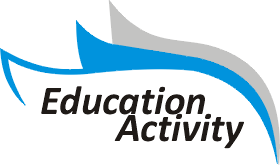
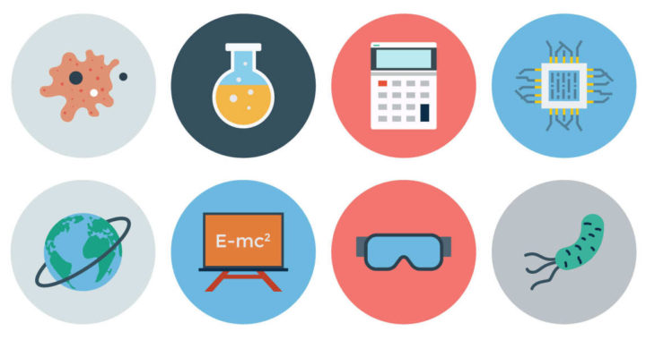
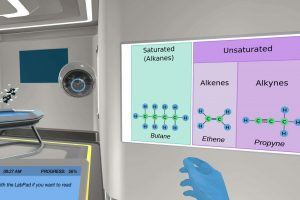

## Site identity
Education Activities (http://www.educationactivities.org/) is an online magazine-style blog publishing articles on education, careers, study, and related subjects. Its tagline-style quote says that education should aim at teaching values rather than mere facts.

Current date shown: Thursday, June 17, 2021.

## Topic categories
Education, Financial Aid, Certification, Science, Languages, Skills Development, College and University, General, Online Education, Home Schooling.
Each category has its own listing at http://www.educationactivities.org/category/ followed by the lowercase hyphenated name (e.g. /category/financial-aid, /category/college-and-university, /category/skills-development, /category/online-education, /category/home-schooling).

## Site pages
- Home: http://www.educationactivities.org/
- Blog: http://www.educationactivities.org/blog
- About Us: http://www.educationactivities.org/about-us
- Privacy Policy: http://www.educationactivities.org/privacy-policy
- Contact us: http://www.educationactivities.org/contact-us
- Search function available.
- Browsing views for posts: Popular, Latest, and by Category.
- Quick links list: Home, About Us, Blog, Privacy Policy, Contact us.
- Top categories list: Education, Financial Aid, Certification, Science, Languages.
- Copyright notice (all rights reserved). Built on the "Daily Magazine" theme by AF themes (https://afthemes.com/products/daily-magazine, https://afthemes.com/).

## Author
James E. Turner, described as a business expert. All articles listed are credited to the account "WebEditor" (http://www.educationactivities.org/author/webeditor).

## Featured and recent articles
Article URLs follow the pattern http://www.educationactivities.org/{category-slug}/{article-slug}.html.

- "5 Big Benefits of Digital Marketing Career" – Online Education, 2021-05-24. /online-education/5-big-benefits-of-digital-marketing-career.html

- "The Importance of Learning Business English for Your Career" – Education, 2021-02-18. /education/the-importance-of-learning-business-english-for-your-career.html

- "Is it worth doing masters in the Netherlands? What are the top specialities?" – Education, 2020-10-02. /education/is-it-worth-doing-masters-in-the-netherlands-what-are-the-top-specialities.html

- "Easy Ways of Adapting CBD In Your Daily Morning Routine" – Education, 2020-09-04. /education/easy-ways-of-adapting-cbd-in-your-daily-morning-routine.html

- "Writing Subreddits on Reddit" – College and University, 2020-08-07. Summary: Reddit gives writers a place to get honest feedback and community support. /college-and-university/writing-subreddits-on-reddit.html

## Science articles
- "Trump Declares Decide to Lead EPA Chemical Security Workplace" – 2018-10-02. Summary: US President Donald Trump announced the nomination of Michael Dourson to head the chemical safety office of the EPA. /science/trump-declares-decide-to-lead-epa-chemical-security-workplace.html

- "How Will Non-public Spaceflight Corporations Change The Improvement of Area Sources?" – 2018-10-01. Summary: Space flight involves the government as well as private space companies, all playing major roles. /science/how-will-non-public-spaceflight-corporations-change-the-improvement-of-area-sources.html

- "Every part You Should Know About The Deionized Water And Ion Change Filter" – 2018-09-30. Summary: Deionization, also called demineralization, is the removal of ions from water, which are electrically charged particles. /science/every-part-you-should-know-about-the-deionized-water-and-ion-change-filter.html

- "The In And Out Of Precision Dairy Farming" – 2018-09-29. Summary: Many technologies keep arriving, and their use in the dairy industry is growing. /science/the-in-and-out-of-precision-dairy-farming.html

- "Significance Of Information Scientist In Your Enterprise" – 2018-09-06. Summary: Data Scientist is one of the key job profiles of the 21st century, and the article asks why. /science/significance-of-information-scientist-in-your-enterprise.html

- "Biography Of Mathematician Pythagoras" – 2018-09-01. /science/biography-of-mathematician-pythagoras.html

## Skills Development articles
- "Building a Healthy Thriving Business through Training and Inspiration" – 2019-02-11. /skills-development/building-a-healthy-thriving-business-through-training-and-inspiration.html
- "Check Your Writing at All Times" – 2019-01-17. /skills-development/check-your-writing-at-all-times.html

## College and University articles
- "How to prepare for JEE Advanced 2020?" – 2020-02-01. /college-and-university/how-to-prepare-for-jee-advanced-2020.html

- "A Discussion Regarding Why Physical Education in Early School is So Important" – 2020-01-08. /college-and-university/a-discussion-regarding-why-physical-education-in-early-school-is-so-important.html

- "Getting Your Child to Love School" – 2019-01-18. /college-and-university/getting-your-child-to-love-school.html

- "BBA Faculties In Delhi NCR – Construct A Strong Company Basis" – 2018-09-18. /college-and-university/bba-faculties-in-delhi-ncr-construct-a-strong-company-basis.html

## Education articles
- "Learn About Organic Chemistry" – 2020-08-02. /education/learn-about-organic-chemistry.html

- "The Importance Of Primary School Mathematics" – 2020-08-02. /education/the-importance-of-primary-school-mathematics.html

## Online Education articles
- "Why do I need to do an MBA?" – 2019-07-14. /online-education/why-do-i-need-to-do-an-mba.html

- "Buy college essays online on OnlineCollegeEssay.com" – 2019-01-16. /online-education/buy-college-essays-online-on-onlinecollegeessay-com.html

- "The On-line AED Coaching That Makes You Ready to Deal with Emergencies" – 2018-09-26. /online-education/the-on-line-aed-coaching-that-makes-you-ready-to-deal-with-emergencies.html

- "Newest 5 Girls Training Information Price Studying" – 2018-09-25. /online-education/newest-5-girls-training-information-price-studying.html

## General articles
- "Treadmill Critiques – No Improved Way to pick out Your Physical fitness Tools" – 2020-06-12. /general/treadmill-critiques-no-improved-way-to-pick-out-your-physical-fitness-tools.html
- "What You Ought to Know About Educating Particular Training" – 2018-09-23. /general/what-you-ought-to-know-about-educating-particular-training.html
- "Easy methods to Manage Your Dwelling for Instructional Success" – 2018-09-22. /general/easy-methods-to-manage-your-dwelling-for-instructional-success.html
- "Overview of the Ministry of Schooling" – 2018-09-21. /general/overview-of-the-ministry-of-schooling.html
- "Which Instructional Platform Is Greatest for Your Baby? Differentiating On-line Vs Conventional Training" – 2018-09-20. /general/which-instructional-platform-is-greatest-for-your-baby-differentiating-on-line-vs-conventional-training.html
- "Break Free from Dead End Jobs: Electrician Training Opens the Door to Many Career Options" – 2017-11-09. Image below. /general/break-free-from-dead-end-jobs-electrician-training-opens-the-door-to-many-career-options.html

- "Overcoming Particular Schooling Apathy and Efficiently Navigating the Particular Schooling Maze!" – 2018-09-01. /general/overcoming-particular-schooling-apathy-and-efficiently-navigating-the-particular-schooling-maze.html

## Certification articles
- "Three Advantages of Enrolling in Hairstyling Diploma Programs at Brampton Pores and Skin Care Academy" – 2018-09-01. /certification/three-advantages-of-enrolling-in-hairstyling-diploma-programs-at-brampton-pores-and-skin-care-academy.html

## Image notes
 and the other images above accompany their respective articles; no further images appear.

