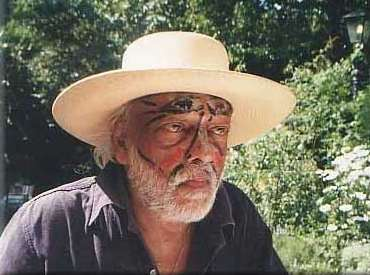
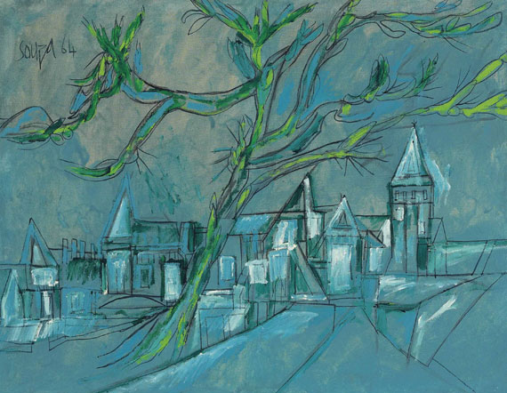
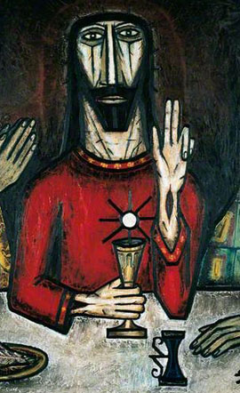
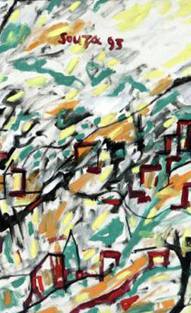
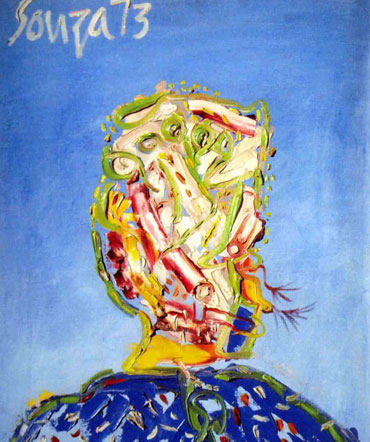
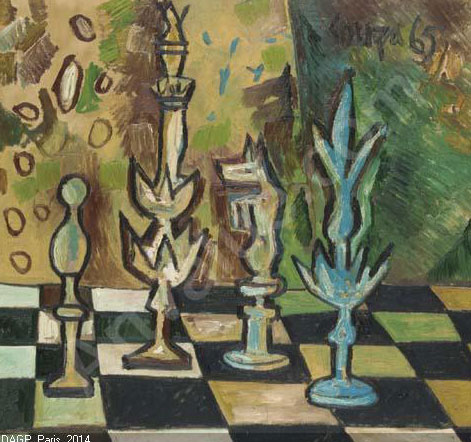

 

 [ F N Souza International Fine Arts Foundation & Family Trust Inc. ](http://www.fnsouzafoundation.com/)

History & Works

-  [ Home ](http://www.fnsouzafoundation.com/)
-  [ About F N Souza ](/index.php/about-f-n-souza)
-   Family History

-

-  [ Family History - English ](/index.php/family-history/family-history-english)
-  [ Family History - Portuguese ](/index.php/family-history/family-history-portuguese)
-  [ Gallery ](/index.php/gallery)
-   Available For Sale

-

-  [ Acrylic On Board ](/index.php/available-for-sale/acrylic-on-board)
-  [ Acrylic On Canvas ](/index.php/available-for-sale/acrylic-on-canvas)
-  [ Oil On Canvas ](/index.php/available-for-sale/oil-on-canvas)
-  [ News ](/index.php/news)
-  [ Contacts ](/index.php/contacts)
-  [ F. N. Souza Exonerates Son and Sole Heir Francis Patrick Souza Of All Accusations and Any Involvement With Forgeries ](/index.php/f-n-souza-exonerates-son-sole-heir-francis-patrick-souza-of-all-accusations-any-involvement-with-forgeries)

# Ciudad En Esapana

# Multicoloured Villagescape

# Vatican Cityscape

# God, Sex & The City

# Landscape

# City Landscape

# Faces

# Last Supper

# Modern & Contemporary Art

## Francis Newton Souza

A pioneer of his time, Francis Newton Souza was the first Indian artist to be recognized globally. Hailed in the west as ‘India’s mystical expressionist,’ his fluid graphic style and thought provoking distortions of the human body evoke an emotional experience, which transforms conventional views. [Read More](/index.php/about-f-n-souza)

## photo gallery

 Explore a significant collection of the latest works.

 

 

 

 

 

 

## Contact form

 Send message

  © 2021 [ Privacy Policy ](/index.php)  More Art Gallery Templates at [TemplateMonster.com](http://www.templatemonster.com/category.php?category=102&type=24)

**
 Login or register

 Log in [Create an account](/index.php/component/users/?view=registration)        Remember me
 [Forgot your username?](/index.php/component/users/?view=remind) / [Forgot your password?](/index.php/component/users/?view=reset)

 [Login with Facebook](javascript:void(0);)
 [Login with Google +](javascript:void(0);)
