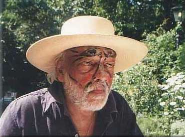
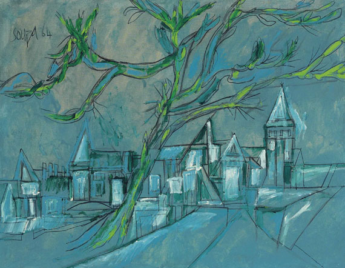
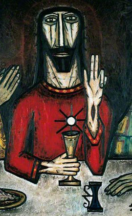
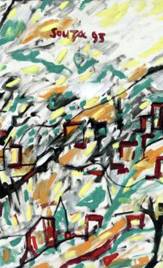
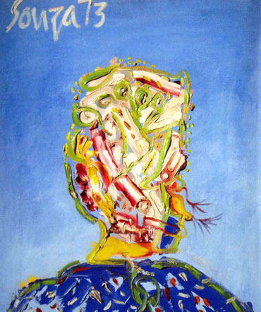
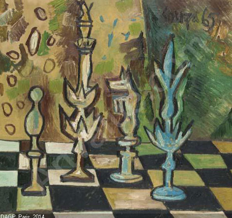

## Organisation
F N Souza International Fine Arts Foundation & Family Trust Inc. Website: http://www.fnsouzafoundation.com/
Tagline: History & Works.

## Site navigation items
- Home (http://www.fnsouzafoundation.com/)
- About F N Souza (/index.php/about-f-n-souza)
- Family History, with two versions: English (/index.php/family-history/family-history-english) and Portuguese (/index.php/family-history/family-history-portuguese)
- Gallery (/index.php/gallery)
- Available For Sale, divided by medium: Acrylic On Board (/index.php/available-for-sale/acrylic-on-board), Acrylic On Canvas (/index.php/available-for-sale/acrylic-on-canvas), Oil On Canvas (/index.php/available-for-sale/oil-on-canvas)
- News (/index.php/news)
- Contacts (/index.php/contacts)

## News item
A published statement in which F. N. Souza clears his son and only heir, Francis Patrick Souza, of every accusation and of any role in forgeries. Link: /index.php/f-n-souza-exonerates-son-sole-heir-francis-patrick-souza-of-all-accusations-any-involvement-with-forgeries

## Artwork titles
- Ciudad En Esapana
- Multicoloured Villagescape
- Vatican Cityscape
- God, Sex & The City
- Landscape
- City Landscape
- Faces
- Last Supper

## Modern & Contemporary Art: Francis Newton Souza

Souza was a trailblazer and the first Indian artist to gain worldwide recognition. Western critics called him "India's mystical expressionist." His flowing, graphic manner and his provocative distortions of the human body produce an emotional response that changes how people conventionally see things. Link to read more: /index.php/about-f-n-souza

## Photo gallery
An invitation to browse a substantial selection of recent works. Six images, each linking to a larger version:
-  larger image: /images/fnsouza/homepage_gallery/landscape.jpg
-  larger image: /images/fnsouza/homepage_gallery/last_supper.jpg
-  larger image: /images/fnsouza/homepage_gallery/villagescape.jpg
-  larger image: /images/fnsouza/homepage_gallery/abstract_head.jpg
-  larger image: /images/fnsouza/homepage_gallery/chess.jpg
-  larger image: /images/fnsouza/homepage_gallery/mother_child.jpg

## Contact form
A form for visitors to send a message to the foundation, with a "Send message" button.

## Legal and credits
- © 2021
- Privacy Policy (/index.php)
- Credit: More Art Gallery Templates at TemplateMonster.com (http://www.templatemonster.com/category.php?category=102&type=24)

## User accounts
- Login or register option.
- Log in with a username and password, with a "Remember me" option.
- Create an account (/index.php/component/users/?view=registration)
- Forgot your username? (/index.php/component/users/?view=remind)
- Forgot your password? (/index.php/component/users/?view=reset)
- Alternative sign-in with Facebook and with Google +.
