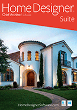
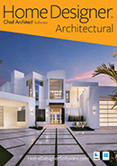
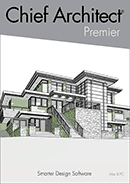
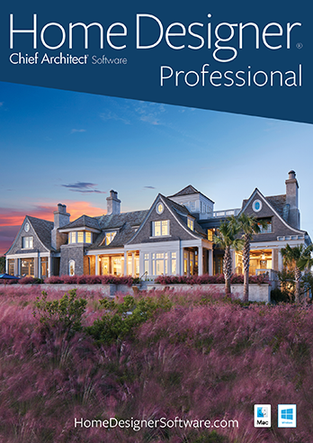

## Organisation
Home Designer® Software is the do-it-yourself home design line from Chief Architect®, Inc. (© 2003–2021). Site: https://www.homedesignersoftware.com/. Its content areas are: All Content, Support, Videos, Blog, HomeTalk Forum.

## Utility links
- My Account: https://accounts.chiefarchitect.com/
- Contact Us: /company/contact.html
- Cart: https://shopping.chiefarchitect.com/hdshop/checkout/cart/

## Main headline and introduction
Home design software for DIY users. Home Designer Software is described as the top-rated 3D interior design, remodeling and home design software. It is built on technology from Chief Architect's professional architectural software, simplified for DIY users. People are invited to see why it is the best home design app for visualizing and designing a house project.

Rental offer: Home Designer Pro 2021 for $59/mo. (https://shopping.chiefarchitect.com/hdshop/checkout/cart/add/?product=Home%20Designer%20Pro%202021%20Rental&related_product=Home%20Designer%20Pro%202021%20Backup%20and%20Storage%20USB)

### Calls to action
- Download: Trial Version (/products/trial.html); Purchase Software (/products/home-designer-pro/)
- Explore: Home Design & Remodeling (/homedesign/); Interior Design (/interior-design/); Kitchens & Baths (/kitchen-bath/); Decks & Landscaping (/landscape-deck/)
- Learn: Overview Video (/videos/overview/pro/); How-To Tutorial Videos (/videos/); Webinars (/products/training.html#bootcamp)

## Features of the software
- Advanced tools for roofs, foundations and framing. Drawing walls generates a 3D model automatically. Placing a door or window cuts it into the wall and framing updates automatically. Moving walls updates the roof and foundation as well.
- Everything added to a design goes into a materials list, allowing cost estimates and budgeting.
- Kitchen and bath remodeling: cabinets are smart objects that snap, bump and conform to walls, available in many types. A Material Painter lets users switch colors and styles quickly to compare options.
- Renovation projects (updating a master bath, modernizing an interior, building a deck): a space planning assistant helps lay out floor plans. The 3D Library (https://www.chiefarchitect.com/3d-library/go/?family=Home%20Designer) holds thousands of paints, materials and furnishings.
- Work in 2D and 3D. 2D floor plans show room layout and dimensions; 3D offers realistic visualization including virtual tours, so a design can be experienced before it is built.
- Samples Gallery (samples.html) shows 3D rendering examples made in Home Designer.

## Product lineup
Chief Architect offers three DIY products: Suite, Architectural and Pro. Its professional architectural line covers full residential design. Compare Products: /products/product-chooser.html

**Home Designer Suite** (/products/home-designer-suite/): buy for $99 (regular $129). Upgrades from $29 (/whats-new/?from-product=suite&to-product=suite).

**Home Designer Architectural** (/products/home-designer-architectural/): buy for $199 (regular $249). Upgrades from $39 (regular $49) (/whats-new/?from-product=architectural&to-product=architectural).

**Home Designer Pro** (/products/home-designer-pro/): rent for $59/mo., or buy for $495 (regular $595). Upgrades from $99 (regular $119) (/whats-new/?from-product=professional&to-product=professional).

**Chief Architect Professional Software** (/chief-architect/), with a LEARN MORE link: 

## Why choose Home Designer
Tagline: top-rated DIY home design software. Link: Compare Features (/products/product-chooser.html).

Powerful, fun and easy software. Chief Architect states it provides the highest quality software, live customer support at no charge, and the best learning resources in the industry (/getting-started/). The software runs on Mac or PC and can be deactivated, so it is easy to move between computers. All Home Designer products are compatible with the professional Chief Architect line (https://www.chiefarchitect.com/). Designs can be shared with friends and family through the 3D Viewer app (https://www.chiefarchitect.com/products/3d-viewer/). Any Home Designer product can be purchased, rented or tried via a trial download (/products/trial.html).

## Learn more links
- Trial Download (/products/trial.html)
- Compare Products (/products/product-chooser.html)
- What's New in 2021 (/whats-new/#whats-new-summary)
- System Requirements (/products/system-requirements.html)
- Satisfaction Guarantee (/products/guarantee.html)
- Overview Video (/videos/overview/pro/)
- Samples Gallery (/samples.html)
- Rental Option & FAQ (/software-rental/)

## Purchase options
Choices for new purchase or upgrade, and for rent or buy:
- Product (Mac & PC): Home Designer Pro 2021, Home Designer Architectural 2021, Home Designer Suite 2021
- Media: Download or USB
- Backup media: Backup USB or No Backup USB
- Price display: Buy price and Sale price

## Navigation and resource links
**Products:** Home Designer (DIY) Products (/#products) — Professional (/products/home-designer-pro/), Architectural (/products/home-designer-architectural/), Suite (/products/home-designer-suite/); Chief Architect (Pro) Products (/chief-architect/); Compare Products (/#compare); 3D Viewer App (https://www.chiefarchitect.com/products/3d-viewer/); Upgrades & Discounts (/discounts/); Trial Download (/products/trial.html); Academic (https://www.chiefarchitect.com/academic/); Add-on Products (/products/addon/); System Requirements (/products/system-requirements.html).

**Project Type:** Home Design & Remodeling (/homedesign/); Interior Design (/interior-design/); Kitchens & Baths (/kitchen-bath/); Decks & Landscaping (/landscape-deck/); Professional Designers (/chief-architect/).

**User Center:** Getting Started Resources (/getting-started/); Shopping Cart (https://shopping.chiefarchitect.com/hdshop/); My Account (https://accounts.chiefarchitect.com/); Training Videos (/videos/); Sample Plans & Renderings (/samples.html); Catalog & Content Downloads (https://www.chiefarchitect.com/3d-library/go/?family=Home%20Designer); Webinars (/products/training.html); Resource Center (https://www.chiefarchitect.com/usercenter/links.html); HomeTalk User Forum (https://hometalk.chiefarchitect.com/).

**Support:** Support Resources (/support/); Documentation (/support/documentation.html); Knowledge Base (/support/database.html); Training Videos (/videos/); Program Updates (/support/updates.html).

**Company:** About Chief Architect (/company/); Careers (https://www.chiefarchitect.com/company/careers.html); Marketing Graphics (/company/pressgraphics/); Newsletter (/company/newsletters/); Testimonials (/products/testimonials.html); Satisfaction Guarantee (/products/guarantee.html); Affiliate Program (/affiliate-program/); Contact Us – Social (/company/contact.html).

## Social and community links
- HomeTalk forum: https://hometalk.chiefarchitect.com/
- Blog: https://chiefarchitectblog.com/
- Facebook: https://www.facebook.com/ChiefArchitect
- YouTube: https://www.youtube.com/user/ChiefArchitectInc
- Instagram: https://www.instagram.com/chiefarchitectsoftware/
- Houzz: https://www.houzz.com/pro/chiefarchitect/
- Pinterest: https://www.pinterest.com/chiefarchitect/

## Legal
© 2003–2021 Chief Architect, Inc. All rights reserved. Terms of Use: https://www.chiefarchitect.com/company/terms.html. Privacy Policy: https://www.chiefarchitect.com/company/privacy.html.
