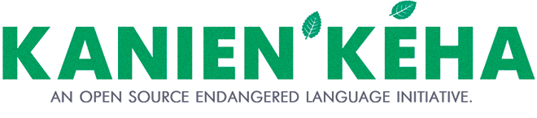
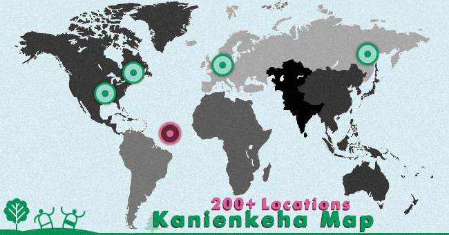
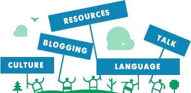
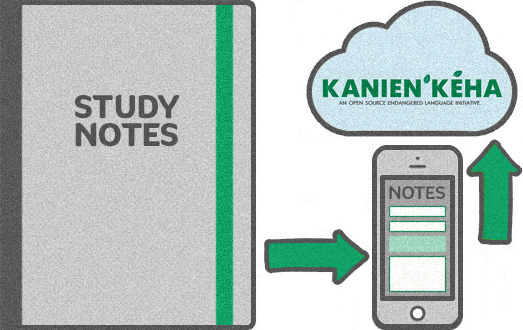
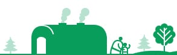

## Kanienkeha.net

Kanienkeha.net is an open source initiative dedicated to the endangered Kanienkeha (Mohawk) language. It publishes new content every week and relies on small donations to keep going. Supporters can give through Patreon: http://patreon.com/mohdictionary

Visitors can try sample searches: apple, colors, numbers.

Site name on the web: kanienkeha.net. Developed by Doolittle Productions (http://doolittleproductions.com/).

## Navigation links

- Home: https://kanienkeha.net
- About: https://kanienkeha.net/about/ (footer version: /about-us/)
- Contact: https://kanienkeha.net/contact/
- Donate: https://kanienkeha.net/donate/
- Resources: https://kanienkeha.net/resources/
- Categories (sitemap): https://kanienkeha.net/sitemap/
- Add Words: https://kanienkeha.net/add-words/
- Language Information: https://kanienkeha.net/language/
- Blog: https://kanienkeha.net/blogs/
- Map: https://kanienkeha.net/map/
- Log In: https://kanienkeha.net/login/
- Register: https://kanienkeha.net/register/
- Footer also lists Sitemap: /sitemap/

## Map

An interactive map is available at https://kanienkeha.net/map/

## Most recent entries (Mohawk phrase, with English meaning)

Page navigation: pages 1 to 4, Next, and Last (page 53 of 53). Example page URLs: https://kanienkeha.net/page/2/, /page/3/, /page/4/, /page/53/

### Phrases
- "What is your last name?" (listed as "Last name?, What is your"): Oh nahò:ten tesahsenná:sere? — https://kanienkeha.net/phrases/oh-nahoten-tesahsennasere/

### Commands (daily routine)
- Sit down and eat: Sátien tánon tesatská:hon — https://kanienkeha.net/phrases/command/satien-tanon-tesatskahon/
- Get dressed: Satsheronniánion — https://kanienkeha.net/phrases/command/get-dressed/
- Wash your hands: Sahtsóhare — https://kanienkeha.net/phrases/command/sahtsohare/
- Wash your face: Satkonhsóhare — https://kanienkeha.net/phrases/command/satkonhsohare/
- Brush your hair: Satkeróthiwh — https://kanienkeha.net/phrases/command/satkerothiwh/
- Fix your hair: Satko’tsón:ni — https://kanienkeha.net/phrases/command/satkotsonni/
- Take a bath: Satá:wen — https://kanienkeha.net/phrases/command/satawen/
- Make your bed: Satenaktahserón:ni — https://kanienkeha.net/phrases/command/satenaktahseronni/
- Wake up: Satkétsko — https://kanienkeha.net/phrases/command/satketsko/
- Brush your teeth: Satenawiróhare — https://kanienkeha.net/phrases/command/satenawirohare/

### Occupations
All links are under https://kanienkeha.net/occupation/ followed by the slug shown.
- Photographer: Shakoia’tárha’ — shakoiatarha/
- Goalie: Tehatenia’taranónnha’ — tehateniataranonnha/
- Occupations (the word for the category itself): Tsi Nikaio’tenhserò:ten’s — tsi-nikaiotenhserotens/
- Astronaut: Ísi’na’karon’iati Iehretha — isinakaroniati-iehretha/
- Pharmacist: Kanonhkwa’tsherón:nis — kanonhkwatsheronnis/
- Steelworker (male): Karistatsi Roio’tens — karistatsi-roiotens/
- Steelworker (female): Karistatsi Iakio’tens — karistatsi-iakiotens/
- Truck driver (male): Ka’serehkówa Ratórie’s — kaserehkowa-ratories/
- Truck driver (female): Ka’serehkowa Iotórie’s — kaserehkowa-iotories/
- Veterinarian: Katshé:nen Tehshakóhsnie — katshenen-tehshakohsnie/
- Computer worker (female): Kawennaráhstha Iakoió’te — kawennarahstha-iakoiote/
- Computer worker (male): Kawennaráhstha roió’te — kawennarahstha-roiote/
- Education director: Ohén:ton Í:rate ne Ionterihwaienstahkhwaniónhkhwa — ohenton-irate-ne-ionterihwaienstahkhwanionhkhwa/
- Optometrist (male): Okà:ra Shakotkèn:se — okara-shakotkense/
- Optometrist (female): Okà:ra iakotkèn:se — okara-iakotkense/
- Writer (male): Rahiá:tons — rahiatons/
- Writer (female): Iehiá:tons — iehiatons/
- Carpenter (male): Rahson’karaké:tas — rahsonkaraketas/
- Carpenter (female): Iehson’karaké:tas — iehsonkaraketas/
- Blacksmith: Rahwiston:ni — rahwistonni/
- Waiter: Rakhwahéhrha — rakhwahehrha/
- Painter (male): Rakontsheráhrhos — rakontsherahrhos/
- Painter (female): Iekontsheráhrhos — iekontsherahrhos/
- Baker (male): Rana’tarón:nis — ranataronnis/
- Baker (female): Iena’tarón:nis — ienataronnis/
- Artist (female): Ieráhstha — ierahstha/
- Reporter (male): Rarihó’kwats — rarihokwats/
- Reporter (female): Ierihó’kwats — ierihokwats/
- Engineer or surveyor (male): Raristí:seres — raristiseres/
- Engineer or surveyor (female): Ieristí:seres — ieristiseres/
- Steel fabricator: Raristón:nis — raristonnis/
- Welder (female): Ieristóseras — ieristoseras/
- Electrician (male): Raronwarahéhrha — raronwarahehrha/
- Electrician (female): Ieronwarahéhrha — ieronwarahehrha/
- Taxidermist: Ra’swahseráta’s — raswahseratas/
- Fireman (female): Ion’swáhtha — ionswahtha/
- Salesperson (female): Iontenhí:nons — iontenhinons/
- Plumber: Ratihonro’tahéhrha Ohné:kanos Aó:wen — ratihonrotahehrha-ohnekanos-aowen/
- Councillors: Ratitsénhaiens — ratitsenhaiens/

## Blog articles

- Mission Statement of the People of Grand River Country — https://kanienkeha.net/blogs/mission-statement-of-the-people-of-grand-river-country/
- 5 Common Misconceptions Surrounding Endangered Languages — https://kanienkeha.net/blogs/5-common-misconceptions-surrounding-endangered-languages/
- Bonding with your child through your native language — https://kanienkeha.net/blogs/bonding-with-your-child-through-your-native-language/
- Thanksgiving Address: Giving Greetings to the Natural World — https://kanienkeha.net/blogs/ohenton-karihwatehkwen/
- How to use the single post index — https://kanienkeha.net/blogs/how-to-use-the-single-post-index/

A separate blog also exists at http://blog.kanienkeha.net/

## Language choice

Two languages are offered: English, and Kanienkeha (Mohawk).

## Word of the day

A daily word is shared under the hashtag #WordOfTheDay. A random word can also be pulled up: https://kanienkeha.net/grammer/nouns/kahionha/

## Social and support channels

Encouragement to spread the word through these accounts, all named mohdictionary:
- Facebook: https://www.facebook.com/mohdictionary
- Twitter: http://twitter.com/mohdictionary (also https://twitter.com/mohdictionary)
- Instagram: http://instagram.com/mohdictionary
- Newsletter (TinyLetter): http://tinyletter.com/MohDictionary/ 
- Gumroad: https://gumroad.com/l/gOKI 
- Patreon: https://www.patreon.com/mohdictionary
- PayPal: https://www.paypal.me/MohDictionary
- Brand name for these accounts: MohDictionary

## Uploading notes

Language learners who take notes are invited to send them in so the language curators can archive them. As an open source project, the research grows as contributors share. Upload page: /notes

## Site statistics

- Words: 2650
- Categories: 159 (https://kanienkeha.net/sitemap/)
- Tags: 260
- Blog posts: 10 (http://blog.kanienkeha.net/)

## Welcome message from the founder

Greeting: She:kon (hello). The site was built so the community can develop online resources for the Kanienkeha language. With contributions from visitors and elders, the aim is a digital inventory of the language, along with discussion of the cultural meaning behind each word. If the dictionary reaches roughly 10,000 words, the project moves to a next phase: building a Google-style translator with audio to help with pronunciation.

Closing: Nia:wen (thank you). Signed Benjamin Doolittle.

