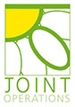

[

## Knee Guru

 ](/)
 YOUR SOURCE OF KNEE INFORMATION

 **

- 
- 
- 
- 

- [About](/KNEEnotes/about)
- [Learning Portfolio](/KNEEnotes/learning-portfolio)

- [Primers](/KNEEnotes/learning-portfolio#Primers)
- [Courses](/KNEEnotes/learning-portfolio#Courses)
- [eBooks](/KNEEnotes/learning-portfolio#eBooks)
- [Expert Views](/KNEEnotes/learning-portfolio#Expert-Views)
- [General Articles](/KNEEnotes/learning-portfolio#General-Articles)
- [Journal Interpretations](/KNEEnotes/learning-portfolio#Journal-Interpretations)
- [Dictionary](/knee-dictionary/letter_a)
- [Community](/KNEEnotes/community)

- [Forum discussion](https://www.kneeguru.co.uk/KNEEtalk/)
- [Be Social](/KNEEnotes/be-social)
- [Readers' Blogs](/KNEEnotes/readers-blogs)
- [Contributions from Patients](/KNEEnotes/contributions-patients)
- [Testimonials](/KNEEnotes/testimonials)
- [Live Events](/KNEEnotes/live-events-0)
- [Donations](https://www.kneeguru.co.uk/KNEEnotes/donate-kneeguru-website)
- [Specialists](/KNEEnotes/specialists)
- [Clinics](/clinics)
- [Product Reviews](/KNEEnotes/product-reviews)

- [Book Reviews](/KNEEnotes/shop#Book-Reviews)
- [Product Reviews](/KNEEnotes/shop#Product-Reviews)
- [The Team](/KNEEnotes/the-team)

## Learn about knees...

[look up a specific knee topic](https://www.kneeguru.co.uk/knee-dictionary/letter_a)

[get to grips with knee anatomy](https://www.kneeguru.co.uk/KNEEnotes/primers/knee-anatomy/knee-anatomy-putting-content-context)

[participate in forum discussions](https://www.kneeguru.co.uk/KNEEtalk/index.php?board=7.0)

[see knee rehabilitation exercises](https://www.kneeguru.co.uk/KNEEnotes/primers/a-z-rehabilitation-exercises/active-assisted-flexion)

[locate a knee surgeon nearby](https://www.kneeguru.co.uk/KNEEnotes/knee-professionals/knee-surgeons)

[book an online consultation](https://www.kneeguru.co.uk/KNEEnotes/articles/general-articles/2020/online-consultations-and-second-opinions)

#### [PRIMERS](/KNEEnotes/learning-portfolio#Primers)

ABCs for beginners wanting to understand the basics about knees

#### [COURSES](/KNEEnotes/learning-portfolio#Courses)

Selected knee topics presented by Experts in a detailed course format

#### [EBOOKS](/KNEEnotes/learning-portfolio#eBooks)

Downloadable monographs on selected knee topics for you to read at your leisure

#### [EXPERT VIEWS](/KNEEnotes/learning-portfolio#Expert-Views)

Blogs from knee surgeons and physiotherapists with knee expertise

#### [GENERAL ARTICLES](/KNEEnotes/learning-portfolio#General-Articles)

In-house blogs about knee issues by our editorial team

#### [JOURNAL INTERPRETATIONS](/KNEEnotes/learning-portfolio#Journal-Interpretations)

Interpretations by our editorial team of published medical articles

## Latest Content

#### [All about arthrofibrosis of the knee](/KNEEnotes/articles/general-articles/2019/all-about-arthrofibrosis-knee)

Q&A-style article all about arthrofibrosis.

#### [Implications of a 'floating' knee meniscus](/KNEEnotes/articles/general-articles/2018/implications-floating-knee-meniscus)

An explanation of what it means to have a 'floating' knee [meniscus](https://www.kneeguru.co.uk/KNEEnotes/knee-dictionary/meniscus) on [MRI](https://www.kneeguru.co.uk/KNEEnotes/knee-dictionary/mri) imaging.

#### [Online Consultations and Second Opinions](/KNEEnotes/articles/general-articles/2020/online-consultations-and-second-opinions)

A list of surgeons and physiotherapists associated with KNEEguru who are willing to do online consultations.

#### [What does metal allergy mean for patients waiting to have knee replacement surgery?](/KNEEnotes/articles/general-articles/2020/what-does-metal-allergy-mean-patients-waiting-have-knee)

A [knee surgeon](https://www.kneeguru.co.uk/KNEEnotes/knee-dictionary/knee-surgeon) discusses why metal allergy can be important when considering [knee replacement](https://www.kneeguru.co.uk/KNEEnotes/knee-dictionary/knee-replacement).

#### [Arthroscopic excision of an Osgood Schlatter ossicle](/KNEEnotes/articles/expert-views/2017/arthroscopic-excision-osgood-schlatter-ossicle)

Dr Lars Blønd discusses a case of a patient who had had Osgood Schlatters' disorder as a child, but continued to be symptomatic into adulthood.

#### [Meniscus substitution - Webinar presented by Professor Peter Verdonk and Mr Tim Spalding](/KNEEnotes/articles/general-articles/2020/meniscus-substitution-webinar-presented-professor-peter)

Webinar recording of event hosted in July 2020 about current options for patients who have lost their [medial meniscus](https://www.kneeguru.co.uk/KNEEnotes/knee-dictionary/medial-meniscus)

#### [Second opinions and online consultations with knee surgeons](/KNEEnotes/articles/general-articles/2020/second-opinions-and-online-consultations-knee-surgeons)

Short article discussing the options of consulting a [knee surgeon](https://www.kneeguru.co.uk/KNEEnotes/knee-dictionary/knee-surgeon) online.

#### [2017 - Primary repair of the anterior cruciate ligament: A paradigm shift.](/KNEEnotes/articles/journal-interpretations/2017/2017-primary-repair-anterior-cruciate-ligament)

An interpretation by the editor of a 2017 medical publication.

#### [Knee Surgeons as online educators of their peers](/KNEEnotes/articles/expert-views/2017/knee-surgeons-online-educators-their-peers)

A brief discussion about the direction of medical education.

#### [Arthrofibrosis and rheumatoid arthritis](/KNEEnotes/articles/expert-views/2020/arthrofibrosis-and-rheumatoid-arthritis)

Dr Kayley Usher offers some practical information to patients with [rheumatoid arthritis](https://www.kneeguru.co.uk/KNEEnotes/knee-dictionary/rheumatoid-arthritis) who also suffer from [arthrofibrosis](https://www.kneeguru.co.uk/KNEEnotes/knee-dictionary/arthrofibrosis).

## Our Sponsors

 As the KNEEguru matures in both concept and content, it is requiring more substantial financial support to allow us to continue to deliver fresh high quality content and interactive media. Unique content takes considerable time to craft, and we are very grateful for this extra support.

 

 *More about us...*

## Professional Standards

 This site complies with the [ HONcode standard for trustworthy health](https://www.healthonnet.org/HONcode/Conduct.html) information:

[Verify here.](https://www.healthonnet.org/HONcode/Conduct.html?HONConduct712243)

## Corporate Details

This site is owned by a UK-based limited company (company number 2893459; incorporated 1st February 1994). The domain was first registered on 4th February 1997.

Registered Address: The KNEEguru, c/o Price Pearson Limited (att. Chris Cooper, Accountant), Finch House, 28/30 Wolverhampton Street, Dudley, West Midlands, DY1 1DB, United Kingdom.

## Stay in touch

Sign up to stay in touch. We will mail you when there is important new content on our sites to share with you, or if there are any significant changes.

## Your safety

  [Mission Statement](/KNEEnotes/mission-statement) [Privacy Policy](/KNEEnotes/our-team-and-principles/privacy-policy) [Cookies Policy](/KNEEnotes/our-team-and-principles/cookies-policy) [Terms and Conditions](/KNEEnotes/our-team-and-principles/terms-and-conditions) [Funding, Advertising & Sponsorship Policy](/KNEEnotes/our-team-and-principles/ads-policy) [Make a one-off Donation](/KNEEnotes/giving-back-kneeguru-site/donate-kneeguru-website)

Information provided on the site is meant to complement and not replace any advice or information from a health professional.

[-A](javascript:;)

[A](javascript:;)

[+A](javascript:;)
