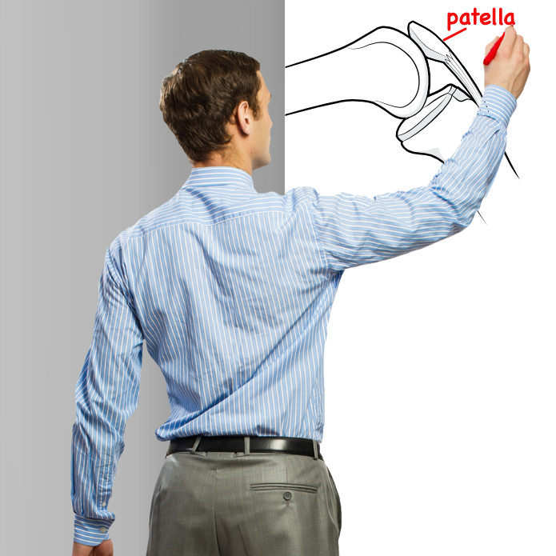
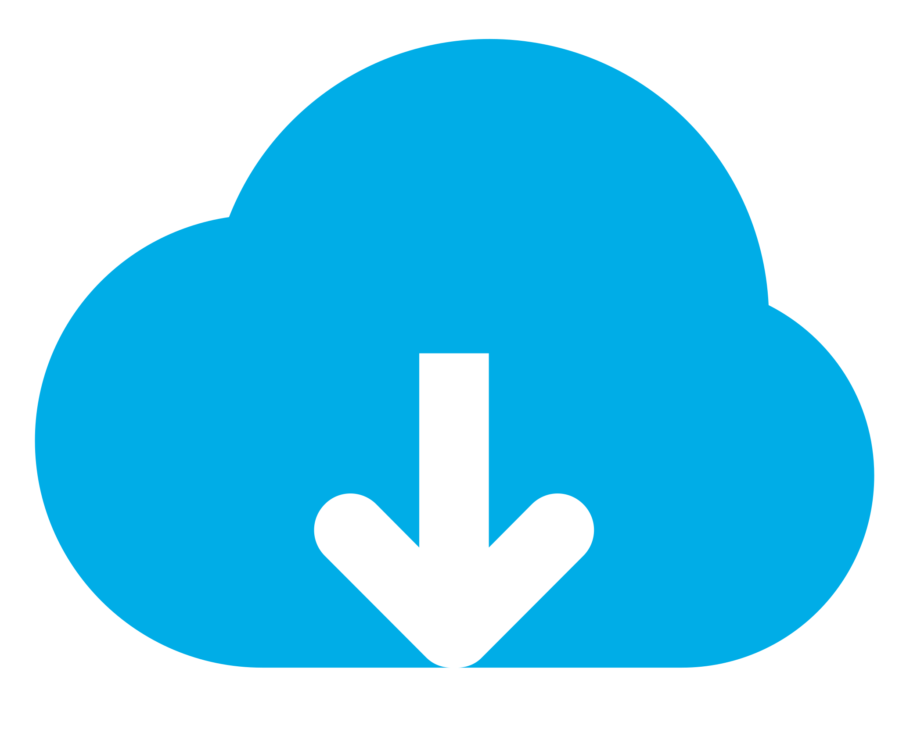
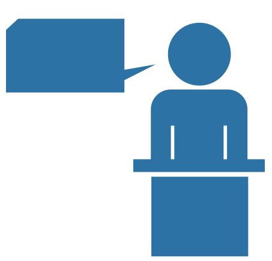
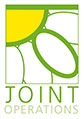

# Knee Guru: Content Brief

## Organisation identity
- The name is Knee Guru (also written KNEEguru). Its tagline presents it as the place to go for information about knees.
- Social media profiles: Twitter (https://twitter.com/KNEEguru), Facebook (https://www.facebook.com/The.KNEEguru), YouTube (https://www.youtube.com/user/kneeguru), Pinterest (https://www.pinterest.com/kneeguru).
- Main site address: https://www.kneeguru.co.uk

## Navigation items
- About (/KNEEnotes/about)
- Learning Portfolio (/KNEEnotes/learning-portfolio), with these parts: Primers, Courses, eBooks, Expert Views, General Articles, Journal Interpretations (each links to its anchor on the portfolio page, e.g. /KNEEnotes/learning-portfolio#Primers)
- Dictionary (/knee-dictionary/letter_a)
- Community (/KNEEnotes/community), with: Forum discussion (https://www.kneeguru.co.uk/KNEEtalk/), Be Social (/KNEEnotes/be-social), Readers' Blogs (/KNEEnotes/readers-blogs), Contributions from Patients (/KNEEnotes/contributions-patients), Testimonials (/KNEEnotes/testimonials), Live Events (/KNEEnotes/live-events-0), Donations (https://www.kneeguru.co.uk/KNEEnotes/donate-kneeguru-website)
- Specialists (/KNEEnotes/specialists)
- Clinics (/clinics)
- Product Reviews (/KNEEnotes/product-reviews), with: Book Reviews (/KNEEnotes/shop#Book-Reviews), Product Reviews (/KNEEnotes/shop#Product-Reviews)
- The Team (/KNEEnotes/the-team)

## Ways to learn about knees

Calls to action, each with a dotted-arrow marker :
- Look up a specific knee topic: https://www.kneeguru.co.uk/knee-dictionary/letter_a
- Get to grips with knee anatomy: https://www.kneeguru.co.uk/KNEEnotes/primers/knee-anatomy/knee-anatomy-putting-content-context
- Take part in forum discussions: https://www.kneeguru.co.uk/KNEEtalk/index.php?board=7.0
- See knee rehabilitation exercises: https://www.kneeguru.co.uk/KNEEnotes/primers/a-z-rehabilitation-exercises/active-assisted-flexion
- Find a knee surgeon near you: https://www.kneeguru.co.uk/KNEEnotes/knee-professionals/knee-surgeons
- Book an online consultation: https://www.kneeguru.co.uk/KNEEnotes/articles/general-articles/2020/online-consultations-and-second-opinions

## Content categories
-  **Primers**: beginner-level basics for people who want to understand knees. Link: /KNEEnotes/learning-portfolio#Primers
-  **Courses**: in-depth, structured courses on chosen knee topics, taught by experts. Link: /KNEEnotes/learning-portfolio#Courses
-  **eBooks**: downloadable monographs on chosen knee topics, to read in your own time. Link: /KNEEnotes/learning-portfolio#eBooks
-  **Expert Views**: blogs written by knee surgeons and physiotherapists who specialise in knees. Link: /KNEEnotes/learning-portfolio#Expert-Views
-  **General Articles**: blogs on knee issues written in-house by the editorial team. Link: /KNEEnotes/learning-portfolio#General-Articles
-  **Journal Interpretations**: the editorial team's plain readings of published medical papers. Link: /KNEEnotes/learning-portfolio#Journal-Interpretations

## Latest content (articles)
- **All about arthrofibrosis of the knee**: a question-and-answer article covering arthrofibrosis. (/KNEEnotes/articles/general-articles/2019/all-about-arthrofibrosis-knee)
- **Implications of a 'floating' knee meniscus**: explains what it means when a knee [meniscus](https://www.kneeguru.co.uk/KNEEnotes/knee-dictionary/meniscus) appears "floating" on [MRI](https://www.kneeguru.co.uk/KNEEnotes/knee-dictionary/mri) imaging. (/KNEEnotes/articles/general-articles/2018/implications-floating-knee-meniscus)
- **Online Consultations and Second Opinions** (2020): lists the surgeons and physiotherapists linked to KNEEguru who offer online consultations. (/KNEEnotes/articles/general-articles/2020/online-consultations-and-second-opinions)
- **What does metal allergy mean for patients waiting to have knee replacement surgery?** (2020): a [knee surgeon](https://www.kneeguru.co.uk/KNEEnotes/knee-dictionary/knee-surgeon) explains why metal allergy matters when considering [knee replacement](https://www.kneeguru.co.uk/KNEEnotes/knee-dictionary/knee-replacement). (/KNEEnotes/articles/general-articles/2020/what-does-metal-allergy-mean-patients-waiting-have-knee)
- **Arthroscopic excision of an Osgood Schlatter ossicle** (2017): Dr Lars Blønd describes a patient who had Osgood Schlatters' disorder in childhood and still had symptoms as an adult. (/KNEEnotes/articles/expert-views/2017/arthroscopic-excision-osgood-schlatter-ossicle)
- **Meniscus substitution - Webinar presented by Professor Peter Verdonk and Mr Tim Spalding** (2020): a recording of a July 2020 webinar on the current options for patients who have lost their [medial meniscus](https://www.kneeguru.co.uk/KNEEnotes/knee-dictionary/medial-meniscus). (/KNEEnotes/articles/general-articles/2020/meniscus-substitution-webinar-presented-professor-peter)
- **Second opinions and online consultations with knee surgeons** (2020): a short piece on the options for consulting a [knee surgeon](https://www.kneeguru.co.uk/KNEEnotes/knee-dictionary/knee-surgeon) online. (/KNEEnotes/articles/general-articles/2020/second-opinions-and-online-consultations-knee-surgeons)
- **2017 - Primary repair of the anterior cruciate ligament: A paradigm shift.**: the editor's interpretation of a 2017 medical publication. (/KNEEnotes/articles/journal-interpretations/2017/2017-primary-repair-anterior-cruciate-ligament)
- **Knee Surgeons as online educators of their peers** (2017): a short discussion of where medical education is heading. (/KNEEnotes/articles/expert-views/2017/knee-surgeons-online-educators-their-peers)
- **Arthrofibrosis and rheumatoid arthritis** (2020): Dr Kayley Usher gives practical information to patients with [rheumatoid arthritis](https://www.kneeguru.co.uk/KNEEnotes/knee-dictionary/rheumatoid-arthritis) who also have [arthrofibrosis](https://www.kneeguru.co.uk/KNEEnotes/knee-dictionary/arthrofibrosis). (/KNEEnotes/articles/expert-views/2020/arthrofibrosis-and-rheumatoid-arthritis)

## Sponsors
- As the KNEEguru grows in scope and content, it needs more substantial funding to keep producing fresh, high-quality content and interactive media. Original content takes a lot of time to produce, and the site is very grateful for the added support.
- Sponsor logos and links:
  -  Joint Operations: http://jointoperations.co.uk/
  -  Össur: https://www.ossur.co.uk/
  - The Regenerative Clinic (its logo has no image reference): https://www.theregenerativeclinic.co.uk/our-clinics/
- Link text: "More about us..."

## Professional standards
-  The site meets the HONcode standard for trustworthy health information (https://www.healthonnet.org/HONcode/Conduct.html). Verification link: https://www.healthonnet.org/HONcode/Conduct.html?HONConduct712243
- RSS feed:  https://www.kneeguru.co.uk/KNEEnotes/rss.xml

## Corporate details
- The site belongs to a UK limited company, number 2893459, incorporated on 1 February 1994. The domain was first registered on 4 February 1997.
- Registered address: The KNEEguru, c/o Price Pearson Limited (att. Chris Cooper, Accountant), Finch House, 28/30 Wolverhampton Street, Dudley, West Midlands, DY1 1DB, United Kingdom.

## Mailing list
- Visitors can sign up to be contacted. They will be emailed when important new content appears on the company's sites, or when there are significant changes.

## Safety and policies
- Medical disclaimer: the information on the site is meant to complement advice from a health professional, not replace it.
- Policy pages:
  - Mission Statement (/KNEEnotes/mission-statement)
  - Privacy Policy (/KNEEnotes/our-team-and-principles/privacy-policy)
  - Cookies Policy (/KNEEnotes/our-team-and-principles/cookies-policy)
  - Terms and Conditions (/KNEEnotes/our-team-and-principles/terms-and-conditions)
  - Funding, Advertising & Sponsorship Policy (/KNEEnotes/our-team-and-principles/ads-policy)
  - Make a one-off Donation (/KNEEnotes/giving-back-kneeguru-site/donate-kneeguru-website)

## Text size controls
- Three options for reading size: smaller text (-A) , reset to default (A) , larger text (+A) 

