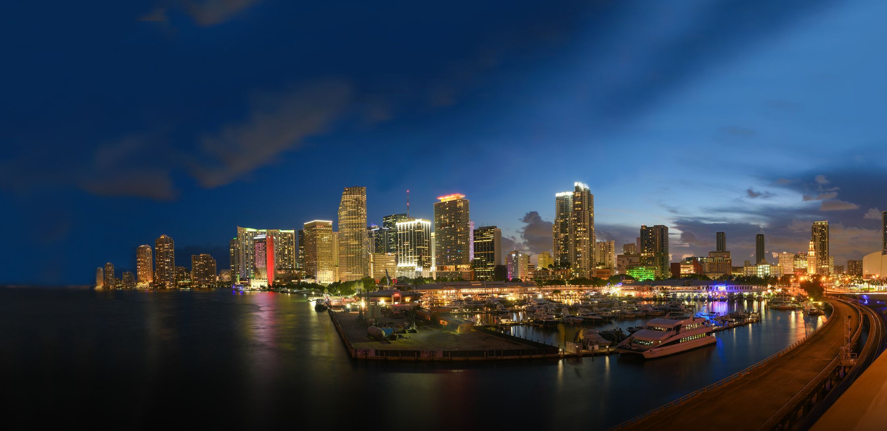
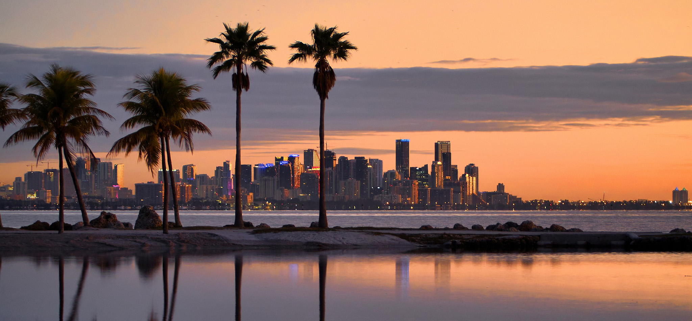

;)

 

- [Media and Press Center](https://www.miamidda.com/media-center/)
- [Public Meetings](https://www.miamidda.com/public-meetings/)

-  [Translate](javascript: void( 0 );)

- Afrikaans
- Albanian
- Amharic
- Arabic
- Armenian
- Azerbaijani
- Basque
- Belarusian
- Bengali
- Bosnian
- Bulgarian
- Catalan
- Cebuano
- Chichewa
- Chinese (Simplified)
- Chinese (Traditional)
- Corsican
- Croatian
- Czech
- Danish
- Dutch
- Esperanto
- Estonian
- Filipino
- Finnish
- French
- Frisian
- Galician
- Georgian
- German
- Greek
- Gujarati
- Haitian Creole
- Hausa
- Hawaiian
- Hebrew
- Hindi
- Hmong
- Hungarian
- Icelandic
- Igbo
- Indonesian
- Irish
- Italian
- Japanese
- Javanese
- Kannada
- Kazakh
- Khmer
- Korean
- Kurdish (Kurmanji)
- Kyrgyz
- Lao
- Latin
- Latvian
- Lithuanian
- Luxembourgish
- Macedonian
- Malagasy
- Malay
- Malayalam
- Maltese
- Maori
- Marathi
- Mongolian
- Myanmar (Burmese)
- Nepali
- Norwegian
- Pashto
- Persian
- Polish
- Portuguese
- Punjabi
- Romanian
- Russian
- Samoan
- Scots Gaelic
- Serbian
- Sesotho
- Shona
- Sindhi
- Sinhala
- Slovak
- Slovenian
- Somali
- Spanish
- Sundanese
- Swahili
- Swedish
- Tajik
- Tamil
- Telugu
- Thai
- Turkish
- Ukrainian
- Urdu
- Uzbek
- Vietnamese
- Welsh
- Xhosa
- Yiddish
- Yoruba
- Zulu
-  [Social](javascript: void( 0 );)

-  [ Instagram ](https://www.instagram.com/downtownmia/)
-  [ Twitter ](https://twitter.com/downtownmia)
-  [ YouTube ](https://www.youtube.com/user/miamidda2929)
-  [ Facebook ](https://www.facebook.com/downtownMIA/)
-  [ LinkedIn ](https://www.linkedin.com/company/miami-downtown-development-authority)
-  [ Email ](mailto:info@miamidda.com)
-  [  Search ](javascript: void( 0 );)

 

- [Focus Areas](#)

- [Business Support + Economic Development](https://www.miamidda.com/business/)
- [Enhanced Services](https://www.miamidda.com/quality-of-life/)
- [Branding, Communications, and Events](https://www.miamidda.com/marketing-comm/)
- [Planning, Transportation & Resiliency](https://www.miamidda.com/placemaking-transportation/)
- [Research & Reports](https://www.miamidda.com/collateral/)
- [Community Resources](https://www.miamidda.com/communityresources/)
- [Explore Downtown](#)

- [Attractions](https://www.miamidda.com/explore-downtown/)
- [Dine](https://www.miamidda.com/dine/)
- [Shop](https://www.miamidda.com/explore-downtown/shop/)
- [Stay](https://www.miamidda.com/explore-downtown/stay/)
- [Downtown Nightlife](https://www.miamidda.com/explore-downtown/nightlife/)
- [Getting to and Around Downtown](https://www.miamidda.com/explore-downtown/mobility/)
- [About Us](#)

- [Welcome to Downtown Miami](https://www.miamidda.com/message-to-our-directors/)
- [DDA Budget](https://www.miamidda.com/dda-budget/)
- [DDA Procurement](https://www.miamidda.com/dda-procurement/)
- [DDA District Maps](https://www.miamidda.com/data-resources/districts-maps/)
- [DDA Board](https://www.miamidda.com/dda-board/)
- [DDA Staff](https://www.miamidda.com/staff-roster/)
- [Contact Us](https://www.miamidda.com/contact-us/)
- [Event Calendar](/dda-meetings/)

# Living

Downtown Mia

# Doing Business

Downtown Mia

# Exploring

Downtown Mia

Epicenter of the Americas

 [Discover the Possibilities](#columns)

 [ More information ](https://www.miamidda.com/artcontest/)

### School Agenda Cover Contest for Kids

 [ Click here to enter contest ](https://www.miamidda.com/artcontest/)

                  

## Living in Downtown Miami

Truly electrifying and uniquely refreshing, Downtown Miami is a special place to call home. With extensive and diverse living options, including more than 100 residential buildings, you’ll find something for everyone here – from the young professional to the growing family unit. When it comes to activities, there’s an equal wealth of choices waiting outside your door. Let us help you learn more about living in our ever-evolving, always-intriguing home.

Whether you are a current resident or are looking to become one, we want to help you En Vogue with everything that is happening from the arts and food scenes to the ins outs of major projects transforming Downtown Miami.

 [    Small Business & Loan Assistance ](https://www.miamidda.com/small-businesses/)
 [    Getting Around Town ](https://www.miamidda.com/explore-downtown/mobility/)
 [    Community Resources ](https://www.miamidda.com/communityresources/)
 [    Dine ](https://www.miamidda.com/dine/)
 [    Small Business Assistance ](https://www.miamidda.com/small-businesses/)
 [    Message to Our DWNTWNRs ](https://www.miamidda.com/message-to-our-dwntwnrs/)
 [    Incentives ](https://www.miamidda.com/community-grants/incentives/)
 [    Education ](https://www.miamidda.com/services-initiatives/business-development-research/education/)
 [    Community Resources ](https://www.miamidda.com/communityresources/)
 [    Places to Stay ](https://www.miamidda.com/explore-downtown/stay/)
 [    Getting Around Town ](https://www.miamidda.com/explore-downtown/mobility/)
 [    Dine ](https://www.miamidda.com/dine/)
 [    Message to DWNTWNRs ](https://www.miamidda.com/message-to-our-dwntwnrs/)

 
 For Information On

## Making Miami Your Forever Home- 'Follow The Sun'

[Click Here](https://www.miamidda.com/follow-the-sun/)

## What is the Miami Downtown Development Authority?

The Miami Downtown Development Authority (Miami DDA) is an independent agency of the City of Miami funded by a special tax levy on properties within its district boundaries. The agency is governed by a 15-member board of directors, including three public appointees and 12 downtown property owners, business owners, and/or residents. The board sets policy direction, which is implemented by a multi-disciplinary team under the executive director's oversight.

Our mission is to grow, strengthen, and promote the economic health and vitality of Downtown Miami. As an autonomous agency of the City, the Miami DDA advocates, facilitates, plans, and executes business development, planning, capital improvements, and marketing and communication strategies.

**We commit to fulfill our mission collaboratively, ethically, and professionally, consistent with the Authority's public purpose.**

 1967 We were established
 15 Member board
 2 Square miles

  [@joiseyshowaa](https://www.flickr.com/photos/joiseyshowaa/) · [Twilight Miami Skyline](https://www.flickr.com/photos/joiseyshowaa/40034610353/in/photolist-2cSPfzu-23ZHQSD-2fGmTcA-2cSwBby-2e7Qj5G-2e9AQ67-2e9AKGC-2e9AHW3-2eegK7B-2e9AHdE-23BLaXR-23BLekT-2e9APL9-P2pkP8-2eVLUHx-2b7r6PE-29rTw59-2bcqvX7-2dY5d2c-RQ67p1-2cs6Qpw-2dY5dzX-RQ67Hs-QgEv2z-23qvCsR-2dGdcvU-2cEM3af-2dGdtJq-2gvf9yt-2gu7AFm-2gu7ADN-2gu7AAg-2gu7AzV-2gu7Ayh-2gu765b-2gu7t8F-2gu762L-2gu7t61-2gu75Wf-2gu75Vo-2gu7sVg) · [CC BY-SA 2.0](https://creativecommons.org/licenses/by-sa/2.0/)

## Latest News

### WSVN 7 News | Pop-up vaccination site unveiled at downtown Miamis DuPont Building

5.17.21

[Read More](https://www.miamidda.com/wsvn-7-news-pop-up-vaccination-site-unveiled-at-downtown-miamis-dupont-building/)

### Telemundo 51 | Comienza proyecto millionario para reviltalizar la calle Flagler

5.19.21

[Read More](https://www.miamidda.com/telemundo-51-comienza-proyecto-millionario-para-reviltalizar-la-calle-flagler/)

### WSVN 7 News | Miami-Dade leaders begin Flagler Street beautification project

5.19.21

[Read More](https://www.miamidda.com/wsvn-7-news-miami-dade-leaders-begin-flagler-street-beautification-project/)

 [View All News](https://www.miamidda.com/media-center/press/)

## Upcoming Events

### Miami DDA Nominating Committee Meeting – Board Candidate Finalist Interviews Part 2

6.3.21

The June 3, 2021 Miami DDA Nominating Committee Meeting – Board Candidate Finalist Interviews Part 2, will be held at the Miami DDA Conference...

[See Details](https://www.miamidda.com/event/miami-dda-nominating-committee-meeting-board-candidate-finalist-interviews-part-1/)

### Miami DDA COVID-19 Recovery Committee Meeting – Revised Date

6.14.21

The June 14, 2021 Miami DDA COVID-19 Recovery Committee Meeting will be held at the Miami DDA Conference Room located at 200 South Biscayne Blvd.,...

[See Details](https://www.miamidda.com/event/miami-dda-covid-19-recovery-committee-meeting-revised-date/)

### Miami DDA Finance Committee Meeting

6.17.21

The June 17, 2021 Miami DDA Finance Committee Meeting will be held at the Miami DDA Conference Room located at 200 South Biscayne Blvd., Suite 2929,...

[See Details](https://www.miamidda.com/event/miami-dda-finance-committee-meeting-2/)

 [View All Events](https://www.miamidda.com/dda-meetings/)

## Proudly Serving Downtown Miami: The Arts & Entertainment District, Miami CBD, and Brickell.

#### Contact us today to learn more about our great districts.

Under Florida law, e-mail addresses and contact information are public records. If you do not want your information released in response to a public records request, do not submit your information to this entity. Instead, contact the Miami Downtown Development Authority (DDA) by phone or in writing.

Arts & Entertainment
Central Business District
Brickell

#### @downtownmia

 Miami DDA

- [Marketing & Events](https://www.miamidda.com/services-initiatives/marketing-comm/)
- [Business Support + Economic Development](https://www.miamidda.com/business/)
- [Enhanced Services](https://www.miamidda.com/quality-of-life/)
- [Planning, Transportation & Resiliency](https://www.miamidda.com/placemaking-transportation/)
 Data + Research

- [Research & Reports](https://www.miamidda.com/collateral/)
- [Maps](https://www.miamidda.com/data-resources/districts-maps/) Community Grants

- [Community Grants](https://www.miamidda.com/marketing-comm/miami-dda-funding-programs/)
 Explore Downtown

- [Things to Do](https://www.miamidda.com/explore-downtown/)
- [Dining](https://www.miamidda.com/dine/)
- [Nightlife](https://www.miamidda.com/explore-downtown/nightlife/)
- [Hotels](https://www.miamidda.com/explore-downtown/stay/)
- [Shopping](https://www.miamidda.com/explore-downtown/shop/)
- [Getting Around](https://www.miamidda.com/explore-downtown/mobility/) Calendars

- [Public Meetings](https://www.miamidda.com/public-meetings/)
 Media Center

- [Newsletters](https://www.miamidda.com/media-center/dwntwnr/)
- [Video Spotlight](https://www.miamidda.com/media-center/business-spotlight/)
- [Press](https://www.miamidda.com/media-center/press/)
- [Downloadable Images](https://www.miamidda.com/media-center/collateral-images/)
- [Miami DDA Logos](https://www.miamidda.com/media-center/logos-usage/)

#### Get Downtown Updates

 Subscribe

Under Florida law, e-mail addresses and contact information are public records. If you do not want your information released in response to a public records request, do not submit your information to this entity. Instead, contact the Miami Downtown Development Authority (DDA) by phone or in writing.

---

 
  Made with  by [Pacific54](https://www.pacific54.com)   © 2019 Miami Downtown Development Authority
 [ADA Compliance](https://www.miamidda.com/ada-compliance/) [Annual Report](https://www.miamidda.com/wp-content/uploads/AnnualReport_1718_web.pdf)
