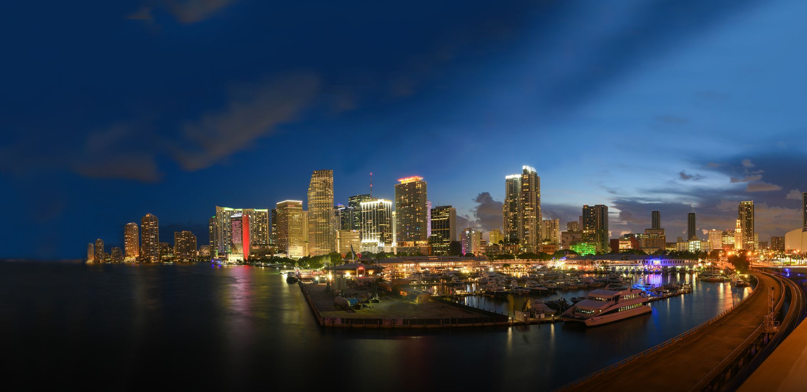
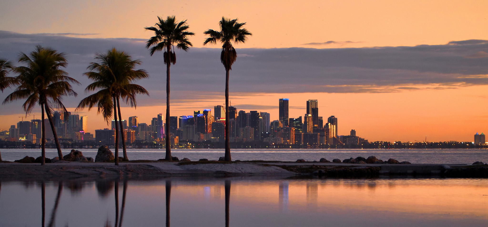

## Organisation overview
The Miami Downtown Development Authority (Miami DDA) is an independent agency of the City of Miami. It is funded by a special tax levy on properties inside its district boundaries. Site: https://www.miamidda.com. Logo: 

Tagline: Downtown Miami is the "Epicenter of the Americas."

## Mission and governance
- Mission: to grow, strengthen and promote the economic health and vitality of Downtown Miami.
- As an autonomous city agency, it advocates, facilitates, plans and carries out business development, planning, capital improvements, and marketing and communications strategies.
- Governed by a 15-member board of directors: three public appointees and 12 downtown property owners, business owners and/or residents. The board sets policy direction; a multi-disciplinary staff team under the executive director implements it.
- Commitment statement: to carry out the mission collaboratively, ethically and professionally, in line with the Authority's public purpose.
- Key facts: established in 1967; 15-member board; district covers 2 square miles.
- Districts served: the Arts & Entertainment District, the Miami CBD (Central Business District), and Brickell. Visitors are invited to make contact to learn more about these districts.

## Three ways to engage with Downtown Miami
- Living in Downtown Miami
- Doing Business in Downtown Miami
- Exploring Downtown Miami
- Call to action: "Discover the Possibilities" (links to the #columns anchor).

## Living in Downtown Miami
Downtown Miami is presented as an electrifying, refreshing place to call home, with more than 100 residential buildings suiting everyone from young professionals to growing families, plus plenty of activities nearby. The DDA wants to help current and prospective residents stay in the know about arts, food, and major transformation projects in the area.

Resource links offered for residents, businesses and visitors:
- Small Business & Loan Assistance: https://www.miamidda.com/small-businesses/
- Small Business Assistance: https://www.miamidda.com/small-businesses/
- Getting Around Town: https://www.miamidda.com/explore-downtown/mobility/
- Community Resources: https://www.miamidda.com/communityresources/
- Dine: https://www.miamidda.com/dine/
- Message to Our DWNTWNRs: https://www.miamidda.com/message-to-our-dwntwnrs/
- Incentives: https://www.miamidda.com/community-grants/incentives/
- Education: https://www.miamidda.com/services-initiatives/business-development-research/education/
- Places to Stay: https://www.miamidda.com/explore-downtown/stay/
- Message to DWNTWNRs: https://www.miamidda.com/message-to-our-dwntwnrs/

## Follow The Sun
Information about making Miami a "forever home" through the "Follow The Sun" program. Link text: "Click Here" → https://www.miamidda.com/follow-the-sun/

## School Agenda Cover Contest for Kids
An art contest for children to design a school agenda cover. Calls to action: "More information" and "Click here to enter contest" → https://www.miamidda.com/artcontest/

## Photo

Credit: Flickr user @joiseyshowaa (https://www.flickr.com/photos/joiseyshowaa/), photo "Twilight Miami Skyline" (https://www.flickr.com/photos/joiseyshowaa/40034610353/in/photolist-2cSPfzu-23ZHQSD-2fGmTcA-2cSwBby-2e7Qj5G-2e9AQ67-2e9AKGC-2e9AHW3-2eegK7B-2e9AHdE-23BLaXR-23BLekT-2e9APL9-P2pkP8-2eVLUHx-2b7r6PE-29rTw59-2bcqvX7-2dY5d2c-RQ67p1-2cs6Qpw-2dY5dzX-RQ67Hs-QgEv2z-23qvCsR-2dGdcvU-2cEM3af-2dGdtJq-2gvf9yt-2gu7AFm-2gu7ADN-2gu7AAg-2gu7AzV-2gu7Ayh-2gu765b-2gu7t8F-2gu762L-2gu7t61-2gu75Wf-2gu75Vo-2gu7sVg), licensed CC BY-SA 2.0 (https://creativecommons.org/licenses/by-sa/2.0/).

## Latest news (press coverage)
- WSVN 7 News: a pop-up vaccination site opened at downtown Miami's DuPont Building. Dated 5.17.21. https://www.miamidda.com/wsvn-7-news-pop-up-vaccination-site-unveiled-at-downtown-miamis-dupont-building/
- Telemundo 51 (in Spanish): a multimillion-dollar project begins to revitalise Flagler Street. Dated 5.19.21. https://www.miamidda.com/telemundo-51-comienza-proyecto-millionario-para-reviltalizar-la-calle-flagler/
- WSVN 7 News: Miami-Dade leaders start a Flagler Street beautification project. Dated 5.19.21. https://www.miamidda.com/wsvn-7-news-miami-dade-leaders-begin-flagler-street-beautification-project/
- Each has a "Read More" link; "View All News" → https://www.miamidda.com/media-center/press/

## Upcoming events
- Miami DDA Nominating Committee Meeting, Board Candidate Finalist Interviews Part 2 — 6.3.21. Held at the Miami DDA Conference Room (text truncated). "See Details" → https://www.miamidda.com/event/miami-dda-nominating-committee-meeting-board-candidate-finalist-interviews-part-1/
- Miami DDA COVID-19 Recovery Committee Meeting (revised date) — 6.14.21. Held at the Miami DDA Conference Room, 200 South Biscayne Blvd. "See Details" → https://www.miamidda.com/event/miami-dda-covid-19-recovery-committee-meeting-revised-date/
- Miami DDA Finance Committee Meeting — 6.17.21. Held at the Miami DDA Conference Room, 200 South Biscayne Blvd., Suite 2929. "See Details" → https://www.miamidda.com/event/miami-dda-finance-committee-meeting-2/
- "View All Events" → https://www.miamidda.com/dda-meetings/

## Public records notice
Under Florida law, email addresses and contact details are public records. Anyone who doesn't want their details released in response to a public records request should not submit them through the site and should instead contact the Miami DDA by phone or in writing. This notice appears with both the contact invitation and the newsletter sign-up.

## Newsletter
"Get Downtown Updates" with a Subscribe action.

## Contact and social
- Email: info@miamidda.com
- Social handle: @downtownmia
- Instagram: https://www.instagram.com/downtownmia/
- Twitter: https://twitter.com/downtownmia
- YouTube: https://www.youtube.com/user/miamidda2929
- Facebook: https://www.facebook.com/downtownMIA/
- LinkedIn: https://www.linkedin.com/company/miami-downtown-development-authority

## Site navigation content
Quick links: Media and Press Center (https://www.miamidda.com/media-center/); Public Meetings (https://www.miamidda.com/public-meetings/). Search is available. A language translation menu offers about 100 languages, from Afrikaans and Albanian through Chinese (Simplified and Traditional), French, Spanish and Hindi to Yoruba and Zulu.

**Focus Areas**
- Business Support + Economic Development: https://www.miamidda.com/business/
- Enhanced Services: https://www.miamidda.com/quality-of-life/
- Branding, Communications, and Events: https://www.miamidda.com/marketing-comm/
- Planning, Transportation & Resiliency: https://www.miamidda.com/placemaking-transportation/
- Research & Reports: https://www.miamidda.com/collateral/
- Community Resources: https://www.miamidda.com/communityresources/

**Explore Downtown**
- Attractions: https://www.miamidda.com/explore-downtown/
- Dine: https://www.miamidda.com/dine/
- Shop: https://www.miamidda.com/explore-downtown/shop/
- Stay: https://www.miamidda.com/explore-downtown/stay/
- Downtown Nightlife: https://www.miamidda.com/explore-downtown/nightlife/
- Getting to and Around Downtown: https://www.miamidda.com/explore-downtown/mobility/

**About Us**
- Welcome to Downtown Miami: https://www.miamidda.com/message-to-our-directors/
- DDA Budget: https://www.miamidda.com/dda-budget/
- DDA Procurement: https://www.miamidda.com/dda-procurement/
- DDA District Maps: https://www.miamidda.com/data-resources/districts-maps/
- DDA Board: https://www.miamidda.com/dda-board/
- DDA Staff: https://www.miamidda.com/staff-roster/
- Contact Us: https://www.miamidda.com/contact-us/
- Event Calendar: /dda-meetings/

**Miami DDA program links**
- Marketing & Events: https://www.miamidda.com/services-initiatives/marketing-comm/
- Business Support + Economic Development: https://www.miamidda.com/business/
- Enhanced Services: https://www.miamidda.com/quality-of-life/
- Planning, Transportation & Resiliency: https://www.miamidda.com/placemaking-transportation/
- Data + Research: Research & Reports (https://www.miamidda.com/collateral/); Maps (https://www.miamidda.com/data-resources/districts-maps/)
- Community Grants: https://www.miamidda.com/marketing-comm/miami-dda-funding-programs/
- Explore Downtown: Things to Do (https://www.miamidda.com/explore-downtown/); Dining (https://www.miamidda.com/dine/); Nightlife (https://www.miamidda.com/explore-downtown/nightlife/); Hotels (https://www.miamidda.com/explore-downtown/stay/); Shopping (https://www.miamidda.com/explore-downtown/shop/); Getting Around (https://www.miamidda.com/explore-downtown/mobility/)
- Calendars: Public Meetings (https://www.miamidda.com/public-meetings/)
- Media Center: Newsletters (https://www.miamidda.com/media-center/dwntwnr/); Video Spotlight (https://www.miamidda.com/media-center/business-spotlight/); Press (https://www.miamidda.com/media-center/press/); Downloadable Images (https://www.miamidda.com/media-center/collateral-images/); Miami DDA Logos (https://www.miamidda.com/media-center/logos-usage/)

## Legal and credits
- © 2019 Miami Downtown Development Authority
- Website made by Pacific54: https://www.pacific54.com
- ADA Compliance: https://www.miamidda.com/ada-compliance/
- Annual Report (PDF): https://www.miamidda.com/wp-content/uploads/AnnualReport_1718_web.pdf
