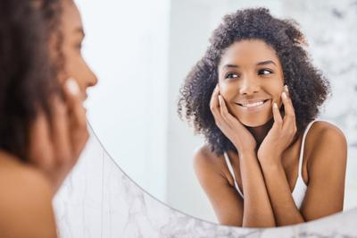
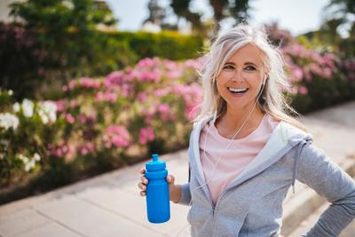
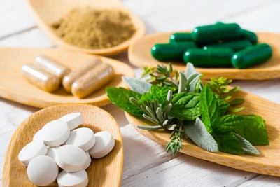

## Organisation
Natural Wellbeing (legal entity: Natural Wellbeing Distribution, Inc., © 2021) sells all-natural, plant-based dietary supplements made for women. Tagline: "All-Natural Supplements For Women Like You," with the invitation to mindfully take part in one's everyday wellness. Social profiles:
- Facebook: https://www.facebook.com/naturalwellbeinghealth
- Pinterest: https://www.pinterest.com/naturalwellbeing
- Instagram: https://www.instagram.com/naturalwellbeinghealth/

Logo:  

## Offer and announcements
- Free shipping on every US order above $50.
- Account login, site search and shopping cart are available.
- A "Shop All" link leads to the full supplement catalogue (/collections/our_supplements); a "View all" link does the same.

## Mission and approach
- **Renewing yourself naturally:** The company aims to help women reconnect with optimal health. Its full range of expertly formulated plant-based supplements is meant to help restore energy, stamina and vitality, needing only a few minutes of daily self-care.
- **Inspired by nature, refined by science:** Formulas respect the long-standing traditional uses of herbs and combine them with current scientific research. They are developed by clinical herbalists and manufactured in the USA in GMP-certified facilities. Quality and care are stressed. Link: Learn More (/pages/the-natural-wellbeing-difference).
- **Discover another way:** Thoughtful alternatives to support body and mind at every life stage, offering a caring connection with nature and a chance for daily self-care.
- Closing statement: a vibrant mind and healthy body make life's journey best.
- A wellness kits link (/collections/wellness-kits) accompanies the mission text.

## Featured products (prices in USD)
- Adaptogenic Stress Relief: $39.95
- Hair Essentials: from $29.95
- Kids' Attention Gold: $44.95
- Golden Milk Bliss: $39.95
- Marine Collagen Plus: $52.95
- Mushroom Cocoa Bliss: $47.95
- Female Libido: $39.95
- Immune Sure: $34.95
- Sleep Essentials: $32.95
- Bladder Control Plus with Urox®: from $39.95
- Trilex Essentials: $34.95
- B-Complex Liquid: $24.95

## Product collections
Shop menu (/collections/our_supplements):

**Life Boosters** (/collections/life-boosters)  
- Adaptogenic Stress Relief
- Golden Milk Bliss
- Immune Sure
- Mind Your Memory
- Mushroom Cocoa Bliss
- Stress Support Kit

**Life Glow** (/collections/life-glow)  
- Fo-Ti Essentials
- Hair Essentials
- Hair Essentials + Fo-Ti Combo
- Healthy Hair, Skin, Nails Kit
- Marine Collagen Plus

**Life Essentials** (/collections/life-essentials)  
- B-Complex Liquid
- Concentration Essentials
- Kids' Attention Gold
- Sleep Essentials
- Thyroid Support Essentials
- Thyroid Support Kit
- Trilex Essentials

**Life Transitions** (/collections/life-transitions)  
- Bladder Control Plus
- Female Libido
- Menopause Transitions
- Mindful Menopause Kit

**Wellness Bundles** (/collections/wellness-bundles) 
- Healthy Hair, Skin, Nails Kit
- Mindful Menopause Kit
- Stress Support Kit
- Thyroid Support Kit

## Programs and support
- **Wellbeing Rewards** (/pages/rewards): Customers earn points and other benefits by making Natural Wellbeing part of their daily routine. Call to action: Get Rewarded.
- **Meet Our Team** (/pages/our-team): A caring, empathetic support staff dedicated to helping customers. Call to action: Say Hello.
- **Ask An Expert** (/pages/ask-an-expert): Customers can pose questions about any supplement. Call to action: Have a Question?

## Other pages
- Our Story (/pages/our-story)
- The Natural Wellbeing Difference (/pages/the-natural-wellbeing-difference)
- Health Journal (https://blog.naturalwellbeing.com)
- FAQ (/pages/frequently-asked-questions)
- Our Guarantee (/pages/our-guarantee)
- Giving Back (/pages/giving-back)
- Shipping policy (/policies/shipping-policy)
- Returns (/policies/refund-policy)
- Affiliate Program (/pages/affiliate-program)
- Wholesale & Partnership (/pages/request-a-wholesale-account)
- Account (/account), Search (/search), Cart (/cart), Contact Us (/pages/contact-us)

## Contact
- Phone: 1 (800) 536-9353 (+1-800-536-9353)
- Email: info@naturalwellbeing.com
- Support hours (Pacific Time): Monday–Friday 8 am–6 pm; Saturday–Sunday 8 am–5 pm; holidays 8 am–5 pm.

## Newsletter
- Sign up and save: subscribers receive exclusive promotions, giveaways, news about new products and the latest in women's health. Visitors enter their email address and press Subscribe.

## Legal and payments
- Disclaimer: These statements have not been evaluated by the FDA. The products are not intended to diagnose, treat, cure or prevent any disease.
- Accepted payment methods:         
- © 2021 Natural Wellbeing Distribution, Inc.
