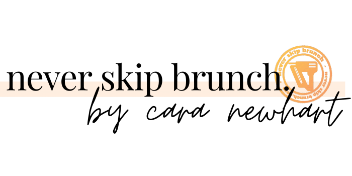
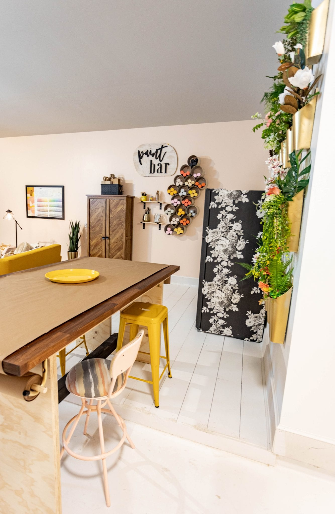
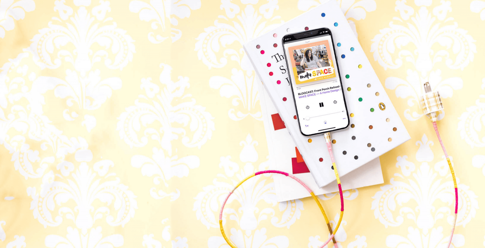
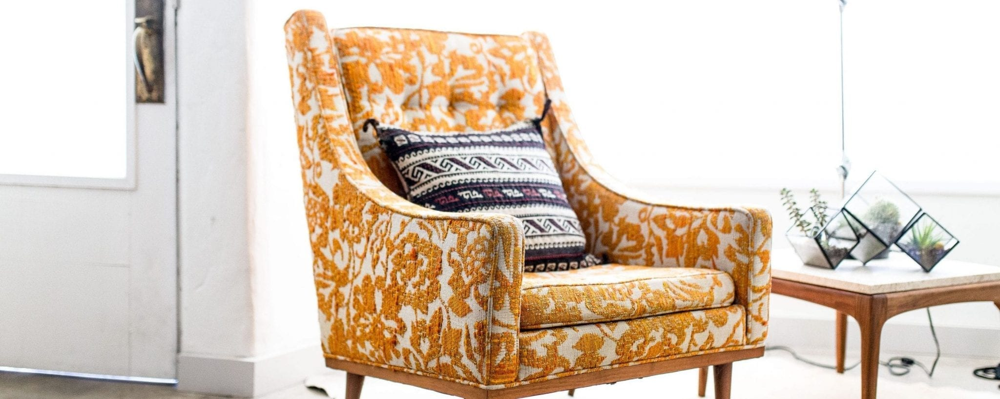

## Organisation
Never Skip Brunch is a home design and DIY brand run by Cara Newhart. Tagline: empowering women to DIY big. Cara describes herself as a DIY queen obsessed with color and prints. Her aim is to help people build a beautifully lived-in life through home design advice and stylish DIY tutorials. She wants to bring the good vibes and photo-worthy moments of brunch into a space that helps readers develop their crafty side and make things like a pro.

Short tagline for the shop: fun and fresh home goodies. Shop: https://shop.neverskipbrunch.com (also called The NSB Shop).

## Main offerings and links
- Blog: https://www.neverskipbrunch.com/blog/ (blog categories can be browsed)
- Decor & Interiors: https://www.neverskipbrunch.com/home-design/
  - Browse home projects (https://www.neverskipbrunch.com/home-design/)
  - Design consultation (https://www.neverskipbrunch.com/services/)
  - Interior design calculators (https://www.neverskipbrunch.com/interior-design-calculators/)
- DIY Projects: https://www.neverskipbrunch.com/diy-projects/
  - Browse DIY projects
  - Starter tools (https://www.neverskipbrunch.com/tools)
  - DIY project coaching (https://www.neverskipbrunch.com/services/)
- Make Space podcast: https://www.neverskipbrunch.com/make-space-podcast
  - Subscribe (https://www.neverskipbrunch.com/make-space-podcast/#subscribe)
  - Episodes (https://www.neverskipbrunch.com/topics/make-space/)
  - Listener feedback (https://www.neverskipbrunch.com/make-space-podcast/feedback)
- DIY & design plans + templates: https://divein.neverskipbrunch.com/
- YouTube channel: https://bit.ly/NeverSkipBrunchYouTube
- Free downloads: https://www.neverskipbrunch.com/downloads/
- Workshops: https://neverskipbrunch.eventbrite.com/
- Work with me: https://www.neverskipbrunch.com/work-with-me/
- Interior design portfolio: https://www.neverskipbrunch.com/portfolio/
- Press: https://www.neverskipbrunch.com/press
- About: https://www.neverskipbrunch.com/about/ (call to action: about and learn more)
- Contact: https://www.neverskipbrunch.com/contact
- Terms of Use: https://www.neverskipbrunch.com/terms-of-use/
- Home page: https://www.neverskipbrunch.com/

## Blog introduction
The blog is for two kinds of readers.
- Experienced DIYers or people with solid home design knowledge: a library of fun projects, decor guidance and styling advice.
- Newcomers or those doubting their creative ability: Cara hopes they find inspiration and encouragement. Call to action: browse all posts (https://www.neverskipbrunch.com/blog).

## Make Space podcast

A home design show. Conversations cover home design strategy, decor advice, and interior design tips and tricks, helping listeners imagine a beautifully lived-in home. Call to action: listen and subscribe (https://www.neverskipbrunch.com/make-space-podcast/).

## Videos
Fun and fresh videos are available on the YouTube channel: https://bit.ly/NeverSkipBrunchYouTube

## Latest blog posts (all in the DIY category, https://www.neverskipbrunch.com/topics/diy/)
- Part 02 of the breakfast nook DIY: a space makeover with small dining room ideas on a budget. https://www.neverskipbrunch.com/part-02-breakfast-nook-diy-space-makeover-small-dining-room-ideas-on-a-budget/
- Part 01 of the breakfast nook DIY: flipping a table and chairs. https://www.neverskipbrunch.com/breakfast-nook-diy-furniture-flip-table-and-chairs/
- DIY gold range hood: a simple, renter-friendly appliance makeover. https://www.neverskipbrunch.com/diy-gold-range-hood-simple-renter-friendly-appliance-makeover/
- The post archive spans 60 pages (page 2: https://www.neverskipbrunch.com/page/2/, page 3: https://www.neverskipbrunch.com/page/3/, page 60: https://www.neverskipbrunch.com/page/60/), with a link to the next page.

## Contact and collaboration

Cara enjoys hearing from women with DIY and design questions or feedback. Brands interested in collaborating can find details on the contact page. Call to action: grab a virtual coffee (https://www.neverskipbrunch.com/contact).

## Social media
- Facebook: https://facebook.com/neverskipbrunch 
- Instagram: https://instagram.com/neverskipbrunch 
- Pinterest: https://pinterest.com/neverskipbrunch 
- Twitter: https://twitter.com/neverskipbrunch 
- YouTube: https://youtube.com/c/neverskipbrunch 

Instagram feed with call to action to follow (https://www.instagram.com/neverskipbrunch/). Recent posts mention:
- A chaotic store trip involving lugging items around (https://www.instagram.com/p/CO39UHFgdld/)
- Not catching a break, with a "second..." story (https://www.instagram.com/p/CM4riwAgXfv/)
- Announcement of season 2 of the #FurnitureFlipChallenge (https://www.instagram.com/p/CMItEgYggRy/)
- A question about whether the viewer's closet is as out of control as Cara's was (https://www.instagram.com/p/CKXnxLPAjWZ/)
- "How I got started" in DIY, answering a frequent question (https://www.instagram.com/p/CKU1neZAMz_/)
- Excitement for #FinishFriday (https://www.instagram.com/p/CIqYO5Zgjl_/)
- Hype about whether a bidet can be life changing (https://www.instagram.com/p/CIZZTB5glH8/)
- A fireplace as the final detail of a guest room (https://www.instagram.com/p/CIJxWd_gn0c/)

## Newsletter
Visitors can join the newsletter. A search option is offered for finding content. Subscription options are mentioned.

## Legal notes
- Affiliate disclosure: the site contains affiliate links for convenience. Cara is an Amazon Associate and member of other affiliate programs and earns from qualifying purchases. The links cost readers nothing extra, and she always gives her honest opinion.
- Copyright 2021, Never Skip Brunch, by Cara Newhart (https://neverskipbrunch.com/about).
- Content is protected against copying.
