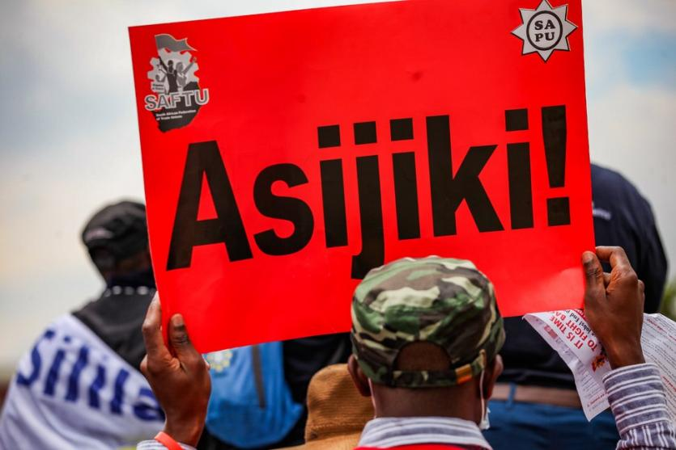
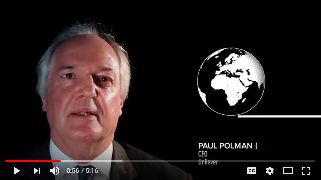

# New Climate Economy: Content Brief

## Organisation
- Name: New Climate Economy (Twitter handle @NewClimateEcon)
- Logo: 
- Site tools: a search box (icon: ) and a Sign Up option
- Main pages: About (/content/about), News (/news), Publications (/publications), Contact Us (/contact)

## Featured Commentary

- Date: April 14, 2021
- Title: a commentary arguing that overcoming "the inequality disease" has to become a rallying call for the whole world.
- Call to action: Read More (/content/commentary-defeating-inequality-disease-must-become-global-rallying-call)

## Latest News
Four recent commentaries, plus a link to all news (/news):
- April 6, 2021: a commentary stating that the fight against climate change cannot succeed unless industry takes action (/content/commentary-climate-change-battle-can%E2%80%99t-be-won-without-industry-action)
- March 10, 2021: a commentary proposing a fresh course for U.S.-Africa relations on climate (/content/commentary-new-path-us-africa-climate-relations)
- November 30, 2020: a commentary urging that women be given the opportunity to help rebuild a better food system after the crisis (/content/commentary-we-must-give-women-chance-build-back-better-food-system)
- Link label: All news (/news)

## Videos

- "Unlocking the Inclusive Growth Story of the 21st Century" (/video/unlocking-inclusive-growth-story-21st-century)
- "Landscape restoration is critical to deliver climate action: Ngozi Okonjo-Iweala" (/video/landscape-restoration-critical-deliver-climate-action-ngozi-okonjo-iweala)
- "Seizing the Global Opportunity" (/video/seizing-global-opportunity)

## Events
- Upcoming Events listing (no events currently shown)
- Link to past events: See Past Events (/events)

## Recent Tweets
- Opinion piece by @ClimateHome (http://twitter.com/ClimateHome): as more countries commit to #NetZero targets, they should act quickly on delivering them. Link: https://t.co/UwoYc6zL8B. Posted 2 days 21 hours ago.
- Trinidad and Tobago's government is looking into #ClimateFinance mechanisms to help cut greenhouse gas emissions. Link: https://t.co/FoqHLCjIjb. Posted 2 days 23 hours ago.
- Link to all tweets: https://twitter.com/NewClimateEcon

## Partners
- Managing Partner: World Resources Institute  (/partners/world-resources-institute)
- Other partners:
  - Coalition for Urban Transitions  (/partners/coalition-urban-transitions)
  - Food and Land Use Coalition  (/partners/food-and-land-use-coalition)
- Link to the full list: All partners (/partners)

## Careers
- Careers page (/content/careers)

## Social Media
- YouTube: https://www.youtube.com/channel/UCQwH2YyOkr4scn4G6ZuljHA 
- LinkedIn: http://www.linkedin.com/company/new-climate-economy-project 
- Google+: https://plus.google.com/114394433939488130504 
- Facebook: https://www.facebook.com/pages/New-Climate-Economy/362422800557023 
- Twitter: https://twitter.com/NewClimateEcon 
