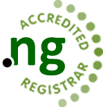
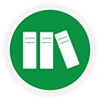

Nigeria Internet Registration Association (NiRA)

- [**](https://facebook.com/niraworks)
- [**](https://twitter.com/niraworks)
- [**](https://plus.google.com/102317337581609707348)
- [**](https://www.youtube.com/channel/UCmgkodKZzKKBZS8CZg_LaRQ)
- [**](https://www.linkedin.com/company/nigeria-internet-registration-association-nira-?trk=co-feed-likes-one)

- ** [0700CALLNIRA](tel:0700CALLNIRA)
- ** [admin@nira.org.ng](mailto:admin@nira.org.ng)

[

# 

](/)

- [Home](/)
- [Who Are We](/who-are-we)
- [Events](/events)
- [Media](/nira-media)
- [Legal](/legal)
- [Join Us](/join-us)
- [Registrars](/registrars)
- [Support](/supports)
- [Switchto.ng](http://www.switchto.ng)

            [joomla slideshow with caption](http://jextensions.com/orbit-jquery-slideshow-for-joomla-2.5/)

### Quick menu

- [Whois Search ](http://whois.nic.net.ng/)
- [Registrars](/ng-registrars)
- [Search](/search)
- [Contact Us](/contact-us)

> [Facebook](https://www.facebook.com/niraworks)

### NiRA Calendar

[Previous Year](https://www.nira.org.ng/?iccaldate=2020-05-1)[Previous Month](https://www.nira.org.ng/?iccaldate=2021-4-1)[Next Year](https://www.nira.org.ng/?iccaldate=2022-05-1)[Next Month](https://www.nira.org.ng/?iccaldate=2021-6-1)
May 2021
    Mon Tue Wed Thu Fri Sat Sun
 1
 2
 3
 4
 5
 6
 7
 8
 9
 10
 11
 12
 13
 14
 15
 16
 17
 18
 19
 20
 21
 22
 23
 24
 25
 26
 27
 28
 29
 30
 31

##  Welcome to the .ng Domain Registry website.

NiRA is the registry for .ng Internet Domain Names and maintains the database of names registered in the .ng country code Top Level Domain.

NiRA is a Not-for-Profit, Non-Governmental Self-Regulating body and managers of the .ng national resource, the country code Top Level Domain(ccTLD) name space in the public interest of Nigeria and global internet communities..

##  Register a .ng Domain

NiRA operates a 3R model of operation, Registry/Registrar/Registrant, it does not register domains directly for registrants. [Read More.](/index.php/join-us/register-ng-domains)

##  NiRA Policies

[Our Policy ](/images/Policies/NIRA_POLICY_DEVELOPMENT.pdf)Development Process gives room to Stakeholder Associations and members of the Internet community to contribute to its formulation. [Read More](/images/Policies/NIRA_POLICY_DEVELOPMENT.pdf)

### Subscribe to our Newsletter

[Subscribe](#)

#### News Update

  Your browser does not support the video tag.

### Registrars

[How to become a Registrar](/become-a-registrar)

[Accreditation Policy](/images/Policies/NiRA-Registrars-Accreditation-Policy.pdf)

[Accredited Registrars](/accredited-registrars)

### Policy Compliance

[NIRA Domain Names Policy](/images/Policies/NIRA_Domain_Names_Policy.pdf)

[NIRA Complaints Policy](/images/Policies/NIRA_COMPLAINTS_POLICY.pdf)

[General Registration Policy](/images/Policies/NIRA-GENERAL-REGISTRATION-POLICY.pdf)

### Support

[Support Services](/supports)

[Submit Ticket](/supports)

[NiRA FAQ](/registrar-faqs)

### Follow us on :

        

---

 © 2019 Nigeria Internet Registration Association (NiRA). All Rights Reserved. [Webmail](https://cp.nira.org.ng:2096/)
 [**](#)

### Main Menu

- [Home](/)
- [Who Are We](/who-are-we)
- [Events](/events)
- [Media](/nira-media)
- [Legal](/legal)
- [Join Us](/join-us)
- [Registrars](/registrars)
- [Support](/supports)
- [Switchto.ng](http://www.switchto.ng)
