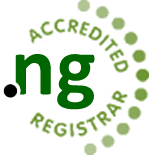

## Organisation

Nigeria Internet Registration Association (NiRA) is the registry for .ng Internet domain names. It maintains the database of all names registered under the .ng country code Top Level Domain (ccTLD). NiRA is a not-for-profit, non-governmental, self-regulating body. It manages the .ng namespace as a national resource, in the public interest of Nigeria and the global internet community.

Welcome message: visitors are greeted to the .ng Domain Registry website.

## Contact details

- Phone: 0700CALLNIRA
- Email: admin@nira.org.ng
- Webmail access: https://cp.nira.org.ng:2096/

## Social media

- Facebook: https://facebook.com/niraworks
- Twitter: https://twitter.com/niraworks
- Google Plus: https://plus.google.com/102317337581609707348
- YouTube: https://www.youtube.com/channel/UCmgkodKZzKKBZS8CZg_LaRQ
- LinkedIn: https://www.linkedin.com/company/nigeria-internet-registration-association-nira-?trk=co-feed-likes-one
- Instagram: https://www.instagram.com/niraworks/
- A Facebook feed/widget for https://www.facebook.com/niraworks is also shown.

Social icons:
    

## Logo

## Site navigation

- Home (/)
- Who Are We (/who-are-we)
- Events (/events)
- Media (/nira-media)
- Legal (/legal)
- Join Us (/join-us)
- Registrars (/registrars)
- Support (/supports)
- Switchto.ng (http://www.switchto.ng)

Quick links:
- Whois Search: http://whois.nic.net.ng/
- Registrars: /ng-registrars
- Search: /search
- Contact Us: /contact-us

## Slideshow

A rotating slideshow with captions, powered by the Joomla Orbit jQuery slideshow extension (http://jextensions.com/orbit-jquery-slideshow-for-joomla-2.5/).

## Calendar

A NiRA event calendar showing May 2021 (days 1 to 31, weeks running Monday to Sunday). Visitors can move to the previous year (https://www.nira.org.ng/?iccaldate=2020-05-1), previous month (https://www.nira.org.ng/?iccaldate=2021-4-1), next year (https://www.nira.org.ng/?iccaldate=2022-05-1) and next month (https://www.nira.org.ng/?iccaldate=2021-6-1).

## Registering a .ng domain

NiRA works on a "3R" model: Registry, Registrar and Registrant. It does not register domains directly for registrants; registration goes through accredited registrars. Link to learn more: /index.php/join-us/register-ng-domains

## Policy development

NiRA's policy development process lets stakeholder associations and members of the internet community contribute to shaping policies. Document: /images/Policies/NIRA_POLICY_DEVELOPMENT.pdf (an alternate copy is at /images/Policies/NIRA-_POLICY_DEVELOPMENT.pdf)

## Newsletter

Visitors can subscribe to the NiRA newsletter.

## News updates

A news area with three items, each with an image placeholder, and a video player (with a fallback message for browsers that don't support video).

## Registrar resources

- How to become a registrar: /become-a-registrar
- Registrars Accreditation Policy: /images/Policies/NiRA-Registrars-Accreditation-Policy.pdf
- List of accredited registrars: /accredited-registrars

## Policy compliance documents

- NIRA Domain Names Policy: /images/Policies/NIRA_Domain_Names_Policy.pdf
- NIRA Complaints Policy: /images/Policies/NIRA_COMPLAINTS_POLICY.pdf
- General Registration Policy: /images/Policies/NIRA-GENERAL-REGISTRATION-POLICY.pdf

## Support

- Support Services: /supports
- Submit a support ticket: /supports
- NiRA FAQ: /registrar-faqs

## Legal notice

© 2019 Nigeria Internet Registration Association (NiRA). All Rights Reserved.
