-

-  [ ** 812.481.4787 ](tel:812.481.4787)
-  [ **  Sign Up for News!  ](#header-newsletter-signup)

-
 [ Get a FREE Catalog ](https://www.ridetech.com/information/free-catalog/)
-  [  Login / Register  ](https://www.ridetech.com/account/)

  

-

Search

-
-
 [  $0.00  * * ](https://www.ridetech.com/cart/)

-

No products in the cart.

- [Products**](https://www.ridetech.com/product-category/products/)

- [Suspension Packages](https://www.ridetech.com/product-category/products/suspension_packages/)
- [– Air Suspension](https://www.ridetech.com/product-category/products/air_suspension/)
- [– StreetGRIP Suspension](https://www.ridetech.com/product-category/products/streetgrip/)
- [– Coil-Over Suspension](https://www.ridetech.com/product-category/products/coil_overs/)
- [Shock Absorbers](https://www.ridetech.com/product-category/products/shocks/)
- [RidePRO-E5 Air Suspension Control](https://www.ridetech.com/product-category/products/air_suspension/air-ride-suspension-control-systems/)
- [Tubular Control Arms](https://www.ridetech.com/product-category/products/tubular_control_arms/)
- [4-Links](https://www.ridetech.com/product-category/products/4_links/)
- [MUSCLEbar Sway Bars](https://www.ridetech.com/product-category/products/sway_bars/)
- [Bushings](https://www.ridetech.com/product-category/products/components/bushings/)
- [R-Joint Rod Ends](https://www.ridetech.com/product-category/products/r_joint/)
- [Load Leveling](https://www.ridetech.com/product-category/applications/load_leveling/)
- [Tru Turn](https://www.ridetech.com/product-category/products/tru_turn/)
- [TigerCage](https://www.ridetech.com/product-category/products/tigercage/)
- [Components](https://www.ridetech.com/product-category/products/components/)
- [Tools and Accessories](https://www.ridetech.com/product-category/products/tools_accessories/)
- [Steering](https://www.ridetech.com/product-category/products/steering_and_brakes/)
- [Brakes & Rear Ends](https://www.ridetech.com/product-category/products/brakes_rear_ends/)
- [Apparel](https://www.ridetech.com/product-category/products/apparel_and_signs/)
- [Applications**](https://www.ridetech.com/product-category/applications/)

- [Muscle Cars and Classics](https://www.ridetech.com/product-category/applications/musclecars_classics/)
- [Street Rods & Customs](https://www.ridetech.com/product-category/applications/streetrods_customs/)
- [Trucks](https://www.ridetech.com/product-category/applications/trucks/)
- [Corvettes](https://www.ridetech.com/product-category/applications/corvettes/)
- [Late Model Muscle Cars](https://www.ridetech.com/product-category/applications/late-model-musclecars/)
- [Load Leveling](https://www.ridetech.com/product-category/applications/load_leveling/)
- [NEWS**](https://www.ridetech.com/info/)

- [Latest Updates](https://www.ridetech.com/info/)
- [About Ridetech](https://www.ridetech.com/information/about/)
- [Event Calendar](https://www.ridetech.com/calendar/)
- [Customer Rides](https://www.ridetech.com/information/customer-rides/)
- [Current Job Openings](https://www.ridetech.com/jobs/)
- [Tech**](https://www.ridetech.com/tech/)

- [Tech Articles](https://www.ridetech.com/tech/)
- [RideTech StrongARM Dimensions](https://www.ridetech.com/tech/ridetech-strongarm-dimensions/)
- [Spring Rate Calculator](https://www.ridetech.com/tech/spring-rate-calculator/)
- [Vehicle Weight Database](https://www.ridetech.com/tech/vehicle-weights/)
- [Frequently Asked Questions](https://www.ridetech.com/tech/faq/)
- [1,000,001 Mile Warranty](https://www.ridetech.com/tech/1000001-mile-warranty/)
- [Shock Absorber Trade-In](https://www.ridetech.com/tech/coilover-trade-in/)
- [Controller Software Downloads](https://www.ridetech.com/tech/air-controller-instructions/)
- [Videos](https://www.ridetech.com/category/video/)
- [Dealers](https://www.ridetech.com/dealers/)
- [FORUM](https://www.ridetech.com/forums/forum/tech-products/)
- [Projects](https://www.ridetech.com/garage/)
- [Industrial](https://www.ridetech.com/industrial/)
- [Careers](https://www.ridetech.com/jobs/)

 [
 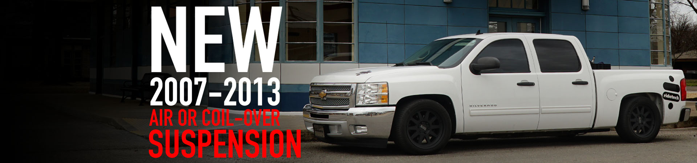  ](https://www.ridetech.com/product-category/applications/trucks/2007_2013_gm_silverado/)
 
 [
 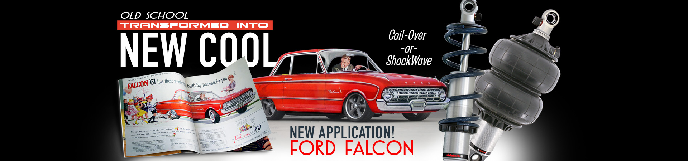  ](https://www.ridetech.com/new-suspension-tech-for-the-ford-falcon-better-ride-and-handling/)
 [
 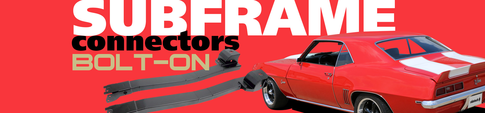  ](https://www.ridetech.com/product/camaro-firebird-subframe-connectors/)

### **FREE SHIPPING**

**free ground shipping to the continental U.S. for orders of $100 or more
**

## Shop by Vehicle

 [

 

  Muscle Cars and Classics     ](https://www.ridetech.com/product-category/applications/musclecars_classics/)

 [

 

  Late Model Muscle Cars     ](https://www.ridetech.com/product-category/applications/late-model-musclecars/)

 [

 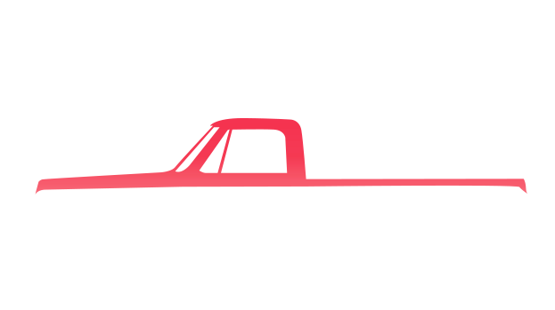

  Trucks     ](https://www.ridetech.com/product-category/applications/trucks/)

 [

 

  Street Rods and Customs     ](https://www.ridetech.com/product-category/applications/streetrods_customs/)

 [

 

  Corvettes     ](https://www.ridetech.com/product-category/applications/corvettes/)

## Shop by Product

---

##

 [

 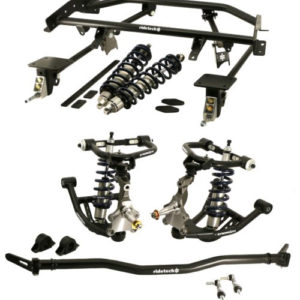

  Suspension Packages     ](https://www.ridetech.com/product-category/products/suspension_packages/)

 [

 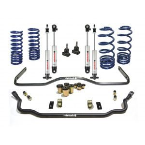

  Streetgrip Suspension     ](https://www.ridetech.com/product-category/products/streetgrip/)

 [

 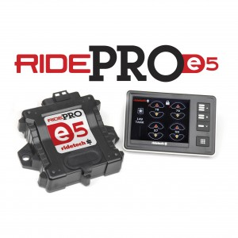

  Air Ride Suspension Control Systems     ](https://www.ridetech.com/product-category/products/air_suspension/air-ride-suspension-control-systems/)

 [

 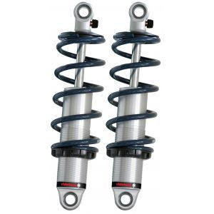

  Coilovers     ](https://www.ridetech.com/product-category/products/coil_overs/)

 [

 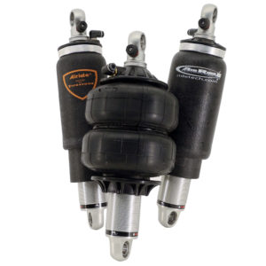

  ShockWave Integrated Air Springs and Shocks     ](https://www.ridetech.com/product-category/products/air_suspension/shockwaves/)

 [

 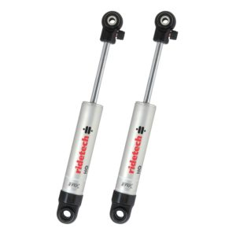

  Shock Absorbers     ](https://www.ridetech.com/product-category/products/shocks/)

 [

 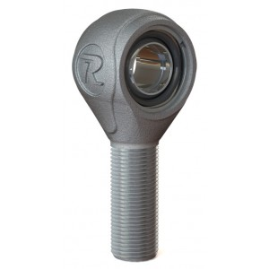

  R-Joint Rod Ends     ](https://www.ridetech.com/product-category/products/r_joint/)

 [

 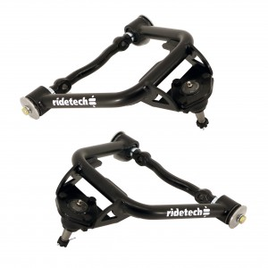

  Tubular Control Arms     ](https://www.ridetech.com/product-category/products/tubular_control_arms/)

 [

 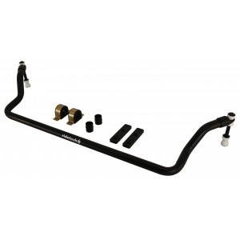

  MUSCLEbar Sway Bars     ](https://www.ridetech.com/product-category/products/sway_bars/)

 [

 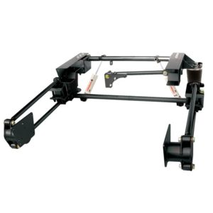

  4-Links     ](https://www.ridetech.com/product-category/products/4_links/)

 [

 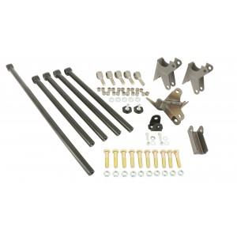

  Universal 4-Links     ](https://www.ridetech.com/product-category/products/4_links/universal-4-links/)

 [

  LevelTow Kits     ](https://www.ridetech.com/product-category/products/load_leveling_systems/leveltow-kits/)

 [

  Tru Turn     ](https://www.ridetech.com/product-category/products/tru_turn/)

 [

  TigerCage     ](https://www.ridetech.com/product-category/products/tigercage/)

 [

  CoolRide - Air Spring and Shock Kits     ](https://www.ridetech.com/product-category/products/air_suspension/coolride/)

 [

  Components     ](https://www.ridetech.com/product-category/products/components/)

 [

  AIRoverLeaf     ](https://www.ridetech.com/product-category/products/air_suspension/airoverleaf/)

 [

  Steering     ](https://www.ridetech.com/product-category/products/steering_and_brakes/)

 [

  Tools     ](https://www.ridetech.com/product-category/products/tools_accessories/tools/)

 [

  Brakes and Rear Ends     ](https://www.ridetech.com/product-category/products/brakes_rear_ends/)

 [

  Apparel     ](https://www.ridetech.com/product-category/products/apparel_and_signs/)

 [

  Bushings     ](https://www.ridetech.com/product-category/products/components/bushings/)

-
-

## Cart

-

## Get Connected

 First Name

 Last Name

 Email address:

 

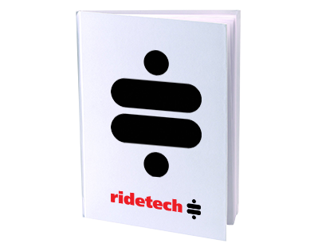

 

## **FREE**

### Product Catalog

 [ REQUEST A CATALOG ](https://www.ridetech.com/information/free-catalog/)

## Latest News

 [

 Salt Lake City GoodGuys Car show Info & Photo Gallery.

When: May 21 – 23, 2021 Where : Utah State Fairpark The 2nd RaceDeck GoodGuys [...]

    ](https://www.ridetech.com/salt-lake-city-goodguys-car-show-info-photo-gallery/)

 [

 Great Times at the C-10 Nationals – America’s Largest truck event!

The C10 Nationals is the world’s largest Chevrolet & GMC Truck & SUV event. Held [...]

    ](https://www.ridetech.com/great-times-at-the-c-10-nationals-americas-largest-truck-event/)    [ View all news ](https://www.ridetech.com/info/)

## ridetech.com

#### Performance Suspension Specialist

Ridetech manufactures exciting suspension systems that improve the handling and ride quality of your muscle car, truck, Corvette or hot rod. From restorations and show cars, to high-speed autocross and track day cars, Ridetech offers a wide range of premium products including air suspension systems (air ride), coil-overs, shock absorbers, coil and leaf springs, tubular control arms, roll bars, sway bars and much more.

### Don’t see what you’re looking for? Let us know!

Connect With Us:[**](http://www.facebook.com/ridetech)[**](http://instagram.com/ridetechsuspension)[**](mailto:sales@ridetech.com)[**](tel:812-481-4787)[**](http://www.youtube.com/ridetechtv/)

---

### Contact Info

**Phone:** 812.481.4787
 **Fax:** 812.634.6632
 **Hours:** Mon – Fri 8:00am 6:00pm EST

350 S. St. Charles St
 Jasper, Indiana, 47546
 sales@ridetech.com

Information

- [News](https://www.ridetech.com/info/)
- [About Ridetech](https://www.ridetech.com/information/about/)
- [Job Openings](https://www.ridetech.com/jobs/)
- [Dealers](https://www.ridetech.com/dealers/)
- [General Policies](https://www.ridetech.com/information/general-policies/)
- [Warranties and Returns](https://www.ridetech.com/information/warranties-returns/)
- [Privacy & Cookies Policy](https://www.ridetech.com/privacy-policy/)
- [CA Prop 65](https://www.ridetech.com/information/prop65/)
Applications

- [Muscle Cars and Classics](https://www.ridetech.com/product-category/applications/musclecars_classics/)
- [Street Rods and Customs](https://www.ridetech.com/product-category/applications/streetrods_customs/)
- [Trucks](https://www.ridetech.com/product-category/applications/trucks/)
- [Corvettes](https://www.ridetech.com/product-category/applications/corvettes/)
- [Late Model Muscle Cars](https://www.ridetech.com/product-category/applications/late-model-musclecars/)
- [Load Leveling](https://www.ridetech.com/product-category/applications/load_leveling/)

### Your Account

[My Account](https://www.ridetech.com/account/)

[Orders](https://www.ridetech.com/account/orders/)

[Wishlist](https://www.ridetech.com/wishlist/)

 Copyright 2021 © **Ridetech**     [**](#top)
