# Ridetech Content Brief

## Company Overview
Ridetech (site: ridetech.com) is a performance suspension specialist based in Jasper, Indiana. It makes suspension systems that improve handling and ride quality for muscle cars, trucks, Corvettes and hot rods. Its customers range from restorers and show-car builders to autocross and track-day drivers. Its premium range includes air suspension (air ride), coil-overs, shock absorbers, coil and leaf springs, tubular control arms, roll bars, sway bars and more. Visitors who can't find what they want are invited to get in touch.

## Contact Details
- Phone: 812.481.4787 (also linked as tel:812.481.4787 and tel:812-481-4787)
- Fax: 812.634.6632
- Hours: Monday to Friday, 8:00am to 6:00pm EST
- Address: 350 S. St. Charles St, Jasper, Indiana, 47546
- Email: sales@ridetech.com
- Social and contact links: Facebook (http://www.facebook.com/ridetech), Instagram (http://instagram.com/ridetechsuspension), email (mailto:sales@ridetech.com), phone, YouTube (http://www.youtube.com/ridetechtv/)

## Shipping Offer
Orders of $100 or more get free ground shipping within the continental U.S.

## Free Catalog
Ridetech offers a free product catalog. A call to action reads "Request a Catalog", and a "Get a FREE Catalog" link is also offered. Both go to https://www.ridetech.com/information/free-catalog/.

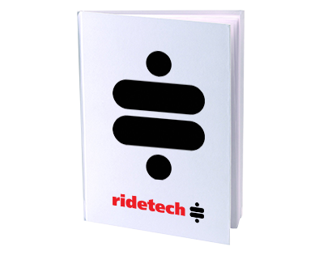

## Newsletter and Sign-Up
- A "Sign Up for News!" prompt leads to a newsletter form headed "Get Connected".
- The form asks for first name, last name and email address.
- A linked item points to the 1,000,001 Mile Warranty page: https://www.ridetech.com/tech/1000001-mile-warranty/

## Featured Promotions
Four featured items, each linking to its own page:
- 2007–2013 GM Silverado products: https://www.ridetech.com/product-category/applications/trucks/2007_2013_gm_silverado/
  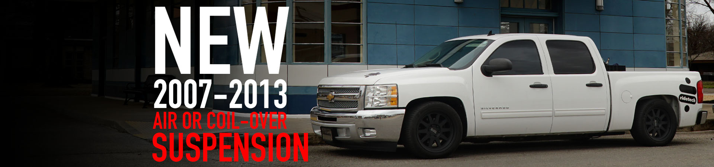
- RidePRO-E5 air suspension control systems: https://www.ridetech.com/product-category/products/air-suspension/air-ride-suspension-control-systems/
  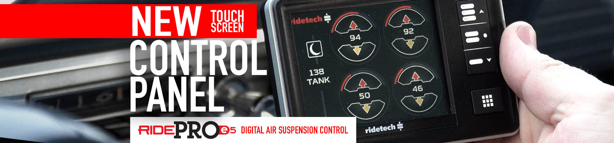
- An article on new suspension tech for the Ford Falcon, promising better ride and handling: https://www.ridetech.com/new-suspension-tech-for-the-ford-falcon-better-ride-and-handling/
  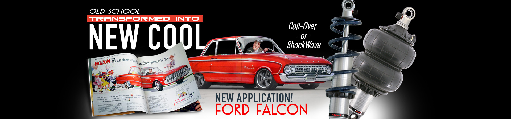
- Camaro/Firebird subframe connectors: https://www.ridetech.com/product/camaro-firebird-subframe-connectors/
  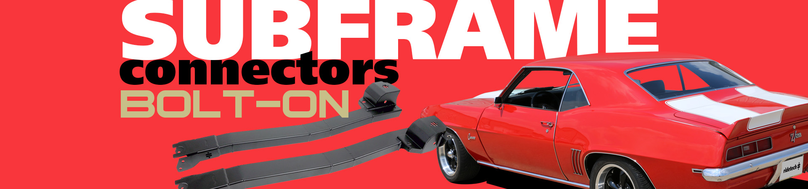

## Shop by Vehicle
Five vehicle categories, under https://www.ridetech.com/product-category/applications/:
- Muscle Cars and Classics (musclecars_classics/) 
- Late Model Muscle Cars (late-model-musclecars/) 
- Trucks (trucks/) 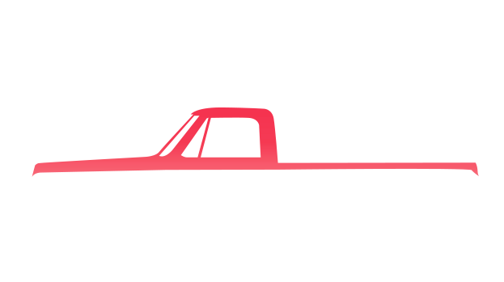
- Street Rods and Customs (streetrods_customs/) 
- Corvettes (corvettes/) 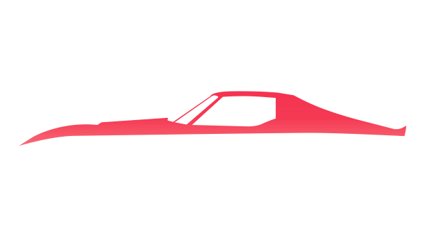

Load Leveling is a further application category (https://www.ridetech.com/product-category/applications/load_leveling/).

## Shop by Product
All under https://www.ridetech.com/product-category/products/ unless noted:
- Suspension Packages (suspension_packages/) 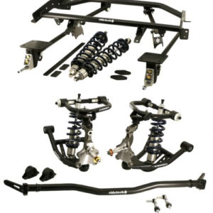
- Streetgrip Suspension (streetgrip/) 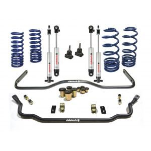
- Air Ride Suspension Control Systems (air_suspension/air-ride-suspension-control-systems/) 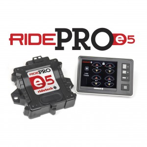
- Coilovers (coil_overs/) 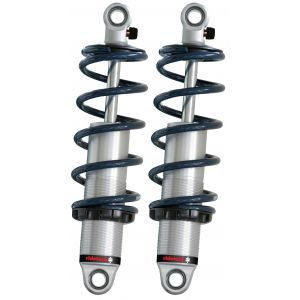
- ShockWave Integrated Air Springs and Shocks (air_suspension/shockwaves/) 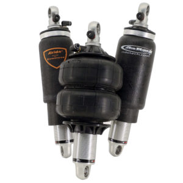
- Shock Absorbers (shocks/) 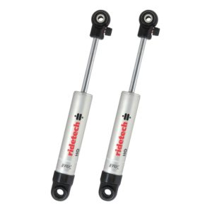
- R-Joint Rod Ends (r_joint/) 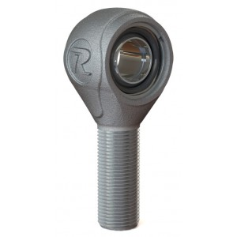
- Tubular Control Arms (tubular_control_arms/) 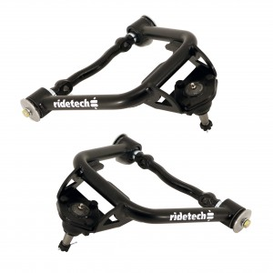
- MUSCLEbar Sway Bars (sway_bars/) 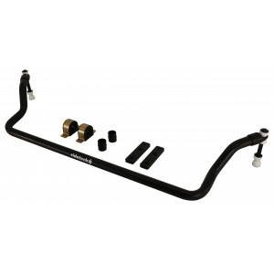
- 4-Links (4_links/) 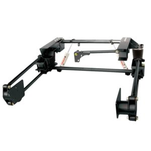
- Universal 4-Links (4_links/universal-4-links/) 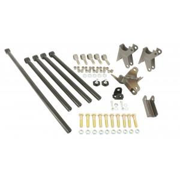
- LevelTow Kits (load_leveling_systems/leveltow-kits/)
- Tru Turn (tru_turn/)
- TigerCage (tigercage/)
- CoolRide – Air Spring and Shock Kits (air_suspension/coolride/)
- Components (components/)
- AIRoverLeaf (air_suspension/airoverleaf/)
- Steering (steering_and_brakes/)
- Tools (tools_accessories/tools/)
- Brakes and Rear Ends (brakes_rear_ends/)
- Apparel (apparel_and_signs/)
- Bushings (components/bushings/)

## Full Product Menu
Main product categories (under /product-category/products/): Suspension Packages (with sub-types Air Suspension, StreetGRIP Suspension, Coil-Over Suspension), Shock Absorbers, RidePRO-E5 Air Suspension Control, Tubular Control Arms, 4-Links, MUSCLEbar Sway Bars, Bushings, R-Joint Rod Ends, Load Leveling, Tru Turn, TigerCage, Components, Tools and Accessories, Steering, Brakes & Rear Ends, Apparel.

## News and Company Information
- Latest Updates: https://www.ridetech.com/info/
- About Ridetech: https://www.ridetech.com/information/about/
- Event Calendar: https://www.ridetech.com/calendar/
- Customer Rides: https://www.ridetech.com/information/customer-rides/
- Current Job Openings / Careers: https://www.ridetech.com/jobs/

### Latest News Items
1. Salt Lake City GoodGuys car show info and photo gallery. The event runs May 21–23, 2021 at Utah State Fairpark and is the second RaceDeck GoodGuys event. Link: https://www.ridetech.com/salt-lake-city-goodguys-car-show-info-photo-gallery/
2. Report on the C-10 Nationals, billed as America's largest truck event. The C10 Nationals is the world's largest gathering for Chevrolet and GMC trucks and SUVs. Link: https://www.ridetech.com/great-times-at-the-c-10-nationals-americas-largest-truck-event/

A "View all news" link goes to https://www.ridetech.com/info/.

## Technical Resources
- Tech Articles: https://www.ridetech.com/tech/
- RideTech StrongARM Dimensions: https://www.ridetech.com/tech/ridetech-strongarm-dimensions/
- Spring Rate Calculator: https://www.ridetech.com/tech/spring-rate-calculator/
- Vehicle Weight Database: https://www.ridetech.com/tech/vehicle-weights/
- Frequently Asked Questions: https://www.ridetech.com/tech/faq/
- 1,000,001 Mile Warranty: https://www.ridetech.com/tech/1000001-mile-warranty/
- Shock Absorber Trade-In: https://www.ridetech.com/tech/coilover-trade-in/
- Controller Software Downloads: https://www.ridetech.com/tech/air-controller-instructions/
- Videos: https://www.ridetech.com/category/video/

## Community and Other Areas
- Dealers: https://www.ridetech.com/dealers/
- Forum: https://www.ridetech.com/forums/forum/tech-products/
- Projects: https://www.ridetech.com/garage/
- Industrial: https://www.ridetech.com/industrial/

## Policies and Legal
- General Policies: https://www.ridetech.com/information/general-policies/
- Warranties and Returns: https://www.ridetech.com/information/warranties-returns/
- Privacy & Cookies Policy: https://www.ridetech.com/privacy-policy/
- CA Prop 65: https://www.ridetech.com/information/prop65/
- Copyright 2021 © Ridetech

## Account, Search and Cart
- Login / Register: https://www.ridetech.com/account/
- My Account: https://www.ridetech.com/account/
- Orders: https://www.ridetech.com/account/orders/
- Wishlist: https://www.ridetech.com/wishlist/
- Site search is available.
- Shopping cart (https://www.ridetech.com/cart/) shows a running total, currently $0.00, and the message "No products in the cart."

## Brand Assets
Ridetech logo, linking to https://www.ridetech.com/: 
