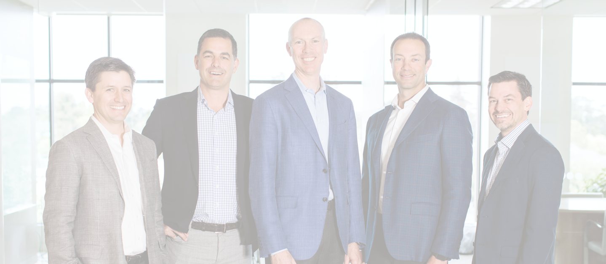

# STG Partners: Content Brief

## Organisation
STG is a private equity firm. It backs innovative market leaders in software, data, and analytics, concentrating on the mid-market. Its tagline presents it as a partner for business transformation. Link to the firm's approach page: /our-approach/

## Featured announcement
McAfee has announced the sale of its enterprise business to Symphony Technology Group for $4.0 billion (dated 2021-03-08). Link: https://stgpartners.com/2021/03/08/mcafee-announces-sale-of-enterprise-business-to-symphony-technology-group-for-4-0-billion/

## Core values and approach
- **Customer Centric**: building companies in which the customer comes first.
  
- **Committed to Growth**: investing in portfolio businesses to produce sustainable, long-term revenue growth.
  
- **Engaged Partners**: collaborators who are flexible and creative.
  

## Accelerators
Strategic and practical help with attracting, acquiring, and retaining talent, and with setting up productive offshore teams. Call to action: "Learn more." Link: /stg-labs/

## Portfolio
STG builds strategic value in market-leading companies across software, data, and analytics. Call to action: "View Our Work." Link: /portfolio/

## Who We Are
STG describes itself as business builders with deep expertise in its sectors. Call to action: "Read More." Link: /who-we-are/

- **Experts**: deep knowledge of software, data, and analytics.
  
- **Innovators**: the track record, experience, and vision needed to create winning companies that define their markets.
  

## News
Each item below has a "Read More" link.

- **1 June (2021)**: Escalent acquires Grail Insights. https://stgpartners.com/2021/06/01/escalent-acquires-grail-insights/
- **26 May (2021)**: Press Ganey acquires SPH Analytics. https://stgpartners.com/2021/05/26/press-ganey-acquires-sph-analytics/
- **19 May (2021)**: Dodge Data & Analytics launches ACCELERATE Marketing Solutions. https://stgpartners.com/2021/05/19/dodge-data-analytics-launches-accelerate-marketing-solutions/
- **4 May (2021)**: Symphony Talent announces a distinctive research partnership with Aptitude Research and Talent Board. https://stgpartners.com/2021/05/04/symphony-talent-announces-distinctive-research-partnership-with-aptitude-research-and-talent-board/
- **4 May (2021)**: Extenda Retail signs a long-term partnership with Health and Sports Nutrition Group (HSNG) to roll out its WMS solution. https://stgpartners.com/2021/05/04/extenda-retail-signs-long-term-partnership-with-health-and-sports-nutrition-group-hsng-to-roll-out-wms-solution/

## Site navigation links
- Home: https://stgpartners.com/
- Our Approach: https://stgpartners.com/our-approach/
- Portfolio: https://stgpartners.com/portfolio/
- Who We Are: https://stgpartners.com/who-we-are/
- News: https://stgpartners.com/news/
- Contact: https://stgpartners.com/contact/

## Legal
© 2021 STG Partners, LLC. Terms Of Use link: /terms-of-use/
