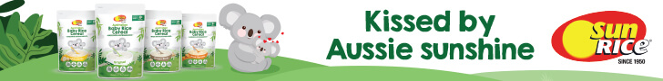

## Organisation
Tell Me Baby is an Australian website where parents read and write reviews of baby products. It is run by Tell Me Media Pty Ltd (© 2021, all rights reserved). Website: https://tellmebaby.com.au

## Navigation and account
- Browse reviews, Our community, Tools, Articles
- Login: https://tellmebaby.com.au/profile/login
- Signup: https://tellmebaby.com.au/profile/register
- A search facility is available.

## Main message
Baby product reviews written by Australian parents.

A search box lets visitors find baby product reviews.

## Review categories
Eight product categories, plus a link to view all categories (https://tellmebaby.com.au/product-category):
- Out & about: https://tellmebaby.com.au/product-category/baby-out-and-about/
- Car travel: https://tellmebaby.com.au/product-category/car-travel-with-baby/
- Bath time: https://tellmebaby.com.au/product-category/baby-bath-time/
- Feeding: https://tellmebaby.com.au/product-category/feeding/
- Change time: https://tellmebaby.com.au/product-category/baby-changing-time/
- Sleep & nap time: https://tellmebaby.com.au/product-category/baby-sleep-and-nap-time/
- Health & safety: https://tellmebaby.com.au/product-category/health-safety/
- Just for mum: https://tellmebaby.com.au/product-category/just-for-mum/

## How it works
Four steps:
1. Search for a product, brand or category.
2. Read reviews from real parents in similar situations.
3. Buy the product that suits your family.
4. Join the community and leave a review.

Call to action: Join TMB Rewards (https://tellmebaby.com.au/become-member).

## Sponsored link
A sponsored promotional image links to https://tellmebaby.com.au/linkout/80618

## Trending products (with review counts)
- Tommee Tippee Super-Steam Advanced Electric Steriliser, 119 reviews: https://tellmebaby.com.au/product/tommee-tippee-super-steam-advanced-electric-steriliser/ 
- Sudocrem Healing Cream, 618 reviews: https://tellmebaby.com.au/product/sudocrem-healing-cream/ 
- Bugaboo Cameleon 3 plus, 94 reviews: https://tellmebaby.com.au/product/bugaboo-cameleon3-plus/ 
- Milton Antibacterial Surface Wipes, 73 reviews: https://tellmebaby.com.au/product/milton-antibacterial-surface-wipes/ 

## Recent reviews
Each entry has the product, an excerpt from the review, and the reviewer's name. A link leads to more reviews: /product-category/
- **Medela Swing Single Electric Breast Pump**, by Mikala Peschek. A new, exclusively breastfeeding mum wanted something simple and easy to control, and says this pump fits that need. https://tellmebaby.com.au/product/medela-swing-single-electric-breast-pump/ 
- **Bio-Oil Skincare**, by Kaitlin Littlewood. The product has a reputation as a miracle-worker for scars, acne and stretch marks, but the reviewer hasn't noticed any drastic results. https://tellmebaby.com.au/product/bio-oil-skincare/ 
- **Cherub Baby Dissolvable Food Pouch & Breast Milk Bag Labels**, by Sheila Kimpo. The reviewer finds the labels cool and cute but couldn't use them when preparing food for their baby, and isn't sure why. https://tellmebaby.com.au/product/cherub-baby-dissolvable-food-pouch-breast-milk-bag-labels/ 
- **CUB Organic Beef & Veggies Pouch 6m+**, by Chloe Hogan. Their baby loves homemade puréed vegetables but won't eat puréed meat, which they find hard. https://tellmebaby.com.au/product/cub-organic-beef-veggies-pouch-6m/ 

## 2021 Tell Me Baby Award Winners
Highest-rated product in each category (all links under https://tellmebaby.com.au/product/):
- Baby bottle: Pigeon SofTouch Bottle (PPSU) — pigeon-softouch-bottle-ppsu/ 
- Baby capsule: Britax Safe-n-Sound Unity NEOS Baby Capsule — britax-safe-n-sound-unity-neos-baby-capsule/ 
- Baby car seat: Britax Safe-n-Sound Millenia+ Convertible Car Seat — britax-safe-n-sound-milleniaplus-convertible-car-seat/ 
- Baby cereal: Nestlé CERELAC Multigrain with Pear — nestle-cerelac-multigrain-with-pear/ 
- Baby pouch: Rafferty's Garden Strawberry No Added Sugar Yoghurt 6m+ — raffertys-garden-strawberry-no-added-sugar-yoghurt-6m/ 
- Baby snack: Baby Mum-Mum Organic Rice Rusks — baby-mum-mum-organic-rice-rusks/ 
- Baby healthcare: Flo Baby Saline Nasal Spray — flo-baby-saline-nasal-spray/ 
- Baby moisturiser: MooGoo Soothing MSM Moisturiser — moogoo-soothing-msm-moisturiser/ 
- Baby monitor: Oricom Secure870 3.5″ Touchscreen Monitor w/ Starry Lightshow — oricom-secure870-3-5-touchscreen-monitor-w-starry-lightshow/ 
- Baby haircare: Mustela Foam Shampoo for Newborns — mustela-foam-shampoo-newborns/ 
- Baby sunscreen: Cancer Council Kids Sunscreen SPF50+ — cancer-council-kids-sunscreen-spf50/ 
- Baby thermometer: Braun ThermoScan 5 IRT 6030 Ear Thermometer — braun-thermoscan-5-irt-6030-ear-thermometer/ 
- Baby vitamins and supplements (including probiotics): Biostime Infant Probiotics with Vitamin D — biostime-infant-probiotics-vitamin-d/ 
- Baby wipes: Joonya Eco Wipes — joonya-eco-wipes/ 
- Best hospital grade breast pump: Spectra S2 Hospital Grade Double Electric Breast Pump — spectra-s2-hospital-grade-double-electric-breast-pump/ 
- Best portable breast pump: Medela Freestyle Flex Breast Pump — medela-freestyle-flex-breast-pump/ 
- Dummy: Tommee Tippee Super Soft Comforter — tommee-tippee-super-soft-comforter/ 
- Highchair (excluding portable high chairs): Stokke Tripp Trapp Chair — stokke-tripp-trapp-chair/ 
- Mum skincare product: MooGoo Skin Milk Udder Cream — moogoo-skin-milk-udder-cream/ 
- Mum vitamins and supplements (pregnancy and postnatal): Qiara Pregnancy & Breastfeeding — qiara-pregnancy-breastfeeding/ 
- Nappy: Huggies Ultimate Nappies — huggies-ultimate-nappies/ 
- Premmie nappy: BabyLove Premmie Nappies — babylove-premmie-nappies/ 
- Swimmer nappy: Huggies Little Swimmers Disposable Swimpants — huggies-little-swimmers-disposable-swimpants/ 
- Nappy bag: OiOi Faux Leather Nappy Backpack — oioi-faux-leather-nappy-backpack/ 
- Nappy rash product: Weleda Baby & Child Calendula Nappy Change Cream — weleda-baby-child-calendula-nappy-change-cream/ 
- Nursery furniture: Boori Classic Cot Bed — boori-classic-cot-bed/ 
- Play and development: Fisher-Price Little People Caring for Animals Farm — fisher-price-little-people-caring-for-animals-farm/ 
- Pregnancy test: First Response Early Result In-Stream Pregnancy Test — first-response-early-result-in-stream-pregnancy-test/ 
- Sleeping bags and swaddles: Love To Dream Swaddle UP Transition Bag Warm 2.5 TOG — love-to-dream-swaddle-up-transition-bag-warm-2-5-tog/ 
- Steriliser: Tommee Tippee Closer to Nature Essentials Starter Kit — tommee-tippee-closer-nature-essentials-starter-kit/ 
- Teething product: Pigeon Training Teether Step 1 — pigeon-training-teether-step-1/ 
- Water bottle/sippy cup: b.box Drink Bottle — b-box-drink-bottle/ 
- Pram over $1000: Bugaboo Fox 2 — bugaboo-fox-2/ 
- Pram under $1000: Babybee ROVER 2019 2-in-1 Bassinet + Stroller Set — babybee-rover-2019-2-in-1-bassinet-stroller-set/ 
- Double pram: Babybee DUO 2-in-1 Single to Double Stroller — babybee-duo-2-in-1-single-to-double-stroller/ 
- Baby carrier: Baby Tula Free-to-Grow Carrier — baby-tula-free-to-grow-carrier/ 
- Baby wash: MooGoo Natural Mini Moo Bubbly Wash — moogoo-natural-mini-moo-bubbly-wash/ 
- Toddler milk: Bellamy's Organic Step 3 Toddler Milk Drink — bellamys-organic-step-3-toddler-milk-drink/ 

## Recent articles
Link to read more: https://tellmebaby.com.au/blog
- Competition: win 1 of 10 Mamas & Papas silver rattles — https://tellmebaby.com.au/baby/life-with-baby/win-silver-rattles/ 
- Six must-have toddler items, which readers can also win — https://tellmebaby.com.au/toddler/life-with-toddler/6-must-have-toddler-items/ 
- How to express and store colostrum before the baby is born — https://tellmebaby.com.au/baby/feeding-baby/how-to-express-and-store-colostrum-antenatally/ 
- The baby names Australians are searching for most at the moment — https://tellmebaby.com.au/pregnancy/most-searched-baby-names-in-australia/ 
- It really is possible to bring a baby's night sleep into line with the parents' — https://tellmebaby.com.au/baby/dream-feeding-baby-sleep/ 

## About Tell Me Baby
Tell Me Baby shows what parents genuinely think about a wide range of baby products. Visitors can search by name, brand or category to find current information and reviews on items they're considering. After buying something, they can leave a review to help other parents and earn real rewards. The site covers every kind of baby product, from dummies to prams, formula to toys.

## TMB Rewards
Joining is free. Members earn Kmart, Coles and Target vouchers for sharing opinions on baby products they've tried. Call to action: Join now (/profile/register/).

## Site links and social media
Link groups titled Tell Me Baby, Brands, Community and Here to help (no further items listed).
- Facebook: https://www.facebook.com/TellMeBabyau/
- Instagram: https://www.instagram.com/tellmebabyau/?hl=en
- YouTube: https://www.youtube.com/channel/UCdewUxe5sbABUfSnVB5ofug

© Tell Me Media Pty Ltd 2021. All Rights Reserved

