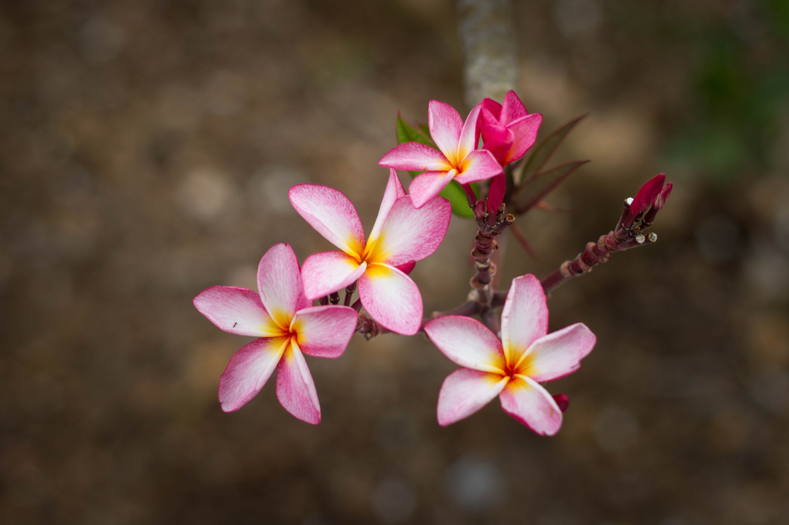
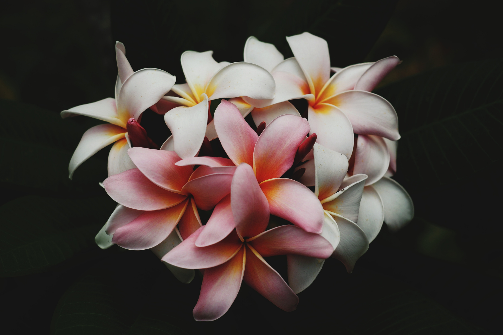
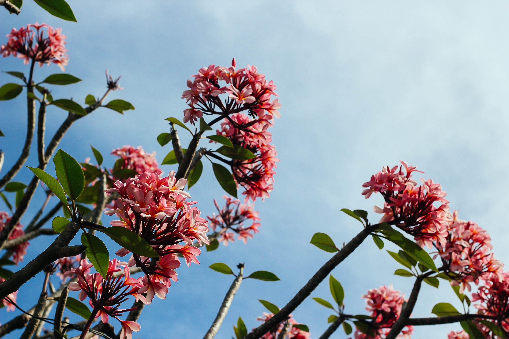

## About The Frangipani Creative
The Frangipani Creative is the studio run by Corinne Rodrigues (https://corinnerodrigues.com), based in Secunderabad, India. It offers training and coaching in writing, blogging and creativity.

## About Corinne Rodrigues
- Describes herself as a lover of words, a blogger on self-acceptance, and a book reviewer.
- A woman enjoying midlife, having moved from self-improvement toward self-acceptance and being happy as herself.
- Writes about life, wellness and relationships at Everyday Gyaan (http://everydaygyaan.com).
- An avid reader who reviews books at CorinneRodrigues.com (http://corinnerodrigues.com).
- Offers coaching at The Frangipani Creative (https://thefrangipanicreative.com) for anyone wanting to explore their creativity.
- Details of programs, courses, training and other offline events are coming soon.
- A linked post explains why she chose the name The Frangipani Creative: https://thefrangipanicreative.com/my-love-for-frangipani/

## Service: Personalized Blog Coaching
Coaching for people who want to start a blog or improve their existing blogging. Call to action: "Read more" at https://thefrangipanicreative.com/personalized-blog-coaching/

## Client testimonials (Happy Clients)
Collection page: https://thefrangipanicreative.com/happy-clients/. All three testimonials are rated 5 out of 5 and dated 2019-10-15.

**Sunita Saldhana** (blog: https://sunitasaldhana.com/; testimonial page: https://thefrangipanicreative.com/testimonials/sunita-saldhana/)
She had long struggled with SEO and getting her blog noticed. The training taught her both what to do and the reasons behind it. Writing a real blog post during the session and applying the lessons on the spot helped her understand fully. She calls Corinne a wonderful teacher who made it all easy.

**Madhavi Mahadev** (https://thefrangipanicreative.com/testimonials/madhavi-mahadev/)
She attended the course "Introduction to Blogging/Start A Blog in 2019". She found the training a memorable experience, mainly thanks to its fun and interesting activities. It gave her all the blogging information she wanted plus knowledge of related topics. The programme went beyond her expectations in content, method and focus, and she hopes for more courses from The Frangipani Creative.

**Anil Kumar Margani** (https://thefrangipanicreative.com/testimonials/anil-kumar-margani/)
He felt like a lone fish in a vast ocean of blogging and spent months looking for someone to learn from. His search ended at The Frangipani Creative, which gave him the support and information to start blogging. He found Corinne and the others there cooperative and friendly, and recommends it for anyone seeking guidance or support in writing or blogging.

## Blog articles
- Writer's Healthy Diet and Lifestyle, by Lux: https://thefrangipanicreative.com/writers-healthy-diet-and-lifestyle/
- 12 Productivity Hacks for Writing, by Fabida Abdulla: https://thefrangipanicreative.com/productivity-hacks-for-writing/
- 4 Steps On How to Focus On Writing, by Lux: https://thefrangipanicreative.com/focus-on-writing/
- Have You Found The Treasures of Journaling?, by Fabida Abdulla: https://thefrangipanicreative.com/the-treasures-of-journaling/
- 20 Quotes To Encourage You To Be A Fearless Writer (listed among recent posts): https://thefrangipanicreative.com/quotes-to-encourage-you-to-be-a-fearless-writer/
- Author pages: https://thefrangipanicreative.com/author/lux/ and https://thefrangipanicreative.com/author/fabida-abdulla/

## Instagram feed
Account: thefrangipanicreative, described as training and coaching for writing, blogging and creativity (https://www.instagram.com/thefrangipanicreative/). A "Follow on Instagram" link and a "Load More" option accompany the feed. Recent posts include short captions on these themes:
- Diary writing in the past
- Getting bogged down by non-essentials
- Looking back to take stock
- Excitement over a recent purchase
- Handling your inner critic
- A quote on infinite creativity
- Getting stuck on a current project
- An offer from @artist_pragya

## Social media
- Facebook (Like): https://facebook.com/822416371294356
- Instagram (Follow): https://instagram.com/thefrangipanicreative
- LinkedIn (Follow): https://www.linkedin.com/in/corinnecr
- Pinterest (Follow): https://pinterest.com/thefrangipanicreative
- Twitter (Follow): https://twitter.com/CorinneBlogs

## Location and contact
Shop #4, AWHO Colony Sector 'A', Gautam Enclave, Secunderabad – 500 009, India
Mobile: 91-8886034647
Landline: 91-40-29560398

## Site pages and links
- Home: https://thefrangipanicreative.com/
- Blog: https://thefrangipanicreative.com/blog/
- The Frangipani Creative Podcast: https://thefrangipanicreative.com/the-frangipani-creative-podcast/
- Happy Clients: https://thefrangipanicreative.com/happy-clients/
- Contact: https://thefrangipanicreative.com/contact/
- Archives: https://thefrangipanicreative.com/archives/
- Books I Recommend: https://www.amazon.in/shop/corinneblogs?listId=258F67AEOVR3U&ref=idea_share_inf

## Disclosures
All posts and pages may contain affiliate links. Full disclosures, commenting policies and PR information: https://thefrangipanicreative.com/disclosures-and-pr-information/

© 2020 - The Frangipani Creative
