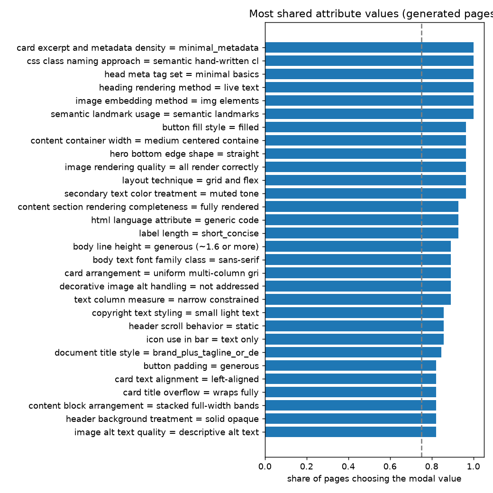

# Attribute-value variation across 28 generated pages
284 attributes coded on at least 15 pages. Bands by modal-value share: shared (>= 0.75) 121, split (0.5-0.75) 124, varied (< 0.5) 39.

Pairwise agreement between pages over all attributes: mean **0.580** (descriptive only: it equals what independent coding with the same value frequencies would give, so it measures how concentrated the choices are, not clustering). Spread across page pairs: SD 0.0500 vs permutation null 0.0264 (95% of nulls 0.0235-0.0302): some pages resemble each other MORE than independent coding would give (structure / clusters).

By modal value type: shared presence (modal share >= 0.75, a feature is there) 47; shared absence/other (the modal value says the feature is absent or not applicable) 74.

## Bands by family
- color: {'shared': 7, 'split': 14, 'varied': 10}
- component: {'shared': 37, 'split': 29, 'varied': 12}
- copy: {'shared': 7, 'split': 5, 'varied': 3}
- decoration: {'shared': 12, 'split': 11, 'varied': 3}
- imagery: {'shared': 6, 'split': 4, 'varied': 2}
- layout: {'shared': 24, 'split': 27, 'varied': 4}
- other: {'shared': 1}
- semantic_dom: {'shared': 13, 'split': 10, 'varied': 1}
- typography: {'shared': 14, 'split': 24, 'varied': 4}

## Most shared PRESENT values (modal share, modal value is not an absence/other value)
| attribute | modal value | share | coded | normalised entropy |
|---|---|---|---|---|
| card excerpt and metadata density | minimal_metadata | 1.0 | 28 | 0.0 |
| css class naming approach | semantic hand-written classes | 1.0 | 28 | 0.0 |
| head meta tag set | minimal basics | 1.0 | 28 | 0.0 |
| heading rendering method | live text | 1.0 | 28 | 0.0 |
| image embedding method | img elements | 1.0 | 28 | 0.0 |
| semantic landmark usage | semantic landmarks | 1.0 | 28 | 0.0 |
| button fill style | filled | 0.964 | 28 | 0.222 |
| content container width | medium centered container | 0.964 | 28 | 0.222 |
| hero bottom edge shape | straight | 0.964 | 28 | 0.222 |
| image rendering quality | all render correctly | 0.964 | 28 | 0.222 |
| layout technique | grid and flex | 0.964 | 28 | 0.222 |
| secondary text color treatment | muted tone | 0.964 | 28 | 0.222 |
| content section rendering completeness | fully rendered | 0.929 | 28 | 0.371 |
| html language attribute | generic code | 0.929 | 28 | 0.371 |
| label length | short_concise | 0.929 | 28 | 0.371 |
| body line height | generous (~1.6 or more) | 0.893 | 28 | 0.491 |
| body text font family class | sans-serif | 0.893 | 28 | 0.491 |
| card arrangement | uniform multi-column grid | 0.893 | 28 | 0.491 |
| decorative image alt handling | not addressed | 0.893 | 28 | 0.491 |
| text column measure | narrow constrained | 0.893 | 28 | 0.372 |
| copyright text styling | small light text | 0.857 | 28 | 0.463 |
| header scroll behavior | static | 0.857 | 28 | 0.592 |
| icon use in bar | text only | 0.857 | 28 | 0.592 |
| document title style | brand_plus_tagline_or_descriptor | 0.846 | 26 | 0.47 |
| button padding | generous | 0.821 | 28 | 0.677 |
| card text alignment | left-aligned | 0.821 | 28 | 0.536 |
| card title overflow | wraps fully | 0.821 | 28 | 0.508 |
| content block arrangement | stacked full-width bands | 0.821 | 28 | 0.536 |
| header background treatment | solid opaque | 0.821 | 28 | 0.677 |
| image alt text quality | descriptive alt text | 0.821 | 28 | 0.508 |

## Most varied attributes (lowest modal share)
| attribute | modal value | share | values used |
|---|---|---|---|
| card and read-more link style | text link with arrow | 0.25 | 6 |
| footer background tone | dark neutral | 0.321 | 4 |
| social link presentation | plain text links | 0.357 | 5 |
| hero headline treatment | large white overlay heading | 0.357 | 4 |
| hero background treatment | solid color or other | 0.357 | 4 |
| accent hue family | orange/amber/gold | 0.357 | 5 |
| text column alignment and extras | left-aligned heading and text only | 0.393 | 3 |
| secondary call-to-action treatment | button | 0.393 | 3 |
| hero layout structure | full-bleed overlay | 0.393 | 4 |
| hero CTA button arrangement | single CTA adjacent to text | 0.393 | 4 |
| heading-subtitle terminal punctuation | terminal_periods | 0.393 | 3 |
| corner radius | small | 0.393 | 4 |
| top bar background | dark | 0.429 | 3 |
| primary hue family | navy/blue | 0.429 | 6 |
| pill-shaped button usage | no pill buttons | 0.429 | 4 |

## Against the originals
Not computed: run code_pages.py --which original (about the same cost as the generated run).

## Coder reliability (vision coder vs values coded from the judges' observations)
Overall 69% over 1268 comparisons; by family: color 73%, component 71%, copy 75%, decoration 79%, imagery 53%, layout 63%, other 0%, semantic_dom 57%, typography 76%. Neither side is ground truth.
