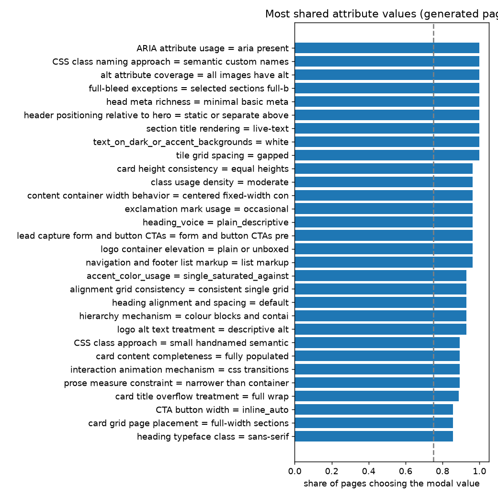

# Attribute-value variation across 28 generated pages
314 attributes coded on at least 15 pages. Bands by modal-value share: shared (>= 0.75) 126, split (0.5-0.75) 140, varied (< 0.5) 48.

Pairwise agreement between pages over all attributes: mean **0.562** (descriptive only: it equals what independent coding with the same value frequencies would give, so it measures how concentrated the choices are, not clustering). Spread across page pairs: SD 0.0439 vs permutation null 0.0254 (95% of nulls 0.0228-0.0284): some pages resemble each other MORE than independent coding would give (structure / clusters).

By modal value type: shared presence (modal share >= 0.75, a feature is there) 56; shared absence/other (the modal value says the feature is absent or not applicable) 70.

## Bands by family
- color: {'shared': 11, 'split': 18, 'varied': 9}
- component: {'shared': 32, 'split': 30, 'varied': 8}
- copy: {'shared': 14, 'split': 15, 'varied': 1}
- decoration: {'shared': 8, 'split': 8, 'varied': 4}
- imagery: {'shared': 12, 'split': 15, 'varied': 2}
- layout: {'shared': 21, 'split': 22, 'varied': 12}
- other: {'shared': 1, 'split': 1, 'varied': 1}
- semantic_dom: {'shared': 13, 'split': 11, 'varied': 3}
- typography: {'shared': 14, 'split': 20, 'varied': 8}

## Most shared PRESENT values (modal share, modal value is not an absence/other value)
| attribute | modal value | share | coded | normalised entropy |
|---|---|---|---|---|
| ARIA attribute usage | aria present | 1.0 | 28 | 0.0 |
| CSS class naming approach | semantic custom names | 1.0 | 28 | 0.0 |
| alt attribute coverage | all images have alt | 1.0 | 28 | 0.0 |
| full-bleed exceptions | selected sections full-bleed | 1.0 | 28 | 0.0 |
| head meta richness | minimal basic meta | 1.0 | 28 | 0.0 |
| header positioning relative to hero | static or separate above hero | 1.0 | 28 | 0.0 |
| section title rendering | live-text | 1.0 | 28 | 0.0 |
| text_on_dark_or_accent_backgrounds | white | 1.0 | 28 | 0.0 |
| tile grid spacing | gapped | 1.0 | 28 | 0.0 |
| card height consistency | equal heights | 0.964 | 28 | 0.222 |
| class usage density | moderate | 0.964 | 28 | 0.222 |
| content container width behavior | centered fixed-width container | 0.964 | 28 | 0.222 |
| exclamation mark usage | occasional | 0.964 | 28 | 0.222 |
| heading_voice | plain_descriptive | 0.964 | 28 | 0.222 |
| lead capture form and button CTAs | form and button CTAs present | 0.964 | 28 | 0.222 |
| logo container elevation | plain or unboxed | 0.964 | 28 | 0.222 |
| navigation and footer list markup | list markup | 0.964 | 28 | 0.222 |
| accent_color_usage | single_saturated_against_muted | 0.929 | 28 | 0.279 |
| alignment grid consistency | consistent single grid | 0.929 | 28 | 0.371 |
| heading alignment and spacing | default | 0.929 | 28 | 0.371 |
| hierarchy mechanism | colour blocks and containers | 0.929 | 28 | 0.371 |
| logo alt text treatment | descriptive alt | 0.929 | 28 | 0.371 |
| CSS class approach | small handnamed semantic | 0.893 | 28 | 0.372 |
| card content completeness | fully populated | 0.893 | 28 | 0.372 |
| interaction animation mechanism | css transitions | 0.893 | 28 | 0.372 |
| prose measure constraint | narrower than container | 0.893 | 28 | 0.372 |
| card title overflow treatment | full wrap | 0.889 | 27 | 0.382 |
| CTA button width | inline_auto | 0.857 | 28 | 0.463 |
| card grid page placement | full-width sections | 0.857 | 28 | 0.592 |
| heading typeface class | sans-serif | 0.857 | 28 | 0.592 |

## Most varied attributes (lowest modal share)
| attribute | modal value | share | values used |
|---|---|---|---|
| footer social and extras | none | 0.286 | 5 |
| secondary column content type | image | 0.321 | 7 |
| footer bottom bar | not distinct | 0.321 | 4 |
| section_background_alternation | mixed_light_and_dark_bands | 0.357 | 5 |
| logo content type | images only | 0.357 | 4 |
| link group layout | multi-column grid | 0.357 | 3 |
| label usage context | section_headings_eyebrows | 0.357 | 5 |
| icon delivery format | not_applicable | 0.357 | 4 |
| hero layout and background | full-bleed photo background | 0.357 | 6 |
| card content richness | title and summary text | 0.357 | 4 |
| body line height | about 1.6 | 0.357 | 5 |
| accent_hue_family | orange_yellow | 0.357 | 5 |
| section column structure | other | 0.393 | 4 |
| overall corner roundness baseline | small radii | 0.393 | 4 |
| icon_implementation | icon_font_or_raster | 0.393 | 4 |

## Against the originals
Not computed: run code_pages.py --which original (about the same cost as the generated run).

## Coder reliability (vision coder vs values coded from the judges' observations)
Overall 73% over 1614 comparisons; by family: color 75%, component 77%, copy 54%, decoration 81%, imagery 66%, layout 75%, other 93%, semantic_dom 73%, typography 72%. Neither side is ground truth.
