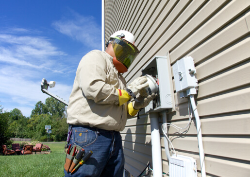

[Español](https://espanol.aeptexas.com)

   LOG IN

-  [My Account](#)
-  [Outages](#)
-  [Savings](#)
-  [Community](#)
-  [Contact](#)     LOG IN

# KNOWLEDGE IS POWER.

 [Due to the pandemic, scams have been on the rise. Learn what you need to do to keep your family safe.](/account/bills/fraud-scams)

 [Electric Choice](/company/about/choice/)

 [Report an outage](/outages/report)

 [Start, Stop, Move service](/account/service)

 [Rates & Tariffs](/company/about/rates/)

## Bring Home Energy Savings

Apply for rebates and start saving energy and money at home. AEP Texas offers rebates to help bridge the gap when you make energy efficient upgrades in your home. By upgrading now, ENERGY STAR® appliances, heating and cooling systems, and other efficient upgrades can save you energy and money for years to come.

 [Learn about incentives](https://aeptexasefficiency.com/)

 Choosing LED bulbs can help save you more money.
 [See how](/savings/business/energy/lighting)

  [

     Get Revved up for Electric Cars What you should know before you buy electric   ](/clean-energy/electric-cars)

  [

     Solutions for your business Find out how to save money, connect service, and more.   ](/business/industry-solutions/)
  [

     ARE YOU NEW TO AEP TEXAS Welcome to the AEP Family! Register for your new account here.   ](/account/register)

     [Enroll in outage alerts](/account/settings/notifications/) Stay in the loop—get email or text alerts to let you know when your power goes out and when it’s restored.
 [Sign up today](/account/settings/notifications/)

 

### View Your Meter Order Status

Want to know the status of your meter installation? Let’s show you how to follow your order process from start to finish.

 [Track your order](/business/builders/meter-status)

 

### Confused About Outages?

We’ve compiled answers to our most frequently asked questions.

 [Get answers](/outages/faq)

 

### Caring for Our Community

See how we’re working with you to deliver brighter futures for our communities.

 [How we're helping](/community/caring)

- [Safety](/safety/)
- [Company](/company/)
- [Clean Energy](/clean-energy/)
- [Business](/business/)

 Need help? Call us.
 [866.223.8508](tel:8662238508)

 [Español](https://espanol.aeptexas.com)

 [Visit AEP.com](https://www.aep.com)|[Investors](https://aep.com/investors/)|[Careers](https://aep.com/careers/ )

 Use of this site constitutes acceptance of the AEP Terms and Conditions | [View our Privacy Policy](/privacy-policy). © 1996-2021 American Electric Power. All Rights Reserved.
   

### Welcome back!

Please login to manage your account.

User ID

Password

Remember User ID

  Forgot [User ID](/account/forgot-user-id) or [Password](/account/forgot-password/)?
 [Register](/account/register)
