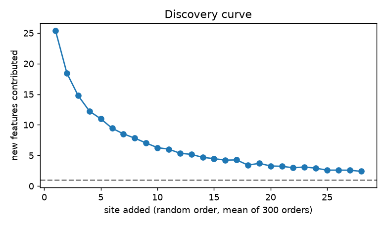
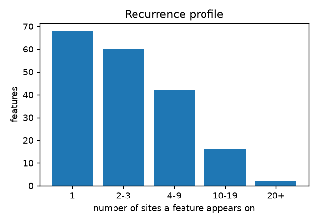

# Adequacy of the seed feature catalog
28 seed sites, 188 canonical features. Hold-out coverage uses ids assigned once over all sites (see script docstring).

## Discovery curve
Mean new features per added site over the last 8 sites: **2.81** (plateau if < 1) -> plateau = **False**. First site contributes 25.4 features. 

## Singleton share
Features seen on one site only: **36%** (limit 40%). Observations in singleton features or mapped to no feature: **15%** (limit 30%; 7% mapped to no feature). Too concrete = **False**.

## Recurrence profile (sites per feature)
1: 68 | 2-3: 60 | 4-9: 42 | 10-19: 16 | 20+: 2

By family:
- color: {'1': 8, '2-3': 12, '4-9': 3, '10-19': 1, '20+': 0}
- component: {'1': 13, '2-3': 12, '4-9': 16, '10-19': 4, '20+': 0}
- copy: {'1': 7, '2-3': 7, '4-9': 5, '10-19': 0, '20+': 0}
- decoration: {'1': 3, '2-3': 5, '4-9': 4, '10-19': 1, '20+': 0}
- imagery: {'1': 5, '2-3': 6, '4-9': 3, '10-19': 0, '20+': 0}
- layout: {'1': 11, '2-3': 3, '4-9': 5, '10-19': 3, '20+': 1}
- other: {'1': 4, '2-3': 1, '4-9': 1, '10-19': 0, '20+': 0}
- semantic_dom: {'1': 6, '2-3': 7, '4-9': 3, '10-19': 3, '20+': 1}
- typography: {'1': 11, '2-3': 7, '4-9': 2, '10-19': 4, '20+': 0}

## Between-site overlap (Jaccard of feature sets)
mean 0.156, quartiles 0.116 / 0.152 / 0.192; same-category pairs 0.161 (n=17) vs different-category 0.155.

## Judge consistency (share of a judge's observations matched by the other)
- copy: {'opus': 0.744, 'sonnet': 0.811, 'n': 231}
- other: {'opus': 0.81, 'sonnet': 1.0, 'n': 71}
- semantic_dom: {'opus': 0.804, 'sonnet': 0.976, 'n': 439}
- component: {'opus': 0.901, 'sonnet': 0.956, 'n': 462}
- imagery: {'opus': 0.861, 'sonnet': 0.858, 'n': 278}
- typography: {'opus': 0.87, 'sonnet': 0.91, 'n': 295}
- layout: {'opus': 0.882, 'sonnet': 0.905, 'n': 424}
- decoration: {'opus': 0.943, 'sonnet': 0.901, 'n': 207}
- color: {'opus': 0.872, 'sonnet': 0.895, 'n': 185}

## Hold-out coverage over 20 repeated 24/4 splits
mean **0.897**, range 0.817-0.984, 100% of splits >= 80%. Lowest-covered sites when held out: [(0.72, 'greatdayimprovements_com'), (0.74, 'bathurst12hour_com_au'), (0.79, 'bather_com'), (0.81, 'aeptexas_com'), (0.82, 'naturalwellbeing_com')]. Generalizes (mean >= 80%) = **True**.

## Detector agreement
{'features_compared': 29, 'mean_agreement': 0.725, 'low_agreement_features': ['F002', 'F027', 'F038', 'F068', 'F069', 'F078', 'F117', 'F120', 'F122']}

## Readout (decision table)
- Mixed signal (plateau=False, hold-out coverage>=80%=True): treat the catalog as provisional; extend discovery before freezing.
- Low detector agreement on some features -> tighten definitions and relabel a sample.

## Features with no programmatic detector (150)
These need the vision checklist (candidate engineering gaps): F003 Uppercase letter-spaced eyebrow labels; F005 Serif headings paired with sans body; F006 Card titles bold, not uppercase or link-styled; F007 All-caps headings; F008 Centered headings and intro text; F009 Hero headline partly accent-colored; F011 White hero headline on dark background; F012 Headings in title or sentence case; F013 Link underline treatment; F014 Compact body line height, small h2; F015 Copyright line small grey with hairline; F016 Excerpt and byline gray text under titles; F017 Hero h1 split into two sizes; F019 Modest heading scale; F020 Navigation labels small title case near logo; F021 News headlines medium-weight h4; F022 Prices bold green with struck-through original; F023 Section titles with thick underline rule; F024 Serif body with sans headings; F025 Alternating tinted section background bands; F026 Blue-based palette with dark navy; F028 Single red accent color; F030 Green-tinted dark body text; F031 Navy-tinted dark body text; F032 Pink or magenta accent; F033 Single orange accent color; F034 Dark brown or rust or purple-slate text; F035 Dark footer band; F036 Dark navy bands for secondary content; F037 Earthy or warm multi-color palette; F039 Single cyan or teal accent color; F040 Two-tone text on dark (white headings, muted body); F041 Clean white header band; F042 Dark top announcement or utility bar; F044 Gray alert strip with white button; F045 Green-based palette; F046 Light band interrupting dark page; F047 Warm beige band separating sections; F048 Warm beige-gray neutral borders and fills; F050 Narrow centered content container ...
