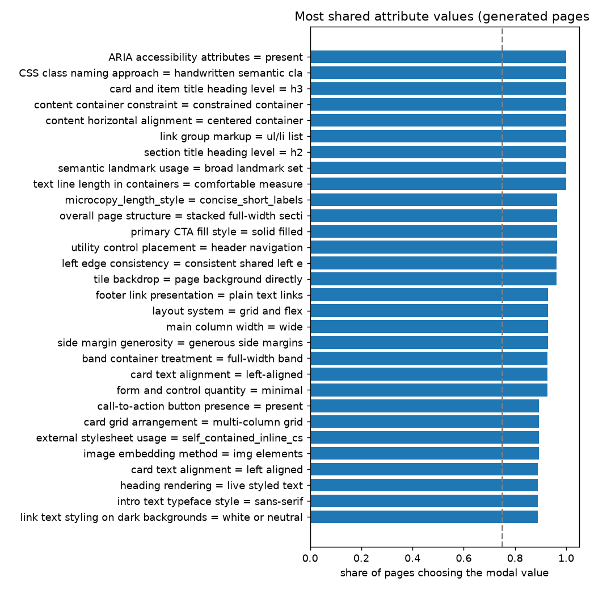

# Attribute-value variation across 28 generated pages
278 attributes coded on at least 15 pages. Bands by modal-value share: shared (>= 0.75) 121, split (0.5-0.75) 116, varied (< 0.5) 41.

Pairwise agreement between pages over all attributes: mean **0.581** (descriptive only: it equals what independent coding with the same value frequencies would give, so it measures how concentrated the choices are, not clustering). Spread across page pairs: SD 0.0499 vs permutation null 0.0270 (95% of nulls 0.0240-0.0305): some pages resemble each other MORE than independent coding would give (structure / clusters).

By modal value type: shared presence (modal share >= 0.75, a feature is there) 61; shared absence/other (the modal value says the feature is absent or not applicable) 60.

## Bands by family
- color: {'shared': 8, 'split': 12, 'varied': 14}
- component: {'shared': 36, 'split': 31, 'varied': 7}
- copy: {'shared': 5, 'split': 15, 'varied': 3}
- decoration: {'shared': 7, 'split': 6, 'varied': 3}
- imagery: {'shared': 1, 'split': 4, 'varied': 3}
- layout: {'shared': 25, 'split': 16, 'varied': 8}
- semantic_dom: {'shared': 20, 'split': 11, 'varied': 2}
- typography: {'shared': 19, 'split': 21, 'varied': 1}

## Most shared PRESENT values (modal share, modal value is not an absence/other value)
| attribute | modal value | share | coded | normalised entropy |
|---|---|---|---|---|
| ARIA accessibility attributes | present | 1.0 | 28 | 0.0 |
| CSS class naming approach | handwritten semantic classes | 1.0 | 28 | 0.0 |
| card and item title heading level | h3 | 1.0 | 28 | 0.0 |
| content container constraint | constrained container | 1.0 | 28 | 0.0 |
| content horizontal alignment | centered container | 1.0 | 28 | 0.0 |
| link group markup | ul/li list | 1.0 | 28 | 0.0 |
| section title heading level | h2 | 1.0 | 28 | 0.0 |
| semantic landmark usage | broad landmark set | 1.0 | 28 | 0.0 |
| text line length in containers | comfortable measure | 1.0 | 28 | 0.0 |
| microcopy_length_style | concise_short_labels | 0.964 | 28 | 0.222 |
| overall page structure | stacked full-width sections | 0.964 | 28 | 0.222 |
| primary CTA fill style | solid filled | 0.964 | 28 | 0.222 |
| utility control placement | header navigation | 0.964 | 28 | 0.222 |
| left edge consistency | consistent shared left edge | 0.963 | 27 | 0.229 |
| tile backdrop | page background directly | 0.963 | 27 | 0.229 |
| footer link presentation | plain text links | 0.929 | 28 | 0.279 |
| layout system | grid and flex | 0.929 | 28 | 0.371 |
| main column width | wide | 0.929 | 28 | 0.371 |
| side margin generosity | generous side margins | 0.929 | 28 | 0.371 |
| band container treatment | full-width band | 0.926 | 27 | 0.381 |
| card text alignment | left-aligned | 0.926 | 27 | 0.381 |
| form and control quantity | minimal | 0.926 | 27 | 0.381 |
| call-to-action button presence | present | 0.893 | 28 | 0.491 |
| card grid arrangement | multi-column grid | 0.893 | 28 | 0.372 |
| external stylesheet usage | self_contained_inline_css | 0.893 | 28 | 0.491 |
| image embedding method | img elements | 0.893 | 28 | 0.491 |
| card text alignment | left aligned | 0.889 | 27 | 0.503 |
| heading rendering | live styled text | 0.889 | 27 | 0.503 |
| intro text typeface style | sans-serif | 0.889 | 27 | 0.503 |
| link text styling on dark backgrounds | white or neutral | 0.889 | 27 | 0.34 |

## Most varied attributes (lowest modal share)
| attribute | modal value | share | values used |
|---|---|---|---|
| accent color hue | red | 0.25 | 6 |
| primary button fill color | other accent | 0.286 | 6 |
| link color | other accent | 0.321 | 5 |
| hero imagery | gradient or artwork only | 0.321 | 5 |
| separation_technique | borders_plus_tonal_panels | 0.357 | 4 |
| promo block background | dark or grey flat | 0.357 | 5 |
| intro section placement | other or not present | 0.357 | 3 |
| hero layout | two-column split | 0.357 | 5 |
| hero background treatment | photo | 0.357 | 5 |
| contact_info_presentation_format | plain visible text | 0.357 | 4 |
| band content type | signup/CTA strip | 0.357 | 4 |
| alternating band palette | light and dark mix | 0.357 | 6 |
| quick-link item style | other | 0.37 | 5 |
| post wrapper markup | not present | 0.393 | 4 |
| list item layout | other | 0.393 | 4 |

## Against the originals
Not computed: run code_pages.py --which original (about the same cost as the generated run).

## Coder reliability (vision coder vs values coded from the judges' observations)
Overall 68% over 1431 comparisons; by family: color 71%, component 69%, copy 45%, decoration 66%, imagery 48%, layout 71%, semantic_dom 72%, typography 68%. Neither side is ground truth.
