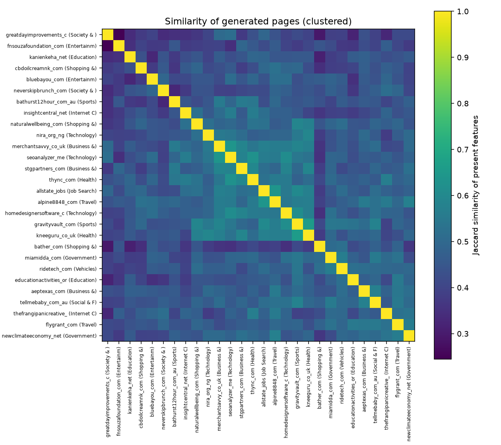
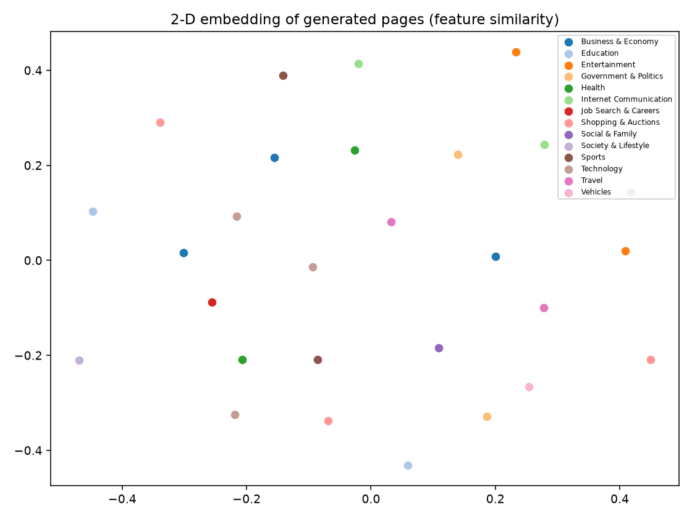

# Variation among the generated pages (28 seed sites)
Features in the catalog: 188. Prevalence bands: {'universal': 18, 'common': 42, 'occasional': 50, 'rare': 64, '': 14}.

## (1) Most shared features (prevalence with Wilson 95% interval)
| feature | family | present/known | prevalence | band |
|---|---|---|---|---|
| Generous body size and line height | typography | 28/28 | 1.0 (0.879-1) | universal |
| Narrow centered content container | layout | 28/28 | 1.0 (0.879-1) | universal |
| Semantic landmark elements used | semantic_dom | 28/28 | 1.0 (0.879-1) | universal |
| Minimal head meta tags | semantic_dom | 28/28 | 1.0 (0.879-1) | universal |
| ARIA attributes present | semantic_dom | 28/28 | 1.0 (0.879-1) | universal |
| Lean lightweight markup | other | 28/28 | 1.0 (0.879-1) | universal |
| Large bold headings with strong hierarchy | typography | 27/28 | 0.964 (0.823-0.994) | universal |
| Link underline treatment | typography | 27/28 | 0.964 (0.823-0.994) | universal |
| Alternating tinted section background bands | color | 27/28 | 0.964 (0.823-0.994) | universal |
| Uses CSS grid with flexbox | layout | 27/28 | 0.964 (0.823-0.994) | universal |
| Alternating background bands between sections | decoration | 27/28 | 0.964 (0.823-0.994) | universal |
| Clean sequential heading hierarchy | semantic_dom | 27/28 | 0.964 (0.823-0.994) | universal |
| Navigation without dropdown carets | component | 26/28 | 0.929 (0.774-0.98) | universal |
| Subtitle microcopy beneath headings or banners | copy | 26/28 | 0.929 (0.774-0.98) | universal |
| Lean minimal markup | semantic_dom | 26/28 | 0.929 (0.774-0.98) | universal |
| Live text headings not images | semantic_dom | 26/28 | 0.929 (0.774-0.98) | universal |
| Self-contained page without external assets | other | 26/28 | 0.929 (0.774-0.98) | universal |
| Thin borders and hairline separators | decoration | 25/27 | 0.926 (0.766-0.979) | universal |
| Dark footer band | color | 25/28 | 0.893 (0.728-0.963) | common |
| Compact header with logo and inline nav | layout | 25/28 | 0.893 (0.728-0.963) | common |
| Multi-column card grids | layout | 25/28 | 0.893 (0.728-0.963) | common |
| Rounded corners on cards and containers | decoration | 25/28 | 0.893 (0.728-0.963) | common |
| Headings in title or sentence case | typography | 24/28 | 0.857 (0.685-0.943) | common |
| Tall airy page with generous spacing | layout | 24/28 | 0.857 (0.685-0.943) | common |
| Widespread rounded corners on cards | component | 24/28 | 0.857 (0.685-0.943) | common |

Full table: prevalence.csv.

## (4) Homogenization
Jaccard similarity of present features between generated pages: mean 0.464; same-category pairs 0.470 (n=17) vs different-category 0.464. Spread in measured style (z-scored measurements, mean pairwise distance): generated 3.46 vs originals 4.707; difference -1.247 (bootstrap 95% CI [-2.059, -0.241]); a negative difference with an interval below 0 means the generated pages are MORE alike than the originals.

 

## (3) Paired original vs generated (measurements; Wilcoxon, BH-adjusted q)
- radius_round_share: original median 0.006 -> generated 0.112 (diff 0.112, rank-biserial 0.936, q=0.0)
- radius_zero_share: original median 0.974 -> generated 0.843 (diff -0.125, rank-biserial -0.985, q=0.0)
- meta_tag_count: original median 14.0 -> generated 3.0 (diff -11.0, rank-biserial -0.989, q=0.0)
- inline_style_attrs: original median 43.0 -> generated 3.0 (diff -38.0, rank-biserial -1.0, q=0.0)
- script_count: original median 40.0 -> generated 1.0 (diff -39.5, rank-biserial -1.0, q=0.0)
- grid_count: original median 0.0 -> generated 7.0 (diff 7.0, rank-biserial 1.0, q=0.0)
- anchor_count: original median 104.5 -> generated 38.0 (diff -57.5, rank-biserial -1.0, q=0.0)
- h1_body_ratio: original median 2.429 -> generated 3.9 (diff 1.196, rank-biserial 0.988, q=0.0001)
- stylesheet_count: original median 8.5 -> generated 0.0 (diff -8.5, rank-biserial -1.0, q=0.0001)
- font_family_count: original median 4.0 -> generated 2.0 (diff -2.0, rank-biserial -0.915, q=0.0002)
- h1_size_px: original median 36.0 -> generated 62.4 (diff 23.2, rank-biserial 0.93, q=0.0005)
- transform_count: original median 5.5 -> generated 0.0 (diff -5.5, rank-biserial -0.962, q=0.0007)

## (5) Inheritance vs invention
{'n_hue_pairs': 24, 'median_accent_hue_diff_deg': 34.3, 'chance_median_deg': 92.8, 'p_closer_than_chance': 0.034, 'spearman_body_bg_lightness': [0.076, 0.701]}

## (6) Drivers of variation (descriptive; ~2 sites per category)
- copy_words: rho 0.625, p 0.0004
- images_in_prompt: rho -0.091, p 0.6453
- fidelity_share: rho -0.108, p 0.5859
- original_page_height: rho 0.478, p 0.01
- category (14 groups of 1-3 sites; descriptive only): rho , p 0.3264

## (2) Lift vs originals
not computed (no original-page feature matrix yet: run detect_features.py --which original)

## (7) Run-to-run noise
Not computed: needs repeat generations (one run per site so far).
