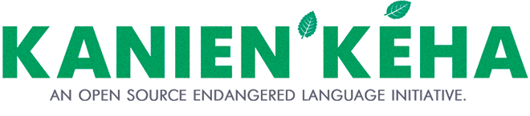
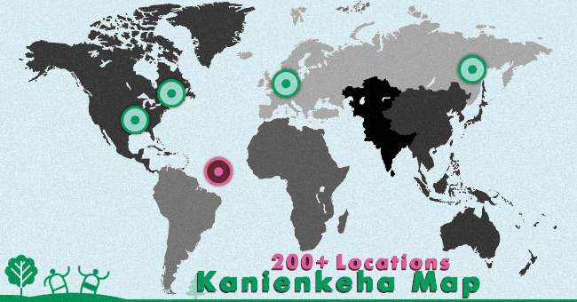
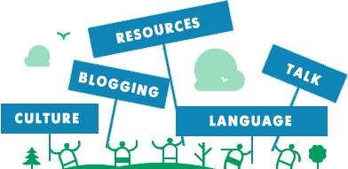
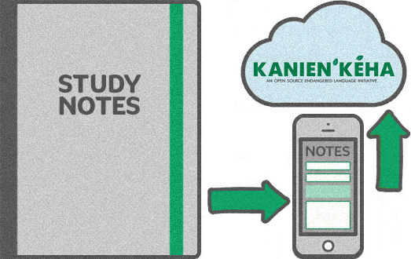

# 

- [Home](https://kanienkeha.net)

- [About](https://kanienkeha.net/about/)
- [Contact](https://kanienkeha.net/contact/)
- [Donate](https://kanienkeha.net/donate/)
- [Resources](https://kanienkeha.net/resources/)
- ** Close
- [Categories](https://kanienkeha.net/sitemap/)
- [Add Words](https://kanienkeha.net/add-words/)
- [Language Information](https://kanienkeha.net/language/)
- [Blog](https://kanienkeha.net/blogs/)
- [Map](https://kanienkeha.net/map/)
- [Resources](https://kanienkeha.net/resources/)
- [Donate](https://kanienkeha.net/donate/)
- [Log In](https://kanienkeha.net/login/)
- [Register](https://kanienkeha.net/register/)
- [Contact](https://kanienkeha.net/contact/)

Try these: [apple](#)[colors](#)[numbers](#)

Welcome to **Kanienkeha.net**, an open source endangered language initiative. If you want to help keep us going strong and putting out new content every week, please consider a small donation. You’ll be happy you did! [Support us on Patreon!](http://patreon.com/mohdictionary)

##

 Most Recent **

##  [Last name?, What is your](https://kanienkeha.net/phrases/oh-nahoten-tesahsennasere/)

Oh nahò:ten tesahsenná:sere?

##  [Sit down and eat](https://kanienkeha.net/phrases/command/satien-tanon-tesatskahon/)

Sátien tánon tesatská:hon

##  [Get dressed](https://kanienkeha.net/phrases/command/get-dressed/)

Satsheronniánion

##  [Wash your hands](https://kanienkeha.net/phrases/command/sahtsohare/)

Sahtsóhare

##  [Wash your face](https://kanienkeha.net/phrases/command/satkonhsohare/)

Satkonhsóhare

##  [Brush your hair](https://kanienkeha.net/phrases/command/satkerothiwh/)

Satkeróthiwh

##  [Fix your hair](https://kanienkeha.net/phrases/command/satkotsonni/)

Satko’tsón:ni** **

##  [Take a bath](https://kanienkeha.net/phrases/command/satawen/)

Satá:wen

##  [Make your bed](https://kanienkeha.net/phrases/command/satenaktahseronni/)

Satenaktahserón:ni

##  [Wake up](https://kanienkeha.net/phrases/command/satketsko/)

Satkétsko

##  [Brush your teeth](https://kanienkeha.net/phrases/command/satenawirohare/)

Satenawiróhare

##  [Photographer](https://kanienkeha.net/occupation/shakoiatarha/)

Shakoia’tárha’

##  [Goalie](https://kanienkeha.net/occupation/tehateniataranonnha/)

Tehatenia’taranónnha’

##  [Occupations](https://kanienkeha.net/occupation/tsi-nikaiotenhserotens/)

Tsi Nikaio’tenhserò:ten’s

##  [Astronaut](https://kanienkeha.net/occupation/isinakaroniati-iehretha/)

Ísi’na’karon’iati Iehretha

##  [Pharmacist](https://kanienkeha.net/occupation/kanonhkwatsheronnis/)

Kanonhkwa’tsherón:nis

##  [Steelworker (m)](https://kanienkeha.net/occupation/karistatsi-roiotens/)

Karistatsi Roio’tens

##  [Steelworker (f)](https://kanienkeha.net/occupation/karistatsi-iakiotens/)

Karistatsi Iakio’tens

##  [Truck Driver (m)](https://kanienkeha.net/occupation/kaserehkowa-ratories/)

Ka’serehkówa Ratórie’s

##  [Truck Driver (f)](https://kanienkeha.net/occupation/kaserehkowa-iotories/)

Ka’serehkowa Iotórie’s

##  [Veterinarian](https://kanienkeha.net/occupation/katshenen-tehshakohsnie/)

Katshé:nen Tehshakóhsnie

##  [Computer Worker (f)](https://kanienkeha.net/occupation/kawennarahstha-iakoiote/)

Kawennaráhstha Iakoió’te

##  [Computer Worker (m)](https://kanienkeha.net/occupation/kawennarahstha-roiote/)

Kawennaráhstha roió’te

##  [Education Director](https://kanienkeha.net/occupation/ohenton-irate-ne-ionterihwaienstahkhwanionhkhwa/)

Ohén:ton Í:rate ne Ionterihwaienstahkhwaniónhkhwa

##  [Optometrist (m)](https://kanienkeha.net/occupation/okara-shakotkense/)

Okà:ra Shakotkèn:se

##  [Optometrist (f)](https://kanienkeha.net/occupation/okara-iakotkense/)

Okà:ra iakotkèn:se

##  [Writer (m)](https://kanienkeha.net/occupation/rahiatons/)

Rahiá:tons

##  [Writer (f)](https://kanienkeha.net/occupation/iehiatons/)

Iehiá:tons

##  [Carpenter (m)](https://kanienkeha.net/occupation/rahsonkaraketas/)

Rahson’karaké:tas

##  [Carpenter (f)](https://kanienkeha.net/occupation/iehsonkaraketas/)

Iehson’karaké:tas

##  [Blacksmith](https://kanienkeha.net/occupation/rahwistonni/)

Rahwiston:ni

##  [Waiter](https://kanienkeha.net/occupation/rakhwahehrha/)

Rakhwahéhrha

##  [Painter (m)](https://kanienkeha.net/occupation/rakontsherahrhos/)

Rakontsheráhrhos

##  [Painter (f)](https://kanienkeha.net/occupation/iekontsherahrhos/)

Iekontsheráhrhos

##  [Baker (m)](https://kanienkeha.net/occupation/ranataronnis/)

Rana’tarón:nis

##  [Baker (f)](https://kanienkeha.net/occupation/ienataronnis/)

Iena’tarón:nis

##  [Artist (f)](https://kanienkeha.net/occupation/ierahstha/)

Ieráhstha

##  [Reporter (m)](https://kanienkeha.net/occupation/rarihokwats/)

Rarihó’kwats

##  [Reporter (f)](https://kanienkeha.net/occupation/ierihokwats/)

Ierihó’kwats

##  [Engineer, Surveyor (m)](https://kanienkeha.net/occupation/raristiseres/)

Raristí:seres

##  [Engineer, Surveyor (f)](https://kanienkeha.net/occupation/ieristiseres/)

Ieristí:seres

##  [Steel fabricator](https://kanienkeha.net/occupation/raristonnis/)

Raristón:nis

##  [Welder (f)](https://kanienkeha.net/occupation/ieristoseras/)

Ieristóseras

##  [Electrician (m)](https://kanienkeha.net/occupation/raronwarahehrha/)

Raronwarahéhrha

##  [Electrician (f)](https://kanienkeha.net/occupation/ieronwarahehrha/)

Ieronwarahéhrha

##  [Taxidermist](https://kanienkeha.net/occupation/raswahseratas/)

Ra’swahseráta’s

##  [Fireman (f)](https://kanienkeha.net/occupation/ionswahtha/)

Ion’swáhtha

##  [Salesperson (f)](https://kanienkeha.net/occupation/iontenhinons/)

Iontenhí:nons

##  [Plumber](https://kanienkeha.net/occupation/ratihonrotahehrha-ohnekanos-aowen/)

Ratihonro’tahéhrha Ohné:kanos Aó:wen

##  [Councillors](https://kanienkeha.net/occupation/ratitsenhaiens/)

Ratitsénhaiens

1[2](https://kanienkeha.net/page/2/)[3](https://kanienkeha.net/page/3/)[4](https://kanienkeha.net/page/4/)[Next ›](https://kanienkeha.net/page/2/)[Last »](https://kanienkeha.net/page/53/)

-

## .

-

 [ Mission Statement of the People of Grand River Country ](https://kanienkeha.net/blogs/mission-statement-of-the-people-of-grand-river-country/)

-

 [ 5 Common Misconceptions Surrounding Endangered Languages ](https://kanienkeha.net/blogs/5-common-misconceptions-surrounding-endangered-languages/)

-

 [ Bonding with your child through your native language ](https://kanienkeha.net/blogs/bonding-with-your-child-through-your-native-language/)

-

 [ Thanksgiving Address: Giving Greetings to the Natural World ](https://kanienkeha.net/blogs/ohenton-karihwatehkwen/)

-

 [ How to use the single post index ](https://kanienkeha.net/blogs/how-to-use-the-single-post-index/)

### Choose your Language!

**English (English)**Kanienkeha (Mohawk)

-

## #WordOfTheDay

-

## Spread the word!

-  [ ** ](https://www.facebook.com/mohdictionary)
-  [ ** ](http://twitter.com/mohdictionary)
-  [ ** ](http://instagram.com/mohdictionary)

-
[Random Word](https://kanienkeha.net/grammer/nouns/kahionha/)
-

[Become a patron on **Patreon.**](https://www.patreon.com/mohdictionary)
-

## Uploading your Notes

### Help our language curators, we’ll archive your notes.

We appreciate that you’re taking great language Notes. As part of our Open Source project, our research grows when we grow together.

-

## Total Site Numbers

- Words:

2650
- [Categories](https://kanienkeha.net/sitemap/):

159
- Tags:

260
- [Blog](http://blog.kanienkeha.net/):

10
-

## She:kon/Greetings:

This website was created for community development of the Kanienkeha online language resources. With help from you and our elders we can create a digital inventory of the language and discuss the cultural significance behind each word. If we can build the dictionary to about 10,000 words this program will expand to a next phase and development will start on a google style translator with audio to help with pronunciation.

 Nia:wen/Thank you
 Benjamin Doolittle

 **MohDictionary**
  [mohdictionary ](https://www.facebook.com/mohdictionary)
  [mohdictionary ](http://twitter.com/mohdictionary)
  [mohdictionary ](http://tinyletter.com/MohDictionary/)
  [mohdictionary](https://gumroad.com/l/gOKI)
 [mohdictionary](https://www.patreon.com/mohdictionary)
 [mohdictionary](https://www.paypal.me/MohDictionary)

kanienkeha.net
** Developed by: [Doolittle Productions](http://doolittleproductions.com/)**

- [Home](https://kanienkeha.net)
- [About](/about-us/)
- [Donate](/donate/)
- [Resources](/resources/)
- [Sitemap](/sitemap/)
- [Register](/register/)
- [Contact](/contact/)
 Follow us on [** Twitter](https://twitter.com/mohdictionary), [** Facebook](https://www.facebook.com/mohdictionary) & [** Facebook](https://www.facebook.com/mohdictionary)
