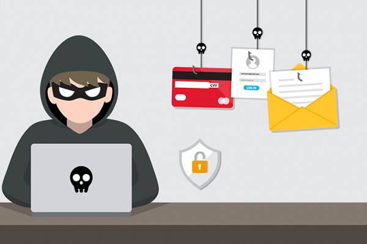

- Merchant Accounts

- [Merchant Account Providers](https://www.merchantsavvy.co.uk/best-uk-merchant-accounts-card-payment-services/)
- [High-Risk Merchant Accounts](https://www.merchantsavvy.co.uk/high-risk-merchant-accounts/)
- [Recurring Payments](https://www.merchantsavvy.co.uk/direct-debit-recurring-payments/)
- [Guide To Card Processing Fees](https://www.merchantsavvy.co.uk/credit-card-processing-fees/)
- Card Machines

- [Card Machines](https://www.merchantsavvy.co.uk/credit-card-machines-readers/)
- [EPOS Systems](https://www.merchantsavvy.co.uk/epos-systems/)
- [Virtual Terminals](https://www.merchantsavvy.co.uk/virtual-terminals/)
- Online

- [Payment Gateways](https://www.merchantsavvy.co.uk/payment-gateways/)
- [Online Payment Systems](https://www.merchantsavvy.co.uk/online-payment-systems/)
- [eCommerce Platforms](https://www.merchantsavvy.co.uk/ecommerce-platforms-for-uk-businesses/)
- [EPOS](https://www.merchantsavvy.co.uk/epos-systems/)
- [Quotes](https://www.merchantsavvy.co.uk/quotes/)
  Menu

# Payment Processing Made Simple (& Cheaper)

-     We'll get you preferential rates & lower your card processing costs
-     Access 90% of the UK’s leading acquiring banks
-      We recommend the best route to take and why
-     No sales agents or multiple call centres - just one source of independent advice

 

## Payment Processing

Compare merchant accounts and payment processors to find the best option for business when taking card payments face to face, over the phone or online.

-  [    Merchant Account Providers ](/best-uk-merchant-accounts-card-payment-services/)
-  [    Card Readers & Machines ](/credit-card-machines-readers/)
-  [    Credit Card Processing Fees ](/credit-card-processing-fees/)
-  [    High Risk Merchant Accounts ](/high-risk-merchant-accounts/)

-  [    Payment Gateways ](/payment-gateways/)
-  [    Online Payment Systems ](/online-payment-systems/)
-  [    EPOS Systems ](/epos-systems/)
-  [    Virtual Terminals ](/virtual-terminals/)

## Finance & Banking

Banking and finance options for start-ups and established business that take card payments.

-  [    Merchant Cash Advance ](/business-finance/merchant-cash-advance/)
-  [    Start Up Loans ](/business-loans/start-up-loans/)
-  [    Business Credit Cards ](/business-credit-cards/)

-  [    Business Bank Accounts ](/best-business-bank-accounts/)
-  [    Sole Trader Bank Accounts ](/best-business-bank-accounts/sole-trader-bank-accounts/)
-  [    Charity & Community Bank Accounts ](/best-business-bank-accounts/charity-community-bank-accounts/)

## Research & Stats

 

[UK SMEs ](/uk-sme-data-stats-charts/)

 

[Mobile Payments](/mobile-payment-stats-trends/)

 

[Mobile Ecommerce](/mobile-ecommerce-statistics/)

 

[Remote Working](/remote-working-statistics/)

 

[Payment Fraud](/payment-fraud-statistics/)

Copyright © ALL RIGHTS RESERVED 2021
 Merchant Savvy is a division of VUBO Ltd (Company Number 09017066).
Address: Spaces, 9 Greyfriars Rd, Reading, RG1 1NU.

-  [ Privacy Policy ](/privacy-policy/)
-  [ Terms Of Use ](/terms-use/)

 
