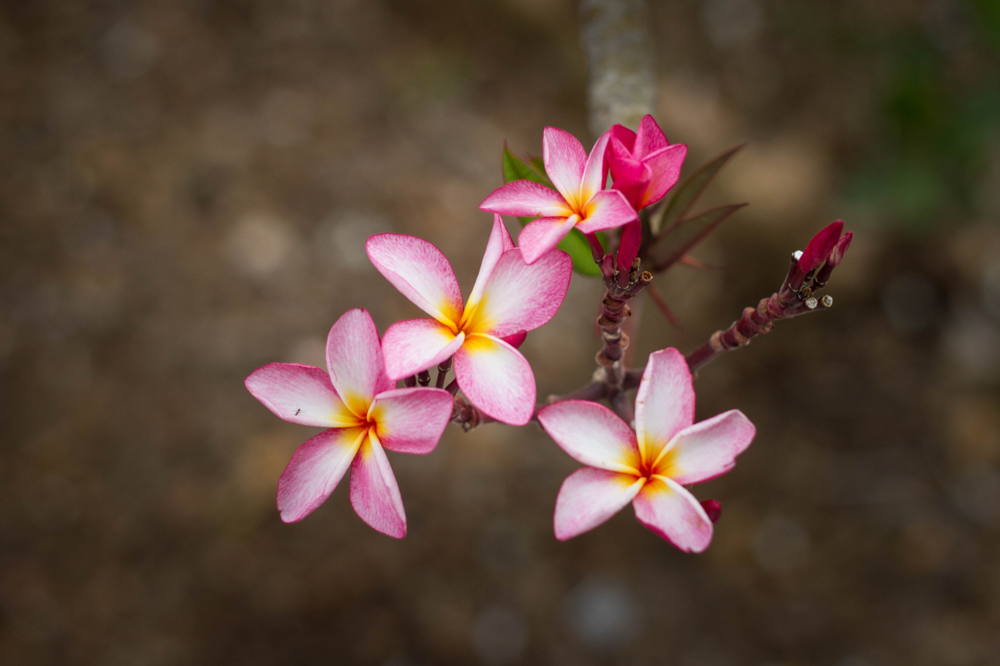
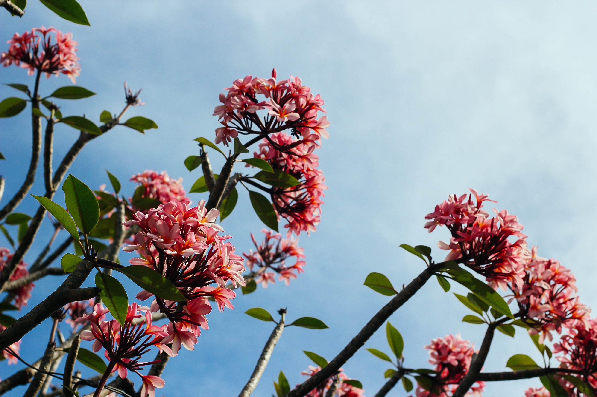

[The Frangipani Creative](https://thefrangipanicreative.com/)

- [Home](https://thefrangipanicreative.com/)
- [Blog](https://thefrangipanicreative.com/blog/)
- [The Frangipani Creative Podcast](https://thefrangipanicreative.com/the-frangipani-creative-podcast/)
- [Happy Clients](https://thefrangipanicreative.com/happy-clients/)
- [Contact](https://thefrangipanicreative.com/contact/)
- [Archives](https://thefrangipanicreative.com/archives/)
- [Books I Recommend](https://www.amazon.in/shop/corinneblogs?listId=258F67AEOVR3U&ref=idea_share_inf)

The Frangipani Creative is the studio of [Corinne Rodrigues](https://corinnerodrigues.com).

A lover of words. A self-acceptance blogger. A book reviewer. A woman happily journeying through midlife, moving from self-improvement to self-acceptance and enjoying being herself.
I write about life, wellness, relationships at [Everyday Gyaan](http://everydaygyaan.com). An avid reader, I review books at [CorinneRodrigues.com](http://corinnerodrigues.com) and offer coaching to anyone looking to explore their creativity at [The Frangipani Creative](https://thefrangipanicreative.com), located in Secunderabad, India.

 Stay tuned for details on programs, courses, training and other offline events.

[Read this](https://thefrangipanicreative.com/my-love-for-frangipani/) to find out why the name The Frangipani Creative made sense to me

#### [Personalized Blog Coaching](https://thefrangipanicreative.com/personalized-blog-coaching/)

Looking to start a blog? Or wanting to up your blogging game? You're in the right place for … [Read more.. ](https://thefrangipanicreative.com/personalized-blog-coaching/)

#### [Happy Clients](https://thefrangipanicreative.com/happy-clients/)

 ** ** ** ** **

## Sunita Saldhana

 I have always struggled with SEO and how to make my blog more visible. The training at The Frangipani Creative was extremely helpful. Not only did I learn what to do, but also why I needed to do it. The hands on experience of actually writing a [blog](https://sunitasaldhana.com/) post there itself and applying what I had learnt ensured that I thoroughly understood what was being taught. Corinne is a wonderful teacher and made everything so easy.

Sunita Saldhana

The Frangipani Creative
5
 2019-10-15T11:21:22+05:30

Sunita Saldhana

  I have always struggled with SEO and how to make my blog more visible. The training at The Frangipani Creative was extremely helpful. Not only did I learn what to do, but also why I needed to do it. The hands on experience of actually writing a blog post there itself and applying what I had learnt ensured that I thoroughly understood what was being taught. Corinne is a wonderful teacher and made everything so easy.

 https://thefrangipanicreative.com/testimonials/sunita-saldhana/

 ** ** ** ** **

## Madhavi Mahadev

 Undergoing training at The Frangipani Creative has not just been a learning opportunity but a memorable experience primarily for its activities. The course I attended, 'Introduction to Blogging/Start A Blog in 2019' gave all the information related to blogging I was looking for and also knowledge of related aspects. The activities were interesting and fun. The programme exceeded my expectation in terms of inputs, methodology and focus. I am looking forward to more such training courses from The Frangipani Creative.

Madhavi Mahadev

The Frangipani Creative
5
 2019-10-15T11:25:39+05:30

Madhavi Mahadev

  Undergoing training at The Frangipani Creative has not just been a learning opportunity but a memorable experience primarily for its activities. The course I attended, 'Introduction to Blogging/Start A Blog in 2019' gave all the information related to blogging I was looking for and also knowledge of related aspects. The activities were interesting and fun. The programme exceeded my expectation in terms of inputs, methodology and focus. I am looking forward to more such training courses from The Frangipani Creative.

 https://thefrangipanicreative.com/testimonials/madhavi-mahadev/

 ** ** ** ** **

## Anil Kumar Margani

 I was a lone fish in the big ocean of blogging when I spent months to find someone whom I can meet and learn from. My search ended at The Frangipani Creative, where I got the entry to the world of blogging. I got the necessary support and information to step forward into blogging. Corinne and all others I met at the Frangipani Creative were very cooperative and friendly in nature. I say The Frangipani Creative is a good destination for anyone who is looking for guidance or support on writing or blogging.

Anil Kumar Margani

The Frangipani Creative
5
 2019-10-15T11:24:24+05:30

Anil Kumar Margani

  I was a lone fish in the big ocean of blogging when I spent months to find someone whom I can meet and learn from. My search ended at The Frangipani Creative, where I got the entry to the world of blogging. I got the necessary support and information to step forward into blogging. Corinne and all others I met at the Frangipani Creative were very cooperative and friendly in nature. I say The Frangipani Creative is a good destination for anyone who is looking for guidance or support on writing or blogging.

 https://thefrangipanicreative.com/testimonials/anil-kumar-margani/

5
3

The Frangipani Creative

#### [Writer’s Healthy Diet and Lifestyle](https://thefrangipanicreative.com/writers-healthy-diet-and-lifestyle/)

 By [Lux](https://thefrangipanicreative.com/author/lux/)

#### [12 Productivity Hacks for Writing](https://thefrangipanicreative.com/productivity-hacks-for-writing/)

By [Fabida Abdulla](https://thefrangipanicreative.com/author/fabida-abdulla/)

#### [4 Steps On How to Focus On Writing](https://thefrangipanicreative.com/focus-on-writing/)

By [Lux](https://thefrangipanicreative.com/author/lux/)

#### [Have You Found The Treasures of Journaling?](https://thefrangipanicreative.com/the-treasures-of-journaling/)

By [Fabida Abdulla](https://thefrangipanicreative.com/author/fabida-abdulla/)

###

#### Follow me on social media

 **

Facebook

 [
Like](https://facebook.com/822416371294356)

 **

Instagram

 [
Follow](https://instagram.com/thefrangipanicreative)

 **

Linkedin

 [
Follow](https://www.linkedin.com/in/corinnecr)

 **

Pinterest

 [
Follow](https://pinterest.com/thefrangipanicreative)

 **

Twitter

 [
Follow](https://twitter.com/CorinneBlogs)

### Location

Shop #4, AWHO Colony Sector ‘A’, Gautam Enclave Secunderabad – 500 009 India Mobile : 91- 8886034647 Landline : 91-40-29560398

### Recent Posts

-  [Writer’s Healthy Diet and Lifestyle](https://thefrangipanicreative.com/writers-healthy-diet-and-lifestyle/)
-  [12 Productivity Hacks for Writing](https://thefrangipanicreative.com/productivity-hacks-for-writing/)
-  [4 Steps On How to Focus On Writing](https://thefrangipanicreative.com/focus-on-writing/)
-  [Have You Found The Treasures of Journaling?](https://thefrangipanicreative.com/the-treasures-of-journaling/)
-  [20 Quotes To Encourage You To Be A Fearless Writer](https://thefrangipanicreative.com/quotes-to-encourage-you-to-be-a-fearless-writer/)

 [

### thefrangipanicreative

Training/Coaching for writing, blogging and creativity

](https://www.instagram.com/thefrangipanicreative/)

 [
 There was a time when writing in a diary was seen
 
 ](https://www.instagram.com/p/CFMym3ngs16/)

 [
 How often we get bogged down with the non-essentia
 
 ](https://www.instagram.com/p/CEled-aAInJ/)

 [
 Looking back is only good when you are taking stoc
 
 ](https://www.instagram.com/p/CDiDpUogKFj/)

 [
 A couple of months ago, I was so excited to buy th
 
 ](https://www.instagram.com/p/CDNr7Ppgoa3/)

 [
 How do you tackle your inner critic – that voice i
 
 ](https://www.instagram.com/p/CCsv_W1gmHe/)

 [
 We have the capacity for infinite creativity. – Ja
 
 ](https://www.instagram.com/p/CCsi1dcg-ow/)

 [
 Are you working on something right now and getting
 
 ](https://www.instagram.com/p/CCpb66vAatd/)

 [
 Another fantastic offer from @artist_pragya
 Conta
 
 ](https://www.instagram.com/p/CCYR2SXAjca/)

 [
 Load More…

 ](javascript:void(0);)

 [Follow on Instagram](https://www.instagram.com/thefrangipanicreative/)

Disclosure: Please note that all posts and pages may contain affiliate links. For complete disclosures, commenting policies and PR information please read [this page](https://thefrangipanicreative.com/disclosures-and-pr-information/).

© 2020 - The Frangipani Creative
