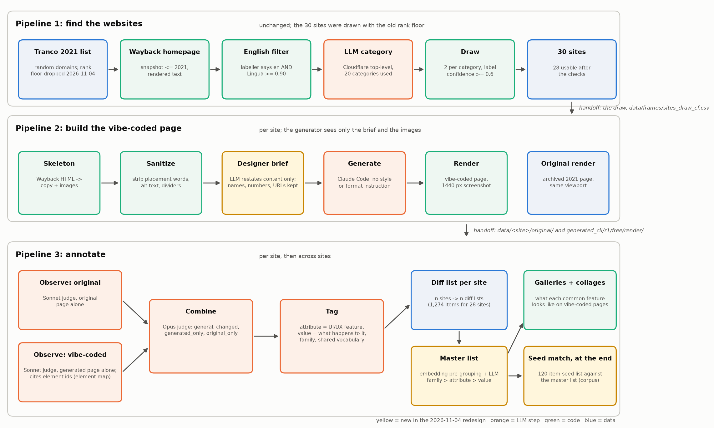

# Pipeline 2: scraping / skeletonizing, then vibe-coding



Runner `run_build_sites.py`; its docstring is reproduced here.

```
PIPELINE 2: scraping / skeletonizing, then vibe-coding. Runner.
usage: python pipeline/2_build_sites/run_build_sites.py [--stages check,build] [--reps 1] [--draw data/frames/sites_draw_cf.csv] [--replacements data/frames/replacements_cf.csv] [--dry-run]
  check   check_selected.py   per drawn site: fetch the Wayback snapshot, build the skeleton (copy + images), test it is usable (150-3000 words, 2-40 images); a failing site is
                              replaced from the same category -> data/sites.csv (final list), data/sites_check.csv, data/<site>/{copy.auto.md, images/, images_manifest.json, original/snapshot.html}
  build   run_site.py --all   per usable site: render the 2021 original, sanitize (strip design clues) -> prompt/copy.md, DESIGNER BRIEF (brief.py: LLM restates the content, names/numbers/URLs verbatim) -> prompt/brief.md,
                              one Claude Code generation ("Build a website from this content. brief.md has the content and images/ has the images.") with NO style or format instruction,
                              auto-detect and render whatever it built -> data/<site>/{original/, prompt/, generated_cli/r<k>/free/}
Input: the draw from pipeline 1. Output for pipeline 3: data/sites.csv + data/<site>/original/ + data/<site>/generated_cli/r1/free/render/. Every stage is resumable; stops when Wayback is unreachable.
```

Files in this folder:
- `check_selected.py`
- `brief.py` (designer-brief layer, new 2026-11-04)
- `formats.py`
- `generate.py`
- `render.py`
- `run_build_sites.py`
- `run_site.py`
- `sanitize.py`
- `skeletonize.py`

See the top-level `PLAN.md` for decisions, status and open items.
