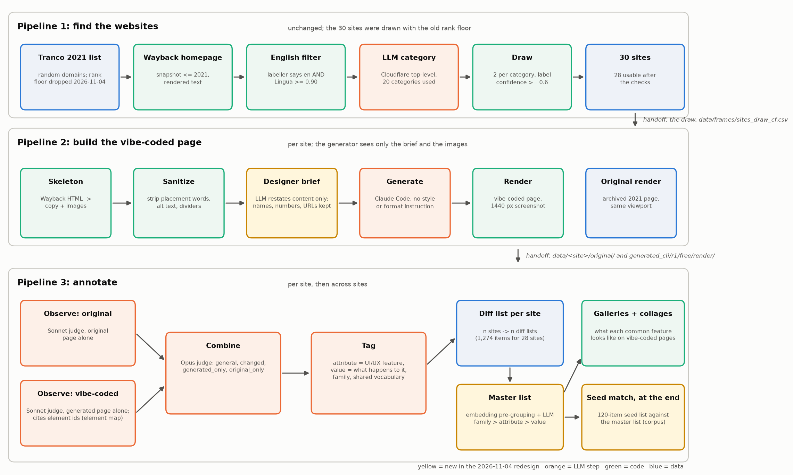

# Pipeline 3: annotate



Runner `run_annotation.py` (redesigned 2026-11-04). Run from the project root.

```
usage: python pipeline/3_annotate/run_annotation.py [--sites a,b,...] [--stages elements,observe,combine,tag,master,galleries,collages,seed] [--seed v1_3] [--min-sites 2] [--workers 4] [--dry-run]
  elements   element_map.py          number the visible elements of each generated page (free)
  observe    observe_page.py         Sonnet: one judge describes the ORIGINAL alone, another the VIBE-CODED page alone (cites element ids) -> data/<site>/diff/observations_{original,generated}.json
  combine    combine_observations.py Opus: combines both into the site's DIFF LIST (general / changed / generated_only / original_only) -> data/<site>/diff/combined.json
  tag        tag_observations.py     attribute (UI/UX feature), value ("<action>: <what happens>"), family, page-wide -> data/<site>/diff/diff.json, data/diff_vocab.json
  master     build_master.py         MASTER LIST: embedding pre-grouping + LLM merge, family -> attribute -> value -> data/master/master_list.{json,md}
  galleries  evidence_galleries.py   crops of cited elements per attribute value (free) -> data/master/galleries/
  collages   feature_collages.py     one vision call per site; one collage per attribute -> data/master/collages/
  seed       match_seed.py           seed list v1.3 matched against the master list (end of the pipeline) -> data/master/seed_match_v1_3.{json,csv,md}
```
Naming: **diff list** = one website (original vs vibe-coded); **master list** = all websites together. Stages are resumable (they skip outputs that exist; per-call caches are in `data/master/cache/`). The 28-site run cost about $22.98.

Reporting scripts (run after the pipeline):
- `plot_distribution.py` writes `data/master/feature_distribution.png` and `.csv`: prevalence histogram and the most widespread attributes.
- `build_viewer.py` writes `data/master/viewer.html`: overview, collages, master list with evidence sheets, seed match. Serve `data/master/` (e.g. `python3 -m http.server 8765 --directory data/master`) and open it.

Other scripts here: `agree.py`, `measurements.py`, `spotcheck.py`, `contamination_probe.py` (built, not run). The earlier annotation routes (judge pair and tiers, feature catalog, embedding merge, attribute-and-value codebook, arms) are in `deprecated/annotation_routes_2026-11-04/`.

See `PLAN.md` (pipeline 3) and `DESIGN_DECISIONS.md` (3.11) for decisions, results and caveats.
