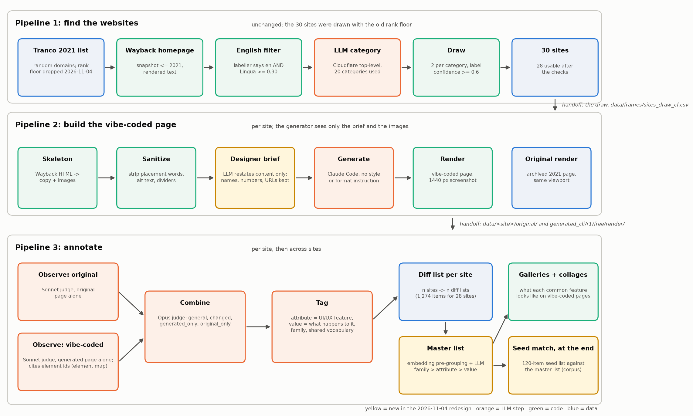

# Pipelines

The project is three pipelines. Run each from the project root; each runner takes `--dry-run` (print the commands) and `--stages`.

| Folder | Does | Runner | Hands off |
|---|---|---|---|
| `1_find_sites/` | find unpopular sites, label them by Cloudflare category, draw the study set | `run_find_sites.py` | `data/frames/sites_draw_cf.csv`, `replacements_cf.csv` |
| `2_build_sites/` | scrape from Wayback, skeletonize (copy + images), sanitize, **designer brief** (LLM restates the content), let Claude Code build the site from the brief and images, render it | `run_build_sites.py` (per site: `run_site.py`) | `data/sites.csv`, `data/<site>/original/`, `data/<site>/generated_cli/r1/free/render/` |
| `3_annotate/` | observe original and vibe-coded separately, combine into a diff list per site, tag attribute/value, master list, galleries, collages, seed match | `run_annotation.py` | `data/<site>/diff/`, `data/master/` (incl. `viewer.html`) |
| `make_diagram.py` | draws `pipeline_diagram.png` | | |
| `shared/` | `llm.py` (headless Claude calls), `pageio.py` (slicing and JSON helpers), `ledger.py` (cost log), `net.py` (wait for network) | | |

Scripts find each other through a small bootstrap at the top of each file (every folder under `pipeline/` is put on `sys.path`), so module names must stay unique across folders. One cross-dependency: pipeline 1 uses `2_build_sites/skeletonize.py` in text-only mode to get a page's copy. See `PLAN.md` for decisions and status.
